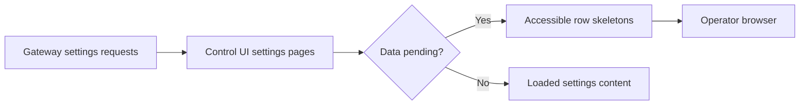

Codex review: needs maintainer review before merge. _Reviewed August 31, 2026, 11:36 PM ET / September 1, 2026, 03:36 UTC._

# ClawSweeper review

## What this changes

This PR replaces text-only loading states across Control UI settings pages with accessible skeleton layouts and adds mocked-Gateway Playwright coverage.

## Merge readiness

⚠️ **Ready for maintainer review - 1 item remains**

Keep open for explicit maintainer handling: the member-associated, `maintainer`-labeled PR has resolved the prior device-loading blocker, and this review found no remaining blocking correctness or security defect.

**Priority:** P3
**Reviewed head:** `2c17d59830be3309a2affd9738c3edf4fc758b11`

## Review scores

| Measure | Result | What it means |
|---|---|---|
| **Overall readiness** | 🐚 platinum hermit **(4/6)** | The patch is a coherent, tested Control UI refinement, and the previous concrete blockers are addressed. |
| **Proof confidence** | 🌊 off-meta tidepool | Not applicable: Repository state identifies this as a member-associated PR, so the external-contributor proof gate does not apply; its supplied mocked-Gateway browser scenarios remain supplemental validation. |
| **Patch quality** | 🐚 platinum hermit **(4/6)** | No actionable review findings were identified. |

## Verification

| Check | Result | Evidence |
|---|---|---|
| **Real behavior** | Not applicable | Not applicable: Repository state identifies this as a member-associated PR, so the external-contributor proof gate does not apply; its supplied mocked-Gateway browser scenarios remain supplemental validation. |
| **Evidence reviewed** | 4 items | Current-main behavior: Current main still has the text-only empty renderer and does not contain this PR's shared settings skeleton helper, so the PR remains a distinct contribution. Prior device finding fixed: The head now renders a skeleton whenever inventory groups are absent during loading, independently of Gateway presence; this covers the prior missed state. Regression coverage: The added browser scenario supplies Gateway presence, defers a device reload, and asserts the shared skeleton in the formerly missed loading condition. |
| **Findings** | None | None. |
| **Security** | None | None. |

## How this fits together

Control UI settings pages request data from the Gateway and render an interim state while responses are pending. The change replaces those temporary text states with row-shaped placeholders before settings content is available.

## Before merge

- [ ] **Resolve merge risk (P1)** - The patch adds 157 net production lines for loading-state polish; retain the shared helper as the single canonical pattern and avoid further per-page skeleton variants.

<strong>Agent review details</strong>

### Security

None.

### PR surface

Source +157, Tests +475. Total +632 across 19 files.

View PR surface stats

| Area | Files | Added | Removed | Net |
|---|---:|---:|---:|---:|
| Source | 17 | 226 | 69 | +157 |
| Tests | 2 | 476 | 1 | +475 |
| Docs | 0 | 0 | 0 | 0 |
| Config | 0 | 0 | 0 | 0 |
| Generated | 0 | 0 | 0 | 0 |
| Other | 0 | 0 | 0 | 0 |
| **Total** | **19** | **702** | **70** | **+632** |

### Review metrics

| Metric | Value | Why it matters |
|---|---|---|
| **Production versus test delta** | production +157 net (226 added, 69 removed); tests +475 net (476 added, 1 removed) | The production growth is concentrated in one reusable skeleton primitive, its styles, and page adoption; the test growth exercises the affected routes in a browser. |

### Merge-risk options

**Maintainer options:**
1. **Decide the mitigation before merge**  
   Land the shared settings skeleton pattern once exact-head CI is green, preserving the deliberate Config spinner and Custodian refresh-spinner exceptions.
2. **Pause or close**  
   Do not merge this PR until maintainers decide whether the risk is worth taking.

### Technical review

Best possible solution:

Land the shared settings skeleton pattern once exact-head CI is green, preserving the deliberate Config spinner and Custodian refresh-spinner exceptions.

Do we have a high-confidence way to reproduce the issue?

Not applicable as a defect report: the PR's changed pending-data states are directly represented by the mocked-Gateway browser scenarios, including the prior Gateway-presence device case.

Is this the best way to solve the issue?

Yes. Centralizing accessible row markup in the settings UI primitive avoids duplicated loading layouts while preserving surfaces whose existing spinner behavior is intentional.

AGENTS.md: found and applied where relevant.

Codex review notes: model internal, reasoning high; reviewed against [09a71580645f](https://github.com/openclaw/openclaw/commit/09a71580645f6ee2da22ac22938da04e76c3cfa6).

### Labels

Label changes:

- add `P3`: This is a low-risk Control UI loading-state polish change with no remaining confirmed functional regression.
- add `rating: 🐚 platinum hermit`: Overall readiness is 🐚 platinum hermit; proof is 🌊 off-meta tidepool and patch quality is 🐚 platinum hermit.
- add `status: 👀 ready for maintainer look`: ClawSweeper has no concrete contributor-facing blocker left for this PR. Not applicable: Repository state identifies this as a member-associated PR, so the external-contributor proof gate does not apply; its supplied mocked-Gateway browser scenarios remain supplemental validation.
- remove `P2`: Current review triage priority is P3, so this older priority label is no longer current.
- remove `rating: 🦐 gold shrimp`: Current PR rating is `rating: 🐚 platinum hermit`, so this older rating label is no longer current.
- remove `merge-risk: 🚨 automation`: Current PR review selected no merge-risk labels.
- remove `status: ⏳ waiting on author`: Current PR status label is `status: 👀 ready for maintainer look`.

Label justifications:

- `P3`: This is a low-risk Control UI loading-state polish change with no remaining confirmed functional regression.
- `rating: 🐚 platinum hermit`: Overall readiness is 🐚 platinum hermit; proof is 🌊 off-meta tidepool and patch quality is 🐚 platinum hermit.
- `status: 👀 ready for maintainer look`: ClawSweeper has no concrete contributor-facing blocker left for this PR. Not applicable: Repository state identifies this as a member-associated PR, so the external-contributor proof gate does not apply; its supplied mocked-Gateway browser scenarios remain supplemental validation.

### Evidence

What I checked:

- **Current-main behavior:** Current main still has the text-only empty renderer and does not contain this PR's shared settings skeleton helper, so the PR remains a distinct contribution. ([`ui/src/components/settings-ui.ts:373`](https://github.com/openclaw/openclaw/blob/09a71580645f/ui/src/components/settings-ui.ts#L373), [09a71580645f](https://github.com/openclaw/openclaw/commit/09a71580645f))
- **Prior device finding fixed:** The head now renders a skeleton whenever inventory groups are absent during loading, independently of Gateway presence; this covers the prior missed state. ([`ui/src/pages/devices/view-inventory.ts:92`](https://github.com/openclaw/openclaw/blob/2c17d59830be/ui/src/pages/devices/view-inventory.ts#L92), [2c17d59830be](https://github.com/openclaw/openclaw/commit/2c17d59830be))
- **Regression coverage:** The added browser scenario supplies Gateway presence, defers a device reload, and asserts the shared skeleton in the formerly missed loading condition. ([`ui/src/e2e/settings-loading-skeletons.e2e.test.ts:150`](https://github.com/openclaw/openclaw/blob/2c17d59830be/ui/src/e2e/settings-loading-skeletons.e2e.test.ts#L150), [2c17d59830be](https://github.com/openclaw/openclaw/commit/2c17d59830be))
- **Shared owner boundary:** The common helper owns the accessible status label and row-shaped markup, while pages select it only for their pending-data state; Custodian retains its compact refresh spinner. ([`ui/src/components/settings-ui.ts:378`](https://github.com/openclaw/openclaw/blob/2c17d59830be/ui/src/components/settings-ui.ts#L378), [2c17d59830be](https://github.com/openclaw/openclaw/commit/2c17d59830be))

Likely related people:

- **Peter Steinberger:** Suggested for follow-up; no historical authorship or introduction is verified. (role: unverified routing candidate; confidence: low)

### Rating scale

| Score | Internal tier | Crab rank | Meaning |
|---:|:---:|---|---|
| **6/6** | S | 🦀 challenger crab | Exceptional readiness |
| **5/6** | A | 🦞 diamond lobster | Very strong readiness |
| **4/6** | B | 🐚 platinum hermit | Good normal PR; ordinary maintainer review |
| **3/6** | C | 🦐 gold shrimp | Useful, but confidence is limited |
| **2/6** | D | 🦪 silver shellfish | Proof or implementation needs work |
| **1/6** | F | 🧂 unranked krab | Not merge-ready |
| N/A | NA | 🌊 off-meta tidepool | Rating does not apply |

Overall follows the weaker of proof and patch quality.
Shiny media proof means a screenshot, video, or linked artifact directly shows the changed behavior. Runtime, network, CSP, and security claims still need visible diagnostics.

### Workflow

- ClawSweeper keeps one durable marker-backed review comment per issue or PR.
- Re-runs edit this comment so the latest verdict, findings, and automation markers stay together instead of adding duplicate bot comments.
- A fresh review can be triggered by eligible `@clawsweeper re-review` comments, exact-item GitHub events, scheduled/background review runs, or manual workflow dispatch.
- PR/issue authors and users with repository write access can comment `@clawsweeper re-review` or `@clawsweeper re-run` on an open PR or issue to request a fresh review only.
- Maintainers can also comment `@clawsweeper review` to request a fresh review only.
- Fresh-review commands do not start repair, autofix, rebase, CI repair, or automerge.
- Maintainer-only repair and merge flows require explicit commands such as `@clawsweeper autofix`, `@clawsweeper automerge`, `@clawsweeper fix ci`, or `@clawsweeper address review`.
- Maintainers can comment `@clawsweeper explain` to ask for more context, or `@clawsweeper stop` to stop active automation.

### History

Review history (2 earlier review cycles)

<!-- clawsweeper-review-history v=1 total=2 -->
- reviewed 2026-09-01T02:58:35.456Z sha 473ed9754eaf30bde440f74e8d59fbf0cf06d7e8 :: needs maintainer review before merge. :: none
- reviewed 2026-09-01T03:11:23.765Z sha 96f9a314ef06e2345f82083883313c43cb7239ae :: found issues before merge. :: [P2] Keep an inventory loading state beside Gateway presence | [P2] Create the output directory for the isolated spinner test | [P3] Use the suite’s isolated opt-in artifact directory

<!-- clawsweeper-verdict:needs-human item=134684 sha=2c17d59830be3309a2affd9738c3edf4fc758b11 confidence=high updated_at=2026-09-01T03:32:57Z reviewed_at=2026-09-01T03:36:28.732Z lease_owner=github-run-33466515740-1 lease_comment_id=5488495009 source_revision=6187585dcf8c0706ded09ff2764fce8aa3f2059cfc780aa3586b55085bcc0f57 live_verification=absent -->

<!-- clawsweeper-review-version item=134684 reviewed_at=2026-09-01T03:36:28.732Z sha=2c17d59830be3309a2affd9738c3edf4fc758b11 source_revision=6187585dcf8c0706ded09ff2764fce8aa3f2059cfc780aa3586b55085bcc0f57 lease_owner=github-run-33466515740-1 lease_comment_id=5488495009 v=1 -->

<!-- clawsweeper-review item=134684 -->