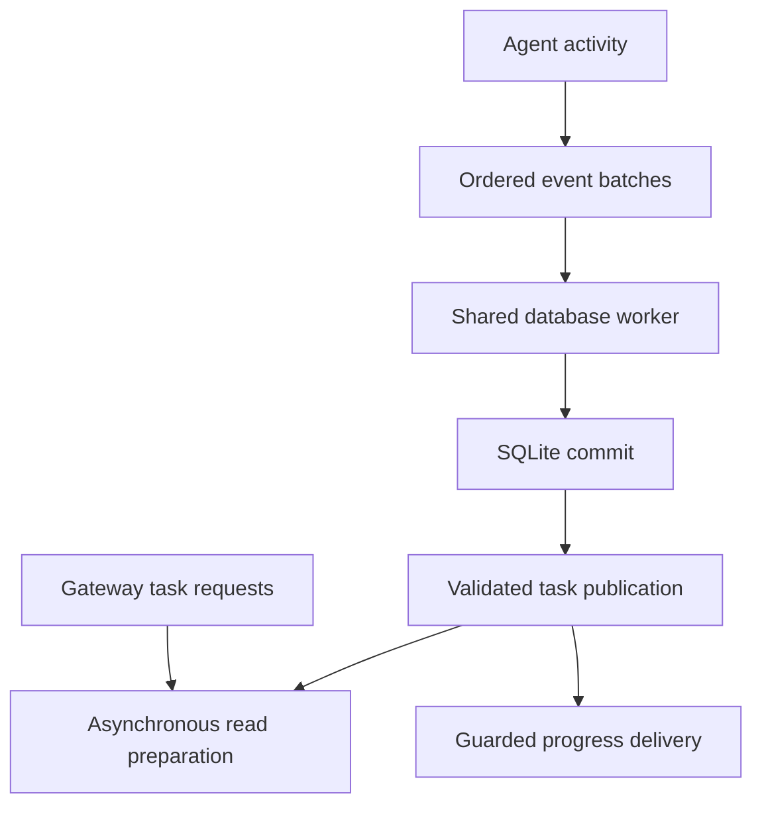

Codex review: blocked before merge. _Reviewed September 19, 2026, 3:06 PM ET / 19:06 UTC (Revision 11)._

# ClawSweeper review

## What this changes

Moves task-event persistence, task reads, and background progress preparation onto the shared database worker so contention does not freeze the Gateway.

> [!WARNING]
> **SQLite table change**
>
> This PR modifies persisted SQLite tables in `src/infra/sqlite-store.worker.ts`. Prefer a design that avoids changing persisted SQLite tables. If the change is necessary, verify migration and upgrade compatibility against an existing database before merge.

## Merge readiness

⛔ **Blocked before merge - 1 item remains**

Still necessary on fetched main, with no blocking defect identified. The storage disposition is supported by the diff, and the previous review's performance limitation does not require a new approval gate.

**Priority:** P2
**Reviewed head:** `6af0dfccc8dbbf21f56b4d6dfbee2fcb4eaee15c`

## Review scores

| Measure | Result | What it means |
|---|---|---|
| **Overall readiness** | 🐚 platinum hermit **(4/6)** | Useful, well-supported reliability repair with meaningful boundary coverage and no identified blocking defect. |
| **Proof confidence** | 🐚 platinum hermit **(4/6)** | Sufficient (live_output): Source-qualified production-path measurements exercise registered task reads against real SQLite contention and show the main-thread timer recovering while ordered persistence completes. Warm/reopened progress publication and authority cases supplement that evidence; it does not establish deployed tail latency or large-inventory CPU bounds. |
| **Patch quality** | 🐚 platinum hermit **(4/6)** | No actionable review findings were identified. |

## Verification

| Check | Result | Evidence |
|---|---|---|
| **Real behavior** | Verified | Sufficient (live_output): Source-qualified production-path measurements exercise registered task reads against real SQLite contention and show the main-thread timer recovering while ordered persistence completes. Warm/reopened progress publication and authority cases supplement that evidence; it does not establish deployed tail latency or large-inventory CPU bounds. |
| **Evidence reviewed** | 8 items | Current main still needs the repair: Fetched main's task event listener still calls synchronous registry mutation for lifecycle, error, tool-start, and liveness persistence. The new event queue and prepared-read modules are absent from that revision. Ordered persistence and native overlap: The event owner coalesces progress, retains lifecycle boundaries, revalidates captured ownership at worker admission, joins granted writes before synchronous consumption, and retains accepted work through drainage. Storage disposition verified: The selected persisted kernels, record types, state schemas, public SDK, Gateway protocol, dependencies, and workflows have no introduced changes. Commit facts travel over a private MessagePort after commit. The author's storage comment explicitly documents that queued events remain volatile until commit and that reads and orderly shutdown join them. |
| **Findings** | None | None. |
| **Security** | None | None. |

## How this fits together

The task registry receives agent activity and stores task status in OpenClaw's shared SQLite database. Gateway requests and background notifications consume its published state.

## Before merge

- [ ] **Add data-model compatibility proof** - Confirm migration or upgrade compatibility proof before merge.

<strong>Agent review details</strong>

### Security

None.

### PR surface

Source +2233, Tests +3299, Docs +42. Total +5574 across 76 files.

View PR surface stats

| Area | Files | Added | Removed | Net |
|---|---:|---:|---:|---:|
| Source | 49 | 3021 | 788 | +2233 |
| Tests | 26 | 3628 | 329 | +3299 |
| Docs | 1 | 45 | 3 | +42 |
| Config | 0 | 0 | 0 | 0 |
| Generated | 0 | 0 | 0 | 0 |
| Other | 0 | 0 | 0 | 0 |
| **Total** | **76** | **6694** | **1120** | **+5574** |

### Review metrics

| Metric | Value | Why it matters |
|---|---|---|
| **Production versus regression coverage** | Net production +2232 lines; tests and test support +3300 lines | Production growth supports ordered asynchronous persistence, settlement recovery, and prepared reads; regression coverage exercises their contention and identity boundaries. |

### Stored data model

Persistent data-model change detected: `serialized state: src/tasks/task-executor-create.async.ts`, `serialized state: src/tasks/task-registry-mutation.ts`, `unknown-data-model-change: src/infra/sqlite-store.worker.ts`, `unknown-data-model-change: src/tasks/task-executor-create.async.ts`. Confirm migration or upgrade compatibility proof before merge.

### Technical review

Best possible solution:

Keep one shared worker and publication owner for task activity, preserving synchronous plugin contracts and current-authority checks without changing persisted formats.

Do we have a high-confidence way to reproduce the issue?

Yes, from source: task events on fetched main enter synchronous database coordination, and the supplied contention evidence exercises that boundary. This read-only review did not execute a reproduction.

Is this the best way to solve the issue?

Yes. Extending the existing worker, transaction, and publication owners addresses the blocking path while retaining stored formats and synchronous public contracts.

AGENTS.md: found and applied where relevant.

Codex review notes: model internal, reasoning medium; reviewed against [2fba90648755](https://github.com/openclaw/openclaw/commit/2fba9064875533c316179bbafe596cdca3576d6c).

### Labels

Label justifications:

- `P2`: Repairs database-contention stalls in task workflows without evidence of an ongoing emergency.
- `rating: 🐚 platinum hermit`: Overall readiness is 🐚 platinum hermit; proof is 🐚 platinum hermit and patch quality is 🐚 platinum hermit.
- `status: 👀 ready for maintainer look`: ClawSweeper has no concrete contributor-facing blocker left for this PR. Sufficient (live_output): Source-qualified production-path measurements exercise registered task reads against real SQLite contention and show the main-thread timer recovering while ordered persistence completes. Warm/reopened progress publication and authority cases supplement that evidence; it does not establish deployed tail latency or large-inventory CPU bounds.
- `proof: sufficient`: Contributor real behavior proof is sufficient. Source-qualified production-path measurements exercise registered task reads against real SQLite contention and show the main-thread timer recovering while ordered persistence completes. Warm/reopened progress publication and authority cases supplement that evidence; it does not establish deployed tail latency or large-inventory CPU bounds.

### Evidence

What I checked:

- **Current main still needs the repair:** Fetched main's task event listener still calls synchronous registry mutation for lifecycle, error, tool-start, and liveness persistence. The new event queue and prepared-read modules are absent from that revision. ([`src/tasks/task-registry-lifecycle.ts`](https://github.com/openclaw/openclaw/blob/2fba9064875533c316179bbafe596cdca3576d6c/src/tasks/task-registry-lifecycle.ts), [2fba90648755](https://github.com/openclaw/openclaw/commit/2fba9064875533c316179bbafe596cdca3576d6c))
- **Ordered persistence and native overlap:** The event owner coalesces progress, retains lifecycle boundaries, revalidates captured ownership at worker admission, joins granted writes before synchronous consumption, and retains accepted work through drainage. ([`src/tasks/task-registry-agent-events.ts:104`](https://github.com/openclaw/openclaw/blob/6af0dfccc8dbbf21f56b4d6dfbee2fcb4eaee15c/src/tasks/task-registry-agent-events.ts#L104), [6af0dfccc8db](https://github.com/openclaw/openclaw/commit/6af0dfccc8dbbf21f56b4d6dfbee2fcb4eaee15c))
- **Storage disposition verified:** The selected persisted kernels, record types, state schemas, public SDK, Gateway protocol, dependencies, and workflows have no introduced changes. Commit facts travel over a private MessagePort after commit. The author's storage comment explicitly documents that queued events remain volatile until commit and that reads and orderly shutdown join them. ([`src/infra/sqlite-worker-operation-admission.ts:239`](https://github.com/openclaw/openclaw/blob/6af0dfccc8dbbf21f56b4d6dfbee2fcb4eaee15c/src/infra/sqlite-worker-operation-admission.ts#L239), [6af0dfccc8db](https://github.com/openclaw/openclaw/commit/6af0dfccc8dbbf21f56b4d6dfbee2fcb4eaee15c))
- **Read and delivery authority:** Prepared reads join a fixed accepted batch prefix and recheck database, store, and task identity. Progress publication retains current backing and audience checks through the final delivery guard; inspected coverage includes pending replacement, cross-audience receipts, and revocation during asynchronous preparation. ([`src/tasks/task-registry-read.ts:89`](https://github.com/openclaw/openclaw/blob/6af0dfccc8dbbf21f56b4d6dfbee2fcb4eaee15c/src/tasks/task-registry-read.ts#L89), [6af0dfccc8db](https://github.com/openclaw/openclaw/commit/6af0dfccc8dbbf21f56b4d6dfbee2fcb4eaee15c))
- **Production-path contention evidence:** The captured body reports a registered tasks.list run using real SQLite coordination on macOS arm64: historical timer delay fell from 368.760 ms to 0.344 ms while counts, terminal state, publication order, and scope denial passed. It separately reports warm/reopened progress-card recovery and subsequent focused validation. These observations are source-qualified, not claimed as current-head Linux or deployed tail-latency measurements. The inspected regression uses the registered Gateway handler and an independently held coordinator. ([`src/tasks/task-registry-read.test.ts:408`](https://github.com/openclaw/openclaw/blob/6af0dfccc8dbbf21f56b4d6dfbee2fcb4eaee15c/src/tasks/task-registry-read.test.ts#L408), [6af0dfccc8db](https://github.com/openclaw/openclaw/commit/6af0dfccc8dbbf21f56b4d6dfbee2fcb4eaee15c))
- **Current head and required gate:** Live REST reads confirmed the pinned head remains open and mergeable; its ci-gate, dependency-review, and security-sensitive-review statuses report success. The stale supplied test merge was not used to attribute removals or regressions. ([6af0dfccc8db](https://github.com/openclaw/openclaw/commit/6af0dfccc8dbbf21f56b4d6dfbee2fcb4eaee15c))

Likely related people:

- **steipete:** Suggested for follow-up; no historical authorship or introduction is verified. (role: unverified routing candidate; confidence: low)
- **obviyus:** Suggested for follow-up; no historical authorship or introduction is verified. (role: unverified routing candidate; confidence: low)

### Rating scale

| Score | Internal tier | Crab rank | Meaning |
|---:|:---:|---|---|
| **6/6** | S | 🦀 challenger crab | Exceptional readiness |
| **5/6** | A | 🦞 diamond lobster | Very strong readiness |
| **4/6** | B | 🐚 platinum hermit | Good normal PR; ordinary maintainer review |
| **3/6** | C | 🦐 gold shrimp | Useful, but confidence is limited |
| **2/6** | D | 🦪 silver shellfish | Proof or implementation needs work |
| **1/6** | F | 🧂 unranked krab | Not merge-ready |
| N/A | NA | 🌊 off-meta tidepool | Rating does not apply |

Overall follows the weaker of proof and patch quality.
Shiny media proof means a screenshot, video, or linked artifact directly shows the changed behavior. Runtime, network, CSP, and security claims still need visible diagnostics.

### Workflow

- ClawSweeper keeps one durable marker-backed review comment per issue or PR.
- Re-runs edit this comment so the latest verdict, findings, and automation markers stay together instead of adding duplicate bot comments.
- A fresh review can be triggered by eligible `@clawsweeper re-review` comments, exact-item GitHub events, scheduled/background review runs, or manual workflow dispatch.
- PR/issue authors and users with repository write access can comment `@clawsweeper re-review` or `@clawsweeper re-run` on an open PR or issue to request a fresh review only.
- Maintainers can also comment `@clawsweeper review` to request a fresh review only.
- Fresh-review commands do not start repair, autofix, rebase, CI repair, or automerge.
- Maintainer-only repair and merge flows require explicit commands such as `@clawsweeper autofix`, `@clawsweeper automerge`, `@clawsweeper fix ci`, or `@clawsweeper address review`.
- Maintainers can comment `@clawsweeper explain` to ask for more context, or `@clawsweeper stop` to stop active automation.

### History

Review history (10 earlier review cycles; latest 8 shown)

<!-- clawsweeper-review-history v=1 total=10 -->
- reviewed 2026-09-19T10:41:52.288Z sha 802ab6be5b7103e78217ab8c48ecb7057448de24 :: blocked before merge. :: none
- reviewed 2026-09-19T11:02:34.463Z sha 802ab6be5b7103e78217ab8c48ecb7057448de24 :: blocked before merge. :: none
- reviewed 2026-09-19T11:18:59.319Z sha 8533096767a554c153aae33a52c3d4a9f0340aed :: blocked before merge. :: none
- reviewed 2026-09-19T12:54:57.097Z sha f7f831d57d32ed47b9394ff2ffbfe82bcaeb67db :: blocked before merge. :: none
- reviewed 2026-09-19T15:24:28.655Z sha 2216c2b16be41a7d0288ff14abffa4c5c5bc6aa5 :: blocked before merge. :: none
- reviewed 2026-09-19T16:01:11.689Z sha a0554a13f838b47eab932e01f14478dbf8aacf0a :: needs maintainer review before merge. :: none
- reviewed 2026-09-19T17:38:19.366Z sha 5e519a64b9f8d27a63e86bfe951c1754fa8f3955 :: blocked before merge. :: none
- reviewed 2026-09-19T18:48:24.665Z sha 6af0dfccc8dbbf21f56b4d6dfbee2fcb4eaee15c :: blocked before merge. :: none

<!-- clawsweeper-verdict:needs-human item=152655 sha=6af0dfccc8dbbf21f56b4d6dfbee2fcb4eaee15c confidence=high updated_at=2026-09-19T19:03:00Z reviewed_at=2026-09-19T19:06:34.270Z lease_owner=github-run-35462990279-1 lease_comment_id=5744554913 source_revision=95bfd8e8143e3bb3458abcb059fe0e3da74217bb3745e2cadc77321af1ebdbd4 live_verification=absent -->
<!-- clawsweeper-review-state:blocked item=152655 sha=6af0dfccc8dbbf21f56b4d6dfbee2fcb4eaee15c v=1 -->

<!-- clawsweeper-review-version item=152655 reviewed_at=2026-09-19T19:06:34.270Z sha=6af0dfccc8dbbf21f56b4d6dfbee2fcb4eaee15c source_revision=95bfd8e8143e3bb3458abcb059fe0e3da74217bb3745e2cadc77321af1ebdbd4 lease_owner=github-run-35462990279-1 lease_comment_id=5744554913 v=1 -->

<!-- clawsweeper-review item=152655 -->