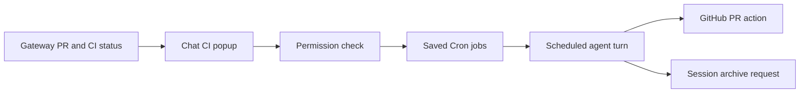

Codex review: needs real behavior proof before merge. _Reviewed September 30, 2026, 2:08 AM ET / 06:08 UTC (Revision 4)._

# ClawSweeper review

## What this changes

Adds three opt-in controls to the Chat CI popup that save recurring Cron jobs for PR repair, merging, and session archival, with status display and coverage.

## Merge readiness

⛔ **Blocked before merge - 6 items remain**

Keep this PR open. Current main and the latest release still provide CI inspection without these controls, and the branch has a coherent implementation. Durable write authority and the conditions for automatic archival still need maintainer confirmation and final-effect proof.

**Priority:** P2
**Reviewed head:** `f2430d32e72216aa66f987c5cc6a58901f51278d`
**Owner decision:** Required. See [Decision needed](#decision-needed).

## Review scores

| Measure | Result | What it means |
|---|---|---|
| **Overall readiness** | 🦐 gold shrimp **(3/6)** | The UI and scheduler paths have useful evidence, but persistent write authority and archive decisions lack final-effect proof. |
| **Proof confidence** | 🦐 gold shrimp **(3/6)** | Needs stronger real behavior proof before merge: Authority-chain proof required: inspected desktop and mobile images show the new popup, and mocked-Gateway browser cases exercise its toggles. A real Cron owner persists and runs the jobs, and the native archive handler rejects a mismatched session ID, but a synthetic model supplies decisions and no allowed or forbidden scheduled turn reaches final GitHub I/O. No stored-data contract changes; the jobs use the existing Cron format. Add redacted final-effect traces, update the PR body for re-review, or ask a maintainer to comment `@clawsweeper re-review` if that does not trigger automatically. |
| **Patch quality** | 🦐 gold shrimp **(3/6)** | Security review found an item that needs attention. |

## Verification

| Check | Result | Evidence |
|---|---|---|
| **Real behavior** | Needs proof | Needs stronger real behavior proof before merge: Authority-chain proof required: inspected desktop and mobile images show the new popup, and mocked-Gateway browser cases exercise its toggles. A real Cron owner persists and runs the jobs, and the native archive handler rejects a mismatched session ID, but a synthetic model supplies decisions and no allowed or forbidden scheduled turn reaches final GitHub I/O. No stored-data contract changes; the jobs use the existing Cron format. Add redacted final-effect traces, update the PR body for re-review, or ask a maintainer to comment `@clawsweeper re-review` if that does not trigger automatically. |
| **Evidence reviewed** | 10 items | Current main: The current-main popup renders CI details without repair, merge, or archive controls. Latest release: The latest supplied release, v2026.9.7, also contains the CI inspection popup without automation controls. Durable automation: The introduced specification gives each control a distinct declaration and schedules an agent turn every five minutes. Repair and merge bind to the session key across conversation resets; archive also captures the session ID. |
| **Findings** | None | None. |
| **Security** | Needs attention | Unproven authority after durable delegation: The saved repair and merge jobs can run after the enabling browser closes or the named session changes. The supplied test transports a target to a synthetic endpoint, so it does not establish that a revoked or reassigned principal is rejected before a GitHub write. |

## How this fits together

The Chat PR chip receives CI status from the Gateway. Its new controls create durable Gateway Cron jobs, whose scheduled agent turns can act on a GitHub PR or request session archival.

## Decision needed

| Question | Recommendation |
|---|---|
| Should a CI-popup opt-in keep repairing or merging the selected PR after a conversation reset or operator-role change, and when may its archive job retire that session? | **Approve scoped durable jobs:** Keep independent per-PR Cron jobs, require current final-effect authority, and archive only after the exact session and unrelated work are checked. |

Why: The branch chooses persistent agent delegation, but the paired request and discussion do not settle revocation and unrelated-work semantics.

## Before merge

- [ ] **Add real behavior proof** - Needs stronger real behavior proof before merge: Authority-chain proof required: inspected desktop and mobile images show the new popup, and mocked-Gateway browser cases exercise its toggles. A real Cron owner persists and runs the jobs, and the native archive handler rejects a mismatched session ID, but a synthetic model supplies decisions and no allowed or forbidden scheduled turn reaches final GitHub I/O. No stored-data contract changes; the jobs use the existing Cron format. Add redacted final-effect traces, update the PR body for re-review, or ask a maintainer to comment `@clawsweeper re-review` if that does not trigger automatically.
- [ ] **Resolve security concern: Unproven authority after durable delegation** - The saved repair and merge jobs can run after the enabling browser closes or the named session changes. The supplied test transports a target to a synthetic endpoint, so it does not establish that a revoked or reassigned principal is rejected before a GitHub write.
- [ ] **Resolve merge risk (P1)** - Repair and merge jobs intentionally survive conversation resets. The available proof does not show rejection before a final GitHub write if the original operator loses authority or the named session is reassigned to a different principal.
- [ ] **Resolve merge risk (P1)** - The archive recipe asks the agent to defer for another open PR or pending work, but the supplied end-to-end archive evidence exercises only the native exact-session-ID guard; preservation of unrelated PR work remains unproven.
- [ ] **Complete next step (P2)** - Confirm the durable authorization and archive contract, then provide redacted allowed and nearest-forbidden final-effect proof before merge.
- [ ] **Resolve maintainer decision** - Resolve the maintainer decision shown above before merge.

## Findings

- [medium] Unproven authority after durable delegation — `ui/src/lib/session-pr-automation-spec.ts:56`

<strong>Agent review details</strong>

### Security

Needs attention: Persistent jobs can initiate later PR writes; current-authority rejection at final GitHub I/O remains unproven.

### PR surface

Source +1013, Tests +1017, Docs +1. Total +2031 across 19 files.

View PR surface stats

| Area | Files | Added | Removed | Net |
|---|---:|---:|---:|---:|
| Source | 11 | 1032 | 19 | +1013 |
| Tests | 7 | 1021 | 4 | +1017 |
| Docs | 1 | 1 | 0 | +1 |
| Config | 0 | 0 | 0 | 0 |
| Generated | 0 | 0 | 0 | 0 |
| Other | 0 | 0 | 0 | 0 |
| **Total** | **19** | **2054** | **23** | **+2031** |

### Review metrics

| Metric | Value | Why it matters |
|---|---|---|
| **Production and test growth** | production net +1,013 lines; tests net +1,017 lines | The new popup state and Cron recipes explain the production growth, while the added tests cover browser selection and scheduled transport. |
| **Recurring opt-ins** | 3 controls; each checks every 5 minutes | Enabling all three creates up to 36 scheduled model turns per hour for one PR session. |

### Root-cause cluster

Relationship: `fixed_by_candidate`
Canonical: https://github.com/openclaw/openclaw/issues/161487
Summary: This PR is the open candidate implementation for the paired CI-popup feature request.

Members:
- `canonical`: https://github.com/openclaw/openclaw/issues/161487 - The PR body explicitly closes the issue, and both request the same three popup controls.

Proposal only: this assessment does not dispatch repair, suppress jobs, mutate sibling items, close, or merge anything.

### Merge-risk options

**Maintainer options:**
1. **Confirm and prove scoped delegation (recommended)**  
   Settle revocation semantics and show allowed and nearest-forbidden cases reaching or being rejected before final GitHub and archive effects.
2. **Pause durable automation**  
   Keep the PR open while the team decides whether persistent agent-initiated writes and archival fit this popup.

### Technical review

Best possible solution:

Confirm the durable delegation contract, then keep the three intents with Cron while proving current authority and target checks at final GitHub I/O and guarded archival through the actual agent-tool path.

Do we have a high-confidence way to reproduce the issue?

Not applicable: this requests new opt-in behavior. Current main and v2026.9.7 show CI inspection without these controls.

Is this the best way to solve the issue?

Unclear: existing Cron is a suitable durable owner, but the selected authority and archive contract needs maintainer confirmation and final-effect evidence.

AGENTS.md: found and applied where relevant.

Codex review notes: model internal, reasoning high; reviewed against [04e8db12f777](https://github.com/openclaw/openclaw/commit/04e8db12f777e3954f4ebee035b09deb5f3e5f85).

### Labels

Label changes:

- add `rating: 🦐 gold shrimp`: Overall readiness is 🦐 gold shrimp; proof is 🦐 gold shrimp and patch quality is 🦐 gold shrimp.
- remove `rating: 🦪 silver shellfish`: Current PR rating is `rating: 🦐 gold shrimp`, so this older rating label is no longer current.

Label justifications:

- `P2`: This is a useful but non-urgent improvement to the Chat PR workflow.
- `merge-risk: 🚨 security-boundary`: A saved opt-in can initiate later PR writes, and final-effect behavior after authority changes is not yet proven.
- `merge-risk: 🚨 session-state`: Automatic archival can affect a session containing unrelated work, beyond the exact-ID rejection covered by the native handler test.
- `rating: 🦐 gold shrimp`: Overall readiness is 🦐 gold shrimp; proof is 🦐 gold shrimp and patch quality is 🦐 gold shrimp.
- `status: 📣 needs proof`: The PR needs real behavior proof before ClawSweeper can clear the contributor ask. Needs stronger real behavior proof before merge: Authority-chain proof required: inspected desktop and mobile images show the new popup, and mocked-Gateway browser cases exercise its toggles. A real Cron owner persists and runs the jobs, and the native archive handler rejects a mismatched session ID, but a synthetic model supplies decisions and no allowed or forbidden scheduled turn reaches final GitHub I/O. No stored-data contract changes; the jobs use the existing Cron format. Add redacted final-effect traces, update the PR body for re-review, or ask a maintainer to comment `@clawsweeper re-review` if that does not trigger automatically.
- `proof: 📸 screenshot`: Contributor real behavior proof includes screenshot evidence. Authority-chain proof required: inspected desktop and mobile images show the new popup, and mocked-Gateway browser cases exercise its toggles. A real Cron owner persists and runs the jobs, and the native archive handler rejects a mismatched session ID, but a synthetic model supplies decisions and no allowed or forbidden scheduled turn reaches final GitHub I/O. No stored-data contract changes; the jobs use the existing Cron format. Add redacted final-effect traces, update the PR body for re-review, or ask a maintainer to comment `@clawsweeper re-review` if that does not trigger automatically.

### Evidence

Security concerns:

- [medium] Unproven authority after durable delegation — `ui/src/lib/session-pr-automation-spec.ts:56`
  The saved repair and merge jobs can run after the enabling browser closes or the named session changes. The supplied test transports a target to a synthetic endpoint, so it does not establish that a revoked or reassigned principal is rejected before a GitHub write.
  Confidence: 0.88

What I checked:

- **Current main:** The current-main popup renders CI details without repair, merge, or archive controls. ([`ui/src/pages/chat/components/chat-pull-requests.ts:110`](https://github.com/openclaw/openclaw/blob/04e8db12f777e3954f4ebee035b09deb5f3e5f85/ui/src/pages/chat/components/chat-pull-requests.ts#L110), [04e8db12f777](https://github.com/openclaw/openclaw/commit/04e8db12f777e3954f4ebee035b09deb5f3e5f85))
- **Latest release:** The latest supplied release, v2026.9.7, also contains the CI inspection popup without automation controls. ([`ui/src/pages/chat/components/chat-pull-requests.ts:110`](https://github.com/openclaw/openclaw/blob/c074824a27c96d3983043f9eeb33823cd1772d8c/ui/src/pages/chat/components/chat-pull-requests.ts#L110), [c074824a27c9](https://github.com/openclaw/openclaw/commit/c074824a27c96d3983043f9eeb33823cd1772d8c))
- **Durable automation:** The introduced specification gives each control a distinct declaration and schedules an agent turn every five minutes. Repair and merge bind to the session key across conversation resets; archive also captures the session ID. ([`ui/src/lib/session-pr-automation-spec.ts:97`](https://github.com/openclaw/openclaw/blob/f2430d32e72216aa66f987c5cc6a58901f51278d/ui/src/lib/session-pr-automation-spec.ts#L97), [f2430d32e722](https://github.com/openclaw/openclaw/commit/f2430d32e72216aa66f987c5cc6a58901f51278d))
- **Permission and write path:** The UI requires automation administration scope before changing a control; Gateway cron.add records creator provenance and guards the initial mutation. The scheduled PR write is then requested in the persisted agent message. ([`ui/src/pages/chat/components/chat-ci-automation-control.ts:304`](https://github.com/openclaw/openclaw/blob/f2430d32e72216aa66f987c5cc6a58901f51278d/ui/src/pages/chat/components/chat-ci-automation-control.ts#L304), [f2430d32e722](https://github.com/openclaw/openclaw/commit/f2430d32e72216aa66f987c5cc6a58901f51278d))
- **Scheduled-path proof:** The new test creates jobs through cron.add, reloads a separate scheduler, and observes selected-PR targets after a session replacement. Its model endpoint is synthetic and does not execute GitHub repair or merge decisions. ([`src/cron/service.pr-automation.test.ts:181`](https://github.com/openclaw/openclaw/blob/f2430d32e72216aa66f987c5cc6a58901f51278d/src/cron/service.pr-automation.test.ts#L181), [f2430d32e722](https://github.com/openclaw/openclaw/commit/f2430d32e72216aa66f987c5cc6a58901f51278d))
- **Archive boundary:** The test calls the native sessions.patch handler and verifies that an expected-session-ID mismatch rejects archival before changing the replacement session. The synthetic model supplies the request; no PR outcome or unrelated-PR decision is exercised. ([`src/cron/service.pr-automation.test.ts:232`](https://github.com/openclaw/openclaw/blob/f2430d32e72216aa66f987c5cc6a58901f51278d/src/cron/service.pr-automation.test.ts#L232), [f2430d32e722](https://github.com/openclaw/openclaw/commit/f2430d32e72216aa66f987c5cc6a58901f51278d))

Likely related people:

- **steipete:** Suggested for follow-up; no historical authorship or introduction is verified. (role: unverified routing candidate; confidence: low)
- **roboclaw-bot:** Suggested for follow-up; no historical authorship or introduction is verified. (role: unverified routing candidate; confidence: low)
- **vyctorbrzezowski:** Suggested for follow-up; no historical authorship or introduction is verified. (role: unverified routing candidate; confidence: low)

### Rank-up moves

Optional improvements that raise the rating; they are not merge blockers.

- Add final-effect proof for the selected PR and the nearest unauthorized or reassigned principal, showing rejection before GitHub I/O.
- Exercise archive through the actual sessions tool with an unrelated open PR or pending work, and record the observed non-archive outcome.

### Rating scale

| Score | Internal tier | Crab rank | Meaning |
|---:|:---:|---|---|
| **6/6** | S | 🦀 challenger crab | Exceptional readiness |
| **5/6** | A | 🦞 diamond lobster | Very strong readiness |
| **4/6** | B | 🐚 platinum hermit | Good normal PR; ordinary maintainer review |
| **3/6** | C | 🦐 gold shrimp | Useful, but confidence is limited |
| **2/6** | D | 🦪 silver shellfish | Proof or implementation needs work |
| **1/6** | F | 🧂 unranked krab | Not merge-ready |
| N/A | NA | 🌊 off-meta tidepool | Rating does not apply |

Overall follows the weaker of proof and patch quality.
Shiny media proof means a screenshot, video, or linked artifact directly shows the changed behavior. Runtime, network, CSP, and security claims still need visible diagnostics.

### Workflow

- ClawSweeper keeps one durable marker-backed review comment per issue or PR.
- Re-runs edit this comment so the latest verdict, findings, and automation markers stay together instead of adding duplicate bot comments.
- A fresh review can be triggered by eligible `@clawsweeper re-review` comments, exact-item GitHub events, scheduled/background review runs, or manual workflow dispatch.
- PR/issue authors and users with repository write access can comment `@clawsweeper re-review` or `@clawsweeper re-run` on an open PR or issue to request a fresh review only.
- Maintainers can also comment `@clawsweeper review` to request a fresh review only.
- Fresh-review commands do not start repair, autofix, rebase, CI repair, or automerge.
- Maintainer-only repair and merge flows require explicit commands such as `@clawsweeper autofix`, `@clawsweeper automerge`, `@clawsweeper fix ci`, or `@clawsweeper address review`.
- Maintainers can comment `@clawsweeper explain` to ask for more context, or `@clawsweeper stop` to stop active automation.

### History

Review history (3 earlier review cycles)

<!-- clawsweeper-review-history v=1 total=3 -->
- reviewed 2026-09-30T01:44:11.737Z sha e4846014aea1340eb663622c40d8630391e36294 :: needs real behavior proof before merge. :: [P1] Reject stale session jobs before starting an agent turn | [P2] Stop rescheduling the popup when it cannot read
- reviewed 2026-09-30T01:51:19.909Z sha e4846014aea1340eb663622c40d8630391e36294 :: needs real behavior proof before merge. :: [P1] Reject stale session jobs before starting an agent turn
- reviewed 2026-09-30T02:04:33.984Z sha e4846014aea1340eb663622c40d8630391e36294 :: needs real behavior proof before merge. :: [P1] Reject stale session jobs before starting repair or merge turns

<!-- clawsweeper-security:security-sensitive item=161492 sha=f2430d32e72216aa66f987c5cc6a58901f51278d confidence=high updated_at=2026-09-30T06:04:13Z reviewed_at=2026-09-30T06:08:12.379Z lease_owner=github-run-36676285612-1 lease_comment_id=5905159199 source_revision=8e4b1a45ec7832a4eb573985858b4f0efe5063169c4b2a3f57edbdc418dbcf1a live_verification=absent -->
<!-- clawsweeper-verdict:needs-human item=161492 sha=f2430d32e72216aa66f987c5cc6a58901f51278d confidence=high updated_at=2026-09-30T06:04:13Z reviewed_at=2026-09-30T06:08:12.379Z lease_owner=github-run-36676285612-1 lease_comment_id=5905159199 source_revision=8e4b1a45ec7832a4eb573985858b4f0efe5063169c4b2a3f57edbdc418dbcf1a live_verification=absent -->
<!-- clawsweeper-review-state:blocked item=161492 sha=f2430d32e72216aa66f987c5cc6a58901f51278d v=1 -->

<!-- clawsweeper-review-version item=161492 reviewed_at=2026-09-30T06:08:12.379Z sha=f2430d32e72216aa66f987c5cc6a58901f51278d source_revision=8e4b1a45ec7832a4eb573985858b4f0efe5063169c4b2a3f57edbdc418dbcf1a lease_owner=github-run-36676285612-1 lease_comment_id=5905159199 v=1 -->

<!-- clawsweeper-review item=161492 -->