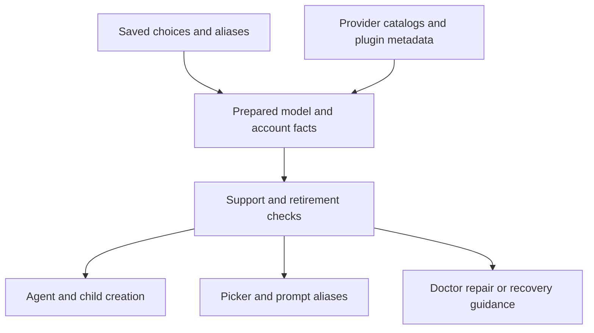

Codex review: blocked before merge. _Reviewed September 17, 2026, 2:50 AM ET / 06:50 UTC (Revision 7)._

# ClawSweeper review

## What this changes

Shares model-support checks across child-agent creation, model resolution, prompt aliases, and pickers, and extends Doctor repair to retired native xAI selections.

## Merge readiness

⛔ **Blocked before merge - 5 items remain**

This PR remains useful: current main still accepts endpoint-only native model fallbacks and does not retire native API xAI auto selections. No discrete blocking code defect was found. The updated evidence resolves the earlier package-verification gap, while the intentional compatibility change still warrants owner acceptance.

**Priority:** P2
**Reviewed head:** `08e2f6002888b085eabe7eaa8b9de0f2cf31d300`
**Owner decision:** Required. See [Decision needed](#decision-needed).

## Review scores

| Measure | Result | What it means |
|---|---|---|
| **Overall readiness** | 🐚 platinum hermit **(4/6)** | Useful consolidated implementation with strong behavior and upgrade evidence; the compatibility tradeoff remains an owner decision rather than a newly identified code defect. |
| **Proof confidence** | 🦞 diamond lobster **(5/6)** | Sufficient (live_output): The captured final-package observations exercise shared admission, picker retirement, and Doctor through upgraded Gateways and Telegram Test Server controls, including custom-model completion and account/history preservation. Inspected screenshots corroborate visible behavior at their original build identities; the explicitly incomplete extra fallback recording is excluded. |
| **Patch quality** | 🐚 platinum hermit **(4/6)** | No actionable review findings were identified. |

## Verification

| Check | Result | Evidence |
|---|---|---|
| **Real behavior** | Verified | Sufficient (live_output): The captured final-package observations exercise shared admission, picker retirement, and Doctor through upgraded Gateways and Telegram Test Server controls, including custom-model completion and account/history preservation. Inspected screenshots corroborate visible behavior at their original build identities; the explicitly incomplete extra fallback recording is excluded. |
| **Evidence reviewed** | 10 items | Verified introduced scope: The local merge-base-to-head comparison supplies the complete file list beyond the truncated prompt. The checkout is the pinned original head; the supplied stale test merge was not used to infer removal of current-main behavior. Current main still has the reported acceptance gap: Current main's fallback predicate accepts a configured endpoint without a model definition; the PR replaces that inference with route-aware support checks. Current main also lacks the new shared spawn admission function. Native API retirement remains absent on main: The current-main xAI manifest restricts auto retirement to the subscription host. The PR adds the native API host and applies retirement after effective-route projection. |
| **Findings** | None | None. |
| **Security** | None | None. |

## How this fits together

OpenClaw combines saved model choices, provider catalogs, account information, and plugin metadata before starting an agent. These changes make selection, child-agent creation, picker visibility, and Doctor repair consume consistent support and retirement decisions.

## Decision needed

| Question | Recommendation |
|---|---|
| Should native model IDs previously accepted from endpoint configuration alone now require an explicit definition, catalog entry, or provider-owned resolution? | **Preserve default compatibility:** Narrow unconditional rejection to verified unsupported or retired routes, leaving broader strict admission for an explicitly approved policy. |

Why: The implementation and PR body deliberately change an established acceptance path; successful upgrade examples establish coverage but cannot decide whether that broader compatibility tradeoff is acceptable.

## Before merge

- [ ] **Resolve merge risk (P1)** - Existing selections using unlisted native model IDs can stop resolving after upgrade until explicitly defined or supported by a provider resolver; the successful upgrade fixtures do not eliminate this intentional compatibility change.
- [ ] **Complete next step (P2)** - Obtain owner acceptance of rejecting previously accepted unlisted native model IDs, or narrow the restriction to preserve default compatibility.
- [ ] **Resolve maintainer decision** - Resolve the maintainer decision shown above before merge.
- [ ] **Review config compatibility** - Confirm compatibility and upgrade impact for the changed config or default surface before merge.
- [ ] **Add data-model compatibility proof** - Confirm migration or upgrade compatibility proof before merge.

<strong>Agent review details</strong>

### Security

None.

### PR surface

PR surface statistics unavailable: the file list is incomplete.

### Review metrics

| Metric | Value | Why it matters |
|---|---|---|
| **Production versus regression coverage** | Production net +707; tests and test support net +2242 | The growth is concentrated in regression coverage, with production additions justified by shared admission, native alias support, and route-aware Doctor repair. |

### Stored data model

Persistent data-model change detected: `migration/backfill/repair: src/commands/doctor/shared/codex-route-session-repair.ts`, `migration/backfill/repair: src/commands/doctor/shared/retired-session-model-repair.ts`, `unknown-data-model-change: src/commands/doctor/shared/retired-model-ref-repair.ts`, `unknown-data-model-change: src/commands/doctor/shared/retired-session-model-repair.ts`, `unknown-truncated-pull-files`. Confirm migration or upgrade compatibility proof before merge.

### Merge-risk options

**Maintainer options:**
1. **Narrow native rejection (recommended)**  
   Preserve endpoint-only compatibility for unverified native IDs while rejecting known retired selections through the shared owner.
2. **Approve the documented cutover**  
   Explicitly accept that some saved native IDs will require definitions after upgrade, using the supplied upgrade evidence to bound the decision.

### Technical review

Best possible solution:

Keep one support owner and route-specific retirement repair, preserving default compatibility for unlisted native IDs unless the responsible owner explicitly accepts their rejection.

Do we have a high-confidence way to reproduce the issue?

Yes, source establishes the path: a saved xAI auto alias on the native API can pass endpoint-only fallback acceptance, while main's retirement rule covers only the subscription host. This review did not execute the reproduction.

Is this the best way to solve the issue?

The shared resolver and retirement owner are a sound repair direction; whether rejecting every unlisted native ID is the best scope remains a compatibility decision.

AGENTS.md: found and applied where relevant.

Codex review notes: model internal, reasoning medium; reviewed against [8b9739cc48c0](https://github.com/openclaw/openclaw/commit/8b9739cc48c02167dc31387b93a6ce780b27de95).

### Labels

Label justifications:

- `P2`: This repairs a bounded model-selection and child-creation problem without evidence of an emergency runtime outage.
- `merge-risk: 🚨 compatibility`: The introduced support predicate intentionally rejects some native model selections accepted by the existing endpoint-only path.
- `rating: 🐚 platinum hermit`: Overall readiness is 🐚 platinum hermit; proof is 🦞 diamond lobster and patch quality is 🐚 platinum hermit.
- `status: 👀 ready for maintainer look`: ClawSweeper has no concrete contributor-facing blocker left for this PR. Sufficient (live_output): The captured final-package observations exercise shared admission, picker retirement, and Doctor through upgraded Gateways and Telegram Test Server controls, including custom-model completion and account/history preservation. Inspected screenshots corroborate visible behavior at their original build identities; the explicitly incomplete extra fallback recording is excluded.
- `proof: sufficient`: Contributor real behavior proof is sufficient. The captured final-package observations exercise shared admission, picker retirement, and Doctor through upgraded Gateways and Telegram Test Server controls, including custom-model completion and account/history preservation. Inspected screenshots corroborate visible behavior at their original build identities; the explicitly incomplete extra fallback recording is excluded.
- `proof: telegram-e2e`: This PR needs Telegram Test Server proof with the repository E2E skill. The PR changes Telegram-visible model rejection and picker choices; the supplied Test Server observations cover those behaviors.

### Evidence

What I checked:

- **Verified introduced scope:** The local merge-base-to-head comparison supplies the complete file list beyond the truncated prompt. The checkout is the pinned original head; the supplied stale test merge was not used to infer removal of current-main behavior. ([08e2f6002888](https://github.com/openclaw/openclaw/commit/08e2f6002888b085eabe7eaa8b9de0f2cf31d300))
- **Current main still has the reported acceptance gap:** Current main's fallback predicate accepts a configured endpoint without a model definition; the PR replaces that inference with route-aware support checks. Current main also lacks the new shared spawn admission function. ([`src/agents/embedded-agent-runner/model.configured-overrides.ts:230`](https://github.com/openclaw/openclaw/blob/8b9739cc48c02167dc31387b93a6ce780b27de95/src/agents/embedded-agent-runner/model.configured-overrides.ts#L230), [8b9739cc48c0](https://github.com/openclaw/openclaw/commit/8b9739cc48c02167dc31387b93a6ce780b27de95))
- **Native API retirement remains absent on main:** The current-main xAI manifest restricts auto retirement to the subscription host. The PR adds the native API host and applies retirement after effective-route projection. ([`extensions/xai/openclaw.plugin.json:113`](https://github.com/openclaw/openclaw/blob/8b9739cc48c02167dc31387b93a6ce780b27de95/extensions/xai/openclaw.plugin.json#L113), [8b9739cc48c0](https://github.com/openclaw/openclaw/commit/8b9739cc48c02167dc31387b93a6ce780b27de95))
- **Intentional compatibility restriction:** The introduced predicate preserves explicit definitions and custom/local endpoints, but rejects native routes lacking catalog support. The captured PR body explicitly acknowledges that previously accepted unlisted native IDs may require definitions; Doctor repairs known retirements rather than every affected ID. ([`src/agents/embedded-agent-runner/model.configured-overrides.ts:69`](https://github.com/openclaw/openclaw/blob/08e2f6002888b085eabe7eaa8b9de0f2cf31d300/src/agents/embedded-agent-runner/model.configured-overrides.ts#L69), [08e2f6002888](https://github.com/openclaw/openclaw/commit/08e2f6002888b085eabe7eaa8b9de0f2cf31d300))
- **Shared admission and account preservation:** Admission uses the target agent's policy, prepared account decisions, selected route, and existing model resolver; it checks freshness after asynchronous resolution and retains the original automatic candidate when a fallback is supported. Focused tests cover missing pins, incompatible subscription routes, native-owned models, and stale generations. ([`src/agents/model-runtime-choice.ts:15`](https://github.com/openclaw/openclaw/blob/08e2f6002888b085eabe7eaa8b9de0f2cf31d300/src/agents/model-runtime-choice.ts#L15), [08e2f6002888](https://github.com/openclaw/openclaw/commit/08e2f6002888b085eabe7eaa8b9de0f2cf31d300))
- **Gateway boundary regression:** The inspected regression starts a Gateway and requests models.list for prepared/full and default/configured views. It expects retired native rows to disappear, custom rows to remain available, and authored rows to remain in provider-config inventory. Tests were inspected, not executed during this read-only review. ([`src/gateway/server.models-native-retirement.test.ts:23`](https://github.com/openclaw/openclaw/blob/08e2f6002888b085eabe7eaa8b9de0f2cf31d300/src/gateway/server.models-native-retirement.test.ts#L23), [08e2f6002888](https://github.com/openclaw/openclaw/commit/08e2f6002888b085eabe7eaa8b9de0f2cf31d300))

Likely related people:

- **steipete:** Suggested for follow-up; no historical authorship or introduction is verified. (role: unverified routing candidate; confidence: low)
- **obviyus:** Suggested for follow-up; no historical authorship or introduction is verified. (role: unverified routing candidate; confidence: low)

### Rank-up moves

Optional improvements that raise the rating; they are not merge blockers.

- Record owner acceptance of the native-ID restriction or narrow rejection to preserve default compatibility.

### Rating scale

| Score | Internal tier | Crab rank | Meaning |
|---:|:---:|---|---|
| **6/6** | S | 🦀 challenger crab | Exceptional readiness |
| **5/6** | A | 🦞 diamond lobster | Very strong readiness |
| **4/6** | B | 🐚 platinum hermit | Good normal PR; ordinary maintainer review |
| **3/6** | C | 🦐 gold shrimp | Useful, but confidence is limited |
| **2/6** | D | 🦪 silver shellfish | Proof or implementation needs work |
| **1/6** | F | 🧂 unranked krab | Not merge-ready |
| N/A | NA | 🌊 off-meta tidepool | Rating does not apply |

Overall follows the weaker of proof and patch quality.
Shiny media proof means a screenshot, video, or linked artifact directly shows the changed behavior. Runtime, network, CSP, and security claims still need visible diagnostics.

### Workflow

- ClawSweeper keeps one durable marker-backed review comment per issue or PR.
- Re-runs edit this comment so the latest verdict, findings, and automation markers stay together instead of adding duplicate bot comments.
- A fresh review can be triggered by eligible `@clawsweeper re-review` comments, exact-item GitHub events, scheduled/background review runs, or manual workflow dispatch.
- PR/issue authors and users with repository write access can comment `@clawsweeper re-review` or `@clawsweeper re-run` on an open PR or issue to request a fresh review only.
- Maintainers can also comment `@clawsweeper review` to request a fresh review only.
- Fresh-review commands do not start repair, autofix, rebase, CI repair, or automerge.
- Maintainer-only repair and merge flows require explicit commands such as `@clawsweeper autofix`, `@clawsweeper automerge`, `@clawsweeper fix ci`, or `@clawsweeper address review`.
- Maintainers can comment `@clawsweeper explain` to ask for more context, or `@clawsweeper stop` to stop active automation.

### History

Review history (6 earlier review cycles)

<!-- clawsweeper-review-history v=1 total=6 -->
- reviewed 2026-09-16T15:34:32.059Z sha 36b9335a40a497e8a4308270416801f1f79173cb :: blocked before merge. :: none
- reviewed 2026-09-16T17:01:08.640Z sha 2ad9153cd10b22258280edb15f6968ffcbc16f66 :: blocked before merge. :: none
- reviewed 2026-09-17T02:36:42.312Z sha 8afb413ec9a37b290614c2397c50d92c825a80e6 :: blocked before merge. :: none
- reviewed 2026-09-17T05:25:03.335Z sha b12d66a91bc18b9aae2801ea4a31640425f4a75a :: blocked before merge. :: none
- reviewed 2026-09-17T06:15:16.328Z sha b12d66a91bc18b9aae2801ea4a31640425f4a75a :: blocked before merge. :: none
- reviewed 2026-09-17T06:27:59.387Z sha 08e2f6002888b085eabe7eaa8b9de0f2cf31d300 :: blocked before merge. :: none

<!-- clawsweeper-verdict:needs-human item=150128 sha=08e2f6002888b085eabe7eaa8b9de0f2cf31d300 confidence=high updated_at=2026-09-17T06:46:55Z reviewed_at=2026-09-17T06:50:09.661Z lease_owner=github-run-35191187577-1 lease_comment_id=5710219556 source_revision=93525d63edc07a77e8b1030500af2a0d98e28559746eccc329c7659446ed2c84 live_verification=absent -->
<!-- clawsweeper-review-state:blocked item=150128 sha=08e2f6002888b085eabe7eaa8b9de0f2cf31d300 v=1 -->

<!-- clawsweeper-review-version item=150128 reviewed_at=2026-09-17T06:50:09.661Z sha=08e2f6002888b085eabe7eaa8b9de0f2cf31d300 source_revision=93525d63edc07a77e8b1030500af2a0d98e28559746eccc329c7659446ed2c84 lease_owner=github-run-35191187577-1 lease_comment_id=5710219556 v=1 -->

<!-- clawsweeper-review item=150128 -->