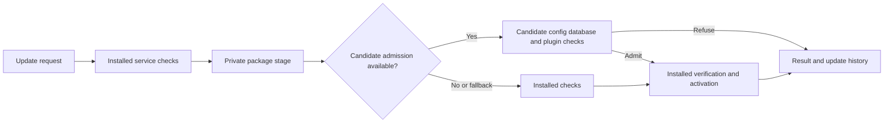

Codex review: blocked before merge. _Reviewed September 24, 2026, 8:46 AM ET / 12:46 UTC (Revision 8)._

# ClawSweeper review

## What this changes

For package updates, the branch stages the selected release for read-only configuration, database, and plugin admission, then leaves verification and activation with the installed updater while adding a CLI override and optional run-history fields.

## Merge readiness

⛔ **Blocked before merge - 1 item remains**

Keep open. Current main still uses installed admission before staging, so this PR supplies distinct work. The earlier Node recovery and Gateway schema findings are repaired in the reviewed head; I found no new actionable patch defect.

**Priority:** P2
**Reviewed head:** `f6eb934bcb4b1ed85450b7934bee1a153cb8461d`

## Review scores

| Measure | Result | What it means |
|---|---|---|
| **Overall readiness** | 🦞 diamond lobster **(5/6)** | The patch has a coherent owner split, broad exact-head validation, and detailed package-update behavior evidence without a supported blocking finding. |
| **Proof confidence** | 🦞 diamond lobster **(5/6)** | Sufficient (terminal): The PR body records packaged update runs through the production CLI using published 2026.9.1–2026.9.6 drivers and this candidate, observing candidate admission, installed fallback, and preserved plugin configuration after Doctor. The linked outer Testbox runs are cancelled, so their conclusions are not treated as passing workflow checks. Admission remains optional in existing SQLite origin JSON, and source plus ledger tests support reading records without it. |
| **Patch quality** | 🦞 diamond lobster **(5/6)** | No actionable review findings were identified. |

## Verification

| Check | Result | Evidence |
|---|---|---|
| **Real behavior** | Verified | Sufficient (terminal): The PR body records packaged update runs through the production CLI using published 2026.9.1–2026.9.6 drivers and this candidate, observing candidate admission, installed fallback, and preserved plugin configuration after Doctor. The linked outer Testbox runs are cancelled, so their conclusions are not treated as passing workflow checks. Admission remains optional in existing SQLite origin JSON, and source plus ledger tests support reading records without it. |
| **Evidence reviewed** | 10 items | Current main still needs the change: Current main resolves the target and proceeds through installed preflight without the candidate-admission marker or command; its package metadata also lacks the marker. Candidate and installed responsibilities: The installed process checks managed-service ownership before launching admission; a candidate verdict is recorded before the installed update continues. Admission subprocess boundary: The supervisor writes a private context file, strips update-authority environment keys, invokes the staged entry point with a bounded wait, and validates its verdict before use. |
| **Findings** | None | None. |
| **Security** | None | None. |

## How this fits together

The update CLI receives an update request, resolves and stages a package, checks whether it can safely proceed, then activates it and records the outcome. This change lets the staged package perform selected admission checks while the installed updater retains service and execution authority.

## Before merge

- [ ] **Review config compatibility** - Confirm compatibility and upgrade impact for the changed config or default surface before merge.

<strong>Agent review details</strong>

### Security

None.

### PR surface

PR surface statistics unavailable: the file list is incomplete.

### Review metrics

| Metric | Value | Why it matters |
|---|---|---|
| **Production and proof growth** | production +2024/−371 lines; tests and proof +2817/−248 lines | The new cross-process update contract accounts for substantial production growth and has corresponding boundary and package-update coverage. |
| **Operator and record surface** | 1 CLI option, 1 package capability marker, 1 optional run field | These are the compatibility surfaces maintainers need to recognize when the supporting updater ships. |

### Stored data model

Persistent data-model change detected: `migration/backfill/repair: config/knip.config.ts`, `migration/backfill/repair: scripts/e2e/lib/upgrade-survivor/update-admission-entry-probe.mjs`, `migration/backfill/repair: scripts/e2e/lib/upgrade-survivor/update-first-hop-compat.sh`, `migration/backfill/repair: src/cli/update-cli/update-command-admit.ts`, `serialized state: scripts/e2e/lib/upgrade-survivor/update-admission-entry-probe.mjs`, `serialized state: scripts/e2e/lib/upgrade-survivor/update-first-hop-compat.sh`, and 6 more. Migration or upgrade compatibility proof is recorded; maintainers should verify it before merge.

### Technical review

Best possible solution:

Supporting package updaters should use the staged release for candidate-owned checks while retaining installed ownership of service, runtime, activation, and recovery, with visible guidance for older drivers that cannot use the handoff.

Do we have a high-confidence way to reproduce the issue?

Not applicable as a feature PR. The older-driver pre-staging refusal is supported by related update receipts and source, but this read-only review did not execute the reported installation.

Is this the best way to solve the issue?

Yes. The existing updater remains the execution owner, while the staged release evaluates only the compatibility checks its version understands.

AGENTS.md: found and applied where relevant.

Codex review notes: model internal, reasoning high; reviewed against [da5e443fe5bb](https://github.com/openclaw/openclaw/commit/da5e443fe5bbc4070e41f177472ecc49623d3460).

### Labels

Label changes:

- add `rating: 🦞 diamond lobster`: Overall readiness is 🦞 diamond lobster; proof is 🦞 diamond lobster and patch quality is 🦞 diamond lobster.
- remove `rating: 🐚 platinum hermit`: Current PR rating is `rating: 🦞 diamond lobster`, so this older rating label is no longer current.

Label justifications:

- `P2`: This is a significant update-path improvement, but older installed drivers cannot gain it retroactively.
- `merge-risk: 🚨 compatibility`: The intentional auto default changes which version judges package admission; the reviewed installed override and fallback preserve an operator path.
- `rating: 🦞 diamond lobster`: Overall readiness is 🦞 diamond lobster; proof is 🦞 diamond lobster and patch quality is 🦞 diamond lobster.
- `status: 👀 ready for maintainer look`: ClawSweeper has no concrete contributor-facing blocker left for this PR. Sufficient (terminal): The PR body records packaged update runs through the production CLI using published 2026.9.1–2026.9.6 drivers and this candidate, observing candidate admission, installed fallback, and preserved plugin configuration after Doctor. The linked outer Testbox runs are cancelled, so their conclusions are not treated as passing workflow checks. Admission remains optional in existing SQLite origin JSON, and source plus ledger tests support reading records without it.
- `proof: sufficient`: Contributor real behavior proof is sufficient. The PR body records packaged update runs through the production CLI using published 2026.9.1–2026.9.6 drivers and this candidate, observing candidate admission, installed fallback, and preserved plugin configuration after Doctor. The linked outer Testbox runs are cancelled, so their conclusions are not treated as passing workflow checks. Admission remains optional in existing SQLite origin JSON, and source plus ledger tests support reading records without it.

### Evidence

What I checked:

- **Current main still needs the change:** Current main resolves the target and proceeds through installed preflight without the candidate-admission marker or command; its package metadata also lacks the marker. ([`src/cli/update-cli/update-command.ts:251`](https://github.com/openclaw/openclaw/blob/da5e443fe5bbc4070e41f177472ecc49623d3460/src/cli/update-cli/update-command.ts#L251), [da5e443fe5bb](https://github.com/openclaw/openclaw/commit/da5e443fe5bbc4070e41f177472ecc49623d3460))
- **Candidate and installed responsibilities:** The installed process checks managed-service ownership before launching admission; a candidate verdict is recorded before the installed update continues. ([`src/cli/update-cli/update-command-candidate-admission.ts:78`](https://github.com/openclaw/openclaw/blob/f6eb934bcb4b1ed85450b7934bee1a153cb8461d/src/cli/update-cli/update-command-candidate-admission.ts#L78), [f6eb934bcb4b](https://github.com/openclaw/openclaw/commit/f6eb934bcb4b1ed85450b7934bee1a153cb8461d))
- **Admission subprocess boundary:** The supervisor writes a private context file, strips update-authority environment keys, invokes the staged entry point with a bounded wait, and validates its verdict before use. ([`src/infra/update-candidate-admission.ts:100`](https://github.com/openclaw/openclaw/blob/f6eb934bcb4b1ed85450b7934bee1a153cb8461d/src/infra/update-candidate-admission.ts#L100), [f6eb934bcb4b](https://github.com/openclaw/openclaw/commit/f6eb934bcb4b1ed85450b7934bee1a153cb8461d))
- **Stored-record compatibility:** Admission is optional in the run schema and is stored in the existing origin JSON column. Decoding adds the projected field only when an older or newer row contains it; the ledger tests cover bounded retention and recovery-receipt eviction. ([`src/infra/update-run-read.kernel.ts:25`](https://github.com/openclaw/openclaw/blob/f6eb934bcb4b1ed85450b7934bee1a153cb8461d/src/infra/update-run-read.kernel.ts#L25), [f6eb934bcb4b](https://github.com/openclaw/openclaw/commit/f6eb934bcb4b1ed85450b7934bee1a153cb8461d))
- **Receipt capacity protection:** The encoder retains recovery receipts ahead of admission diagnostics within the existing 16 KiB origin limit; a full-capacity SQLite regression checks the retained bytes. ([`src/infra/update-run-ledger.test.ts:234`](https://github.com/openclaw/openclaw/blob/f6eb934bcb4b1ed85450b7934bee1a153cb8461d/src/infra/update-run-ledger.test.ts#L234), [f6eb934bcb4b](https://github.com/openclaw/openclaw/commit/f6eb934bcb4b1ed85450b7934bee1a153cb8461d))
- **Protocol response compatibility:** The Gateway protocol accepts optional admission data and bounded string Node-engine facts; the validator tests accept the new response and reject a non-string Node-engine value. ([`packages/gateway-protocol/src/update-runs-validators.test.ts:65`](https://github.com/openclaw/openclaw/blob/f6eb934bcb4b1ed85450b7934bee1a153cb8461d/packages/gateway-protocol/src/update-runs-validators.test.ts#L65), [f6eb934bcb4b](https://github.com/openclaw/openclaw/commit/f6eb934bcb4b1ed85450b7934bee1a153cb8461d))

Likely related people:

- **steipete:** Suggested for follow-up; no historical authorship or introduction is verified. (role: unverified routing candidate; confidence: low)
- **vincentkoc:** Suggested for follow-up; no historical authorship or introduction is verified. (role: unverified routing candidate; confidence: low)
- **Jason (Json):** Suggested for follow-up; no historical authorship or introduction is verified. (role: unverified routing candidate; confidence: low)

### Rating scale

| Score | Internal tier | Crab rank | Meaning |
|---:|:---:|---|---|
| **6/6** | S | 🦀 challenger crab | Exceptional readiness |
| **5/6** | A | 🦞 diamond lobster | Very strong readiness |
| **4/6** | B | 🐚 platinum hermit | Good normal PR; ordinary maintainer review |
| **3/6** | C | 🦐 gold shrimp | Useful, but confidence is limited |
| **2/6** | D | 🦪 silver shellfish | Proof or implementation needs work |
| **1/6** | F | 🧂 unranked krab | Not merge-ready |
| N/A | NA | 🌊 off-meta tidepool | Rating does not apply |

Overall follows the weaker of proof and patch quality.
Shiny media proof means a screenshot, video, or linked artifact directly shows the changed behavior. Runtime, network, CSP, and security claims still need visible diagnostics.

### Workflow

- ClawSweeper keeps one durable marker-backed review comment per issue or PR.
- Re-runs edit this comment so the latest verdict, findings, and automation markers stay together instead of adding duplicate bot comments.
- A fresh review can be triggered by eligible `@clawsweeper re-review` comments, exact-item GitHub events, scheduled/background review runs, or manual workflow dispatch.
- PR/issue authors and users with repository write access can comment `@clawsweeper re-review` or `@clawsweeper re-run` on an open PR or issue to request a fresh review only.
- Maintainers can also comment `@clawsweeper review` to request a fresh review only.
- Fresh-review commands do not start repair, autofix, rebase, CI repair, or automerge.
- Maintainer-only repair and merge flows require explicit commands such as `@clawsweeper autofix`, `@clawsweeper automerge`, `@clawsweeper fix ci`, or `@clawsweeper address review`.
- Maintainers can comment `@clawsweeper explain` to ask for more context, or `@clawsweeper stop` to stop active automation.

### History

Review history (7 earlier review cycles)

<!-- clawsweeper-review-history v=1 total=7 -->
- reviewed 2026-09-22T13:52:09.745Z sha 4ee3c292b179bcf70ed071c08e75e93ecdc51d1d :: blocked before merge. :: [P1] Preserve supervisor runtime recovery before refusing admission
- reviewed 2026-09-22T14:26:46.691Z sha ddbbe493906dc66a936bdb5fe63c201df78bcfab :: blocked before merge. :: [P2] Accept nodeEngines in the Gateway admission facts schema
- reviewed 2026-09-22T14:57:48.119Z sha 34deaf131e6f9daa9da27e65fa938cc70fab97cf :: blocked before merge. :: none
- reviewed 2026-09-22T15:12:38.201Z sha 29162206c63ff5917342cf6af7c773f5a0ad2058 :: blocked before merge. :: none
- reviewed 2026-09-22T17:18:53.111Z sha 29162206c63ff5917342cf6af7c773f5a0ad2058 :: blocked before merge. :: none
- reviewed 2026-09-24T10:55:41.279Z sha f6eb934bcb4b1ed85450b7934bee1a153cb8461d :: blocked before merge. :: none
- reviewed 2026-09-24T12:15:00.626Z sha f6eb934bcb4b1ed85450b7934bee1a153cb8461d :: blocked before merge. :: none

<!-- clawsweeper-verdict:needs-human item=155632 sha=f6eb934bcb4b1ed85450b7934bee1a153cb8461d confidence=high updated_at=2026-09-24T12:42:22Z reviewed_at=2026-09-24T12:46:57.885Z lease_owner=github-run-36000564788-1 lease_comment_id=5814327633 source_revision=acac3d57cf18aa1921a4f6f2b0c92fbf8e0cfe39943a98c06148749d1dc4f534 live_verification=absent -->
<!-- clawsweeper-review-state:blocked item=155632 sha=f6eb934bcb4b1ed85450b7934bee1a153cb8461d v=1 -->

<!-- clawsweeper-review-version item=155632 reviewed_at=2026-09-24T12:46:57.885Z sha=f6eb934bcb4b1ed85450b7934bee1a153cb8461d source_revision=acac3d57cf18aa1921a4f6f2b0c92fbf8e0cfe39943a98c06148749d1dc4f534 lease_owner=github-run-36000564788-1 lease_comment_id=5814327633 v=1 -->

<!-- clawsweeper-review item=155632 -->