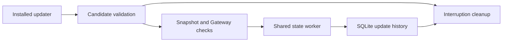

Codex review: blocked before merge. _Reviewed September 29, 2026, 1:32 PM ET / 17:32 UTC (Revision 8)._

# ClawSweeper review

## What this changes

The branch moves update-candidate progress receipts to the shared SQLite worker, settles accepted writes before interruption cleanup, and prepares deferred migration imports before package replacement.

## Merge readiness

⛔ **Blocked before merge - 3 items remain**

Current main still records candidate progress synchronously, so this PR remains useful. The source review found no discrete patch defect, but upgrade safety remains unproved for the current head after an earlier installed hop failed plugin verification and did not restore a healthy managed Gateway.

**Priority:** P2
**Reviewed head:** `66b1246ad7e4cf3dfe91e29dca34deac1fdc927c`

## Review scores

| Measure | Result | What it means |
|---|---|---|
| **Overall readiness** | 🦐 gold shrimp **(3/6)** | The worker cutover has focused authority and failure coverage, but the current installed-runtime repair remains unqualified after an observed earlier-hop failure. |
| **Proof confidence** | 🦐 gold shrimp **(3/6)** | Not applicable: The ordinary contributor proof gate does not apply to this member-authored PR. Real-worker tests cover the SQLite write and refusal boundary, and an earlier Linux/systemd installed two-hop run succeeded; the later import repair still lacks the published-driver compiled rerun required by update policy. No stored-data contract changes. |
| **Patch quality** | 🐚 platinum hermit **(4/6)** | No actionable review findings were identified. |

## Verification

| Check | Result | Evidence |
|---|---|---|
| **Real behavior** | Not applicable | Not applicable: The ordinary contributor proof gate does not apply to this member-authored PR. Real-worker tests cover the SQLite write and refusal boundary, and an earlier Linux/systemd installed two-hop run succeeded; the later import repair still lacks the published-driver compiled rerun required by update policy. No stored-data contract changes. |
| **Evidence reviewed** | 10 items | Current main still uses a synchronous receipt: The candidate progress callback calls the synchronous ledger writer on the updater thread. Worker admission and mutation: The introduced worker operation checks admission at transaction and commit, checks recovery in the transaction, and reuses the ledger's step mutation. Live write custody: The execution guard captures the current executor and handoff state for candidate writes; the worker writer carries that check through dispatch. |
| **Findings** | None | None. |
| **Security** | None | None. |

## How this fits together

The update CLI checks a candidate package using a state snapshot and temporary Gateway. It records the results in SQLite update history, which also informs interruption and cleanup handling.

## Before merge

- [ ] **Resolve merge risk (P1)** - The current head has no successful compiled installed-update result for its import-preparation repair; an earlier head failed plugin verification after package replacement.
- [ ] **Resolve merge risk (P1)** - The failed installed hop's recovery verification did not find a running managed Gateway, so service availability after rollback is unproved for the current head.
- [ ] **Complete next step (P2)** - Complete a current-head compiled published-driver-to-candidate and authenticated return-hop update, verifying plugin checks, progress receipts, and managed-service health after success and rollback.

<strong>Agent review details</strong>

### Security

None.

### PR surface

Source +523, Tests +984, Docs +15. Total +1522 across 31 files.

View PR surface stats

| Area | Files | Added | Removed | Net |
|---|---:|---:|---:|---:|
| Source | 23 | 698 | 175 | +523 |
| Tests | 7 | 1061 | 77 | +984 |
| Docs | 1 | 15 | 0 | +15 |
| Config | 0 | 0 | 0 | 0 |
| Generated | 0 | 0 | 0 | 0 |
| Other | 0 | 0 | 0 | 0 |
| **Total** | **31** | **1774** | **252** | **+1522** |

### Review metrics

| Metric | Value | Why it matters |
|---|---|---|
| **Production and regression-test growth** | production +523 net lines; tests +984 net lines | The production growth serves worker admission and settlement; the added tests exercise write outcomes and interruption at the worker boundary. |

### Merge-risk options

**Maintainer options:**
1. **Qualify the compiled update (recommended)**  
   Run the current-head published-driver-to-candidate and authenticated return-hop checks, including plugin verification and managed-service health after success and rollback.

### Technical review

Best possible solution:

Keep candidate receipts with the existing SQLite worker and ledger mutation while retaining live database and executor custody; leave uncertain outcomes pending for recovery.

Do we have a high-confidence way to reproduce the issue?

Yes, at source level: current main calls the synchronous ledger writer from candidate progress. This read-only review did not run an update.

Is this the best way to solve the issue?

Yes in design: the branch uses the existing worker and ledger mutation instead of adding another write owner. Installed-package compatibility remains to be verified.

AGENTS.md: found and applied where relevant.

Codex review notes: model internal, reasoning high; reviewed against [38dd3c28dd42](https://github.com/openclaw/openclaw/commit/38dd3c28dd42f8c853f35b37ac688c4701bcf474).

### Labels

Label changes:

No label changes.

Label justifications:

- `P2`: This is a bounded update-responsiveness and recovery improvement without an established current emergency.
- `merge-risk: 🚨 compatibility`: An installed update crosses package generations, and the preceding head failed plugin verification when it loaded a replaced chunk.
- `merge-risk: 🚨 availability`: The failed installed hop's recovery verification did not find a running managed Gateway.
- `rating: 🦐 gold shrimp`: Overall readiness is 🦐 gold shrimp; proof is 🦐 gold shrimp and patch quality is 🐚 platinum hermit.
- `status: 👀 ready for maintainer look`: ClawSweeper has no concrete contributor-facing blocker left for this PR. Not applicable: The ordinary contributor proof gate does not apply to this member-authored PR. Real-worker tests cover the SQLite write and refusal boundary, and an earlier Linux/systemd installed two-hop run succeeded; the later import repair still lacks the published-driver compiled rerun required by update policy. No stored-data contract changes.

### Evidence

What I checked:

- **Current main still uses a synchronous receipt:** The candidate progress callback calls the synchronous ledger writer on the updater thread. ([`src/cli/update-cli/update-command-candidate-validation.ts:29`](https://github.com/openclaw/openclaw/blob/38dd3c28dd42f8c853f35b37ac688c4701bcf474/src/cli/update-cli/update-command-candidate-validation.ts#L29), [38dd3c28dd42](https://github.com/openclaw/openclaw/commit/38dd3c28dd42f8c853f35b37ac688c4701bcf474))
- **Worker admission and mutation:** The introduced worker operation checks admission at transaction and commit, checks recovery in the transaction, and reuses the ledger's step mutation. ([`src/infra/update-run-mutation.worker.ts:25`](https://github.com/openclaw/openclaw/blob/66b1246ad7e4cf3dfe91e29dca34deac1fdc927c/src/infra/update-run-mutation.worker.ts#L25), [66b1246ad7e4](https://github.com/openclaw/openclaw/commit/66b1246ad7e4cf3dfe91e29dca34deac1fdc927c))
- **Live write custody:** The execution guard captures the current executor and handoff state for candidate writes; the worker writer carries that check through dispatch. ([`src/cli/update-cli/update-command-execution-guards.ts:32`](https://github.com/openclaw/openclaw/blob/66b1246ad7e4cf3dfe91e29dca34deac1fdc927c/src/cli/update-cli/update-command-execution-guards.ts#L32), [66b1246ad7e4](https://github.com/openclaw/openclaw/commit/66b1246ad7e4cf3dfe91e29dca34deac1fdc927c))
- **Authority boundary coverage:** The real-worker test path covers source replacement, revocation at commit, interruption after acceptance, and an unknown worker outcome. These tests were inspected, not executed in this read-only review. ([`src/infra/update-candidate-canary-progress.test-support.ts:32`](https://github.com/openclaw/openclaw/blob/66b1246ad7e4cf3dfe91e29dca34deac1fdc927c/src/infra/update-candidate-canary-progress.test-support.ts#L32), [66b1246ad7e4](https://github.com/openclaw/openclaw/commit/66b1246ad7e4cf3dfe91e29dca34deac1fdc927c))
- **Import preparation:** The execution runtime now prepares deferred plugin migration imports before the installed package is replaced. ([`src/cli/update-cli/update-execution.runtime.ts:5`](https://github.com/openclaw/openclaw/blob/66b1246ad7e4cf3dfe91e29dca34deac1fdc927c/src/cli/update-cli/update-execution.runtime.ts#L5), [66b1246ad7e4](https://github.com/openclaw/openclaw/commit/66b1246ad7e4cf3dfe91e29dca34deac1fdc927c))
- **Installed-update gap:** The captured PR body reports a successful Linux/systemd two-hop run for an earlier head, then a later installed hop that failed plugin verification after replacement and did not find a running managed service during recovery verification. It explicitly says the current import-preparation repair has not passed the compiled rerun. ([66b1246ad7e4](https://github.com/openclaw/openclaw/commit/66b1246ad7e4cf3dfe91e29dca34deac1fdc927c))

Likely related people:

- **unknown:** The claimed source-line change could not be verified from bounded local history. (role: source history unknown; confidence: low)

### Rank-up moves

Optional improvements that raise the rating; they are not merge blockers.

- Record a current-head compiled installed update that verifies plugin checks and managed-service health after success and rollback.

### Rating scale

| Score | Internal tier | Crab rank | Meaning |
|---:|:---:|---|---|
| **6/6** | S | 🦀 challenger crab | Exceptional readiness |
| **5/6** | A | 🦞 diamond lobster | Very strong readiness |
| **4/6** | B | 🐚 platinum hermit | Good normal PR; ordinary maintainer review |
| **3/6** | C | 🦐 gold shrimp | Useful, but confidence is limited |
| **2/6** | D | 🦪 silver shellfish | Proof or implementation needs work |
| **1/6** | F | 🧂 unranked krab | Not merge-ready |
| N/A | NA | 🌊 off-meta tidepool | Rating does not apply |

Overall follows the weaker of proof and patch quality.
Shiny media proof means a screenshot, video, or linked artifact directly shows the changed behavior. Runtime, network, CSP, and security claims still need visible diagnostics.

### Workflow

- ClawSweeper keeps one durable marker-backed review comment per issue or PR.
- Re-runs edit this comment so the latest verdict, findings, and automation markers stay together instead of adding duplicate bot comments.
- A fresh review can be triggered by eligible `@clawsweeper re-review` comments, exact-item GitHub events, scheduled/background review runs, or manual workflow dispatch.
- PR/issue authors and users with repository write access can comment `@clawsweeper re-review` or `@clawsweeper re-run` on an open PR or issue to request a fresh review only.
- Maintainers can also comment `@clawsweeper review` to request a fresh review only.
- Fresh-review commands do not start repair, autofix, rebase, CI repair, or automerge.
- Maintainer-only repair and merge flows require explicit commands such as `@clawsweeper autofix`, `@clawsweeper automerge`, `@clawsweeper fix ci`, or `@clawsweeper address review`.
- Maintainers can comment `@clawsweeper explain` to ask for more context, or `@clawsweeper stop` to stop active automation.

### History

Review history (7 earlier review cycles)

<!-- clawsweeper-review-history v=1 total=7 -->
- reviewed 2026-09-29T09:17:20.249Z sha f2fed5f693b548821436db832d7f7a1a70ea8901 :: blocked before merge. :: [P1] Require the execution guard for candidate progress writes | [P3] Report the added suite's measured test cost
- reviewed 2026-09-29T10:15:21.958Z sha 1f97a21e1a69a3e755888a77e2b6a512c46d3842 :: blocked before merge. :: none
- reviewed 2026-09-29T13:29:25.091Z sha 1f97a21e1a69a3e755888a77e2b6a512c46d3842 :: blocked before merge. :: none
- reviewed 2026-09-29T14:04:57.397Z sha c7dd487b99fb0d7a0be27d4edbc7b68d448d006e :: blocked before merge. :: none
- reviewed 2026-09-29T15:33:37.142Z sha c7dd487b99fb0d7a0be27d4edbc7b68d448d006e :: blocked before merge. :: none
- reviewed 2026-09-29T16:28:29.009Z sha 6c4e54537bf8f43974fd76fca6109e9d4a1a6218 :: blocked before merge. :: none
- reviewed 2026-09-29T16:54:39.868Z sha ce362c7ee26f3d45fd1084ad25ce637488677b52 :: blocked before merge. :: none

<!-- clawsweeper-verdict:needs-human item=161104 sha=66b1246ad7e4cf3dfe91e29dca34deac1fdc927c confidence=high updated_at=2026-09-29T17:28:00Z reviewed_at=2026-09-29T17:32:01.157Z lease_owner=github-run-36604768319-1 lease_comment_id=5895268721 source_revision=ffa27fdd2f09f9b402a41e53c229c40bf5b0324f50f665b8e651a1aeeeccf340 live_verification=absent -->
<!-- clawsweeper-review-state:blocked item=161104 sha=66b1246ad7e4cf3dfe91e29dca34deac1fdc927c v=1 -->

<!-- clawsweeper-review-version item=161104 reviewed_at=2026-09-29T17:32:01.157Z sha=66b1246ad7e4cf3dfe91e29dca34deac1fdc927c source_revision=ffa27fdd2f09f9b402a41e53c229c40bf5b0324f50f665b8e651a1aeeeccf340 lease_owner=github-run-36604768319-1 lease_comment_id=5895268721 v=1 -->

<!-- clawsweeper-review item=161104 -->