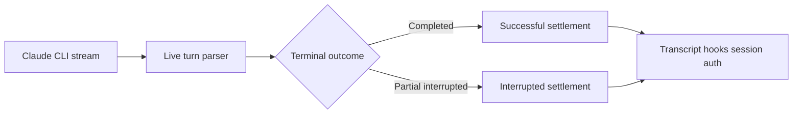

Codex review: needs real behavior proof before merge. _Reviewed August 23, 2026, 12:19 AM ET / 04:19 UTC._

# ClawSweeper review

## What this changes

The PR retains already-streamed Claude CLI text after an interrupted live turn and records the result as aborted or timed out instead of successful.

## Regression provenance

Possible regression — probable (reviewed change; known regression link). No predecessor PR is attributed.

## Merge readiness

⛔ **Blocked until real behavior proof from a real setup is added - 4 items remain**

The patch follows the Claude live-turn owner boundary and carries interruption state through persistence and settlement without a concrete correctness defect found. It still needs after-fix proof from a real Claude CLI setup before merge.

**Priority:** P1
**Reviewed head:** `7ce8b85611d66a9d987173ebe652146b05957fe6`

## Review scores

| Measure | Result | What it means |
|---|---|---|
| **Overall readiness** | 🦪 silver shellfish **(2/6)** | The implementation and focused boundary coverage are sound, but external real-behavior proof is still absent. |
| **Proof confidence** | 🦪 silver shellfish **(2/6)** | Needs real behavior proof before merge: The PR body supplies focused mocked process and runner tests, but its real Claude CLI proof remains marked pending; post redacted after-fix terminal or transcript evidence before merge. After adding proof, update the PR body; ClawSweeper should re-review automatically. If it does not, the PR author or someone with repository write access can comment `@clawsweeper re-review`. |
| **Patch quality** | 🐚 platinum hermit **(4/6)** | No actionable review findings were identified. |

## Verification

| Check | Result | Evidence |
|---|---|---|
| **Real behavior** | Needs proof | Needs real behavior proof before merge: The PR body supplies focused mocked process and runner tests, but its real Claude CLI proof remains marked pending; post redacted after-fix terminal or transcript evidence before merge. After adding proof, update the PR body; ClawSweeper should re-review automatically. If it does not, the PR author or someone with repository write access can comment `@clawsweeper re-review`. |
| **Evidence reviewed** | 6 items | Live-turn owner boundary: The failure path finalizes the parser, retains non-empty error-free text only for abort or signal-timeout reasons, and marks that output with an explicit interruption disposition.<br>Caller and settlement coverage: The runner persists the partial assistant message as aborted, emits a non-successful agent-end event, clears CLI continuity, and suppresses successful auth binding.<br>Sibling invariant: The embedded runner already preserves aborted attempts through after-turn side effects; this PR makes the CLI live path preserve its partial assistant output while retaining an aborted terminal state. |
| **Findings** | None | None. |
| **Security** | None | None. |


### Live Verification

**Command:** `pnpm openclaw --help`

**Result:** PASS (completed)

```text
pnpm openclaw --help
runner@runnervm76f27:/tmp/clawsweeper-live-proof-126883-HfAC9H/target$ pnpm openclaw --help
$ node scripts/run-node.mjs --help
pnpm openclaw --help
[openclaw] Building TypeScript (dist is stale: missing_build_stamp - build stamp missing).
[openclaw] Building bundled plugin assets.
[canvas] build: node scripts/bundle-a2ui.mjs
[log] ‹DIR›/a2ui.bundle.js  chunk │ size: 399.96 kB
[log] ‹DIR›/a2ui-v0.9.bundle.js  chunk │ size: 615.66 kB
[log]
[success] rolldown v1.2.0 Finished in 103.12 ms
[diffs] build: node --import tsx ../../scripts/build-diffs-viewer-runtime.mts curated
[diffs-language-pack] build: node --import tsx ../../scripts/build-diffs-viewer-runtime.mts full
[discord] build: node --import tsx ../../scripts/build-discord-activity-sdk.mts
[tsdown-build] invocation 1/2 finished in 0.7s
node_modules/playwright-core/lib/coreBundle.js (65821:28) [EVAL] Use of direct ˋevalˋ function is strongly discouraged as it poses security risks and may cause
issues with minification.
       ╭─[ node_modules/playwright-core/lib/coreBundle.js:65821:29 ]
       │
 65821 │               const value = eval(ˋ(${expr})ˋ);
       │                             ──┬─
       │                               ╰─── Use of direct ˋevalˋ here.
       │
       │ Help: Consider using indirect eval. For more information, check the documentation: https://rolldown.rs/guide/troubleshooting#avoiding-direct-eval
───────╯

node_modules/playwright-core/lib/coreBundle.js (65828:28) [EVAL] Use of direct ˋevalˋ function is strongly discouraged as it poses security risks and may cause
issues with minification.
       ╭─[ node_modules/playwright-core/lib/coreBundle.js:65828:29 ]
       │
 65828 │               const value = eval(ˋ(${expr})ˋ);
       │                             ──┬─
       │                               ╰─── Use of direct ˋevalˋ here.
       │
       │ Help: Consider using indirect eval. For more information, check the documentation: https://rolldown.rs/guide/troubleshooting#avoiding-direct-eval
───────╯

node_modules/web-tree-sitter/web-tree-sitter.js (2343:30) [EVAL] Use of direct ˋevalˋ function is strongly discouraged as it poses security risks and may cause
issues with minification.
      ╭─[ node_modules/web-tree-sitter/web-tree-sitter.js:2343:31 ]
      │
 2343 │           ASM_CONSTS[start] = eval(func);
      │                               ──┬─
      │                                 ╰─── Use of direct ˋevalˋ here.
      │
      │ Help: Consider using indirect eval. For more information, check the documentation: https://rolldown.rs/guide/troubleshooting#avoiding-direct-eval
──────╯

node_modules/web-tree-sitter/web-tree-sitter.js (2366:32) [EVAL] Use of direct ˋevalˋ function is strongly discouraged as it poses security risks and may cause
issues with minification.
      ╭─[ node_modules/web-tree-sitter/web-tree-sitter.js:2366:33 ]
      │
 2366 │           moduleExports[name] = eval(func);
      │                                 ──┬─
      │                                   ╰─── Use of direct ˋevalˋ here.
      │
      │ Help: Consider using indirect eval. For more information, check the documentation: https://rolldown.rs/guide/troubleshooting#avoiding-direct-eval
──────╯

[tsdown-build] invocation 2/2 finished in 14.1s
[plugin-control-plane-loads] verified 35 built modules with native require and checked doctor closures
runtime-postbuild: 11 phases completed in 4203ms (slowest: built plugin control-plane loads 3488ms)

OpenClaw 2026.8.1 (7ce8b85) — All your chats, one OpenClaw.

Usage: openclaw [options] [command]

Options:
  --container ‹name›   Run the CLI inside a running Podman/Docker container named ‹name› (default: env OPENCLAW_CONTAINER)
  --dev                Dev profile: isolate state under ~/.openclaw-dev, default gateway port 19001, and shift derived ports (browser/canvas)
  -h, --help           Display help for command
  --log-level ‹level›  Global log level override for file + console
… output truncated …
```

**Assertions:**

- PASS `expect_output`: Usage: openclaw

## How this fits together

Claude CLI live sessions parse streamed output before passing a normalized result to the CLI runner. The runner writes transcripts, emits hooks, updates session continuity, and settles auth and execution metadata.



## Before merge

- [ ] **Add real behavior proof** - Needs real behavior proof before merge: The PR body supplies focused mocked process and runner tests, but its real Claude CLI proof remains marked pending; post redacted after-fix terminal or transcript evidence before merge. After adding proof, update the PR body; ClawSweeper should re-review automatically. If it does not, the PR author or someone with repository write access can comment `@clawsweeper re-review`.
- [ ] **Resolve merge risk (P1)** - The interrupted result clears native CLI session continuity and suppresses successful auth settlement; real Claude CLI proof must confirm those projections after an actual abort.
- [ ] **Resolve merge risk (P1)** - Production code grows by a net 78 lines for a bug fix; the added terminal-state carrier appears necessary across existing projections, but the missing base/current-main objects prevented an independent diff comparison.
- [ ] **Complete next step (P2)** - This active contributor PR needs contributor-provided real behavior proof, not an automated repair branch.


<details>
<summary><strong>Agent review details</strong></summary>

### Security

None.

### PR surface

Source +78, Tests +255. Total +333 across 7 files.

<details>
<summary>View PR surface stats</summary>

| Area | Files | Added | Removed | Net |
|---|---:|---:|---:|---:|
| Source | 5 | 121 | 43 | +78 |
| Tests | 2 | 255 | 0 | +255 |
| Docs | 0 | 0 | 0 | 0 |
| Config | 0 | 0 | 0 | 0 |
| Generated | 0 | 0 | 0 | 0 |
| Other | 0 | 0 | 0 | 0 |
| **Total** | **7** | **376** | **43** | **+333** |

</details>

### Review metrics

| Metric | Value | Why it matters |
|---|---|---|
| **Production versus tests** | production +121/-43 (net +78); tests +255/-0 | The new terminal-disposition state crosses persistence, session, hook, trace, and auth settlement surfaces; test growth covers both owner and caller boundaries. |

### Root-cause cluster

Relationship: `fixed_by_candidate`
Canonical: https://github.com/openclaw/openclaw/issues/120207
Summary: This PR is a candidate fix for the open report of Claude live-session partial output being discarded after abort.

Members:
- `canonical`: https://github.com/openclaw/openclaw/issues/120207 - The PR explicitly targets the issue's reported live-turn partial-output loss.

Proposal only: this assessment does not dispatch repair, suppress jobs, mutate sibling items, close, or merge anything.

### Merge-risk options

**Maintainer options:**
1. **Add real abort proof before merge (recommended)**  
   Run a real Claude CLI live turn, interrupt it after visible partial output, and post redacted transcript or terminal evidence showing retained text, an aborted outcome, cleared continuity, and no successful auth settlement.
2. **Accept mock-backed lifecycle coverage**  
   Maintainers may accept the focused mocked owner and caller-boundary tests while taking responsibility for unobserved real CLI lifecycle behavior.

### Technical review

Best possible solution:

Keep one explicit interruption fact on normalized CLI output, settle it once across transcript/session/auth projections, and prove the resulting partial reply in a real Claude CLI abort.

Do we have a high-confidence way to reproduce the issue?

Yes, from source: stream assistant text through a Claude live turn and abort its signal; the focused regression test models that path, though no current-main live CLI run was available to this review.

Is this the best way to solve the issue?

Yes for the code path reviewed: the disposition is attached at the live-turn owner and consumed by existing settlement projections instead of treating partial output as a normal success.

AGENTS.md: found and applied where relevant.

Codex review notes: model internal, reasoning high; reviewed against [434fd0c10690](https://github.com/openclaw/openclaw/commit/434fd0c106902c432a18f3842e050a8b31a76d5a).

### Labels

Label changes:

- add `rating: 🦪 silver shellfish`: Overall readiness is 🦪 silver shellfish; proof is 🦪 silver shellfish and patch quality is 🐚 platinum hermit.
- add `status: 📣 needs proof`: The PR needs real behavior proof before ClawSweeper can clear the contributor ask. Needs real behavior proof before merge: The PR body supplies focused mocked process and runner tests, but its real Claude CLI proof remains marked pending; post redacted after-fix terminal or transcript evidence before merge. After adding proof, update the PR body; ClawSweeper should re-review automatically. If it does not, the PR author or someone with repository write access can comment `@clawsweeper re-review`.
- remove `proof: sufficient`: Current real behavior proof status is mock_only, not sufficient.
- remove `rating: 🐚 platinum hermit`: Current PR rating is `rating: 🦪 silver shellfish`, so this older rating label is no longer current.
- remove `status: 👀 ready for maintainer look`: Current PR status label is `status: 📣 needs proof`.

Label justifications:

- `P1`: Interrupted Claude CLI turns can otherwise silently lose assistant text already streamed to the parser.
- `merge-risk: 🚨 session-state`: The patch intentionally clears persisted native CLI continuity and changes transcript completion state for interrupted turns.
- `merge-risk: 🚨 auth-provider`: The patch suppresses successful auth-binding settlement for partial interrupted CLI output.
- `rating: 🦪 silver shellfish`: Overall readiness is 🦪 silver shellfish; proof is 🦪 silver shellfish and patch quality is 🐚 platinum hermit.
- `status: 📣 needs proof`: The PR needs real behavior proof before ClawSweeper can clear the contributor ask. Needs real behavior proof before merge: The PR body supplies focused mocked process and runner tests, but its real Claude CLI proof remains marked pending; post redacted after-fix terminal or transcript evidence before merge. After adding proof, update the PR body; ClawSweeper should re-review automatically. If it does not, the PR author or someone with repository write access can comment `@clawsweeper re-review`.

### Evidence

What I checked:

- **Live-turn owner boundary:** The failure path finalizes the parser, retains non-empty error-free text only for abort or signal-timeout reasons, and marks that output with an explicit interruption disposition. ([`src/agents/cli-runner/claude-live-turn.ts:135`](https://github.com/openclaw/openclaw/blob/7ce8b85611d6/src/agents/cli-runner/claude-live-turn.ts#L135), [7ce8b85611d6](https://github.com/openclaw/openclaw/commit/7ce8b85611d6))
- **Caller and settlement coverage:** The runner persists the partial assistant message as aborted, emits a non-successful agent-end event, clears CLI continuity, and suppresses successful auth binding. ([`src/agents/cli-runner.ts:542`](https://github.com/openclaw/openclaw/blob/7ce8b85611d6/src/agents/cli-runner.ts#L542), [7ce8b85611d6](https://github.com/openclaw/openclaw/commit/7ce8b85611d6))
- **Sibling invariant:** The embedded runner already preserves aborted attempts through after-turn side effects; this PR makes the CLI live path preserve its partial assistant output while retaining an aborted terminal state. ([`src/agents/embedded-agent-runner/run/attempt-stream-settle.ts:179`](https://github.com/openclaw/openclaw/blob/7ce8b85611d6/src/agents/embedded-agent-runner/run/attempt-stream-settle.ts#L179), [7ce8b85611d6](https://github.com/openclaw/openclaw/commit/7ce8b85611d6))
- **Focused regression coverage:** The new owner-boundary test exercises plain abort, direct TimeoutError, wrapped timeout abort, failover rejection, and empty-output rejection; the caller-boundary test checks transcript/hook/session/auth projections. ([`src/agents/cli-runner/claude-live-session.abort-partial-output.test.ts:48`](https://github.com/openclaw/openclaw/blob/7ce8b85611d6/src/agents/cli-runner/claude-live-session.abort-partial-output.test.ts#L48), [7ce8b85611d6](https://github.com/openclaw/openclaw/commit/7ce8b85611d6))
- **History and ownership:** The checked-out head is Ayaan Zaidi's interruption-classification follow-up; nearby CLI live-session ownership history includes Peter Steinberger's session split and unified failure-policy refactors. The local shallow/promisor history cannot expose the parent commit object. ([`src/agents/cli-runner/claude-live-turn.ts:135`](https://github.com/openclaw/openclaw/blob/7ce8b85611d6/src/agents/cli-runner/claude-live-turn.ts#L135), [7ce8b85611d6](https://github.com/openclaw/openclaw/commit/7ce8b85611d6))
- **Current-main limitation:** The local checkout contains the PR head but not the requested current-main/base blobs; its promisor remote could not resolve github.com, so an independent current-main three-way comparison was unavailable.

Likely related people:

- **Ayaan Zaidi:** Authored the current checked-out follow-up that classifies partial interrupted turns by the signal-reason contract. (role: recent CLI interruption contributor; confidence: high; commits: [7ce8b85611d6](https://github.com/openclaw/openclaw/commit/7ce8b85611d66a9d987173ebe652146b05957fe6); files: `src/agents/cli-runner/claude-live-turn.ts`, `src/agents/cli-runner/cli-run-settlement.ts`)
- **Peter Steinberger:** Recent history attributes the Claude live-session split and unified CLI failure-policy refactors to this area. (role: recent live-session architecture contributor; confidence: medium; commits: [f5aba5443734](https://github.com/openclaw/openclaw/commit/f5aba5443734a160d90e034acac31097203791d2), [b3369840b1f0](https://github.com/openclaw/openclaw/commit/b3369840b1f05fd4073f464ecec65e4bc5f7b531); files: `src/agents/cli-runner/claude-live-turn.ts`, `src/agents/cli-runner/cli-run-settlement.ts`)

### Rank-up moves

Optional improvements that raise the rating; they are not merge blockers.

- Post redacted evidence from a real Claude CLI live turn interrupted after partial output, showing the persisted partial reply and interrupted terminal state.
- Re-run the exact-head required checks after the proof is added.

### Rating scale

| Score | Internal tier | Crab rank | Meaning |
|---:|:---:|---|---|
| **6/6** | S | 🦀 challenger crab | Exceptional readiness |
| **5/6** | A | 🦞 diamond lobster | Very strong readiness |
| **4/6** | B | 🐚 platinum hermit | Good normal PR; ordinary maintainer review |
| **3/6** | C | 🦐 gold shrimp | Useful, but confidence is limited |
| **2/6** | D | 🦪 silver shellfish | Proof or implementation needs work |
| **1/6** | F | 🧂 unranked krab | Not merge-ready |
| N/A | NA | 🌊 off-meta tidepool | Rating does not apply |

Overall follows the weaker of proof and patch quality.
Shiny media proof means a screenshot, video, or linked artifact directly shows the changed behavior. Runtime, network, CSP, and security claims still need visible diagnostics.

### Workflow

- ClawSweeper keeps one durable marker-backed review comment per issue or PR.
- Re-runs edit this comment so the latest verdict, findings, and automation markers stay together instead of adding duplicate bot comments.
- A fresh review can be triggered by eligible `@clawsweeper re-review` comments, exact-item GitHub events, scheduled/background review runs, or manual workflow dispatch.
- PR/issue authors and users with repository write access can comment `@clawsweeper re-review` or `@clawsweeper re-run` on an open PR or issue to request a fresh review only.
- Maintainers can also comment `@clawsweeper review` to request a fresh review only.
- Fresh-review commands do not start repair, autofix, rebase, CI repair, or automerge.
- Maintainer-only repair and merge flows require explicit commands such as `@clawsweeper autofix`, `@clawsweeper automerge`, `@clawsweeper fix ci`, or `@clawsweeper address review`.
- Maintainers can comment `@clawsweeper explain` to ask for more context, or `@clawsweeper stop` to stop active automation.

### History

<details>
<summary>Review history (3 earlier review cycles)</summary>

<!-- clawsweeper-review-history v=1 total=3 -->
- reviewed 2026-08-20T23:45:44.526Z sha 214805fbc81b8aeac529a7cf438a27eca1ae18e6 :: needs real behavior proof before merge. :: [P1] Preserve the abort terminal state with partial output
- reviewed 2026-08-22T18:18:33.807Z sha a72669c2dc040820864daf7b75a28df065dbf64e :: needs changes before merge. :: [P2] Classify wrapped timeouts as timeouts
- reviewed 2026-08-22T18:55:08.572Z sha 230cb5db04e3abd78adcb4cdc9785eba0512c64f :: needs maintainer review before merge. :: none

</details>

</details>

<!-- clawsweeper-verdict:needs-human item=126883 sha=7ce8b85611d66a9d987173ebe652146b05957fe6 confidence=medium updated_at=2026-08-23T04:16:13Z reviewed_at=2026-08-23T04:19:07.707Z lease_owner=github-run-32617363330-1 lease_comment_id=5384166197 source_revision=8ee071b4a8299e73cb094d6639b623b511a962bbbcc915d6ef31745f71a32919 -->

<!-- clawsweeper-review-version item=126883 reviewed_at=2026-08-23T04:19:07.707Z sha=7ce8b85611d66a9d987173ebe652146b05957fe6 source_revision=8ee071b4a8299e73cb094d6639b623b511a962bbbcc915d6ef31745f71a32919 lease_owner=github-run-32617363330-1 lease_comment_id=5384166197 v=1 -->

<!-- clawsweeper-review item=126883 -->