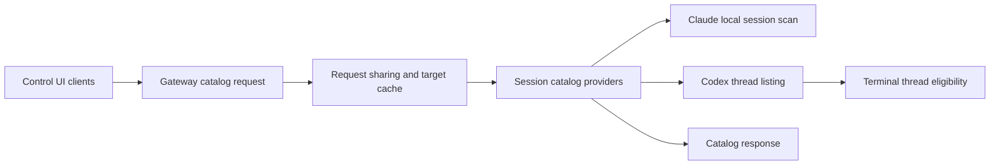

Codex review: needs real behavior proof before merge. _Reviewed July 28, 2026, 1:50 AM ET / 05:50 UTC._

# ClawSweeper review

## What this changes

This PR memoizes executable and provider catalog work, shares concurrent identical Gateway catalog-list requests, and adds brief Claude and Codex session-list caches to reduce Control UI polling cost.

## Merge readiness

⛔ **Blocked until stronger real behavior proof is added - 4 items remain**

Keep this PR open for a narrow correctness repair: the new Codex page memo can authorize a terminal action from a three-second-old catalog hit even though the action requires current thread eligibility. The performance direction is otherwise coherent, but the maintainer label requires explicit human handling after the freshness fix and real after-fix evidence are available.

**Priority:** P2
**Reviewed head:** `6b1aa4d41e392b07f19fb523139b713a51f338ae`

## Review scores

| Measure | Result | What it means |
|---|---|---|
| **Overall readiness** | 🦪 silver shellfish **(2/6)** | The performance proposal has focused tests and a bounded repair, but a stale terminal-eligibility defect and missing inspectable after-fix behavior proof prevent a merge-ready rating. |
| **Proof confidence** | 🦪 silver shellfish **(2/6)** | Needs stronger real behavior proof before merge: The PR body gives before-change production timings and test claims, but it does not provide inspectable after-fix live output, a terminal capture, or a redacted artifact demonstrating the claimed improved catalog behavior; add redacted after-fix timings or a reproducible runtime transcript. After adding proof, update the PR body; ClawSweeper should re-review automatically. If it does not, the PR author or someone with repository write access can comment `@clawsweeper re-review`. |
| **Patch quality** | 🦐 gold shrimp **(3/6)** | 1 actionable review finding remain. |

## Verification

| Check | Result | Evidence |
|---|---|---|
| **Real behavior** | Needs proof | Needs stronger real behavior proof before merge: The PR body gives before-change production timings and test claims, but it does not provide inspectable after-fix live output, a terminal capture, or a redacted artifact demonstrating the claimed improved catalog behavior; add redacted after-fix timings or a reproducible runtime transcript. After adding proof, update the PR body; ClawSweeper should re-review automatically. If it does not, the PR author or someone with repository write access can comment `@clawsweeper re-review`. |
| **Evidence reviewed** | 4 items | Current Codex control behavior: Current main creates a fresh request snapshot for each Codex catalog call, including fresh runtime-config and start-option clones; the proposed branch adds a three-second page memo to this path. Mutation eligibility regression: The proposed `requireCatalogEligibleThread` first accepts a positive result from `findCatalogEligibleThread(..., false)`, which reaches the new page memo. A thread archived or otherwise made ineligible after that cached listing can therefore pass terminal-action eligibility without the fresh list/read described by the new comment. Related merged performance work: The two linked PRs already reduced catalog cloning and Claude scan work; this PR addresses distinct remaining probes, request sharing, and Codex listing costs rather than duplicating either merged change. |
| **Findings** | 1 actionable finding | [P2] Bypass the list memo for mutating-thread eligibility |
| **Security** | None | None. |

## How this fits together

The Gateway combines core session data with session-catalog plugins such as Claude and Codex, then returns paged catalog data to Control UI clients. The PR adds caches at the shared Gateway, executable-discovery, and plugin-provider layers, while terminal actions use the catalog to decide whether a Codex thread is eligible.

## Before merge

- [ ] **Add real behavior proof** - Needs stronger real behavior proof before merge: The PR body gives before-change production timings and test claims, but it does not provide inspectable after-fix live output, a terminal capture, or a redacted artifact demonstrating the claimed improved catalog behavior; add redacted after-fix timings or a reproducible runtime transcript. After adding proof, update the PR body; ClawSweeper should re-review automatically. If it does not, the PR author or someone with repository write access can comment `@clawsweeper re-review`.
- [ ] **Bypass the list memo for mutating-thread eligibility (P2)** - `requireCatalogEligibleThread` now returns a cached positive page result before any refresh. If the thread is archived or otherwise becomes ineligible during the three-second TTL, a terminal action can proceed on stale catalog state. Always force-refresh this eligibility lookup (or read the thread authoritatively) and cover that changed-state case.
- [ ] **Resolve merge risk (P1)** - A three-second passive Codex page cache is valid for catalog rendering, but using a positive cached entry to authorize a terminal operation can act on a thread whose archived or eligibility state has changed since the cache was populated.
- [ ] **Complete next step (P2)** - The protected `maintainer` label and the missing contributor-controlled real-behavior proof require human follow-up; ClawSweeper should not queue an automated repair for this PR.

## Findings

- [P2] Bypass the list memo for mutating-thread eligibility — `extensions/codex/src/session-catalog-terminal.ts:65-70`

<strong>Agent review details</strong>

### Security

None.

### PR surface

Source +277, Tests +277. Total +554 across 13 files.

View PR surface stats

| Area | Files | Added | Removed | Net |
|---|---:|---:|---:|---:|
| Source | 9 | 346 | 69 | +277 |
| Tests | 4 | 293 | 16 | +277 |
| Docs | 0 | 0 | 0 | 0 |
| Config | 0 | 0 | 0 | 0 |
| Generated | 0 | 0 | 0 | 0 |
| Other | 0 | 0 | 0 | 0 |
| **Total** | **13** | **639** | **85** | **+554** |

### Review metrics

None.

### Stored data model

Persistent data-model change detected: `persistent cache schema: extensions/codex/src/session-catalog.test.ts`, `persistent cache schema: src/gateway/server-methods/session-catalog.ts`, `persistent cache schema: src/infra/executable-path.ts`, `serialized state: extensions/anthropic/session-catalog.test.ts`, `serialized state: extensions/codex/src/session-catalog-terminal.ts`, `serialized state: extensions/codex/src/session-catalog-types.ts`, and 10 more. Confirm migration or upgrade compatibility proof before merge.

### Merge-risk options

**Maintainer options:**
1. **Refresh before terminal actions (recommended)**  
   Keep the catalog cache for passive listing, but bypass it for every terminal eligibility check and add a regression proving a cached positive cannot authorize a changed thread.
2. **Accept short-lived action staleness**  
   Document that terminal actions may use up to three-second-old eligibility data and accept that changed thread state may not be observed immediately.

### Technical review

Best possible solution:

Keep the passive three-second page memo for catalog rendering, but make terminal eligibility always use a forced-refresh list or an authoritative fresh thread read before permitting the action.

Do we have a high-confidence way to reproduce the issue?

Yes, from source: populate the proposed Codex page cache with an eligible thread, change that thread to an ineligible state within three seconds, then invoke the terminal eligibility path; its first lookup accepts the cached positive result.

Is this the best way to solve the issue?

No. The passive-list memo is a reasonable performance optimization, but it should not be reused for a terminal action's eligibility decision; a forced refresh or fresh authoritative read is the narrower safe boundary.

Full review comments:

- [P2] Bypass the list memo for mutating-thread eligibility — `extensions/codex/src/session-catalog-terminal.ts:65-70`
  `requireCatalogEligibleThread` now returns a cached positive page result before any refresh. If the thread is archived or otherwise becomes ineligible during the three-second TTL, a terminal action can proceed on stale catalog state. Always force-refresh this eligibility lookup (or read the thread authoritatively) and cover that changed-state case.
  Confidence: 0.91

Overall correctness: patch is incorrect
Overall confidence: 0.88

AGENTS.md: found and applied where relevant.

Codex review notes: model internal, reasoning high; reviewed against [deeebed136c7](https://github.com/openclaw/openclaw/commit/deeebed136c785bf8a8aa09eda9814c00fb7eb10).

### Labels

Label changes:

- add `P2`: The PR improves a frequently used catalog path but the identified stale-eligibility defect has a bounded, repairable blast radius.
- add `merge-risk: 🚨 session-state`: The new Codex page memo can make a terminal action decide eligibility from session state that is no longer current.
- add `rating: 🦪 silver shellfish`: Overall readiness is 🦪 silver shellfish; proof is 🦪 silver shellfish and patch quality is 🦐 gold shrimp.
- add `status: 📣 needs proof`: The PR needs real behavior proof before ClawSweeper can clear the contributor ask. Needs stronger real behavior proof before merge: The PR body gives before-change production timings and test claims, but it does not provide inspectable after-fix live output, a terminal capture, or a redacted artifact demonstrating the claimed improved catalog behavior; add redacted after-fix timings or a reproducible runtime transcript. After adding proof, update the PR body; ClawSweeper should re-review automatically. If it does not, the PR author or someone with repository write access can comment `@clawsweeper re-review`.

Label justifications:

- `P2`: The PR improves a frequently used catalog path but the identified stale-eligibility defect has a bounded, repairable blast radius.
- `merge-risk: 🚨 session-state`: The new Codex page memo can make a terminal action decide eligibility from session state that is no longer current.
- `rating: 🦪 silver shellfish`: Overall readiness is 🦪 silver shellfish; proof is 🦪 silver shellfish and patch quality is 🦐 gold shrimp.
- `status: 📣 needs proof`: The PR needs real behavior proof before ClawSweeper can clear the contributor ask. Needs stronger real behavior proof before merge: The PR body gives before-change production timings and test claims, but it does not provide inspectable after-fix live output, a terminal capture, or a redacted artifact demonstrating the claimed improved catalog behavior; add redacted after-fix timings or a reproducible runtime transcript. After adding proof, update the PR body; ClawSweeper should re-review automatically. If it does not, the PR author or someone with repository write access can comment `@clawsweeper re-review`.

### Evidence

What I checked:

- **Current Codex control behavior:** Current main creates a fresh request snapshot for each Codex catalog call, including fresh runtime-config and start-option clones; the proposed branch adds a three-second page memo to this path. ([`extensions/codex/src/session-catalog.ts:2677`](https://github.com/openclaw/openclaw/blob/deeebed136c7/extensions/codex/src/session-catalog.ts#L2677), [deeebed136c7](https://github.com/openclaw/openclaw/commit/deeebed136c7))
- **Mutation eligibility regression:** The proposed `requireCatalogEligibleThread` first accepts a positive result from `findCatalogEligibleThread(..., false)`, which reaches the new page memo. A thread archived or otherwise made ineligible after that cached listing can therefore pass terminal-action eligibility without the fresh list/read described by the new comment. ([`extensions/codex/src/session-catalog-terminal.ts:65`](https://github.com/openclaw/openclaw/blob/6b1aa4d41e39/extensions/codex/src/session-catalog-terminal.ts#L65), [6b1aa4d41e39](https://github.com/openclaw/openclaw/commit/6b1aa4d41e39))
- **Related merged performance work:** The two linked PRs already reduced catalog cloning and Claude scan work; this PR addresses distinct remaining probes, request sharing, and Codex listing costs rather than duplicating either merged change. ([`src/gateway/server-methods/session-catalog.ts:88`](https://github.com/openclaw/openclaw/blob/83cc8887b831/src/gateway/server-methods/session-catalog.ts#L88), [83cc8887b831](https://github.com/openclaw/openclaw/commit/83cc8887b831))
- **Codex dependency contract pass:** The PR correctly identifies that the Codex app-server list operation is the provider boundary, but a direct sibling `../codex` source inspection was not possible in this read-only environment; the mutation-freshness finding is based on OpenClaw's changed call flow rather than an assumed Codex response contract. ([`extensions/codex/src/session-catalog.ts:2664`](https://github.com/openclaw/openclaw/blob/6b1aa4d41e39/extensions/codex/src/session-catalog.ts#L2664), [6b1aa4d41e39](https://github.com/openclaw/openclaw/commit/6b1aa4d41e39))

Likely related people:

- **steipete:** Authored the two immediately preceding merged catalog-performance changes and the current PR, providing the strongest available feature-history continuity. (role: recent catalog-performance contributor; confidence: high; commits: [83cc8887b831](https://github.com/openclaw/openclaw/commit/83cc8887b831f43e15a61a2a3618a33f915b7843), [92fff941ef41](https://github.com/openclaw/openclaw/commit/92fff941ef417cc72bb144cc46ce057afe0381d4); files: `src/gateway/server-methods/session-catalog.ts`, `extensions/anthropic/session-catalog.ts`, `extensions/codex/src/session-catalog.ts`)

### Rank-up moves

Optional improvements that raise the rating; they are not merge blockers.

- Always force-refresh or authoritatively read Codex thread eligibility before terminal actions, with a regression test.
- Add redacted after-fix catalog timing output or a reproducible live Gateway/Control UI transcript; updating the PR body should trigger re-review, or a maintainer can request `@clawsweeper re-review`.

### Rating scale

| Score | Internal tier | Crab rank | Meaning |
|---:|:---:|---|---|
| **6/6** | S | 🦀 challenger crab | Exceptional readiness |
| **5/6** | A | 🦞 diamond lobster | Very strong readiness |
| **4/6** | B | 🐚 platinum hermit | Good normal PR; ordinary maintainer review |
| **3/6** | C | 🦐 gold shrimp | Useful, but confidence is limited |
| **2/6** | D | 🦪 silver shellfish | Proof or implementation needs work |
| **1/6** | F | 🧂 unranked krab | Not merge-ready |
| N/A | NA | 🌊 off-meta tidepool | Rating does not apply |

Overall follows the weaker of proof and patch quality.
Shiny media proof means a screenshot, video, or linked artifact directly shows the changed behavior. Runtime, network, CSP, and security claims still need visible diagnostics.

### Workflow

- ClawSweeper keeps one durable marker-backed review comment per issue or PR.
- Re-runs edit this comment so the latest verdict, findings, and automation markers stay together instead of adding duplicate bot comments.
- A fresh review can be triggered by eligible `@clawsweeper re-review` comments, exact-item GitHub events, scheduled/background review runs, or manual workflow dispatch.
- PR/issue authors and users with repository write access can comment `@clawsweeper re-review` or `@clawsweeper re-run` on an open PR or issue to request a fresh review only.
- Maintainers can also comment `@clawsweeper review` to request a fresh review only.
- Fresh-review commands do not start repair, autofix, rebase, CI repair, or automerge.
- Maintainer-only repair and merge flows require explicit commands such as `@clawsweeper autofix`, `@clawsweeper automerge`, `@clawsweeper fix ci`, or `@clawsweeper address review`.
- Maintainers can comment `@clawsweeper explain` to ask for more context, or `@clawsweeper stop` to stop active automation.

<!-- clawsweeper-verdict:needs-human item=114961 sha=6b1aa4d41e392b07f19fb523139b713a51f338ae confidence=high updated_at=2026-07-28T05:48:36Z reviewed_at=2026-07-28T05:50:21.900Z lease_owner=github-run-30332704281-1 lease_comment_id=5100453867 source_revision=d48ca3e54f825a13c6cafb8a01b6b12b8ef0ac7d347939adc4bef5812aaa1d9e -->

<!-- clawsweeper-review-version item=114961 reviewed_at=2026-07-28T05:50:21.900Z sha=6b1aa4d41e392b07f19fb523139b713a51f338ae source_revision=d48ca3e54f825a13c6cafb8a01b6b12b8ef0ac7d347939adc4bef5812aaa1d9e lease_owner=github-run-30332704281-1 lease_comment_id=5100453867 v=1 -->

<!-- clawsweeper-review item=114961 -->