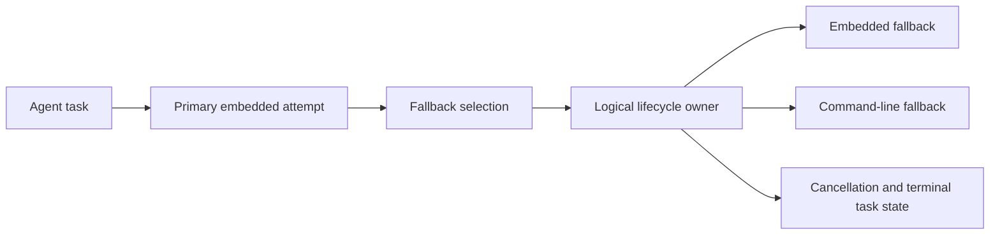

Codex review: needs changes before merge. _Reviewed August 28, 2026, 8:28 AM ET / 12:28 UTC._

# ClawSweeper review

## What this changes

The PR retains cancellation and terminal-lifecycle ownership across embedded and command-line fallback attempts so a primary-model failure cannot strand a running task.

## Regression provenance

Possible regression — probable (reviewed change; failure trace). No predecessor PR is attributed.

## Merge readiness

⛔ **Blocked by patch quality or review findings - 7 items remain**

Keep open: the prior restart-abort leak is fixed, but this head reintroduces a plugin-boundary hole for the new host-only lifecycle callbacks.

Likely related people: obviyus (high, current lifecycle implementation); Patrick Erichsen (medium, surrounding execution wrapper).

**Priority:** P1
**Reviewed head:** `5c8e32f94e1ca3a1e73a1b01ee004a84abddae7e`

## Review scores

| Measure | Result | What it means |
|---|---|---|
| **Overall readiness** | 🧂 unranked krab **(1/6)** | PR readiness rating was derived from proof quality, review findings, security review, and reviewer confidence. |
| **Proof confidence** | 🦞 diamond lobster **(5/6)** | Sufficient (terminal): ClawSweeper live verification passed on the reviewed terminal surface. |
| **Patch quality** | 🧂 unranked krab **(1/6)** | Security review found an item that needs attention. |

## Verification

| Check | Result | Evidence |
|---|---|---|
| **Real behavior** | Verified | Sufficient (terminal): ClawSweeper live verification passed on the reviewed terminal surface. |
| **Evidence reviewed** | 6 items | Introduced host-only callbacks: This PR adds lifecycle-owner and lifecycle-abort callbacks to internal embedded-run parameters and forwards them into every attempt.<br>Plugin boundary does not remove the new callbacks: The public plugin adapter rejects two existing host-authority fields but spreads all remaining plugin parameters into the core runner; the public parameter type includes deferTerminalLifecycle, so JavaScript plugins can attach the newly introduced callbacks.<br>Callbacks reach active-run ownership: After the queue handle is registered, the attempt constructs and supplies the deferred owner; the added dispatch lines forward plugin-supplied callback values to this point. |
| **Findings** | 1 actionable finding | [P1] Reject lifecycle callbacks from plugin-run parameters |
| **Security** | Needs attention | Plugin callers can forge host-only lifecycle callbacks: The plugin adapter forwards arbitrary request properties to the core runner, and the new callbacks are later invoked with active-run lifecycle ownership. |


### Live Verification

**Command:** `node scripts/run-vitest.mjs src/plugins/runtime/runtime-embedded-agent.runtime.test.ts`

**Result:** PASS (completed)

```text
[test] starting test/vitest/vitest.plugins.config.ts

 RUN  v4.1.11 /tmp/clawsweeper-live-proof-126566-Z0Tjbp/target

 ✓  plugins  src/plugins/runtime/runtime-embedded-agent.runtime.test.ts › plugin embedded-agent runtime admission › binds plugin facts and closes the exact prep
ared admission after success 94ms
 ✓  plugins  src/plugins/runtime/runtime-embedded-agent.runtime.test.ts › plugin embedded-agent runtime admission › closes the prepared admission when core exec
ution throws 1ms
 ✓  plugins  src/plugins/runtime/runtime-embedded-agent.runtime.test.ts › plugin embedded-agent runtime admission › records exact admission and attribution-only
 completion without plugin identifiers 2ms
 ✓  plugins  src/plugins/runtime/runtime-embedded-agent.runtime.test.ts › plugin embedded-agent runtime admission › revokes admission immediately when a pending
 plugin run aborts 1ms
 ✓  plugins  src/plugins/runtime/runtime-embedded-agent.runtime.test.ts › plugin embedded-agent runtime admission › closes admission when abort races with liste
ner registration 1ms
 ✓  plugins  src/plugins/runtime/runtime-embedded-agent.runtime.test.ts › plugin embedded-agent runtime admission › does not create admission for an already-abo
rted plugin run 0ms
 ✓  plugins  src/plugins/runtime/runtime-embedded-agent.runtime.test.ts › plugin embedded-agent runtime admission › fails closed outside a plugin scope 1ms
 ✓  plugins  src/plugins/runtime/runtime-embedded-agent.runtime.test.ts › plugin embedded-agent runtime admission › rejects a plugin-supplied admittedRunContext
 1ms
 ✓  plugins  src/plugins/runtime/runtime-embedded-agent.runtime.test.ts › plugin embedded-agent runtime admission › rejects a plugin-supplied preparedRunAdmissi
on 0ms

 Test Files  1 passed (1)
      Tests  9 passed (9)
   Start at  12:29:59
   Duration  1.24s (transform 985ms, setup 834ms, import 25ms, tests 104ms, environment 0ms)

[test] passed 1 Vitest shard in 6.44s


```

**Assertions:**

- PASS `expect_output`: plugin embedded-agent runtime admission

## How this fits together

The agent runner can retry a logical turn in an embedded model runtime or a command-line runtime. Its lifecycle owner supplies cancellation, active-run registration, trajectory terminal events, and final task cleanup.



## Before merge

- [ ] **Reject lifecycle callbacks from plugin-run parameters (P1)** - The new callbacks are marked host-only, but the public plugin adapter only rejects `admittedRunContext` and `preparedRunAdmission` before spreading the entire request into core. Since `deferTerminalLifecycle` is public, a JavaScript plugin can add these fields and receive the owner after active-run registration, allowing it to control cleanup or cancellation for its run. Strip or reject both fields in the adapter and cover the forged request; this is a late discovery only in the sense that the prior reviewed object is unavailable locally, so it is not marked late.
- [ ] **Resolve security concern: Plugin callers can forge host-only lifecycle callbacks** - The plugin adapter forwards arbitrary request properties to the core runner, and the new callbacks are later invoked with active-run lifecycle ownership.
- [ ] **Resolve merge risk (P1)** - A plugin can attach the new JavaScript-only callbacks to the public embedded-run request, receive control over its active lifecycle owner, and alter cancellation or terminal cleanup despite the adapter’s stated host-authority boundary.
- [ ] **Resolve merge risk (P1)** - The bug-fix branch has net production growth of 231 lines; the ownership abstraction is justified only if its private boundary is enforced.
- [ ] **Complete next step (P2)** - The blocking plugin-boundary repair is narrow, mechanical, and independently testable on this PR branch.
- [ ] **Improve patch quality** - Resolve the security review concern or explain why the changed path is safe.
- [ ] **Improve patch quality** - Address the highest-priority review finding and re-run the changed-surface validation.

## Findings

- [P1] Reject lifecycle callbacks from plugin-run parameters — `src/agents/embedded-agent-runner/run/run-attempt-dispatch.ts:467-468`
- [high] Plugin callers can forge host-only lifecycle callbacks — `src/agents/embedded-agent-runner/run/run-attempt-dispatch.ts:467`


<details>
<summary><strong>Agent review details</strong></summary>

### Security

Needs attention: The diff adds host-only lifecycle authority without preserving the existing plugin-runtime boundary.

### PR surface

Source +233, Tests +175. Total +408 across 26 files.

<details>
<summary>View PR surface stats</summary>

| Area | Files | Added | Removed | Net |
|---|---:|---:|---:|---:|
| Source | 22 | 343 | 110 | +233 |
| Tests | 4 | 180 | 5 | +175 |
| Docs | 0 | 0 | 0 | 0 |
| Config | 0 | 0 | 0 | 0 |
| Generated | 0 | 0 | 0 | 0 |
| Other | 0 | 0 | 0 | 0 |
| **Total** | **26** | **523** | **115** | **+408** |

</details>

### Review metrics

| Metric | Value | Why it matters |
|---|---|---|
| **Production versus test LOC** | production +341/-110; tests and test support +182/-5 | The substantial ownership refactor needs the missing plugin-boundary guard to justify its net production growth. |

### Root-cause cluster

Relationship: `fixed_by_candidate`
Canonical: https://github.com/openclaw/openclaw/issues/126311
Summary: This PR is the linked candidate repair for the fallback run that remains active after its primary attempt reaches a terminal failure.

Members:
- `canonical`: https://github.com/openclaw/openclaw/issues/126311 - The PR body explicitly closes it and both describe unowned fallback execution, failed cancellation, and a stranded task state.

Proposal only: this assessment does not dispatch repair, suppress jobs, mutate sibling items, close, or merge anything.

### Merge-risk options

**Maintainer options:**
1. **Enforce the plugin boundary (recommended)**  
   Remove or reject the two lifecycle callbacks before the public plugin adapter invokes the core runner, and add a forged-parameter regression test.
2. **Pause the lifecycle refactor**  
   Do not merge the new retained-owner flow unless plugin callers remain unable to receive or invoke host-only lifecycle ownership.

### Technical review

Best possible solution:

Keep the lifecycle manager private to core callers by stripping or rejecting both callbacks at the plugin adapter, then prove a forged plugin request cannot observe or control the owner while the fallback regressions remain green.

Do we have a high-confidence way to reproduce the issue?

Yes, by source: a plugin can call the public runtime with deferTerminalLifecycle and extra callback properties, which the adapter spreads into the core runner and the new attempt code invokes after active-run registration.

Is this the best way to solve the issue?

No: the shared logical lifecycle owner is the right repair shape, but forwarding its host-only callbacks through the public plugin adapter violates the intended ownership boundary.

Full review comments:

- [P1] Reject lifecycle callbacks from plugin-run parameters — `src/agents/embedded-agent-runner/run/run-attempt-dispatch.ts:467-468`
  The new callbacks are marked host-only, but the public plugin adapter only rejects `admittedRunContext` and `preparedRunAdmission` before spreading the entire request into core. Since `deferTerminalLifecycle` is public, a JavaScript plugin can add these fields and receive the owner after active-run registration, allowing it to control cleanup or cancellation for its run. Strip or reject both fields in the adapter and cover the forged request; this is a late discovery only in the sense that the prior reviewed object is unavailable locally, so it is not marked late.
  Confidence: 0.97

Overall correctness: patch is incorrect
Overall confidence: 0.97

AGENTS.md: found and applied where relevant.

Codex review notes: model internal, reasoning high; reviewed against [ccbbaf2e2e57](https://github.com/openclaw/openclaw/commit/ccbbaf2e2e57f53b3a2b086b3490d21fe40a7c9d).

### Labels

Label changes:

- add `merge-risk: 🚨 security-boundary`: New host-only callbacks are forwarded from the plugin-facing runtime without being stripped or rejected.

Label justifications:

- `P1`: The patch addresses a real fallback-task cancellation and terminal-state failure, but its new boundary defect blocks a safe merge.
- `merge-risk: 🚨 security-boundary`: New host-only callbacks are forwarded from the plugin-facing runtime without being stripped or rejected.
- `merge-risk: 🚨 session-state`: The lifecycle owner controls active-run registration and terminal trajectory ownership across fallback attempts.
- `merge-risk: 🚨 availability`: Incorrect lifecycle-owner control can strand or prematurely release a running fallback task.
- `rating: 🧂 unranked krab`: Overall readiness is 🧂 unranked krab; proof is 🦞 diamond lobster and patch quality is 🧂 unranked krab.
- `status: ⏳ waiting on author`: ClawSweeper has contributor-facing work open and is waiting for author action. Sufficient (terminal): ClawSweeper live verification passed on the reviewed terminal surface.
- `proof: sufficient`: Contributor real behavior proof is sufficient. ClawSweeper live verification passed on the reviewed terminal surface.

### Evidence

Security concerns:

- [high] Plugin callers can forge host-only lifecycle callbacks — `src/agents/embedded-agent-runner/run/run-attempt-dispatch.ts:467`
  The plugin adapter forwards arbitrary request properties to the core runner, and the new callbacks are later invoked with active-run lifecycle ownership.
  Confidence: 0.97

Acceptance criteria:

- [P1] node scripts/run-vitest.mjs src/plugins/runtime/runtime-embedded-agent.runtime.test.ts.
- [P1] node scripts/run-vitest.mjs src/auto-reply/reply/agent-runner-execution-lifecycle.test.ts.
- [P1] node scripts/run-vitest.mjs src/agents/embedded-agent-runner/run/deferred-lifecycle-owner.test.ts.

What I checked:

- **Introduced host-only callbacks:** This PR adds lifecycle-owner and lifecycle-abort callbacks to internal embedded-run parameters and forwards them into every attempt. ([`src/agents/embedded-agent-runner/run/internal-params.ts:21`](https://github.com/openclaw/openclaw/blob/5c8e32f94e1c/src/agents/embedded-agent-runner/run/internal-params.ts#L21), [5c8e32f94e1c](https://github.com/openclaw/openclaw/commit/5c8e32f94e1c))
- **Plugin boundary does not remove the new callbacks:** The public plugin adapter rejects two existing host-authority fields but spreads all remaining plugin parameters into the core runner; the public parameter type includes deferTerminalLifecycle, so JavaScript plugins can attach the newly introduced callbacks. ([`src/plugins/runtime/runtime-embedded-agent.runtime.ts:22`](https://github.com/openclaw/openclaw/blob/5c8e32f94e1c/src/plugins/runtime/runtime-embedded-agent.runtime.ts#L22), [5c8e32f94e1c](https://github.com/openclaw/openclaw/commit/5c8e32f94e1c))
- **Callbacks reach active-run ownership:** After the queue handle is registered, the attempt constructs and supplies the deferred owner; the added dispatch lines forward plugin-supplied callback values to this point. ([`src/agents/embedded-agent-runner/run/attempt-stream-prepare.ts:534`](https://github.com/openclaw/openclaw/blob/5c8e32f94e1c/src/agents/embedded-agent-runner/run/attempt-stream-prepare.ts#L534), [5c8e32f94e1c](https://github.com/openclaw/openclaw/commit/5c8e32f94e1c))
- **Previous restart finding addressed:** The logical-turn finally now completes the deferred manager, and the new regression confirms a restart abort releases the active handle. ([`src/auto-reply/reply/agent-runner-execution.ts:567`](https://github.com/openclaw/openclaw/blob/5c8e32f94e1c/src/auto-reply/reply/agent-runner-execution.ts#L567), [5c8e32f94e1c](https://github.com/openclaw/openclaw/commit/5c8e32f94e1c))
- **No main supersession established:** The lifecycle manager is introduced on this PR head; available local history did not establish a merged replacement. Deeper current-main object reads were limited by unavailable promisor objects and DNS, so this is not a claim that main categorically lacks equivalent work. ([`src/agents/embedded-agent-runner/run/deferred-lifecycle-owner.ts:26`](https://github.com/openclaw/openclaw/blob/5c8e32f94e1c/src/agents/embedded-agent-runner/run/deferred-lifecycle-owner.ts#L26), [5c8e32f94e1c](https://github.com/openclaw/openclaw/commit/5c8e32f94e1c))
- **After-fix behavior proof:** The PR body identifies this exact head and documents a production-Gateway red/green run covering embedded fallback, command-line fallback, in-flight cancellation, terminal task state, and a redacted linked artifact. ([5c8e32f94e1c](https://github.com/openclaw/openclaw/commit/5c8e32f94e1c))

Likely related people:

- **obviyus:** Blame attributes the new lifecycle manager and logical-turn completion integration to the PR head. (role: current lifecycle implementation author; confidence: high; commits: [5c8e32f94e1c](https://github.com/openclaw/openclaw/commit/5c8e32f94e1ca3a1e73a1b01ee004a84abddae7e); files: `src/agents/embedded-agent-runner/run/deferred-lifecycle-owner.ts`, `src/auto-reply/reply/agent-runner-execution.ts`)
- **Patrick Erichsen:** Recent history and blame connect this contributor to the surrounding agent-turn execution wrapper that now owns final completion. (role: recent area contributor; confidence: medium; commits: [7b7858d9552f](https://github.com/openclaw/openclaw/commit/7b7858d9552fcfb1e4d1cff80ad214f4ae79313c); files: `src/auto-reply/reply/agent-runner-execution.ts`)

### Rating scale

| Score | Internal tier | Crab rank | Meaning |
|---:|:---:|---|---|
| **6/6** | S | 🦀 challenger crab | Exceptional readiness |
| **5/6** | A | 🦞 diamond lobster | Very strong readiness |
| **4/6** | B | 🐚 platinum hermit | Good normal PR; ordinary maintainer review |
| **3/6** | C | 🦐 gold shrimp | Useful, but confidence is limited |
| **2/6** | D | 🦪 silver shellfish | Proof or implementation needs work |
| **1/6** | F | 🧂 unranked krab | Not merge-ready |
| N/A | NA | 🌊 off-meta tidepool | Rating does not apply |

Overall follows the weaker of proof and patch quality.
Shiny media proof means a screenshot, video, or linked artifact directly shows the changed behavior. Runtime, network, CSP, and security claims still need visible diagnostics.

### Workflow

- ClawSweeper keeps one durable marker-backed review comment per issue or PR.
- Re-runs edit this comment so the latest verdict, findings, and automation markers stay together instead of adding duplicate bot comments.
- A fresh review can be triggered by eligible `@clawsweeper re-review` comments, exact-item GitHub events, scheduled/background review runs, or manual workflow dispatch.
- PR/issue authors and users with repository write access can comment `@clawsweeper re-review` or `@clawsweeper re-run` on an open PR or issue to request a fresh review only.
- Maintainers can also comment `@clawsweeper review` to request a fresh review only.
- Fresh-review commands do not start repair, autofix, rebase, CI repair, or automerge.
- Maintainer-only repair and merge flows require explicit commands such as `@clawsweeper autofix`, `@clawsweeper automerge`, `@clawsweeper fix ci`, or `@clawsweeper address review`.
- Maintainers can comment `@clawsweeper explain` to ask for more context, or `@clawsweeper stop` to stop active automation.

### History

<details>
<summary>Review history (20 earlier review cycles; latest 8 shown)</summary>

<!-- clawsweeper-review-history v=1 total=20 -->
- reviewed 2026-08-20T14:16:02.311Z sha 120c81a2368f07c6cdbbf818f5e44c281c95237e :: needs maintainer review before merge. :: none
- reviewed 2026-08-20T15:18:40.747Z sha b2235a570f4d5e251d041cb193669b48d8eaace8 :: needs maintainer review before merge. :: none
- reviewed 2026-08-20T15:46:06.434Z sha 3e52427ebfd8c44c40fa6e9a78ba7b3e2161382a :: needs maintainer review before merge. :: none
- reviewed 2026-08-20T16:01:32.652Z sha 3e52427ebfd8c44c40fa6e9a78ba7b3e2161382a :: needs maintainer review before merge. :: none
- reviewed 2026-08-23T22:16:30.989Z sha 3e52427ebfd8c44c40fa6e9a78ba7b3e2161382a :: needs maintainer review before merge. :: none
- reviewed 2026-08-23T22:59:21.189Z sha 3e52427ebfd8c44c40fa6e9a78ba7b3e2161382a :: needs maintainer review before merge. :: none
- reviewed 2026-08-27T08:29:44.273Z sha 3e52427ebfd8c44c40fa6e9a78ba7b3e2161382a :: needs maintainer review before merge. :: none
- reviewed 2026-08-28T11:11:12.764Z sha 870787d114985161cfb44ec07e490c0677731c2a :: needs changes before merge. :: [P1] Release the deferred owner when fallback execution aborts

</details>

</details>

<!-- clawsweeper-security:security-sensitive item=126566 sha=5c8e32f94e1ca3a1e73a1b01ee004a84abddae7e confidence=high updated_at=2026-08-28T12:24:14Z reviewed_at=2026-08-28T12:28:55.281Z lease_owner=github-run-33170846273-1 lease_comment_id=5452468901 source_revision=e3fd259b12be116fd1beaaf293ad9935363db9c67fdea771a8a8b17af03bb1d4 live_verification=passed -->
<!-- clawsweeper-verdict:needs-human item=126566 sha=5c8e32f94e1ca3a1e73a1b01ee004a84abddae7e confidence=high updated_at=2026-08-28T12:24:14Z reviewed_at=2026-08-28T12:28:55.281Z lease_owner=github-run-33170846273-1 lease_comment_id=5452468901 source_revision=e3fd259b12be116fd1beaaf293ad9935363db9c67fdea771a8a8b17af03bb1d4 live_verification=passed -->

<!-- clawsweeper-review-version item=126566 reviewed_at=2026-08-28T12:28:55.281Z sha=5c8e32f94e1ca3a1e73a1b01ee004a84abddae7e source_revision=e3fd259b12be116fd1beaaf293ad9935363db9c67fdea771a8a8b17af03bb1d4 lease_owner=github-run-33170846273-1 lease_comment_id=5452468901 v=1 -->

<!-- clawsweeper-review item=126566 -->