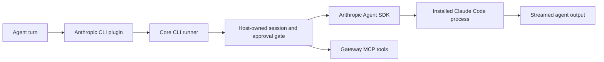

Codex review: needs maintainer review before merge. _Reviewed August 24, 2026, 4:33 AM ET / 08:33 UTC._

# ClawSweeper review

## What this changes

Replaces the Anthropic plugin’s handwritten warm Claude CLI session transport with Anthropic’s Agent SDK and a generic host-owned reusable-session interface.

## Merge readiness

⚠️ **Ready for maintainer review - 4 items remain**

Keep open for maintainer review: this replaces a security- and availability-sensitive Claude execution path and adds a public CLI-plugin transport; no concrete code defect was found, but the pinned SDK contract could not be directly audited and two current check lanes are failing.

**Priority:** P2
**Reviewed head:** `283b66f4d779ccfa4b976e2ed3835974e258f161`

## Review scores

| Measure | Result | What it means |
|---|---|---|
| **Overall readiness** | 🐚 platinum hermit **(4/6)** | The patch has substantial owner-boundary coverage and detailed runtime evidence, with dependency-contract and exact-head CI verification still material before merge. |
| **Proof confidence** | 🌊 off-meta tidepool | Not applicable: Maintainer-authored PRs are exempt from the contributor proof gate; the PR body nevertheless documents extensive redacted after-fix subprocess and hosted-API runs. |
| **Patch quality** | 🐚 platinum hermit **(4/6)** | Security review found an item that needs attention. |

## Verification

| Check | Result | Evidence |
|---|---|---|
| **Real behavior** | Not applicable | Not applicable: Maintainer-authored PRs are exempt from the contributor proof gate; the PR body nevertheless documents extensive redacted after-fix subprocess and hosted-API runs. |
| **Evidence reviewed** | 7 items | Changed execution boundary: The Anthropic runtime directly imports and invokes the Agent SDK, including its custom subprocess path; this establishes the dependency-specific review gate. Host authority enforcement: The core executor revalidates admitted-run authority before and after awaited native-tool approval, then fences retained callbacks before iterator cleanup. Live-session ownership: The generic registry binds a session to its exact owner, fingerprint, generation, and capture grant before activation, with focused tests for rejection and cleanup cases. |
| **Findings** | None | None. |
| **Security** | Needs attention | Audit the pinned SDK’s subprocess and hook contract: The patch delegates Claude process startup, permission callbacks, and query lifecycle to a newly added runtime dependency, whose installed 0.3.219 source/types were unavailable for direct review. |

## How this fits together

Local Claude CLI agent turns are prepared by the Anthropic plugin, executed through the core CLI runner, and returned as normalized agent output. This change moves Claude subprocess/session handling into the official SDK while core retains admission, tool approval, MCP capture, and cleanup ownership.

## Before merge

- [ ] **Resolve security concern: Audit the pinned SDK’s subprocess and hook contract** - The patch delegates Claude process startup, permission callbacks, and query lifecycle to a newly added runtime dependency, whose installed 0.3.219 source/types were unavailable for direct review.
- [ ] **Resolve merge risk (P1)** - The new pinned SDK owns child-process protocol behavior and custom spawn callbacks, but its exact source/types were unavailable for direct contract review.
- [ ] **Resolve merge risk (P1)** - Existing Claude CLI users can encounter changed session, approval, credential-forwarding, or process-lifecycle behavior on upgrade; exact-head CI still includes two failed check lanes whose logs were unavailable here.
- [ ] **Complete next step (P2)** - Protected maintainer work needs a human dependency-contract and exact-head CI review before merge.

## Findings

- [medium] Audit the pinned SDK’s subprocess and hook contract — `extensions/anthropic/agent-sdk.runtime.ts:4`

<strong>Agent review details</strong>

### Security

Needs attention: The new SDK-backed custom spawn and permission path needs an exact-version dependency audit before merge.

### Review metrics

| Metric | Value | Why it matters |
|---|---|---|
| **Production and test delta** | production −1,186; tests/support −4,245 (reported in PR body) | The large refactor is presented as a net deletion, so review should focus on retained ownership invariants rather than raw size. |
| **Plugin SDK contract** | 7 types added, 1 legacy requirement type removed | The public CLI-backend seam now supports plugin-owned execution and reusable-session lifecycle capabilities. |

### Stored data model

Persistent data-model change detected: `migration/backfill/repair: src/commands/doctor-claude-cli.test.ts`, `migration/backfill/repair: src/commands/doctor-claude-cli.ts`, `serialized state: scripts/lib/bundled-plugin-build-entries.mjs`, `serialized state: scripts/lib/docker-plugin-selection.mjs`, `serialized state: scripts/lib/root-package-bundled-plugin-excludes.mjs`, `serialized state: src/agents/cli-runner.helpers.test.ts`, and 12 more. Confirm migration or upgrade compatibility proof before merge.

### Merge-risk options

**Maintainer options:**
1. **Complete SDK and upgrade verification (recommended)**  
   Inspect the exact pinned SDK’s query, hook, and custom-spawn contract, then resolve the failing exact-head checks before merging this execution-path replacement.

### Technical review

Best possible solution:

Complete a direct audit of the resolved Agent SDK version and land only after exact-head validation demonstrates safe upgrade behavior for existing Claude CLI sessions.

Do we have a high-confidence way to reproduce the issue?

Not applicable: this is a runtime refactor rather than a report of a separately reproducible user defect; the PR body supplies post-change runtime evidence.

Is this the best way to solve the issue?

Unclear: the generic host-owned seam is coherent, but direct inspection of the exact Agent SDK contract is still required before calling this the best implementation.

AGENTS.md: found and applied where relevant.

Codex review notes: model internal, reasoning high; reviewed against [3e5b935edf3f](https://github.com/openclaw/openclaw/commit/3e5b935edf3f5e4b0d3a2f840891ffbb5657bd7b).

### Labels

Label changes:

- add `rating: 🐚 platinum hermit`: Overall readiness is 🐚 platinum hermit; proof is 🌊 off-meta tidepool and patch quality is 🐚 platinum hermit.
- remove `rating: 🦐 gold shrimp`: Current PR rating is `rating: 🐚 platinum hermit`, so this older rating label is no longer current.

Label justifications:

- `P2`: This is a broad but actively maintained provider-runtime refactor with meaningful, bounded user impact.
- `merge-risk: 🚨 compatibility`: It changes how existing Claude CLI sessions, credentials, and resume behavior execute after upgrade.
- `merge-risk: 🚨 security-boundary`: A new SDK custom-spawn and permission-hook path handles credentials and native tool authorization.
- `merge-risk: 🚨 availability`: The change replaces warm subprocess lifecycle, cancellation, and process-tree cleanup for local Claude turns.
- `rating: 🐚 platinum hermit`: Overall readiness is 🐚 platinum hermit; proof is 🌊 off-meta tidepool and patch quality is 🐚 platinum hermit.
- `status: ⏳ waiting on author`: ClawSweeper has contributor-facing work open and is waiting for author action. Not applicable: Maintainer-authored PRs are exempt from the contributor proof gate; the PR body nevertheless documents extensive redacted after-fix subprocess and hosted-API runs.

### Evidence

Security concerns:

- [medium] Audit the pinned SDK’s subprocess and hook contract — `extensions/anthropic/agent-sdk.runtime.ts:4`
  The patch delegates Claude process startup, permission callbacks, and query lifecycle to a newly added runtime dependency, whose installed 0.3.219 source/types were unavailable for direct review.
  Confidence: 0.86

What I checked:

- **Changed execution boundary:** The Anthropic runtime directly imports and invokes the Agent SDK, including its custom subprocess path; this establishes the dependency-specific review gate. ([`extensions/anthropic/agent-sdk.runtime.ts:4`](https://github.com/openclaw/openclaw/blob/283b66f4d779/extensions/anthropic/agent-sdk.runtime.ts#L4), [283b66f4d779](https://github.com/openclaw/openclaw/commit/283b66f4d779))
- **Host authority enforcement:** The core executor revalidates admitted-run authority before and after awaited native-tool approval, then fences retained callbacks before iterator cleanup. ([`src/agents/cli-runner/execute-plugin.ts:51`](https://github.com/openclaw/openclaw/blob/283b66f4d779/src/agents/cli-runner/execute-plugin.ts#L51), [283b66f4d779](https://github.com/openclaw/openclaw/commit/283b66f4d779))
- **Live-session ownership:** The generic registry binds a session to its exact owner, fingerprint, generation, and capture grant before activation, with focused tests for rejection and cleanup cases. ([`src/agents/cli-runner/cli-live-session-registry.ts:161`](https://github.com/openclaw/openclaw/blob/283b66f4d779/src/agents/cli-runner/cli-live-session-registry.ts#L161), [283b66f4d779](https://github.com/openclaw/openclaw/commit/283b66f4d779))
- **Dependency ownership and coverage:** The SDK is declared as an Anthropic-plugin runtime dependency and included in the generic package-manifest contract. ([`extensions/anthropic/package.json:7`](https://github.com/openclaw/openclaw/blob/283b66f4d779/extensions/anthropic/package.json#L7), [283b66f4d779](https://github.com/openclaw/openclaw/commit/283b66f4d779))
- **Current-main comparison:** Current main does not contain either the new Agent SDK runtime or generic live-session registry, so this remains active work rather than an implemented-on-main candidate. ([`extensions/anthropic/agent-sdk.runtime.ts:1`](https://github.com/openclaw/openclaw/blob/3e5b935edf3f/extensions/anthropic/agent-sdk.runtime.ts#L1), [3e5b935edf3f](https://github.com/openclaw/openclaw/commit/3e5b935edf3f))
- **Feature provenance:** History identifies the prior warm-session implementation in commit 1b9d3ac57d135e11c7d70ee2979590025f3b5ace; the reviewed implementation is attributed by blame to the current PR head. ([`extensions/anthropic/cli-backend.ts:238`](https://github.com/openclaw/openclaw/blob/1b9d3ac57d13/extensions/anthropic/cli-backend.ts#L238), [1b9d3ac57d13](https://github.com/openclaw/openclaw/commit/1b9d3ac57d13))

Likely related people:

- **steipete:** Current reviewed runtime and generic session-owner lines blame to this PR head; recent history also shows continued Claude CLI maintenance. (role: current refactor author and recent area contributor; confidence: high; commits: [283b66f4d779](https://github.com/openclaw/openclaw/commit/283b66f4d779ccfa4b976e2ed3835974e258f161), [2e606d96e1e7](https://github.com/openclaw/openclaw/commit/2e606d96e1e7544c11c1f50b0ad83ebbd0730dda); files: `extensions/anthropic/agent-sdk.runtime.ts`, `src/agents/cli-runner/cli-live-session-registry.ts`)
- **VACInc:** Commit 1b9d3ac57d135e11c7d70ee2979590025f3b5ace introduced the preceding Claude live-session architecture that this change replaces. (role: prior warm-session feature contributor; confidence: medium; commits: [1b9d3ac57d13](https://github.com/openclaw/openclaw/commit/1b9d3ac57d135e11c7d70ee2979590025f3b5ace), [7f93011562db](https://github.com/openclaw/openclaw/commit/7f93011562dbddd6c864c52fcdd75c7006261ab8); files: `extensions/anthropic/cli-backend.ts`, `src/agents/cli-runner`)
- **joshavant:** Commit d636f5f8e0988db2be8e97ee627ba93053f4d970 maintained the prior Claude live-session protocol gate adjacent to the replaced path. (role: adjacent protocol-gate contributor; confidence: medium; commits: [d636f5f8e098](https://github.com/openclaw/openclaw/commit/d636f5f8e0988db2be8e97ee627ba93053f4d970); files: `src/agents/cli-runner`)

### Rank-up moves

Optional improvements that raise the rating; they are not merge blockers.

- Inspect the resolved 0.3.219 SDK source/types for its query, hook, and custom-spawn contract.
- Resolve the two failed exact-head check lanes and refresh the review against their output.

### Rating scale

| Score | Internal tier | Crab rank | Meaning |
|---:|:---:|---|---|
| **6/6** | S | 🦀 challenger crab | Exceptional readiness |
| **5/6** | A | 🦞 diamond lobster | Very strong readiness |
| **4/6** | B | 🐚 platinum hermit | Good normal PR; ordinary maintainer review |
| **3/6** | C | 🦐 gold shrimp | Useful, but confidence is limited |
| **2/6** | D | 🦪 silver shellfish | Proof or implementation needs work |
| **1/6** | F | 🧂 unranked krab | Not merge-ready |
| N/A | NA | 🌊 off-meta tidepool | Rating does not apply |

Overall follows the weaker of proof and patch quality.
Shiny media proof means a screenshot, video, or linked artifact directly shows the changed behavior. Runtime, network, CSP, and security claims still need visible diagnostics.

### Workflow

- ClawSweeper keeps one durable marker-backed review comment per issue or PR.
- Re-runs edit this comment so the latest verdict, findings, and automation markers stay together instead of adding duplicate bot comments.
- A fresh review can be triggered by eligible `@clawsweeper re-review` comments, exact-item GitHub events, scheduled/background review runs, or manual workflow dispatch.
- PR/issue authors and users with repository write access can comment `@clawsweeper re-review` or `@clawsweeper re-run` on an open PR or issue to request a fresh review only.
- Maintainers can also comment `@clawsweeper review` to request a fresh review only.
- Fresh-review commands do not start repair, autofix, rebase, CI repair, or automerge.
- Maintainer-only repair and merge flows require explicit commands such as `@clawsweeper autofix`, `@clawsweeper automerge`, `@clawsweeper fix ci`, or `@clawsweeper address review`.
- Maintainers can comment `@clawsweeper explain` to ask for more context, or `@clawsweeper stop` to stop active automation.

### History

Review history (6 earlier review cycles)

<!-- clawsweeper-review-history v=1 total=6 -->
- reviewed 2026-08-23T06:21:40.342Z sha 48f9e0bbf195320fd559f515cfd45763ea507b99 :: needs real behavior proof before merge. :: [P1] Keep SDK subprocesses under managed lifecycle ownership | [P3] Remove the release-owned changelog entry
- reviewed 2026-08-23T23:55:59.190Z sha fe842dadefc290086f29b00b173908bc08dbb4b9 :: needs real behavior proof before merge. :: [P1] Keep the SDK child under managed lifecycle ownership | [P1] Avoid bundling every Agent SDK platform binary | [P2] Qualify the SDK-native tool documentation | [P3] Remove the release-owned changelog entry
- reviewed 2026-08-24T01:15:25.191Z sha 63fbaa39115bfeddab1bbe54369e86bbaa66964c :: needs real behavior proof before merge. :: [P1] Keep the SDK child under managed lifecycle ownership | [P1] Prevent all-platform Agent SDK binaries from reaching plugin installs | [P2] Qualify the SDK-native tool documentation | [P3] Remove the release-owned changelog entry
- reviewed 2026-08-24T01:41:53.974Z sha b432b667cd5ac6923012866e274d8252d683af03 :: needs real behavior proof before merge. :: [P1] Bundle only the host’s Agent SDK binary | [P1] Keep the SDK child under managed lifecycle ownership | [P1] Bind native-tool approval to the originating turn | [P2] Document the Agent SDK eligibility gate | [P3] Remove the release-owned changelog entry
- reviewed 2026-08-24T04:16:57.559Z sha b4eaed24ef8c57e4160f1b7003f551f941a082ef :: needs real behavior proof before merge. :: [P1] Preserve host approval for native-tool turns | [P1] Do not package foreign Agent SDK binaries | [P2] Document the SDK fallback eligibility
- reviewed 2026-08-24T07:26:52.967Z sha 4508a0189aeb835dd11f8ed7084bac5b9bc0b506 :: found issues before merge. :: [P3] Remove the release-owned changelog entry

<!-- clawsweeper-security:security-sensitive item=128131 sha=283b66f4d779ccfa4b976e2ed3835974e258f161 confidence=medium updated_at=2026-08-24T08:29:40Z reviewed_at=2026-08-24T08:33:45.206Z lease_owner=github-run-32706408734-1 lease_comment_id=5392632951 source_revision=2dd16554d0e9deaa2bb97f1d5d3989836f4b0161b5896d720a54687d1fa414ad -->
<!-- clawsweeper-verdict:needs-human item=128131 sha=283b66f4d779ccfa4b976e2ed3835974e258f161 confidence=medium updated_at=2026-08-24T08:29:40Z reviewed_at=2026-08-24T08:33:45.206Z lease_owner=github-run-32706408734-1 lease_comment_id=5392632951 source_revision=2dd16554d0e9deaa2bb97f1d5d3989836f4b0161b5896d720a54687d1fa414ad -->

<!-- clawsweeper-review-version item=128131 reviewed_at=2026-08-24T08:33:45.206Z sha=283b66f4d779ccfa4b976e2ed3835974e258f161 source_revision=2dd16554d0e9deaa2bb97f1d5d3989836f4b0161b5896d720a54687d1fa414ad lease_owner=github-run-32706408734-1 lease_comment_id=5392632951 v=1 -->

<!-- clawsweeper-review item=128131 -->