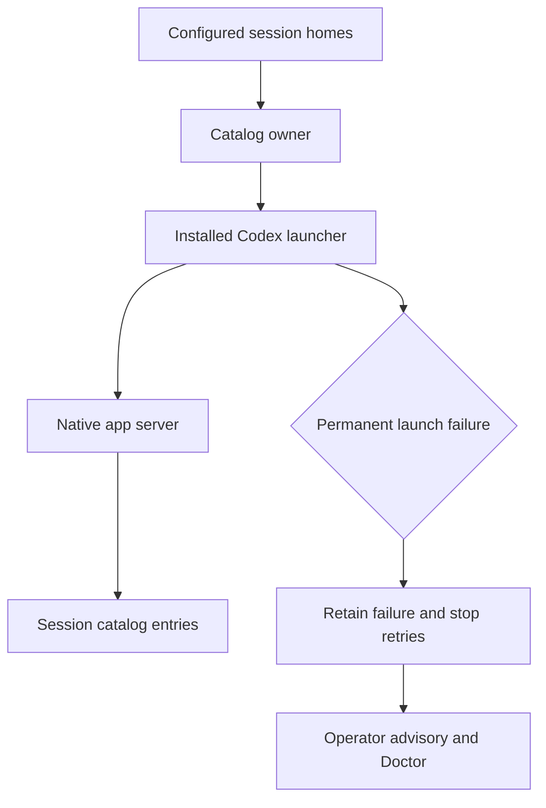

Codex review: blocked before merge. _Reviewed September 21, 2026, 8:57 AM ET / 12:57 UTC (Revision 3)._

# ClawSweeper review

## What this changes

The Codex plugin uses its installed package for background session discovery, stops retrying permanent launch failures, and adds diagnostics and recovery guidance.

## Merge readiness

⛔ **Blocked before merge - 3 items remain**

This remains a useful, distinct fix absent from current main. No discrete introduced correctness or security defect was established.

**Priority:** P2
**Reviewed head:** `281e565f9a6a24cda18ecd3097400ee17d5c4214`

## Review scores

| Measure | Result | What it means |
|---|---|---|
| **Overall readiness** | 🐚 platinum hermit **(4/6)** | A focused owner-level repair with meaningful subprocess evidence and no identified code defect, pending upgrade validation. |
| **Proof confidence** | 🐚 platinum hermit **(4/6)** ✨ media proof bonus | Sufficient (linked_artifact): Recorded Testbox evidence exercises the production stdio/client path with real ENOENT and official-launcher EACCES failures, observes retained failures without another spawn, and verifies native configuration reads without Node on PATH. EBADARCH is injected; macOS upgrade continuity remains a separate compatibility gap. |
| **Patch quality** | 🐚 platinum hermit **(4/6)** | No actionable review findings were identified. |

## Verification

| Check | Result | Evidence |
|---|---|---|
| **Real behavior** | Verified | Sufficient (linked_artifact): Recorded Testbox evidence exercises the production stdio/client path with real ENOENT and official-launcher EACCES failures, observes retained failures without another spawn, and verifies native configuration reads without Node on PATH. EBADARCH is injected; macOS upgrade continuity remains a separate compatibility gap. |
| **Evidence reviewed** | 10 items | Introduced scope and merge ownership: Reviewed the pinned merge-base-to-head production, test, and documentation hunks. The test merge has the recorded base and exact PR head as its ordered parents; package-only catalog selection survives that merge. Current main still needs the fix: The fetched main transport lacks retained spawn failures and still limits interpreter-based launcher execution to Bun; its catalog currency lacks terminal-failure cancellation. Shipped selection contract: The latest supplied release, v2026.9.5, supports desktop-first and package-first candidate lists containing desktop executables. The introduced package-only branch removes those candidates specifically for managed passive catalogs. |
| **Findings** | None | None. |
| **Security** | None | None. |

## How this fits together

The Codex session catalog discovers native conversations through a managed app-server process. Its launch and refresh owners turn configured session homes into searchable catalog entries and report failures to operators.

## Before merge

- [ ] **Resolve merge risk (P1)** - Existing macOS catalogs that used a working desktop executable can become unavailable when their installed Codex package cannot run. Published v2026.9.5-to-candidate upgrade evidence covering catalog availability and successful update completion remains missing.
- [ ] **Complete next step (P2)** - Record the published v2026.9.5 updater-to-candidate macOS transition, showing catalog availability and successful update completion when the optional Codex executable cannot run.
- [ ] **Add data-model compatibility proof** - Confirm migration or upgrade compatibility proof before merge.

<strong>Agent review details</strong>

### Security

None.

### PR surface

Source +276, Tests +426, Docs +25. Total +727 across 26 files.

View PR surface stats

| Area | Files | Added | Removed | Net |
|---|---:|---:|---:|---:|
| Source | 16 | 354 | 78 | +276 |
| Tests | 9 | 459 | 33 | +426 |
| Docs | 1 | 25 | 0 | +25 |
| Config | 0 | 0 | 0 | 0 |
| Generated | 0 | 0 | 0 | 0 |
| Other | 0 | 0 | 0 | 0 |
| **Total** | **26** | **838** | **111** | **+727** |

### Review metrics

| Metric | Value | Why it matters |
|---|---|---|
| **Production versus regression coverage** | Production net +276 lines; tests net +426 lines | The PR explains production growth as retained launch facts, launcher-error handling, and catalog/Doctor integration while reusing existing capture cleanup. |

### Stored data model

Persistent data-model change detected: `migration/backfill/repair: extensions/codex/src/app-server/spawn-error.ts`, `migration/backfill/repair: extensions/codex/src/doctor.ts`, `unknown-data-model-change: extensions/codex/src/doctor.ts`. Confirm migration or upgrade compatibility proof before merge.

### Root-cause cluster

Relationship: `fixed_by_candidate`
Canonical: https://github.com/openclaw/openclaw/issues/154313
Summary: This PR is a candidate repair for the reported executable-refusal loop; earlier capture-retention fixes address adjacent failures.

Members:
- `canonical`: https://github.com/openclaw/openclaw/issues/154313 - The report identifies the macOS Intel spawn refusal and persistent resident-catalog retries addressed here.
- `adjacent_distinct`: https://github.com/openclaw/openclaw/pull/153038 - Merged work bounds capture retention and closed-client retries, without providing this terminal executable-failure handling.
- `adjacent_distinct`: https://github.com/openclaw/openclaw/pull/153468 - Merged work owns crash reclamation and legacy capture diagnostics, which this branch reuses.

Proposal only: this assessment does not dispatch repair, suppress jobs, mutate sibling items, close, or merge anything.

### Merge-risk options

**Maintainer options:**
1. **Verify the published upgrade transition (recommended)**  
   Record the published updater completing the candidate transition with existing macOS catalog state, including the optional executable-failure case.

### Technical review

Best possible solution:

Keep launch-failure handling with the existing transport and catalog owners, with demonstrated upgrade continuity for package-only macOS catalogs.

Do we have a high-confidence way to reproduce the issue?

Yes for the launch-failure mechanism: a missing executable exercises the real startup boundary, supported by the recorded subprocess regressions. The reporter's exact Intel executable remains unidentified, and this review did not execute a current-main reproduction.

Is this the best way to solve the issue?

Yes for retaining terminal failures and stopping catalog scheduling through existing owners; the intentional executable-selection change still needs upgrade validation.

AGENTS.md: found and applied where relevant.

Codex review notes: model internal, reasoning medium; reviewed against [cc69fd0745d8](https://github.com/openclaw/openclaw/commit/cc69fd0745d8ecb9072cb49c59b000e5d81ebcaf).

### Labels

Label changes:

- add `proof: sufficient`: Contributor real behavior proof is sufficient. Recorded Testbox evidence exercises the production stdio/client path with real ENOENT and official-launcher EACCES failures, observes retained failures without another spawn, and verifies native configuration reads without Node on PATH. EBADARCH is injected; macOS upgrade continuity remains a separate compatibility gap.

Label justifications:

- `P2`: This repairs repeated background catalog launch failures with a limited plugin-level blast radius.
- `merge-risk: 🚨 compatibility`: Package-only selection intentionally changes the shipped macOS executable fallback behavior, and its upgrade transition remains unverified.
- `rating: 🐚 platinum hermit`: Overall readiness is 🐚 platinum hermit; proof is 🐚 platinum hermit and patch quality is 🐚 platinum hermit.
- `status: 👀 ready for maintainer look`: ClawSweeper has no concrete contributor-facing blocker left for this PR. Sufficient (linked_artifact): Recorded Testbox evidence exercises the production stdio/client path with real ENOENT and official-launcher EACCES failures, observes retained failures without another spawn, and verifies native configuration reads without Node on PATH. EBADARCH is injected; macOS upgrade continuity remains a separate compatibility gap.
- `proof: sufficient`: Contributor real behavior proof is sufficient. Recorded Testbox evidence exercises the production stdio/client path with real ENOENT and official-launcher EACCES failures, observes retained failures without another spawn, and verifies native configuration reads without Node on PATH. EBADARCH is injected; macOS upgrade continuity remains a separate compatibility gap.

### Evidence

What I checked:

- **Introduced scope and merge ownership:** Reviewed the pinned merge-base-to-head production, test, and documentation hunks. The test merge has the recorded base and exact PR head as its ordered parents; package-only catalog selection survives that merge. ([`extensions/codex/src/session-catalog-control.ts:77`](https://github.com/openclaw/openclaw/blob/ae6451baccb2bfbe5a50b9c6fcfae82b46d2d1e2/extensions/codex/src/session-catalog-control.ts#L77), [ae6451baccb2](https://github.com/openclaw/openclaw/commit/ae6451baccb2bfbe5a50b9c6fcfae82b46d2d1e2))
- **Current main still needs the fix:** The fetched main transport lacks retained spawn failures and still limits interpreter-based launcher execution to Bun; its catalog currency lacks terminal-failure cancellation. ([`extensions/codex/src/app-server/transport-stdio.ts:41`](https://github.com/openclaw/openclaw/blob/cc69fd0745d8ecb9072cb49c59b000e5d81ebcaf/extensions/codex/src/app-server/transport-stdio.ts#L41), [cc69fd0745d8](https://github.com/openclaw/openclaw/commit/cc69fd0745d8ecb9072cb49c59b000e5d81ebcaf))
- **Shipped selection contract:** The latest supplied release, v2026.9.5, supports desktop-first and package-first candidate lists containing desktop executables. The introduced package-only branch removes those candidates specifically for managed passive catalogs. ([`extensions/codex/src/app-server/managed-binary.ts`](https://github.com/openclaw/openclaw/blob/ec9c1a13db8938e5a3eaa51fca2e981cde2395a9/extensions/codex/src/app-server/managed-binary.ts), [ec9c1a13db89](https://github.com/openclaw/openclaw/commit/ec9c1a13db8938e5a3eaa51fca2e981cde2395a9))
- **Dependency contract applies:** The transport directly invokes the official Codex JavaScript launcher with the Gateway interpreter, and the new failure observer interprets that launcher's native-child error output. This establishes the dependency-specific inspection requirement. ([`extensions/codex/src/app-server/transport-stdio.ts:45`](https://github.com/openclaw/openclaw/blob/281e565f9a6a24cda18ecd3097400ee17d5c4214/extensions/codex/src/app-server/transport-stdio.ts#L45), [281e565f9a6a](https://github.com/openclaw/openclaw/commit/281e565f9a6a24cda18ecd3097400ee17d5c4214))
- **Official launcher inspected directly:** Verified dependency ownership through the backing repository's origin URL and personally read the sibling launcher at the recorded revision. It selects platform packages from process architecture, prints native spawn errors and exits with status 1, and forwards termination signals. This is the available sibling revision, not the different revision cited in the PR body. ([`codex-cli/bin/codex.js`](https://github.com/openai/codex/blob/6b9826e3aa83b1a5947db50f4332cb9c65f1b340/codex-cli/bin/codex.js), [6b9826e3aa83](https://github.com/openai/codex/commit/6b9826e3aa83b1a5947db50f4332cb9c65f1b340))
- **Recorded behavior proof:** The complete supplied PR body records Testbox runs covering real ENOENT subprocess startup, official-launcher native EACCES, retained failure without a second spawn, and native configuration reads without Node on child PATH. EBADARCH was injected; no Intel Mac was available. The follow-up records 14 startup tests and 89 focused tests passing. These results were supplied evidence, not executions performed during this review. ([`extensions/codex/src/app-server/transport-spawn.test.ts:34`](https://github.com/openclaw/openclaw/blob/281e565f9a6a24cda18ecd3097400ee17d5c4214/extensions/codex/src/app-server/transport-spawn.test.ts#L34), [281e565f9a6a](https://github.com/openclaw/openclaw/commit/281e565f9a6a24cda18ecd3097400ee17d5c4214))

Likely related people:

- **steipete:** Suggested for follow-up; no historical authorship or introduction is verified. (role: unverified routing candidate; confidence: low)
- **Jason (Json):** Suggested for follow-up; no historical authorship or introduction is verified. (role: unverified routing candidate; confidence: low)

### Rank-up moves

Optional improvements that raise the rating; they are not merge blockers.

- Add published v2026.9.5-to-candidate macOS upgrade evidence covering catalog availability and optional launch-failure handling.

### Rating scale

| Score | Internal tier | Crab rank | Meaning |
|---:|:---:|---|---|
| **6/6** | S | 🦀 challenger crab | Exceptional readiness |
| **5/6** | A | 🦞 diamond lobster | Very strong readiness |
| **4/6** | B | 🐚 platinum hermit | Good normal PR; ordinary maintainer review |
| **3/6** | C | 🦐 gold shrimp | Useful, but confidence is limited |
| **2/6** | D | 🦪 silver shellfish | Proof or implementation needs work |
| **1/6** | F | 🧂 unranked krab | Not merge-ready |
| N/A | NA | 🌊 off-meta tidepool | Rating does not apply |

Overall follows the weaker of proof and patch quality.
Shiny media proof means a screenshot, video, or linked artifact directly shows the changed behavior. Runtime, network, CSP, and security claims still need visible diagnostics.

### Workflow

- ClawSweeper keeps one durable marker-backed review comment per issue or PR.
- Re-runs edit this comment so the latest verdict, findings, and automation markers stay together instead of adding duplicate bot comments.
- A fresh review can be triggered by eligible `@clawsweeper re-review` comments, exact-item GitHub events, scheduled/background review runs, or manual workflow dispatch.
- PR/issue authors and users with repository write access can comment `@clawsweeper re-review` or `@clawsweeper re-run` on an open PR or issue to request a fresh review only.
- Maintainers can also comment `@clawsweeper review` to request a fresh review only.
- Fresh-review commands do not start repair, autofix, rebase, CI repair, or automerge.
- Maintainer-only repair and merge flows require explicit commands such as `@clawsweeper autofix`, `@clawsweeper automerge`, `@clawsweeper fix ci`, or `@clawsweeper address review`.
- Maintainers can comment `@clawsweeper explain` to ask for more context, or `@clawsweeper stop` to stop active automation.

### History

Review history (2 earlier review cycles)

<!-- clawsweeper-review-history v=1 total=2 -->
- reviewed 2026-09-21T06:10:54.009Z sha 46269f6df9d20bb8bfba3709dabcdf640c3c2928 :: blocked before merge. :: none
- reviewed 2026-09-21T09:02:46.648Z sha 531c3d462396ac6841cc1cd42df679a672d62801 :: blocked before merge. :: none

<!-- clawsweeper-verdict:needs-human item=154489 sha=281e565f9a6a24cda18ecd3097400ee17d5c4214 confidence=high updated_at=2026-09-21T12:53:34Z reviewed_at=2026-09-21T12:57:25.365Z lease_owner=github-run-35601896495-1 lease_comment_id=5760797658 source_revision=2f90091e9ee5c57fdd00403a39456bdfe938ea9a79c2fe86b08d742d421135a3 live_verification=absent -->
<!-- clawsweeper-review-state:blocked item=154489 sha=281e565f9a6a24cda18ecd3097400ee17d5c4214 v=1 -->

<!-- clawsweeper-review-version item=154489 reviewed_at=2026-09-21T12:57:25.365Z sha=281e565f9a6a24cda18ecd3097400ee17d5c4214 source_revision=2f90091e9ee5c57fdd00403a39456bdfe938ea9a79c2fe86b08d742d421135a3 lease_owner=github-run-35601896495-1 lease_comment_id=5760797658 v=1 -->

<!-- clawsweeper-review item=154489 -->