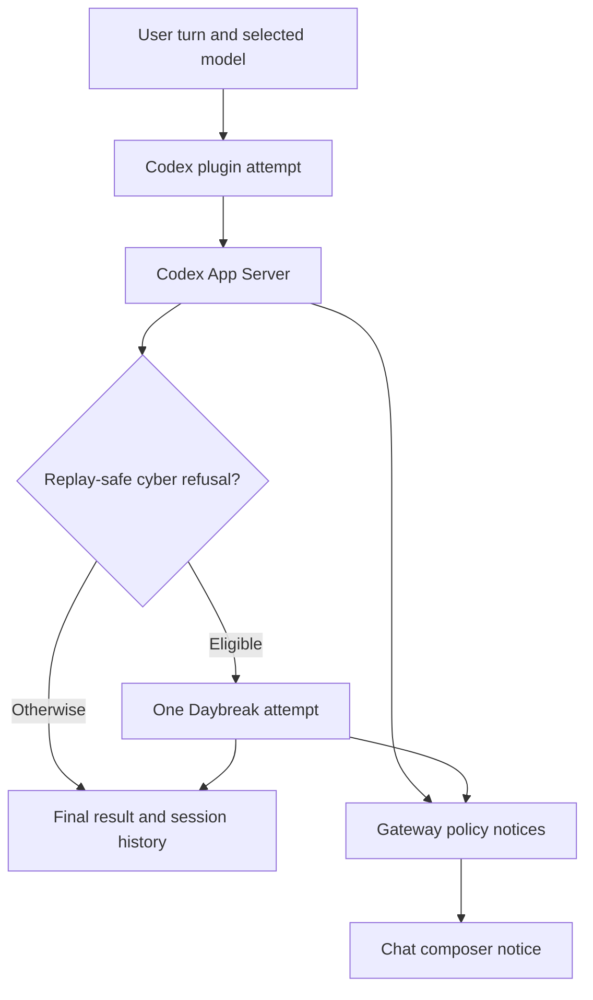

Codex review: blocked before merge. _Reviewed September 11, 2026, 11:35 AM ET / 15:35 UTC (Revision 7)._

# ClawSweeper review

## What this changes

Adds configurable retries of replay-safe Codex cyber refusals on Daybreak and displays provider-policy notices above the chat composer.

## Merge readiness

⛔ **Blocked before merge - 8 items remain**

This protected PR remains useful, but all three prior correctness findings remain unresolved at the pinned head. Current main still lacks the automatic retry; the related merged guidance-only PR does not supersede this work.

**Priority:** P2
**Reviewed head:** `b2ba57c207a0f5ac9e507964807fa1d3b6d007a2`

## Review scores

| Measure | Result | What it means |
|---|---|---|
| **Overall readiness** | 🦐 gold shrimp **(3/6)** | Useful visual evidence and bounded policy work are outweighed by three unresolved integration defects. |
| **Proof confidence** | 🐚 platinum hermit **(4/6)** | Not applicable: The supplied maintainer classification exempts ordinary contributor proof. Inspected screenshots demonstrate composer appearance, and reported App Server probes demonstrate denied entitlement; successful registered-harness escalation and transcript settlement remain unverified. |
| **Patch quality** | 🦐 gold shrimp **(3/6)** | 3 actionable review findings remain. |

## Verification

| Check | Result | Evidence |
|---|---|---|
| **Real behavior** | Not applicable | Not applicable: The supplied maintainer classification exempts ordinary contributor proof. Inspected screenshots demonstrate composer appearance, and reported App Server probes demonstrate denied entitlement; successful registered-harness escalation and transcript settlement remain unverified. |
| **Evidence reviewed** | 11 items | Prior findings remain unchanged: The comparison with the immediately preceding reviewed head returned no changes in the harness, verdict reader, or projector. The latest commit only adjusts a UI binding; none of the three prior blockers was repaired. Retry follows terminal persistence: The harness awaits the complete first attempt before deciding to retry. run-attempt.ts awaits finalizeCodexAttempt, which invokes mirrorBestEffort before returning. transcript-mirror.ts only withholds terminal ownership for deferred failed outcomes, while provider refusals normalize to terminal.kind='ok'. Distinct native turn IDs give the refusal and retry separate mirror identities. Canonical terminal errors are omitted: The new verdict reader reads a top-level promptError. The actual projector returns terminal via attemptTerminal.normalize; canonical failed outcomes carry terminal.error. A 401/403 without an assistant row therefore does not set unavailable or populate the suppression cache. |
| **Findings** | 3 actionable findings | [P1] Defer refusal transcript finalization until the retry decision [P2] Read authorization failures from the canonical terminal result [P2] Clear buffering before closing the projection |
| **Security** | None | None. |

## How this fits together

The Codex plugin sends OpenClaw agent turns to Codex App Server and projects its results into session history and Gateway events. The Control UI consumes those events to display progress and policy outcomes.

## Before merge

- [ ] **Defer refusal transcript finalization until the retry decision (P1)** - The prior blocker remains. Awaiting the first attempt already runs `finalizeCodexAttempt()` and mirrors its terminal refusal. Refusals have `terminal.kind === "ok"`, so the mirror's deferred-failure exception does not apply. The retry gets another native turn ID and can publish a second terminal row for the same run; returning only its result cannot discard the first committed row. Stage terminal publication until escalation settles and verify one final outcome after history refresh.
- [ ] **Read authorization failures from the canonical terminal result (P2)** - The prior blocker remains. `runCodexAppServerAttempt()` returns failures through `terminal`, not a top-level `promptError`. When Daybreak returns 401/403 before producing an assistant row, this reader reports `unavailable: false`, so the unavailable notice and cooloff record are skipped and subsequent refusals repeat the denied attempt. Consume the existing terminal projection and test an actual projector result without assistant output.
- [ ] **Clear buffering before closing the projection (P2)** - The prior blocker remains. The added buffering state clears on assistant output or native completion, but local cancellation, timeout, or transport failure can reach `closeProjection()` without either event. This method immediately fences event emission, and UI run cleanup preserves the notice, leaving a finished run showing 'Cyber safety review'. End buffering before aborting the projection controller and cover closure without native completion.
- [ ] **Resolve merge risk (P1)** - Default-on escalation changes existing configurations from a terminal refusal to an additional model attempt; fresh-install and upgrade behavior, including disabled mode and denied entitlement, lacks registered-harness evidence.
- [ ] **Resolve merge risk (P1)** - The first refusal can own a terminal transcript row before the successful retry, leaving competing outcomes for one run after history refresh.
- [ ] **Resolve merge risk (P1)** - Canonical authorization failures can escape the denial cache, repeatedly incurring the provider reconnect ladder.
- [ ] **Resolve merge risk (P1)** - The PR body still describes removed session-window behavior and says the startup-budget raise is absent, although the pinned diff includes it.
- [ ] **Complete next step (P2)** - Resolve the three retained findings, validate retry settlement and fresh/upgrade behavior through the registered harness, and update the stale implementation and budget claims in the PR body.

## Findings

- [P1] Defer refusal transcript finalization until the retry decision — `extensions/codex/harness.ts:329-330`
- [P2] Read authorization failures from the canonical terminal result — `extensions/codex/src/app-server/cyber-failover.ts:207-208`
- [P2] Clear buffering before closing the projection — `extensions/codex/src/app-server/event-projector.ts:94-95`

<strong>Agent review details</strong>

### Security

None.

### PR surface

Source +597, Tests +777, Docs +67, Generated 0, Other 0. Total +1441 across 32 files.

View PR surface stats

| Area | Files | Added | Removed | Net |
|---|---:|---:|---:|---:|
| Source | 20 | 611 | 14 | +597 |
| Tests | 7 | 803 | 26 | +777 |
| Docs | 2 | 87 | 20 | +67 |
| Config | 0 | 0 | 0 | 0 |
| Generated | 2 | 3 | 3 | 0 |
| Other | 1 | 3 | 3 | 0 |
| **Total** | **32** | **1507** | **66** | **+1441** |

### Review metrics

| Metric | Value | Why it matters |
|---|---|---|
| **Configuration surface** | 3 new settings; automatic retry enabled by default | Existing installations inherit additional model attempts without changing their configuration. |
| **Production versus test growth** | Production +597 net lines; tests +777 net lines | Retry policy and notice handling justify production growth, but the PR body's +356-line figure no longer describes the pinned diff. |

### Merge-risk options

**Maintainer options:**
1. **Repair settlement and prove upgrade behavior (recommended)**  
   Resolve the three findings and exercise the registered harness with automatic and disabled configurations before landing.
2. **Separate notices from automatic escalation**  
   Retain the notice feature with closure cleanup while postponing automatic retries until logical-turn settlement is correct.

### Technical review

Best possible solution:

Keep escalation within one logical-turn settlement owner, consume canonical terminal outcomes, and validate unchanged stored model preferences across fresh and upgraded configurations.

Do we have a high-confidence way to reproduce the issue?

Yes, source provides concrete paths for the three patch defects: refusal followed by retry, a terminal-only authorization error, and buffering followed by local projection closure. No runtime reproduction was executed.

Is this the best way to solve the issue?

No, the wrapper retries after the first attempt has already finalized its transcript; the maintainable solution must coordinate retry selection with terminal publication.

Full review comments:

- [P1] Defer refusal transcript finalization until the retry decision — `extensions/codex/harness.ts:329-330`
  The prior blocker remains. Awaiting the first attempt already runs `finalizeCodexAttempt()` and mirrors its terminal refusal. Refusals have `terminal.kind === "ok"`, so the mirror's deferred-failure exception does not apply. The retry gets another native turn ID and can publish a second terminal row for the same run; returning only its result cannot discard the first committed row. Stage terminal publication until escalation settles and verify one final outcome after history refresh.
  Confidence: 0.99
- [P2] Read authorization failures from the canonical terminal result — `extensions/codex/src/app-server/cyber-failover.ts:207-208`
  The prior blocker remains. `runCodexAppServerAttempt()` returns failures through `terminal`, not a top-level `promptError`. When Daybreak returns 401/403 before producing an assistant row, this reader reports `unavailable: false`, so the unavailable notice and cooloff record are skipped and subsequent refusals repeat the denied attempt. Consume the existing terminal projection and test an actual projector result without assistant output.
  Confidence: 0.99
- [P2] Clear buffering before closing the projection — `extensions/codex/src/app-server/event-projector.ts:94-95`
  The prior blocker remains. The added buffering state clears on assistant output or native completion, but local cancellation, timeout, or transport failure can reach `closeProjection()` without either event. This method immediately fences event emission, and UI run cleanup preserves the notice, leaving a finished run showing 'Cyber safety review'. End buffering before aborting the projection controller and cover closure without native completion.
  Confidence: 0.98

Overall correctness: patch is incorrect
Overall confidence: 0.98

AGENTS.md: found and applied where relevant.

Codex review notes: model internal, reasoning medium; reviewed against [764ea2bffa1c](https://github.com/openclaw/openclaw/commit/764ea2bffa1c0741f3b9dfba890522b362be8cab).

### Labels

Label justifications:

- `P2`: This is a bounded provider-recovery feature with unresolved correctness defects, without evidence of a currently shipped urgent regression.
- `merge-risk: 🚨 session-state`: Retrying after terminal persistence can give one run multiple terminal transcript outcomes.
- `merge-risk: 🚨 auth-provider`: The verdict reader misses canonical entitlement errors and therefore fails to suppress repeated denied attempts.
- `merge-risk: 🚨 compatibility`: Default-on retries change existing configurations and need upgrade-path validation.
- `rating: 🦐 gold shrimp`: Overall readiness is 🦐 gold shrimp; proof is 🐚 platinum hermit and patch quality is 🦐 gold shrimp.
- `status: ⏳ waiting on author`: ClawSweeper has contributor-facing work open and is waiting for author action. Not applicable: The supplied maintainer classification exempts ordinary contributor proof. Inspected screenshots demonstrate composer appearance, and reported App Server probes demonstrate denied entitlement; successful registered-harness escalation and transcript settlement remain unverified.
- `proof: 📸 screenshot`: Contributor real behavior proof includes screenshot evidence. The supplied maintainer classification exempts ordinary contributor proof. Inspected screenshots demonstrate composer appearance, and reported App Server probes demonstrate denied entitlement; successful registered-harness escalation and transcript settlement remain unverified.

### Evidence

What I checked:

- **Prior findings remain unchanged:** The comparison with the immediately preceding reviewed head returned no changes in the harness, verdict reader, or projector. The latest commit only adjusts a UI binding; none of the three prior blockers was repaired. ([`extensions/codex/harness.ts:329`](https://github.com/openclaw/openclaw/blob/b2ba57c207a0f5ac9e507964807fa1d3b6d007a2/extensions/codex/harness.ts#L329), [b2ba57c207a0](https://github.com/openclaw/openclaw/commit/b2ba57c207a0f5ac9e507964807fa1d3b6d007a2))
- **Retry follows terminal persistence:** The harness awaits the complete first attempt before deciding to retry. run-attempt.ts awaits finalizeCodexAttempt, which invokes mirrorBestEffort before returning. transcript-mirror.ts only withholds terminal ownership for deferred failed outcomes, while provider refusals normalize to terminal.kind='ok'. Distinct native turn IDs give the refusal and retry separate mirror identities. ([`extensions/codex/src/app-server/transcript-mirror.ts:153`](https://github.com/openclaw/openclaw/blob/b2ba57c207a0f5ac9e507964807fa1d3b6d007a2/extensions/codex/src/app-server/transcript-mirror.ts#L153), [b2ba57c207a0](https://github.com/openclaw/openclaw/commit/b2ba57c207a0f5ac9e507964807fa1d3b6d007a2))
- **Canonical terminal errors are omitted:** The new verdict reader reads a top-level promptError. The actual projector returns terminal via attemptTerminal.normalize; canonical failed outcomes carry terminal.error. A 401/403 without an assistant row therefore does not set unavailable or populate the suppression cache. ([`extensions/codex/src/app-server/cyber-failover.ts:207`](https://github.com/openclaw/openclaw/blob/b2ba57c207a0f5ac9e507964807fa1d3b6d007a2/extensions/codex/src/app-server/cyber-failover.ts#L207), [b2ba57c207a0](https://github.com/openclaw/openclaw/commit/b2ba57c207a0f5ac9e507964807fa1d3b6d007a2))
- **Buffering cleanup misses local closure:** closeProjection aborts the projection controller without ending safety buffering; subsequent event emission is fenced. Finalization and cleanup call this path after local cancellation or transport failure, while UI run cleanup preserves providerPolicyNotice. ([`extensions/codex/src/app-server/event-projector.ts:94`](https://github.com/openclaw/openclaw/blob/b2ba57c207a0f5ac9e507964807fa1d3b6d007a2/extensions/codex/src/app-server/event-projector.ts#L94), [b2ba57c207a0](https://github.com/openclaw/openclaw/commit/b2ba57c207a0f5ac9e507964807fa1d3b6d007a2))
- **Affirmative Codex dependency boundary:** The patch directly consumes model/safetyBuffering/updated and model/rerouted notifications and retries through the real Codex App Server attempt runner, making the upstream protocol relevant to this review. ([`extensions/codex/src/app-server/event-projector.ts:229`](https://github.com/openclaw/openclaw/blob/b2ba57c207a0f5ac9e507964807fa1d3b6d007a2/extensions/codex/src/app-server/event-projector.ts#L229), [b2ba57c207a0](https://github.com/openclaw/openclaw/commit/b2ba57c207a0f5ac9e507964807fa1d3b6d007a2))
- **Personally inspected upstream protocol:** The sibling checkout defines camelCase safety-buffering notifications and forwards core SafetyBuffering events through the App Server. Its turn processor passes model settings and the optional cyber access program through existing turn handling. Repository ownership was verified through the cache repository's origin, https://github.com/openai/codex.git. ([`codex-rs/app-server-protocol/src/protocol/v2/model.rs:186`](https://github.com/openai/codex/blob/3d2ee51ca2d5db578f328aa75e20aa22c0197c9a/codex-rs/app-server-protocol/src/protocol/v2/model.rs#L186), [3d2ee51ca2d5](https://github.com/openai/codex/commit/3d2ee51ca2d5db578f328aa75e20aa22c0197c9a))

Likely related people:

- **steipete:** Suggested for follow-up; no historical authorship or introduction is verified. (role: unverified routing candidate; confidence: low)
- **sunlit-deng:** Suggested for follow-up; no historical authorship or introduction is verified. (role: unverified routing candidate; confidence: low)

### Rank-up moves

Optional improvements that raise the rating; they are not merge blockers.

- Verify one final transcript outcome through refusal, successful retry, and history refresh while preserving the selected model.
- Cover canonical terminal authorization errors without assistant output and buffering cleanup before projection closure.
- Validate automatic and disabled behavior for fresh and existing configurations, then align the PR body with the pinned implementation.

### Rating scale

| Score | Internal tier | Crab rank | Meaning |
|---:|:---:|---|---|
| **6/6** | S | 🦀 challenger crab | Exceptional readiness |
| **5/6** | A | 🦞 diamond lobster | Very strong readiness |
| **4/6** | B | 🐚 platinum hermit | Good normal PR; ordinary maintainer review |
| **3/6** | C | 🦐 gold shrimp | Useful, but confidence is limited |
| **2/6** | D | 🦪 silver shellfish | Proof or implementation needs work |
| **1/6** | F | 🧂 unranked krab | Not merge-ready |
| N/A | NA | 🌊 off-meta tidepool | Rating does not apply |

Overall follows the weaker of proof and patch quality.
Shiny media proof means a screenshot, video, or linked artifact directly shows the changed behavior. Runtime, network, CSP, and security claims still need visible diagnostics.

### Workflow

- ClawSweeper keeps one durable marker-backed review comment per issue or PR.
- Re-runs edit this comment so the latest verdict, findings, and automation markers stay together instead of adding duplicate bot comments.
- A fresh review can be triggered by eligible `@clawsweeper re-review` comments, exact-item GitHub events, scheduled/background review runs, or manual workflow dispatch.
- PR/issue authors and users with repository write access can comment `@clawsweeper re-review` or `@clawsweeper re-run` on an open PR or issue to request a fresh review only.
- Maintainers can also comment `@clawsweeper review` to request a fresh review only.
- Fresh-review commands do not start repair, autofix, rebase, CI repair, or automerge.
- Maintainer-only repair and merge flows require explicit commands such as `@clawsweeper autofix`, `@clawsweeper automerge`, `@clawsweeper fix ci`, or `@clawsweeper address review`.
- Maintainers can comment `@clawsweeper explain` to ask for more context, or `@clawsweeper stop` to stop active automation.

### History

Review history (6 earlier review cycles)

<!-- clawsweeper-review-history v=1 total=6 -->
- reviewed 2026-09-10T06:18:39.335Z sha 61a51ceff5b781c4bdc43827fb28aa0250f1ae04 :: needs changes before merge. :: [P2] Clear buffering when the projector closes without native completion
- reviewed 2026-09-10T17:43:47.100Z sha 31a1b7a6918593b0b6d2bbacaedcc9326b49c18c :: blocked before merge. :: [P1] Defer refusal transcript finalization until the retry decision | [P2] Read authorization failures from the actual terminal result | [P2] Clear buffering when the projector closes without native completion
- reviewed 2026-09-10T19:42:59.455Z sha f4d9dfdc7b340a4196b295e66d12fcd38986e8d7 :: blocked before merge. :: [P1] Defer refusal transcript finalization until the retry decision | [P2] Read authorization failures from the actual terminal result | [P2] Clear buffering when projection closes without native completion
- reviewed 2026-09-10T20:03:54.305Z sha 6bdffa0e3206b5bdcacb4bb146ced6a678f50903 :: blocked before merge. :: [P1] Defer refusal transcript finalization until the retry decision | [P2] Read authorization failures from the actual terminal result | [P2] Clear buffering before closing the projection
- reviewed 2026-09-11T04:34:20.830Z sha 65440c7fc413361db968e3d3b8276c0c9c70ca45 :: blocked before merge. :: [P1] Defer refusal transcript finalization until the retry decision | [P2] Read authorization failures from the actual terminal result | [P2] Clear buffering before closing the projection
- reviewed 2026-09-11T15:16:35.410Z sha cf068346686632fb421c89e8960716fde4447d6c :: blocked before merge. :: [P1] Defer refusal transcript finalization until the retry decision | [P2] Read authorization failures from the canonical terminal result | [P2] Clear buffering before closing the projection

<!-- clawsweeper-verdict:needs-human item=143761 sha=b2ba57c207a0f5ac9e507964807fa1d3b6d007a2 confidence=high updated_at=2026-09-11T15:31:38Z reviewed_at=2026-09-11T15:35:29.823Z lease_owner=github-run-34616451568-1 lease_comment_id=5636799554 source_revision=bcf90c46c725bf6199529d7a93f92f04155c1edcee565aa7a592f20c1b31517d live_verification=absent -->
<!-- clawsweeper-review-state:blocked item=143761 sha=b2ba57c207a0f5ac9e507964807fa1d3b6d007a2 v=1 -->

<!-- clawsweeper-review-version item=143761 reviewed_at=2026-09-11T15:35:29.823Z sha=b2ba57c207a0f5ac9e507964807fa1d3b6d007a2 source_revision=bcf90c46c725bf6199529d7a93f92f04155c1edcee565aa7a592f20c1b31517d lease_owner=github-run-34616451568-1 lease_comment_id=5636799554 v=1 -->

<!-- clawsweeper-review item=143761 -->