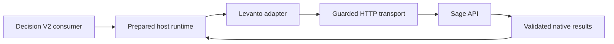

Codex review: needs maintainer review before merge.

## What this changes

Adds an optional Levanto Sage provider for native typed decisions using text and supported inline images.

**Example:** Select levanto/levanto-sage and ask whether a supplied red-square PNG depicts a red object.
- **Before:** OpenClaw has no native Sage adapter for the request.
- **After:** The provider sends the image through Sage’s native API and preserves the Boolean answer, probability, abstention, and reported usage.

## Review scores

| Measure | Result | What it means |
|---|---|---|
| **Overall readiness** | 🦐 gold shrimp **(3/6)** | Useful optional integration with no actionable findings; native API and host-authority proof are composed through harnesses rather than one shipped user flow. |
| **Proof confidence** | 🦐 gold shrimp **(3/6)** | Sufficient (live_output): Recorded authenticated qualification exercises the registered adapter and real Sage transport for text, PNG, JPEG, WebP, and Sort; separate production-owner loopback proof demonstrates allowed dispatch and zero HTTP after credential revocation or replacement during DNS. Relevant provider and fixture bytes are unchanged, and no installed-package SecretRef-to-tool run is claimed. |
| **Patch quality** | 🐚 platinum hermit **(4/6)** | No actionable review findings were identified. |

## Product

**Kind:** Feature · **Worth it:** Yes · **Fix scope:** Complete
**User problem:** Users cannot select Sage for native typed decisions through the prepared provider runtime.
**Reason:** Maintainer-authored direction supports an optional vendor plugin using existing contracts, without changing model defaults or enabling background evaluations.

## Merge readiness

✅ **Ready for maintainer review**

Keep this PR open: the optional provider adds distinct functionality, the previous anchor finding is fixed, and no actionable patch defect remains; exact-head CI is still incomplete.

**Priority:** P2
**Reviewed head:** `fd74668b466f8574467786d338bcd5e6d8f81953`

## Before merge

None.

## Findings

None.

<strong>Agent review details</strong>

### How this fits together

The plugin translates prepared Decision V2 requests into Sage HTTP requests and returns validated native results while the host owns credentials, selection, authority, and accounting.

### Technical review

Best possible solution:

Retain the plugin-owned native adapter on the existing prepared Decision V2 and guarded HTTP owners.

Do we have a high-confidence way to reproduce the issue?

This is a feature addition; source inspection confirms that fetched main lacks the native Levanto plugin.

Is this the best way to solve the issue?

The adapter uses the existing plugin, credential, media, and transport boundaries without adding a competing core owner.

AGENTS.md: found and applied where relevant.

Codex review notes: model internal, reasoning medium; reviewed against [834a32e171e2](https://github.com/openclaw/openclaw/commit/834a32e171e2831f6eac02c57a4783c4999e7819).

### Provenance checked

- `Generated plugin inventory and config baselines` keeps the original intent (d5125f703c066af45cae5e23e1b9045afb79d6e9: The merged SubQ provider updated the same generated inventory and baseline artifacts; this PR preserves that integration and adds Levanto.)
- `Official external plugin distribution` keeps the original intent (21728777dfa06ced1d74b96cca78cd2a0aa8c87c: Official provider externalization uses package catalog entries and excludes external plugins from bundled distribution; Levanto follows that ownership.)

### Testing

Proof path: in-process harness.

### Security

None.

### Evidence

What I checked:

- **Previous finding resolved:** The sole change from the previously reviewed parent replaces the obsolete fragment with prepared-decision-execution-contract-version-2, matching the heading in docs/plugins/sdk-overview/capabilities.md:203. Public docs: [`docs/providers/levanto.md`](https://docs.openclaw.ai/providers/levanto). ([`docs/providers/levanto.md:50`](https://docs.openclaw.ai/providers/levanto), [fd74668b466f](https://github.com/openclaw/openclaw/commit/fd74668b466f8574467786d338bcd5e6d8f81953))
- **Final-effect authority:** The adapter invokes host-owned isAdmissible through the guarded transport immediately before HTTP dispatch; the registered-host fixture exercises allowed requests and credential revocation/replacement during DNS preparation, observing final request counts of 1/0/0. ([`extensions/levanto/decision-provider.ts:226`](https://github.com/openclaw/openclaw/blob/fd74668b466f8574467786d338bcd5e6d8f81953/extensions/levanto/decision-provider.ts#L226), [fd74668b466f](https://github.com/openclaw/openclaw/commit/fd74668b466f8574467786d338bcd5e6d8f81953))
- **Retained native qualification:** The PR body records authenticated text, PNG, JPEG, WebP, and Sort qualification at a49c7f8164d2e89c165bab657e53ed937cc598c0; comparison confirms the provider and both native and host fixtures remain unchanged. ([`extensions/levanto/registration.live.test.ts:56`](https://github.com/openclaw/openclaw/blob/fd74668b466f8574467786d338bcd5e6d8f81953/extensions/levanto/registration.live.test.ts#L56), [fd74668b466f](https://github.com/openclaw/openclaw/commit/fd74668b466f8574467786d338bcd5e6d8f81953))
- **Current CI remains unresolved:** Exact-head CI https://github.com/openclaw/openclaw/actions/runs/39221507144 remains in progress; its failed memory scheduling shard reports missing retry observations at lines 215 and 291, matching the prior-parent annotations without establishing independent base attribution. ([`extensions/memory-core/src/memory/manager-session-scheduling.test.ts:215`](https://github.com/openclaw/openclaw/blob/fd74668b466f8574467786d338bcd5e6d8f81953/extensions/memory-core/src/memory/manager-session-scheduling.test.ts#L215), [fd74668b466f](https://github.com/openclaw/openclaw/commit/fd74668b466f8574467786d338bcd5e6d8f81953))
- **Distinct requested capability:** https://github.com/openclaw/openclaw/issues/157426 requests this native adapter; fetched main has no extensions/levanto tree, while https://github.com/openclaw/openclaw/pull/157225 and https://github.com/openclaw/openclaw/pull/156799 supply the merged runtime and authentication prerequisites. ([`extensions/levanto/index.ts:10`](https://github.com/openclaw/openclaw/blob/834a32e171e2831f6eac02c57a4783c4999e7819/extensions/levanto/index.ts#L10), [834a32e171e2](https://github.com/openclaw/openclaw/commit/834a32e171e2831f6eac02c57a4783c4999e7819))
- **Inspection limits:** Some historical/current-main core blobs were unavailable locally, and CI log downloads redirected to a blocked storage host; GitHub job annotations remained readable, and neither limitation is attributed to the contributor.

### PR surface

Source +1169, Tests +1714, Docs +185, Config +45, Generated 0, Other +24. Total +3137 across 27 files. Added test files: 5.

View PR surface stats

| Area | Files | Added | Removed | Net |
|---|---:|---:|---:|---:|
| Source | 6 | 1169 | 0 | +1169 |
| Tests | 6 | 1714 | 0 | +1714 |
| Docs | 7 | 187 | 2 | +185 |
| Config | 4 | 45 | 0 | +45 |
| Generated | 2 | 3 | 3 | 0 |
| Other | 2 | 24 | 0 | +24 |
| **Total** | **27** | **3142** | **5** | **+3137** |

### Root-cause cluster

Relationship: `fixed_by_candidate`
Canonical: https://github.com/openclaw/openclaw/issues/157426
Summary: This PR implements the native Sage capability requested by the paired issue.

Members:
- `canonical`: https://github.com/openclaw/openclaw/issues/157426 - The requested provider, native operations, prepared credentials, and guarded transport match this PR.

Proposal only: this assessment does not dispatch repair, suppress jobs, mutate sibling items, close, or merge anything.

### Labels

Label changes:

- add `status: 👀 ready for maintainer look`: ClawSweeper has no concrete contributor-facing blocker left for this PR.
- remove `status: ⏳ waiting on author`: Current PR status label is `status: 👀 ready for maintainer look`.

Label justifications:

- `P2`: This is an optional provider capability with bounded user impact and no demonstrated urgent regression.
- `rating: 🦐 gold shrimp`: Overall readiness is 🦐 gold shrimp; proof is 🦐 gold shrimp and patch quality is 🐚 platinum hermit.
- `status: 👀 ready for maintainer look`: ClawSweeper has no concrete contributor-facing blocker left for this PR.
- `proof: sufficient`: Contributor real behavior proof is sufficient.

### Rating scale

6/6 🦀 challenger crab · 5/6 🦞 diamond lobster · 4/6 🐚 platinum hermit · 3/6 🦐 gold shrimp · 2/6 🦪 silver shellfish · 1/6 🧂 unranked krab. Overall follows the weaker of proof and patch quality; ✨ marks media proof (a screenshot, video, or linked artifact) that directly shows the changed behavior.

### Workflow

ClawSweeper edits this one comment on every review. Comment `@clawsweeper re-review` for a fresh review only. Repair and merge execution lanes are retired.

### History

Review history (10 earlier review cycles; latest 8 shown)

<!-- clawsweeper-review-history v=1 total=10 -->
- reviewed 2026-10-17T15:32:44.295Z sha 9625dcc538576e4f869caa049e4b4bb4c073ffa6 :: needs real behavior proof before merge. :: none
- reviewed 2026-10-17T16:06:58.509Z sha 91ab0178566a9300d84a4bd06243bd6cf3a17a47 :: needs maintainer review before merge. :: none
- reviewed 2026-10-17T16:32:30.132Z sha b62bc510ede3e28edcbc76624ccf68432ad4dc71 :: needs maintainer review before merge. :: none
- reviewed 2026-10-18T17:32:32.230Z sha 58e3d9ea3eb07e933cc71989c836b3e0ede31a48 :: needs changes before merge. :: [P3] Describe all five paid requests in the live-test instructions
- reviewed 2026-10-18T17:53:02.061Z sha a49c7f8164d2e89c165bab657e53ed937cc598c0 :: needs maintainer review before merge. :: none
- reviewed 2026-10-19T05:00:18.632Z sha 01fdeb027d375d13558e7062d276c099e27fbb77 :: needs maintainer review before merge. :: none
- reviewed 2026-10-19T05:45:07.128Z sha 9567e1d9c7f00f359b8ca6b9a43598efde85c5d8 :: needs maintainer review before merge. :: none
- reviewed 2026-10-19T07:51:21.190Z sha a6697375dc42d45f2ac3527865eae446a1b75846 :: needs changes before merge. :: [P3] Point the V2 SDK link to its existing section anchor

_Reviewed October 19, 2026, 4:23 AM ET / 08:23 UTC (Revision 11)._

<!-- clawsweeper-verdict:needs-human item=157433 sha=fd74668b466f8574467786d338bcd5e6d8f81953 confidence=high updated_at=2026-10-19T08:18:51Z reviewed_at=2026-10-19T08:23:42.242Z lease_owner=github-run-39221785811-1 lease_comment_id=6262822656 source_revision=76d92660bbcda97a1cf47af3928a71c4c68dd76131c50b7aae318b435b4683a9 hold=not_opted_in findings=0 -->
<!-- clawsweeper-review-state:ready item=157433 sha=fd74668b466f8574467786d338bcd5e6d8f81953 v=1 -->

<!-- clawsweeper-review-version item=157433 reviewed_at=2026-10-19T08:23:42.242Z sha=fd74668b466f8574467786d338bcd5e6d8f81953 source_revision=76d92660bbcda97a1cf47af3928a71c4c68dd76131c50b7aae318b435b4683a9 lease_owner=github-run-39221785811-1 lease_comment_id=6262822656 v=1 -->

<!-- clawsweeper-review item=157433 -->