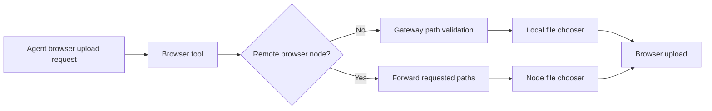

Codex review: needs real behavior proof before merge. _Reviewed July 28, 2026, 12:30 PM ET / 16:30 UTC._

# ClawSweeper review

## What this changes

The PR preserves Gateway-side path validation for local browser sessions while forwarding upload paths unchanged when a remote browser node owns the session.

## Merge readiness

⛔ **Blocked until real behavior proof from a real setup is added - 3 items remain**

The patch matches the current browser-node ownership boundary: current `main` resolves every upload path on the Gateway before it can proxy the request, while the proposed branch leaves proxied paths for the browser-node route to resolve. The patch has focused regression coverage and no concrete correctness or security finding, but the submitted evidence is mock-based rather than a real remote-node upload, so it needs real behavior proof before merge.

Likely related people:
- `vincentkoc` — low-confidence routing candidate; they reported the linked browser-node failure as a repository member.

**Priority:** P2
**Reviewed head:** `9eb474b27a58d8a6816f1f700554fbdbec4d1bde`

## Review scores

| Measure | Result | What it means |
|---|---|---|
| **Overall readiness** | 🦪 silver shellfish **(2/6)** | The implementation and regression tests are focused, but real remote-node behavior proof is still required before merge. |
| **Proof confidence** | 🦪 silver shellfish **(2/6)** | Needs real behavior proof before merge: The PR includes focused mock-based tests and copied test output, but no redacted real remote browser-node upload evidence; add a terminal transcript, runtime logs, or recording that shows a node-local file succeeds after the fix. After adding proof, update the PR body; ClawSweeper should re-review automatically. If it does not, the PR author or someone with repository write access can comment `@clawsweeper re-review`. |
| **Patch quality** | 🐚 platinum hermit **(4/6)** | No actionable review findings were identified. |

## Verification

| Check | Result | Evidence |
|---|---|---|
| **Real behavior** | Needs proof | Needs real behavior proof before merge: The PR includes focused mock-based tests and copied test output, but no redacted real remote browser-node upload evidence; add a terminal transcript, runtime logs, or recording that shows a node-local file succeeds after the fix. After adding proof, update the PR body; ClawSweeper should re-review automatically. If it does not, the PR author or someone with repository write access can comment `@clawsweeper re-review`. |
| **Evidence reviewed** | 4 items | Current-main behavior: Current `main` resolves upload paths with `resolveExistingUploadPaths` before the later proxy/local dispatch decision, so a node-local path can be evaluated against the Gateway filesystem. Proposed ownership correction: The PR conditions Gateway resolution on `!proxyRequest`, retaining local validation and forwarding requested paths unchanged for proxied requests. Focused regression coverage: The added tests assert that proxied uploads do not invoke Gateway-side resolution and do not reject a node-local path merely because it is absent from the Gateway filesystem. |
| **Findings** | None | None. |
| **Security** | None | None. |

## How this fits together

The browser tool accepts agent upload requests and either calls a Gateway-local browser server or proxies the request to a browser node. Upload paths must be resolved by the filesystem that owns the browser control server before the file chooser receives them.

## Before merge

- [ ] **Add real behavior proof** - Needs real behavior proof before merge: The PR includes focused mock-based tests and copied test output, but no redacted real remote browser-node upload evidence; add a terminal transcript, runtime logs, or recording that shows a node-local file succeeds after the fix. After adding proof, update the PR body; ClawSweeper should re-review automatically. If it does not, the PR author or someone with repository write access can comment `@clawsweeper re-review`.
- [ ] **Resolve merge risk (P1)** - A mocked gateway call does not prove that a real remote browser node receives, resolves, and uploads a node-local file correctly; before merge, show a redacted remote-node run that also confirms local uploads retain their existing validation behavior.
- [ ] **Complete next step (P2)** - The code review is clear, but this external PR needs contributor-provided real remote-node behavior proof before normal maintainer merge review.

<strong>Agent review details</strong>

### Security

None.

### PR surface

Source +10, Tests +65. Total +75 across 2 files.

View PR surface stats

| Area | Files | Added | Removed | Net |
|---|---:|---:|---:|---:|
| Source | 1 | 14 | 4 | +10 |
| Tests | 1 | 65 | 0 | +65 |
| Docs | 0 | 0 | 0 | 0 |
| Config | 0 | 0 | 0 | 0 |
| Generated | 0 | 0 | 0 | 0 |
| Other | 0 | 0 | 0 | 0 |
| **Total** | **2** | **79** | **4** | **+75** |

### Review metrics

None.

### Root-cause cluster

Relationship: `fixed_by_candidate`
Canonical: https://github.com/openclaw/openclaw/issues/115251
Summary: This PR explicitly targets the linked remote browser-node upload issue and provides a candidate implementation for that single reported behavior.

Members:
- `canonical`: https://github.com/openclaw/openclaw/issues/115251 - The PR body explicitly links this issue as the report for the Gateway-versus-node filesystem mismatch.

Proposal only: this assessment does not dispatch repair, suppress jobs, mutate sibling items, close, or merge anything.

### Merge-risk options

**Maintainer options:**
1. **Decide the mitigation before merge**  
   Keep one path-validation owner per session: retain Gateway validation for local sessions and validate proxied upload paths only at the browser node's file-chooser boundary, supported by a redacted real remote-node upload proof.
2. **Pause or close**  
   Do not merge this PR until maintainers decide whether the risk is worth taking.

### Technical review

Best possible solution:

Keep one path-validation owner per session: retain Gateway validation for local sessions and validate proxied upload paths only at the browser node's file-chooser boundary, supported by a redacted real remote-node upload proof.

Do we have a high-confidence way to reproduce the issue?

No executed current-main reproduction was available in this review. Source inspection and the focused regression tests provide a clear path: use a proxied browser session with a file that exists only on the browser node.

Is this the best way to solve the issue?

Yes, subject to live proof. Skipping Gateway resolution only for proxied sessions matches the documented route ownership while preserving the existing local-session validation path.

AGENTS.md: found and applied where relevant.

Codex review notes: model internal, reasoning high; reviewed against [a88c4283ad48](https://github.com/openclaw/openclaw/commit/a88c4283ad4842a6a347ee44ce1975d05d7378aa).

### Labels

Label changes:

- add `P2`: This repairs a scoped remote browser-node upload failure without evidence of an emergency availability, security, or data-loss impact.
- add `rating: 🦪 silver shellfish`: Overall readiness is 🦪 silver shellfish; proof is 🦪 silver shellfish and patch quality is 🐚 platinum hermit.
- add `status: 📣 needs proof`: The PR needs real behavior proof before ClawSweeper can clear the contributor ask. Needs real behavior proof before merge: The PR includes focused mock-based tests and copied test output, but no redacted real remote browser-node upload evidence; add a terminal transcript, runtime logs, or recording that shows a node-local file succeeds after the fix. After adding proof, update the PR body; ClawSweeper should re-review automatically. If it does not, the PR author or someone with repository write access can comment `@clawsweeper re-review`.

Label justifications:

- `P2`: This repairs a scoped remote browser-node upload failure without evidence of an emergency availability, security, or data-loss impact.
- `rating: 🦪 silver shellfish`: Overall readiness is 🦪 silver shellfish; proof is 🦪 silver shellfish and patch quality is 🐚 platinum hermit.
- `status: 📣 needs proof`: The PR needs real behavior proof before ClawSweeper can clear the contributor ask. Needs real behavior proof before merge: The PR includes focused mock-based tests and copied test output, but no redacted real remote browser-node upload evidence; add a terminal transcript, runtime logs, or recording that shows a node-local file succeeds after the fix. After adding proof, update the PR body; ClawSweeper should re-review automatically. If it does not, the PR author or someone with repository write access can comment `@clawsweeper re-review`.

### Evidence

What I checked:

- **Current-main behavior:** Current `main` resolves upload paths with `resolveExistingUploadPaths` before the later proxy/local dispatch decision, so a node-local path can be evaluated against the Gateway filesystem. ([`extensions/browser/src/browser-tool.ts:976`](https://github.com/openclaw/openclaw/blob/a88c4283ad48/extensions/browser/src/browser-tool.ts#L976), [a88c4283ad48](https://github.com/openclaw/openclaw/commit/a88c4283ad48))
- **Proposed ownership correction:** The PR conditions Gateway resolution on `!proxyRequest`, retaining local validation and forwarding requested paths unchanged for proxied requests. ([`extensions/browser/src/browser-tool.ts:976`](https://github.com/openclaw/openclaw/blob/9eb474b27a58/extensions/browser/src/browser-tool.ts#L976), [9eb474b27a58](https://github.com/openclaw/openclaw/commit/9eb474b27a58))
- **Focused regression coverage:** The added tests assert that proxied uploads do not invoke Gateway-side resolution and do not reject a node-local path merely because it is absent from the Gateway filesystem. ([`extensions/browser/src/browser-tool.test.ts:3518`](https://github.com/openclaw/openclaw/blob/9eb474b27a58/extensions/browser/src/browser-tool.test.ts#L3518), [9eb474b27a58](https://github.com/openclaw/openclaw/commit/9eb474b27a58))
- **Submitted validation evidence:** The PR body reports 129 focused browser-tool tests passing and a negative-control revert that makes both new tests fail; this supports the unit-level invariant but does not demonstrate a real remote browser-node upload. ([`extensions/browser/src/browser-tool.test.ts:3518`](https://github.com/openclaw/openclaw/blob/9eb474b27a58/extensions/browser/src/browser-tool.test.ts#L3518), [9eb474b27a58](https://github.com/openclaw/openclaw/commit/9eb474b27a58))

Likely related people:

- **vincentkoc:** Reported the browser-node upload failure that this PR explicitly targets; the supplied context identifies them as a repository member, but no current-main feature-history attribution was available in the review evidence. (role: linked issue reporter; confidence: low; files: `extensions/browser/src/browser-tool.ts`, `extensions/browser/src/browser/routes/agent.act.hooks.ts`)

### Rank-up moves

Optional improvements that raise the rating; they are not merge blockers.

- Run one real proxied browser-node upload using a file present only on the node and attach a redacted terminal transcript, logs, or recording.
- Include a local-session negative control showing that Gateway-side invalid-path rejection remains unchanged.

### Rating scale

| Score | Internal tier | Crab rank | Meaning |
|---:|:---:|---|---|
| **6/6** | S | 🦀 challenger crab | Exceptional readiness |
| **5/6** | A | 🦞 diamond lobster | Very strong readiness |
| **4/6** | B | 🐚 platinum hermit | Good normal PR; ordinary maintainer review |
| **3/6** | C | 🦐 gold shrimp | Useful, but confidence is limited |
| **2/6** | D | 🦪 silver shellfish | Proof or implementation needs work |
| **1/6** | F | 🧂 unranked krab | Not merge-ready |
| N/A | NA | 🌊 off-meta tidepool | Rating does not apply |

Overall follows the weaker of proof and patch quality.
Shiny media proof means a screenshot, video, or linked artifact directly shows the changed behavior. Runtime, network, CSP, and security claims still need visible diagnostics.

### Workflow

- ClawSweeper keeps one durable marker-backed review comment per issue or PR.
- Re-runs edit this comment so the latest verdict, findings, and automation markers stay together instead of adding duplicate bot comments.
- A fresh review can be triggered by eligible `@clawsweeper re-review` comments, exact-item GitHub events, scheduled/background review runs, or manual workflow dispatch.
- PR/issue authors and users with repository write access can comment `@clawsweeper re-review` or `@clawsweeper re-run` on an open PR or issue to request a fresh review only.
- Maintainers can also comment `@clawsweeper review` to request a fresh review only.
- Fresh-review commands do not start repair, autofix, rebase, CI repair, or automerge.
- Maintainer-only repair and merge flows require explicit commands such as `@clawsweeper autofix`, `@clawsweeper automerge`, `@clawsweeper fix ci`, or `@clawsweeper address review`.
- Maintainers can comment `@clawsweeper explain` to ask for more context, or `@clawsweeper stop` to stop active automation.

<!-- clawsweeper-verdict:needs-human item=115291 sha=9eb474b27a58d8a6816f1f700554fbdbec4d1bde confidence=high updated_at=2026-07-28T16:29:33Z reviewed_at=2026-07-28T16:30:52.878Z lease_owner=github-run-30378379215-1 lease_comment_id=5106908660 source_revision=09fcc3af5004a86bd1f3493e596788032590070ca8ee06c1acf4973efbdbbcbd -->

<!-- clawsweeper-review-version item=115291 reviewed_at=2026-07-28T16:30:52.878Z sha=9eb474b27a58d8a6816f1f700554fbdbec4d1bde source_revision=09fcc3af5004a86bd1f3493e596788032590070ca8ee06c1acf4973efbdbbcbd lease_owner=github-run-30378379215-1 lease_comment_id=5106908660 v=1 -->

<!-- clawsweeper-review item=115291 -->