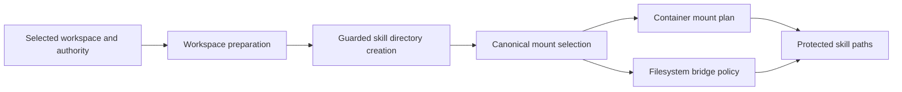

Codex review: needs real behavior proof before merge.

## What this changes

This PR creates missing managed skill directories before selecting read-only sandbox mounts.

**Example:** A new writable sandbox starts with no host skills or .agents/skills directories.
- **Before:** The missing sources are omitted, allowing writes under /workspace/skills.
- **After:** Preparation creates the directories so mount selection includes read-only skill overlays.

## Review scores

| Measure | Result | What it means |
|---|---|---|
| **Overall readiness** | 🦪 silver shellfish **(2/6)** | The focused implementation has no identified code defect, but security-boundary and upgrade evidence is incomplete. |
| **Proof confidence** | 🦪 silver shellfish **(2/6)** | Real behavior proof is necessary before merge. See [Before merge](#before-merge). |
| **Patch quality** | 🦐 gold shrimp **(3/6)** | Security review found an item that needs attention. |

## Product

**Kind:** Bug fix · **Worth it:** Yes · **Fix scope:** Complete
**User problem:** A newly started writable sandbox can modify skill paths because their absent host directories receive no read-only overlays.
**Reason:** The maintainer-authored direction addresses a concrete protection gap, preserves ordinary workspace writes, and reuses existing preparation and mount owners.

## Merge readiness

⛔ **Blocked before merge - 4 items remain**

Keep open: this maintainer-authored PR addresses the linked first-launch protection gap through the existing workspace and mount owners; no discrete introduced code defect was found.

**Priority:** P1
**Reviewed head:** `e8d35e47e902ddc91fab28938beb44b0004d1b7d`

## Before merge

- [ ] **Add real behavior proof** - Authority-chain proof required: supplied tests exercise real directory preparation and mount selection with mocked surrounding services, but do not show a newly launched Docker or Podman sandbox rejecting protected-path writes while allowing ordinary writes, or released/reassigned custody preventing the new mkdir effects; provide redacted terminal output or logs without credentials or private endpoints. After adding proof, update the PR body, then request a new review with `@clawsweeper re-review`. The PR author or someone with repository write access can request it.
- [ ] **Resolve security review attention item** - No concrete introduced bypass was found, but final-effect authority evidence remains incomplete.
- [ ] **Resolve merge risk** - The PR owner must establish that released or reassigned workspace custody prevents the newly introduced host-directory mutations before filesystem I/O.
- [ ] **Add data-model compatibility proof** - The review found that existing stored data may not work after upgrade. Show that existing data still loads and works with this change.

## Findings

None.

### Tests

- Missing end-to-end proof: Supply first-launch container write-rejection evidence, final-effect custody-revocation evidence, and a latest-stable upgrade with retained workspace data and container recovery.

<strong>Agent review details</strong>

### How this fits together

Sandbox preparation consumes the selected workspace, access mode, and lifecycle authority, then supplies protected filesystem sources to container and filesystem-bridge mount selection.

### Technical review

Best possible solution:

Keep creation in workspace preparation, retain the shared validator and filesystem authority guard, and verify first-launch protection plus existing-container recovery.

Do we have a high-confidence way to reproduce the issue?

Current main omits absent skill directories from protected mounts, matching the linked Docker reproduction; this read-only review did not execute target code.

Is this the best way to solve the issue?

The patch is a focused repair using existing owners: preparation materializes shared candidates, while mount resolution remains validation-only and retains containment checks.

AGENTS.md: found and applied where relevant.

Codex review notes: model internal, reasoning medium; reviewed against [ab705c5790a6](https://github.com/openclaw/openclaw/commit/ab705c5790a6db8fcc505590c4ce6d75898e67b6).

### Merge-risk options

**Maintainer options:**
1. **Prove the final filesystem effects (recommended)**  
   The PR owner should show allowed workspace preparation succeeding and revoked or reassigned custody rejecting directory creation before any host mutation.

### Provenance checked

- `Absent skill roots` changes intended behavior with a stated reason (https://github.com/openclaw/openclaw/pull/85591: Existing skill instructions were protected while absent roots intentionally retained normal workspace write behavior.)
- `Materialized skills workspace` keeps the original intent (https://github.com/openclaw/openclaw/pull/90798: Non-workspace skills must be readable through sandbox-owned read-only projections without overwriting user project content.)
- `Private workspace protection` keeps the original intent (https://github.com/openclaw/openclaw/pull/135702: Private workspaces support ordinary coding while protecting their own managed instructions without exposing the shared agent workspace.)

### Testing

Proof path: in-process harness.

### Security

Needs attention: No concrete introduced bypass was found, but final-effect authority evidence remains incomplete.

### Evidence

What I checked:

- **Pinned patch and existing ownership:** The introduced patch shares candidate selection between preparation and validation, invokes preparation after skill sync, and retains canonical containment and leaf-symlink filtering. ([`src/agents/sandbox/workspace-mounts.ts:106`](https://github.com/openclaw/openclaw/blob/e8d35e47e902ddc91fab28938beb44b0004d1b7d/src/agents/sandbox/workspace-mounts.ts#L106), [e8d35e47e902](https://github.com/openclaw/openclaw/commit/e8d35e47e902ddc91fab28938beb44b0004d1b7d))
- **Current main retains the reported path:** Current main filters absent skill sources out of protected mounts and returns from skill synchronization without creating those sources. ([`src/agents/sandbox/workspace-mounts.ts:42`](https://github.com/openclaw/openclaw/blob/ab705c5790a6db8fcc505590c4ce6d75898e67b6/src/agents/sandbox/workspace-mounts.ts#L42), [ab705c5790a6](https://github.com/openclaw/openclaw/commit/ab705c5790a6db8fcc505590c4ce6d75898e67b6))
- **Original behavior was deliberate:** https://github.com/openclaw/openclaw/pull/85591 explicitly preserved writes beneath absent skill roots; this maintainer-authored repair explains changing that behavior to protect first launch. ([`src/agents/sandbox/workspace-mounts.ts:42`](https://github.com/openclaw/openclaw/blob/1b7bf4a56f9c92c0ddb78b26f547a13e4f25996d/src/agents/sandbox/workspace-mounts.ts#L42), [1b7bf4a56f9c](https://github.com/openclaw/openclaw/commit/1b7bf4a56f9c92c0ddb78b26f547a13e4f25996d))
- **Credited replacement and concrete report:** https://github.com/openclaw/openclaw/issues/94425 supplies the missing-directory Docker scenario; https://github.com/openclaw/openclaw/pull/96028 was closed unmerged and its maintainer discussion identifies this PR as the credited continuation of momothemage's work.
- **Supplied proof and enforcement:** The full body reports red/green filesystem regressions but explicitly excludes native first-launch Docker or Podman proof; the security guard says no separate SecOps approval is enforced for this maintainer PR. ([e8d35e47e902](https://github.com/openclaw/openclaw/commit/e8d35e47e902ddc91fab28938beb44b0004d1b7d))
- **Existing-container recovery boundary:** New protected sources change the effective mount plan; a hot retained container with different mounts is preserved and rejected with a recreate command. ([`src/agents/sandbox/current-config.ts:32`](https://github.com/openclaw/openclaw/blob/e8d35e47e902ddc91fab28938beb44b0004d1b7d/src/agents/sandbox/current-config.ts#L32), [e8d35e47e902](https://github.com/openclaw/openclaw/commit/e8d35e47e902ddc91fab28938beb44b0004d1b7d))

### PR surface

Source +71, Tests +64. Total +135 across 4 files. Added test files: 0.

View PR surface stats

| Area | Files | Added | Removed | Net |
|---|---:|---:|---:|---:|
| Source | 2 | 79 | 8 | +71 |
| Tests | 2 | 64 | 0 | +64 |
| Docs | 0 | 0 | 0 | 0 |
| Config | 0 | 0 | 0 | 0 |
| Generated | 0 | 0 | 0 | 0 |
| Other | 0 | 0 | 0 | 0 |
| **Total** | **4** | **143** | **8** | **+135** |

### Root-cause cluster

Relationship: `fixed_by_candidate`
Canonical: https://github.com/openclaw/openclaw/issues/94425
Summary: This PR implements the first-launch missing-source repair tracked by the security report and continues the closed original candidate.

Members:
- `canonical`: https://github.com/openclaw/openclaw/issues/94425 - Its missing-host-directory scenario is the exact behavior repaired by this patch.
- `superseded`: https://github.com/openclaw/openclaw/pull/96028 - The maintainer explicitly identifies this PR as its credited replacement.

Proposal only: this assessment does not dispatch repair, suppress jobs, mutate sibling items, close, or merge anything.

### Labels

Label changes:

- add `P1`: The linked report and current source establish missing first-launch read-only protection on executable skill directories.
- add `merge-risk: 🚨 compatibility`: Previously absent roots become protected mounts, which can change custom-bind selection and require recreation of retained containers.
- add `merge-risk: 🚨 security-boundary`: The patch adds host filesystem mutations during preparation and changes when sandbox skill write restrictions take effect.
- add `rating: 🦪 silver shellfish`: Overall readiness is 🦪 silver shellfish; proof is 🦪 silver shellfish and patch quality is 🦐 gold shrimp.
- add `status: 📣 needs proof`: The PR needs real behavior proof before ClawSweeper can clear the contributor ask.

Label justifications:

- `P1`: The linked report and current source establish missing first-launch read-only protection on executable skill directories.
- `merge-risk: 🚨 security-boundary`: The patch adds host filesystem mutations during preparation and changes when sandbox skill write restrictions take effect.
- `merge-risk: 🚨 compatibility`: Previously absent roots become protected mounts, which can change custom-bind selection and require recreation of retained containers.
- `rating: 🦪 silver shellfish`: Overall readiness is 🦪 silver shellfish; proof is 🦪 silver shellfish and patch quality is 🦐 gold shrimp.
- `status: 📣 needs proof`: The PR needs real behavior proof before ClawSweeper can clear the contributor ask.

### Rank-up moves

Optional improvements that raise the rating; they are not merge blockers.

- Show first-launch protected-path write rejection through the real container runtime while ordinary workspace writes succeed.
- Prove released or reassigned workspace custody prevents the new host-directory mutations before I/O.
- Verify a latest-stable upgrade preserves workspace contents and handles retained containers whose mount plans change.

### Rating scale

6/6 🦀 challenger crab · 5/6 🦞 diamond lobster · 4/6 🐚 platinum hermit · 3/6 🦐 gold shrimp · 2/6 🦪 silver shellfish · 1/6 🧂 unranked krab. Overall follows the weaker of proof and patch quality; ✨ marks media proof (a screenshot, video, or linked artifact) that directly shows the changed behavior.

### Workflow

ClawSweeper edits this one comment on every review. Comment `@clawsweeper re-review` for a fresh review only. Repair and merge execution lanes are retired.

_Reviewed October 24, 2026, 4:32 AM ET / 08:32 UTC._

<!-- clawsweeper-security:security-sensitive item=182412 sha=e8d35e47e902ddc91fab28938beb44b0004d1b7d confidence=high updated_at=2026-10-24T08:28:20Z reviewed_at=2026-10-24T08:32:11.998Z lease_owner=github-run-40078093818-1 lease_comment_id=6381995384 source_revision=383f39d17c9ffe5b47af92b7c4004b90d0fa823fc053eccfeaec39cff30aea05 -->
<!-- clawsweeper-verdict:needs-human item=182412 sha=e8d35e47e902ddc91fab28938beb44b0004d1b7d confidence=high updated_at=2026-10-24T08:28:20Z reviewed_at=2026-10-24T08:32:11.998Z lease_owner=github-run-40078093818-1 lease_comment_id=6381995384 source_revision=383f39d17c9ffe5b47af92b7c4004b90d0fa823fc053eccfeaec39cff30aea05 hold=security findings=0 -->
<!-- clawsweeper-review-state:blocked item=182412 sha=e8d35e47e902ddc91fab28938beb44b0004d1b7d v=1 -->

<!-- clawsweeper-review-version item=182412 reviewed_at=2026-10-24T08:32:11.998Z sha=e8d35e47e902ddc91fab28938beb44b0004d1b7d source_revision=383f39d17c9ffe5b47af92b7c4004b90d0fa823fc053eccfeaec39cff30aea05 lease_owner=github-run-40078093818-1 lease_comment_id=6381995384 v=1 -->

<!-- clawsweeper-review item=182412 -->