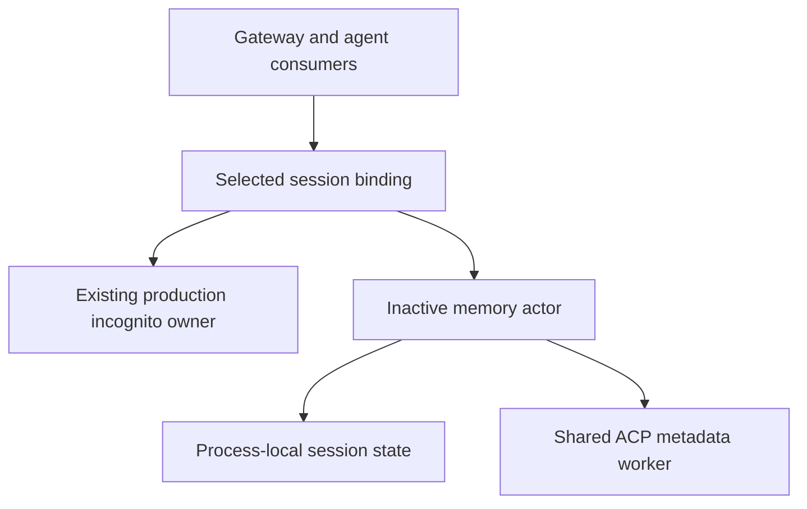

Codex review: needs real behavior proof before merge.

## What this changes

This PR routes session consumers through actor-owned memory storage while leaving production incognito acquisition on its existing owner.

## Review scores

| Measure | Result | What it means |
|---|---|---|
| **Overall readiness** | 🧂 unranked krab **(1/6)** | Useful maintainer-directed preparation, but an unresolved authority defect and absent final-effect authority evidence prevent merge readiness. |
| **Proof confidence** | 🧂 unranked krab **(1/6)** | Real behavior proof is necessary before merge. See [Before merge](#before-merge). |
| **Patch quality** | 🦪 silver shellfish **(2/6)** | Security review found an item that needs attention. |

## Product

**Kind:** Refactor · **Worth it:** Yes · **Fix scope:** Complete
**User problem:** Incognito consumers still depend on separate storage paths that must be adapted before the planned memory-owner cutover.
**Reason:** The maintainer has selected this staged direction, and production activation remains deferred.

## Merge readiness

⛔ **Blocked before merge - 6 items remain**

Keep this maintainer-directed refactor open; the prior ACP caller-guard defect remains in the reviewed head.

**Priority:** P2
**Reviewed head:** `c250a71bf8b954b978de365b18f6b21a2c8a34be`

## Before merge

- [ ] **Add real behavior proof** - Authority-chain proof required: show administrator access allowed and non-administrator access denied through the changed memory-backed Gateway and MCP consumers, then revoke caller authority or reparent the completion source after preparation and show rejection before disclosure, mutation, or tool I/O. The complete body supplies owner tests and prior-head workload/update receipts, but no trace of these final effects; preserve the inactive backend and redact credentials, IPs, phone numbers, and private endpoints. After adding proof, update the PR body; ClawSweeper should re-review automatically. If it does not, the PR author or someone with repository write access can comment `@clawsweeper re-review`.
- [ ] **Preserve the ACP caller guard through memory metadata writes (P2)** - With a live memory binding for agent:main:dashboard:incognito-acp, passing assertCommitAllowed that throws should reject the write, but this callback is only invoked for stage === "transaction". Memory snapshots and session.entry.patch authorize at "commit", so the callback never runs; prepareAcpSessionMutation and commitAcpSessionMutation also receive assertCurrent that checks only the actor and binding authority. Consequently, a cancelled or superseded ACP caller can still patch the entry and persist runtime metadata. Compose caller liveness into the actual entry and shared-worker effect guards, keeping it separate from metadata views intentionally invalidated during publication. This is the unresolved prior finding.
- [ ] **Resolve security concern: Caller-operation authority is not preserved** - The session actor may remain live after the ACP manager operation is cancelled or superseded; actor liveness therefore cannot replace the manager's independent authorization guard.
- [ ] **Resolve merge risk** - Prepared memory-backed Gateway and MCP authority must be shown to reject revoked administrator access and reparented completion sources before disclosure, mutation, or tool I/O.
- [ ] **Improve patch quality** - Add final-effect proof for non-administrator access and for caller revocation or completion-source reparenting before disclosure, mutation, or tool I/O.
- [ ] **Explain or restore the original intent of ACP shared-worker mutation authority** - 05161b949bcded143f477df59834b831054f555e: Move ACP metadata work to the shared worker while preserving lifecycle ownership and live request authority, as described in https://github.com/openclaw/openclaw/pull/167086.

## Findings

- [P2] Preserve the ACP caller guard through memory metadata writes — `src/acp/runtime/session-meta-memory.ts:78-80`
- [medium] Caller-operation authority is not preserved — `src/acp/runtime/session-meta-memory.ts:78`

### Provenance

- `ACP shared-worker mutation authority` changes intended behavior without addressing why it exists (05161b949bcded143f477df59834b831054f555e: Move ACP metadata work to the shared worker while preserving lifecycle ownership and live request authority, as described in https://github.com/openclaw/openclaw/pull/167086.)

### Tests

- Missing end-to-end proof: Supply a production-owner trace of allowed and forbidden memory-backed effects, including caller revocation and completion-source reparenting; the supplied tests do not establish this final-effect scenario.

<strong>Agent review details</strong>

### How this fits together

Gateway, agent, ACP, and SDK consumers send session operations to the selected actor; memory state stays process-local, while shared ACP runtime metadata still uses the durable worker.

### Technical review

Best possible solution:

Preserve ACP caller authority through both storage owners and keep the memory backend inactive until its final-effect authority contract is demonstrated.

Do we have a high-confidence way to reproduce the issue?

Source establishes a deterministic case: with a live memory binding, an assertCommitAllowed callback that throws is never invoked by the new ACP adapter, allowing its entry and metadata mutations to proceed.

Is this the best way to solve the issue?

The staged adapter approach follows the existing actor direction, but caller liveness must be composed into actual effect checks rather than attached to an admission stage the operation never uses.

Full review comments:

- [P2] Preserve the ACP caller guard through memory metadata writes — `src/acp/runtime/session-meta-memory.ts:78-80`
  With a live memory binding for agent:main:dashboard:incognito-acp, passing assertCommitAllowed that throws should reject the write, but this callback is only invoked for stage === "transaction". Memory snapshots and session.entry.patch authorize at "commit", so the callback never runs; prepareAcpSessionMutation and commitAcpSessionMutation also receive assertCurrent that checks only the actor and binding authority. Consequently, a cancelled or superseded ACP caller can still patch the entry and persist runtime metadata. Compose caller liveness into the actual entry and shared-worker effect guards, keeping it separate from metadata views intentionally invalidated during publication. This is the unresolved prior finding.
  Confidence: 0.99

Overall correctness: patch is incorrect
Overall confidence: 0.92

AGENTS.md: found and applied where relevant.

Codex review notes: model internal, reasoning medium; reviewed against [653b1d8bba92](https://github.com/openclaw/openclaw/commit/653b1d8bba921c00b241938e35852afd724c6723).

### Merge-risk options

**Maintainer options:**
1. **Hold for authority validation (recommended)**  
   Keep this PR open and inactive while the ACP guard is repaired and allowed, forbidden, and revoked authority is exercised through the changed final-effect consumers.

### Provenance checked

- `Inactive memory actor and deferred production acquisition` keeps the original intent (5bd4f88535c66197b6d07442b82f7f68d94be6fa: Provide the memory backend while retaining the existing production incognito owner until the coordinated cutover.)
- `Detached transcript snapshot projection` keeps the original intent (320d57bd4fb1280e23f4fb87cdd420751ca14828: Project actor-owned transcript snapshots without reopening their physical store; the changed adapter retains checks before observer disclosure and final result return.)
- `Materialized wrapper dependency context` keeps the original intent (7f2637f18d79c0a74e414da629062f65064d1ff4: Pin wrapper dependencies to their installed package directories; the patch extends that closure while retaining manifest-version checks.)

### Testing

Proof path: in-process harness.

### Security

Needs attention: The memory ACP adapter loses caller-operation authority, and changed disclosure and completion paths need final-effect validation.

### Evidence

Security concerns:

- [medium] Caller-operation authority is not preserved — `src/acp/runtime/session-meta-memory.ts:78`
  The session actor may remain live after the ACP manager operation is cancelled or superseded; actor liveness therefore cannot replace the manager's independent authorization guard.
  Confidence: 0.99

What I checked:

- **Introduced ACP caller guard is unreachable:** The new adapter places assertCommitAllowed inside a transaction-stage authorize callback, but snapshot and entry-patch operations use commit-stage authorization; its shared worker assertions also omit the caller guard. ([`src/acp/runtime/session-meta-memory.ts:78`](https://github.com/openclaw/openclaw/blob/c250a71bf8b954b978de365b18f6b21a2c8a34be/src/acp/runtime/session-meta-memory.ts#L78), [c250a71bf8b9](https://github.com/openclaw/openclaw/commit/c250a71bf8b954b978de365b18f6b21a2c8a34be))
- **Actual storage admission stage:** Memory storage checks the authoritative preimage with authorize("commit"), establishing why the adapter's transaction-only guard does not run. ([`src/config/sessions/session-actor-memory-storage.ts:106`](https://github.com/openclaw/openclaw/blob/c250a71bf8b954b978de365b18f6b21a2c8a34be/src/config/sessions/session-actor-memory-storage.ts#L106), [c250a71bf8b9](https://github.com/openclaw/openclaw/commit/c250a71bf8b954b978de365b18f6b21a2c8a34be))
- **Caller guard carries real lifecycle authority:** The ACP manager composes caller authorization and current-manager-actor checks into assertCommitAllowed; checking only the session storage binding does not preserve this contract. ([`src/acp/control-plane/manager.core.ts:609`](https://github.com/openclaw/openclaw/blob/c250a71bf8b954b978de365b18f6b21a2c8a34be/src/acp/control-plane/manager.core.ts#L609), [c250a71bf8b9](https://github.com/openclaw/openclaw/commit/c250a71bf8b954b978de365b18f6b21a2c8a34be))
- **Prior finding remains unchanged:** The ACP memory adapter is unchanged from the previously reviewed head, so the existing finding remains unresolved rather than being a newly discovered concern. ([`src/acp/runtime/session-meta-memory.ts:78`](https://github.com/openclaw/openclaw/blob/c250a71bf8b954b978de365b18f6b21a2c8a34be/src/acp/runtime/session-meta-memory.ts#L78), [c250a71bf8b9](https://github.com/openclaw/openclaw/commit/c250a71bf8b954b978de365b18f6b21a2c8a34be))
- **Production cutover remains deferred:** Current main selects native-incognito acquisition for ordinary incognito input, and the reviewed exclusion test expects no memory owner to be created. ([`src/config/sessions/session-input-actor.ts:87`](https://github.com/openclaw/openclaw/blob/653b1d8bba921c00b241938e35852afd724c6723/src/config/sessions/session-input-actor.ts#L87), [653b1d8bba92](https://github.com/openclaw/openclaw/commit/653b1d8bba921c00b241938e35852afd724c6723))
- **Maintainer direction and supplied proof:** The complete REST body describes an inactive staged cutover, explicitly accepts append-order, expiry, search, and close-settlement tradeoffs, and supplies test, benchmark, and prior-head update receipts; it supplies no allowed/forbidden final-effect authority trace. ([c250a71bf8b9](https://github.com/openclaw/openclaw/commit/c250a71bf8b954b978de365b18f6b21a2c8a34be))

### PR surface

PR surface statistics unavailable: the file list is incomplete.

### Labels

Label changes:

No label changes.

Label justifications:

- `P2`: This is useful staged session infrastructure, with current exposure limited by the inactive production backend.
- `merge-risk: 🚨 security-boundary`: The ACP adapter bypasses its caller-operation guard, and changed memory-backed disclosure and completion authority still requires final-effect validation.
- `rating: 🧂 unranked krab`: Overall readiness is 🧂 unranked krab; proof is 🧂 unranked krab and patch quality is 🦪 silver shellfish.
- `status: 📣 needs proof`: The PR needs real behavior proof before ClawSweeper can clear the contributor ask.

### Rating scale

6/6 🦀 challenger crab · 5/6 🦞 diamond lobster · 4/6 🐚 platinum hermit · 3/6 🦐 gold shrimp · 2/6 🦪 silver shellfish · 1/6 🧂 unranked krab. Overall follows the weaker of proof and patch quality; ✨ marks media proof (a screenshot, video, or linked artifact) that directly shows the changed behavior.

### Workflow

ClawSweeper edits this one comment on every review. Comment `@clawsweeper re-review` for a fresh review only. Repair and merge execution lanes are retired.

### History

Review history (6 earlier review cycles)

<!-- clawsweeper-review-history v=1 total=6 -->
- reviewed 2026-10-11T20:05:18.400Z sha a21f955850a8956af27f25cdd3c97ee4c8b8d45c :: needs real behavior proof before merge. :: none
- reviewed 2026-10-11T20:46:11.710Z sha 8f274851ab532a6164913146c67d7b15ed8f3524 :: needs real behavior proof before merge. :: [P2] Restore the trusted wrapper's runtime import closure
- reviewed 2026-10-11T21:22:34.049Z sha 9b5746b5c15db9eb4b2971a81fe82be51736a4b4 :: needs real behavior proof before merge. :: none
- reviewed 2026-10-11T21:44:32.703Z sha 9b5746b5c15db9eb4b2971a81fe82be51736a4b4 :: needs real behavior proof before merge. :: none
- reviewed 2026-10-11T23:09:25.178Z sha 755a15090381aa419b45721a179a9177b8cf711f :: needs real behavior proof before merge. :: [P1] Migrate the remaining caller to readConversationsAsync
- reviewed 2026-10-11T23:25:30.359Z sha 22cec2b40b971c6e3775559d8ff5f83ba7c26ed2 :: needs real behavior proof before merge. :: [P2] Preserve the ACP caller guard through memory metadata writes

_Reviewed October 11, 2026, 8:24 PM ET / October 12, 2026, 00:24 UTC (Revision 7)._

<!-- clawsweeper-security:security-sensitive item=169327 sha=c250a71bf8b954b978de365b18f6b21a2c8a34be confidence=high updated_at=2026-10-12T00:18:43Z reviewed_at=2026-10-12T00:24:29.798Z lease_owner=github-run-38187464130-1 lease_comment_id=6115517967 source_revision=d5692b7c7cbe76cffa1bbfb45382e28d8124a7961b5c01b9d24be986f96f5657 -->
<!-- clawsweeper-verdict:needs-human item=169327 sha=c250a71bf8b954b978de365b18f6b21a2c8a34be confidence=high updated_at=2026-10-12T00:18:43Z reviewed_at=2026-10-12T00:24:29.798Z lease_owner=github-run-38187464130-1 lease_comment_id=6115517967 source_revision=d5692b7c7cbe76cffa1bbfb45382e28d8124a7961b5c01b9d24be986f96f5657 hold=security findings=1 -->
<!-- clawsweeper-review-state:blocked item=169327 sha=c250a71bf8b954b978de365b18f6b21a2c8a34be v=1 -->

<!-- clawsweeper-review-version item=169327 reviewed_at=2026-10-12T00:24:29.798Z sha=c250a71bf8b954b978de365b18f6b21a2c8a34be source_revision=d5692b7c7cbe76cffa1bbfb45382e28d8124a7961b5c01b9d24be986f96f5657 lease_owner=github-run-38187464130-1 lease_comment_id=6115517967 v=1 -->

<!-- clawsweeper-review item=169327 -->