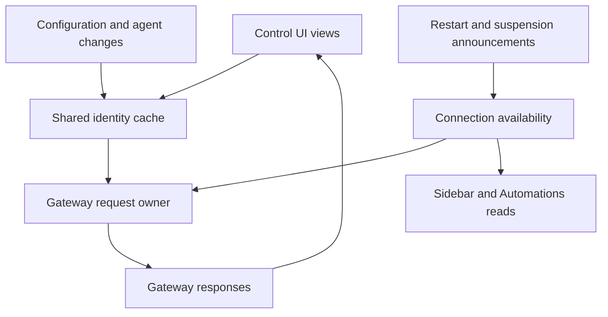

Codex review: needs maintainer review before merge.

## What this changes

The Control UI reuses agent names and avatars until invalidated and pauses background reads during announced Gateway restarts.

**Example:** A user leaves a Control UI chat open through ten idle minutes with presence updates.
- **Before:** The supplied browser baseline sends 11 agent identity requests, including the initial load.
- **After:** The supplied browser candidate sends one identity request and refreshes again after invalidation or reconnect.

## Review scores

| Measure | Result | What it means |
|---|---|---|
| **Overall readiness** | 🐚 platinum hermit **(4/6)** | A focused, correct performance improvement with relevant browser boundary proof and a documented freshness tradeoff. |
| **Proof confidence** | 🐚 platinum hermit **(4/6)** | Sufficient (live_output): Reported Chromium runs exercise the actual UI cache, availability, and shared request paths against synthetic Gateway data, showing quiet idle/drain reads and reconnect recovery; scoped repository policy permits this browser boundary proof. Prepared historical screenshots add no coverage for this PR, and virtual-time counts establish request behavior rather than production throughput. |
| **Patch quality** | 🦞 diamond lobster **(5/6)** | No actionable review findings were identified. |

## Product

**Kind:** Performance · **Worth it:** Yes
**User problem:** Open Control UI tabs repeatedly read unchanged agent identity and send avoidable reads while the Gateway restarts.
**Reason:** The measured per-tab request reductions justify the small change to existing owners. The author also appears in the merged history of the changed policy and explicitly records the direct-file freshness tradeoff.

## Merge readiness

✅ **Ready for maintainer review**

This PR remains useful and distinct from the earlier performance fixes. No actionable patch defect was found, and the reported CI failure matches an earlier main failure rather than this diff.

**Priority:** P2
**Reviewed head:** `b66b7e5934a408289fe33155cfee95ea56ef7bd4`

## Before merge

None.

## Findings

None.

<strong>Agent review details</strong>

### How this fits together

The Control UI reads agent identity and automation information from the Gateway over its shared client. Connection and availability owners control when those reads run and when cached results become obsolete.

### Technical review

Best possible solution:

Keep the existing cache and request owners with event-driven refreshes and the documented direct-file reload tradeoff.

Do we have a high-confidence way to reproduce the issue?

Yes: current-main source retains the one-minute identity expiry and announced-pause probes, and the supplied before/after browser observations exercise those paths. No target code was executed during this read-only review.

Is this the best way to solve the issue?

Yes: the patch changes the existing cache, request, and availability owners and preserves explicit invalidation, cancellation, deadlines, and unannounced-refusal recovery.

AGENTS.md: found and applied where relevant.

Codex review notes: model internal, reasoning medium; reviewed against [1d09a03dc9cd](https://github.com/openclaw/openclaw/commit/1d09a03dc9cd53fc83e6aea1d8f59d201f4f3525).

### Provenance checked

- `ui/src/lib/agents/identity.ts` changes intended behavior with a stated reason (https://github.com/openclaw/openclaw/pull/138635: Share identity reads across views while using a 60-second freshness bound to detect avatar-file replacement.)
- `packages/gateway-client/src/pending-request.ts` changes intended behavior with a stated reason (https://github.com/openclaw/openclaw/pull/167407: Pause five bootstrap reads together and retain a bounded recovery probe because a restart fence can roll back without readiness or socket replacement.)
- `ui/src/components/sidebar-attention-store.ts` keeps the original intent (https://github.com/openclaw/openclaw/pull/155686: Reuse automation inventory until events or connection changes, with visible failed-read retries and local overdue deadlines.)
- `ui/src/pages/cron/cron-page.ts` keeps the original intent (https://github.com/openclaw/openclaw/pull/140097: Prevent hidden-tab automation reads and perform a coalesced catch-up while retaining filters and drafts.)
- `ui/src/app/gateway-store.availability.ts` changes intended behavior with a stated reason (b44741cfeaeb2d7565c767412c8861c5b04ebaab: The existing availability owner expires stale lifecycle evidence into ordinary offline presentation.)

### Testing

Proof path: shipped entry point.

### Security

None.

### Evidence

What I checked:

- **Pinned introduced changes:** The merge-base-to-head diff changes the existing identity cache, bootstrap request owner, availability indicators, and sidebar/Automations consumers; it adds no competing scheduler or persisted state. ([`packages/gateway-client/src/pending-request.ts:77`](https://github.com/openclaw/openclaw/blob/b66b7e5934a408289fe33155cfee95ea56ef7bd4/packages/gateway-client/src/pending-request.ts#L77), [b66b7e5934a4](https://github.com/openclaw/openclaw/commit/b66b7e5934a408289fe33155cfee95ea56ef7bd4))
- **Still necessary on current main:** Fetched main still expires successful identities after 60 seconds and schedules probes for announced pauses; none of the six production/documentation paths changed between the pinned merge base and fetched main. ([`ui/src/lib/agents/identity.ts:28`](https://github.com/openclaw/openclaw/blob/1d09a03dc9cd53fc83e6aea1d8f59d201f4f3525/ui/src/lib/agents/identity.ts#L28), [1d09a03dc9cd](https://github.com/openclaw/openclaw/commit/1d09a03dc9cd53fc83e6aea1d8f59d201f4f3525))
- **Identity freshness provenance and accepted tradeoff:** The earlier merged avatar work explicitly used a 60-second freshness bound to detect direct file replacement. This PR deliberately replaces that policy with event invalidation and documents reload/reconnect for direct IDENTITY.md or avatar-file edits at https://docs.openclaw.ai/web/control-ui. ([`ui/src/lib/agents/identity.ts:26`](https://github.com/openclaw/openclaw/blob/712622517abbd4470beef17060e1419fa1d9c0c0/ui/src/lib/agents/identity.ts#L26), [712622517abb](https://github.com/openclaw/openclaw/commit/712622517abbd4470beef17060e1419fa1d9c0c0))
- **Browser runtime proof:** The fully inspected PR body reports headless Chromium exercising UI boot, rendering, shared identity caches, and transport replay with synthetic Gateway data and virtual time: idle identity requests fall from 11 to 1, announced-drain identity rejections fall from 99 to 0, all four measured methods remain quiet during the drain, and reconnect displays Cedar. The added browser scenario matches these claims; baseline failures and candidate checks are reported in the linked Testbox runs. ([`ui/src/e2e/agent-identity-reconnect.e2e.test.ts:17`](https://github.com/openclaw/openclaw/blob/b66b7e5934a408289fe33155cfee95ea56ef7bd4/ui/src/e2e/agent-identity-reconnect.e2e.test.ts#L17), [b66b7e5934a4](https://github.com/openclaw/openclaw/commit/b66b7e5934a408289fe33155cfee95ea56ef7bd4))
- **Prepared media inspected:** Both downloaded screenshots were inspected. They depict the earlier long-chat/avatar comparison and do not demonstrate this PR's idle-read or restart behavior; this review relies on the browser runtime observations instead.
- **Inherited CI failure:** GitHub job metadata confirms that the PR run and earlier main job both fail Check bundled plugin generated assets. The author identifies the same stale Workboard manifest in both and records the inherited-failure landing exception. Raw logs could not be independently read because their Azure artifact host is blocked by the review proxy; the Workboard manifest and package inputs are unchanged in the inspected merge comparison.

Likely related people:

- **Peter Steinberger:** Raw commit 712622517abbd4470beef17060e1419fa1d9c0c0 adds ui/src/lib/agents/identity.ts:21 relative to its recorded parents. This identifies author metadata, not feature responsibility or a PR merger. (role: source-line author; confidence: high; commits: [712622517abb](https://github.com/openclaw/openclaw/commit/712622517abbd4470beef17060e1419fa1d9c0c0); files: `ui/src/lib/agents/identity.ts`)
- **Nehanth Narendrula:** Raw commit b44741cfeaeb2d7565c767412c8861c5b04ebaab adds ui/src/app/gateway-store.availability.ts:26 relative to its recorded parents. This identifies author metadata, not feature responsibility or a PR merger. (role: source-line author; confidence: medium; commits: [b44741cfeaeb](https://github.com/openclaw/openclaw/commit/b44741cfeaeb2d7565c767412c8861c5b04ebaab); files: `ui/src/app/gateway-store.availability.ts`)

### PR surface

Source +18, Tests +206, Docs +2. Total +226 across 12 files. Added test files: 0.

View PR surface stats

| Area | Files | Added | Removed | Net |
|---|---:|---:|---:|---:|
| Source | 5 | 57 | 39 | +18 |
| Tests | 6 | 295 | 89 | +206 |
| Docs | 1 | 4 | 2 | +2 |
| Config | 0 | 0 | 0 | 0 |
| Generated | 0 | 0 | 0 | 0 |
| Other | 0 | 0 | 0 | 0 |
| **Total** | **12** | **356** | **130** | **+226** |

### Review metrics

| Metric | Value | Why it matters |
|---|---|---|
| **Production versus tests** | Production net +18 LOC; tests net +206 LOC | The small production growth records announcement and recovery state in existing owners while removing successful-cache expiration machinery. |

### Labels

Label changes:

No label changes.

Label justifications:

- `P2`: This reduces redundant per-tab Gateway work during idle use and restart without evidence of an urgent availability regression.
- `merge-risk: 🚨 compatibility`: The explicitly documented freshness tradeoff means direct workspace identity/avatar edits require reload or reconnect instead of automatic expiry.
- `rating: 🐚 platinum hermit`: Overall readiness is 🐚 platinum hermit; proof is 🐚 platinum hermit and patch quality is 🦞 diamond lobster.
- `status: 👀 ready for maintainer look`: ClawSweeper has no concrete contributor-facing blocker left for this PR.
- `proof: sufficient`: Contributor real behavior proof is sufficient.

### Rating scale

6/6 🦀 challenger crab · 5/6 🦞 diamond lobster · 4/6 🐚 platinum hermit · 3/6 🦐 gold shrimp · 2/6 🦪 silver shellfish · 1/6 🧂 unranked krab. Overall follows the weaker of proof and patch quality; ✨ marks media proof (a screenshot, video, or linked artifact) that directly shows the changed behavior.

### Workflow

ClawSweeper edits this one comment on every review. Comment `@clawsweeper re-review` for a fresh review only; repair and merge need explicit maintainer commands such as `@clawsweeper autofix` or `@clawsweeper automerge`.

### History

Review history (2 earlier review cycles)

<!-- clawsweeper-review-history v=1 total=2 -->
- reviewed 2026-10-09T21:22:39.385Z sha b66b7e5934a408289fe33155cfee95ea56ef7bd4 :: needs maintainer review before merge. :: none
- reviewed 2026-10-09T21:29:40.563Z sha b66b7e5934a408289fe33155cfee95ea56ef7bd4 :: needs maintainer review before merge. :: none

_Reviewed October 9, 2026, 6:14 PM ET / 22:14 UTC (Revision 3)._

<!-- clawsweeper-verdict:needs-human item=167968 sha=b66b7e5934a408289fe33155cfee95ea56ef7bd4 confidence=high updated_at=2026-10-09T22:10:19Z reviewed_at=2026-10-09T22:14:10.660Z lease_owner=github-run-37997634433-1 lease_comment_id=6090091056 source_revision=32b8540ebe5e5740408587930d6997a5ffa3b1d08a09c519fb887bb08c4a1365 live_verification=absent hold=not_opted_in findings=0 -->
<!-- clawsweeper-review-state:ready item=167968 sha=b66b7e5934a408289fe33155cfee95ea56ef7bd4 v=1 -->

<!-- clawsweeper-review-version item=167968 reviewed_at=2026-10-09T22:14:10.660Z sha=b66b7e5934a408289fe33155cfee95ea56ef7bd4 source_revision=32b8540ebe5e5740408587930d6997a5ffa3b1d08a09c519fb887bb08c4a1365 lease_owner=github-run-37997634433-1 lease_comment_id=6090091056 v=1 -->

<!-- clawsweeper-review item=167968 -->