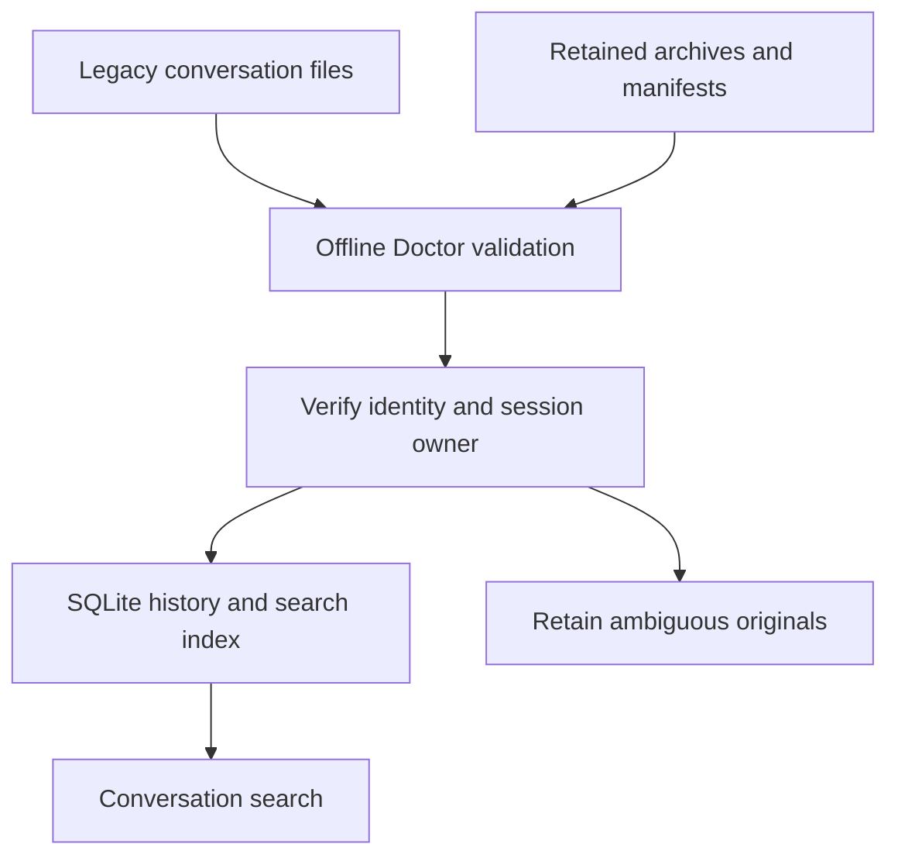

Codex review: needs maintainer review before merge. _Reviewed September 11, 2026, 11:59 PM ET / September 12, 2026, 03:59 UTC (Revision 14)._

# ClawSweeper review

## What this changes

Doctor discovers and imports omitted historical conversations, including protected migration archives, while preserving current sessions and original files.

## Merge readiness

✅ **Ready for maintainer review**

This remains a useful, maintainer-supported repair for a confirmed migration gap. No actionable introduced defect remains, and the published-updater evidence satisfies the previous compatibility-proof request.

**Priority:** P1
**Reviewed head:** `9d581a1b5e129116bc018cceb100ae9d7089c40e`

## Review scores

| Measure | Result | What it means |
|---|---|---|
| **Overall readiness** | 🐚 platinum hermit **(4/6)** | A coherent owner-level repair with strong real-flow evidence and no remaining actionable findings. |
| **Proof confidence** | 🦞 diamond lobster **(5/6)** | Sufficient (live_output): Public Doctor and Gateway results show recovered search, preserved originals, and idempotent retry; separate fresh-agent and published 2026.7.1-2 updater receipts cover admission and upgrade compatibility. The relevant implementation is unchanged from the identified proof revision. |
| **Patch quality** | 🐚 platinum hermit **(4/6)** | No actionable review findings were identified. |

## Verification

| Check | Result | Evidence |
|---|---|---|
| **Real behavior** | Verified | Sufficient (live_output): Public Doctor and Gateway results show recovered search, preserved originals, and idempotent retry; separate fresh-agent and published 2026.7.1-2 updater receipts cover admission and upgrade compatibility. The relevant implementation is unchanged from the identified proof revision. |
| **Evidence reviewed** | 8 items | Reporter confirmed the registry boundary: The reporter’s controlled experiment increased imported windows from 230 to 634 by extending the registry before migration, and explicitly distinguished primary conversations from diagnostic trajectories: https://github.com/openclaw/openclaw/issues/140620#issuecomment-5639615665. Still needed on main and the latest release: Current main still filters import targets by registry existence and builds import records from that registry. The inspected v2026.9.4 implementation has the same boundary; neither contains the new historical-discovery module. The related cold-storage PR addresses a different responsibility. Current-main comparison: The main and pinned-base importer files are identical. Source inspection confirms that search reconciliation starts from persisted transcript rows and cannot discover omitted filesystem history. |
| **Findings** | None | None. |
| **Security** | None | None. |

## How this fits together

Doctor migrates legacy conversation files into OpenClaw’s SQLite session store. Session search consumes that stored history, so files omitted during migration remain unsearchable.

## Before merge

None.

<strong>Agent review details</strong>

### Security

None.

### PR surface

Source +546, Tests +520, Docs +15. Total +1081 across 9 files.

View PR surface stats

| Area | Files | Added | Removed | Net |
|---|---:|---:|---:|---:|
| Source | 5 | 581 | 35 | +546 |
| Tests | 3 | 520 | 0 | +520 |
| Docs | 1 | 15 | 0 | +15 |
| Config | 0 | 0 | 0 | 0 |
| Generated | 0 | 0 | 0 | 0 |
| Other | 0 | 0 | 0 | 0 |
| **Total** | **9** | **1116** | **35** | **+1081** |

### Review metrics

| Metric | Value | Why it matters |
|---|---|---|
| **Production versus regression coverage** | production +546 net lines; tests +520 net lines | Production growth implements the accepted discovery and recovery responsibility while retaining the existing import and storage owners. |

### Stored data model

Persistent data-model change detected: `migration/backfill/repair: src/commands/doctor-session-sqlite-discovery.ts`, `migration/backfill/repair: src/commands/doctor-session-sqlite-readers.ts`, `migration/backfill/repair: src/commands/doctor-session-sqlite.ts`, `unknown-data-model-change: src/commands/doctor-session-sqlite-discovery.ts`, `unknown-data-model-change: src/commands/doctor-session-sqlite-readers.ts`, `unknown-data-model-change: src/commands/doctor-session-sqlite.ts`. Migration or upgrade compatibility proof is recorded; maintainers should verify it before merge.

### Technical review

Best possible solution:

Keep historical recovery within offline Doctor, using the existing transactional importer and protected-original lifecycle.

Do we have a high-confidence way to reproduce the issue?

Yes: current source imports registry entries while sweeping omitted primary files into protected archives, matching the reporter’s controlled experiment. No runtime reproduction or tests were executed during this read-only review.

Is this the best way to solve the issue?

Yes: the patch repairs discovery at the existing offline migration owner and preserves SQLite-only runtime behavior; the recorded fresh-state and published-updater results cover the relevant compatibility boundary.

AGENTS.md: found and applied where relevant.

Codex review notes: model internal, reasoning medium; reviewed against [ec575b2ead3c](https://github.com/openclaw/openclaw/commit/ec575b2ead3c199d2c1d1250122281db8641a5f5).

### Labels

Label justifications:

- `P1`: This repairs confirmed loss of searchable historical conversations during official-release upgrades.
- `rating: 🐚 platinum hermit`: Overall readiness is 🐚 platinum hermit; proof is 🦞 diamond lobster and patch quality is 🐚 platinum hermit.
- `status: 👀 ready for maintainer look`: ClawSweeper has no concrete contributor-facing blocker left for this PR. Sufficient (live_output): Public Doctor and Gateway results show recovered search, preserved originals, and idempotent retry; separate fresh-agent and published 2026.7.1-2 updater receipts cover admission and upgrade compatibility. The relevant implementation is unchanged from the identified proof revision.
- `proof: sufficient`: Contributor real behavior proof is sufficient. Public Doctor and Gateway results show recovered search, preserved originals, and idempotent retry; separate fresh-agent and published 2026.7.1-2 updater receipts cover admission and upgrade compatibility. The relevant implementation is unchanged from the identified proof revision.

### Evidence

What I checked:

- **Reporter confirmed the registry boundary:** The reporter’s controlled experiment increased imported windows from 230 to 634 by extending the registry before migration, and explicitly distinguished primary conversations from diagnostic trajectories: https://github.com/openclaw/openclaw/issues/140620#issuecomment-5639615665.
- **Still needed on main and the latest release:** Current main still filters import targets by registry existence and builds import records from that registry. The inspected v2026.9.4 implementation has the same boundary; neither contains the new historical-discovery module. The related cold-storage PR addresses a different responsibility. ([`src/commands/doctor-session-sqlite.ts:320`](https://github.com/openclaw/openclaw/blob/3a9d69db306cd7f081e06254cb89c4bcc14a7107/src/commands/doctor-session-sqlite.ts#L320), [3a9d69db306c](https://github.com/openclaw/openclaw/commit/3a9d69db306cd7f081e06254cb89c4bcc14a7107))
- **Current-main comparison:** The main and pinned-base importer files are identical. Source inspection confirms that search reconciliation starts from persisted transcript rows and cannot discover omitted filesystem history. ([`src/commands/doctor-session-sqlite.ts:320`](https://github.com/openclaw/openclaw/blob/ec575b2ead3c199d2c1d1250122281db8641a5f5/src/commands/doctor-session-sqlite.ts#L320), [ec575b2ead3c](https://github.com/openclaw/openclaw/commit/ec575b2ead3c199d2c1d1250122281db8641a5f5))
- **Recovery and ownership safeguards:** Discovery validates primary-file identity, rejects conflicting owners and duplicate identities, and excludes completed recovery receipts. The transactional importer rechecks window ownership and preserves an existing logical session node; the existing cold-transcript refusal remains intact. ([`src/config/sessions/session-accessor.sqlite-import.ts:120`](https://github.com/openclaw/openclaw/blob/9d581a1b5e129116bc018cceb100ae9d7089c40e/src/config/sessions/session-accessor.sqlite-import.ts#L120), [9d581a1b5e12](https://github.com/openclaw/openclaw/commit/9d581a1b5e129116bc018cceb100ae9d7089c40e))
- **Prior findings and proof continuity:** The inspected comparison is empty for the historical-import files, documentation, CI-plan test, and session-storage tree between the previously reviewed proof head and this head. Current selector coverage includes transcript-only retired agents; lineage collection includes previous generations and checkpoint references, with discovery confined to Doctor. ([`src/commands/doctor-session-sqlite.discovery.test.ts:53`](https://github.com/openclaw/openclaw/blob/9d581a1b5e129116bc018cceb100ae9d7089c40e/src/commands/doctor-session-sqlite.discovery.test.ts#L53), [9d581a1b5e12](https://github.com/openclaw/openclaw/commit/9d581a1b5e129116bc018cceb100ae9d7089c40e))
- **Complete captured proof body inspected:** The full REST-fetched body matches captured SHA256 2cb1dd72953e40dd1271d1810e716036693fd625c160f6da5e0a3b2f9d5c76fc. Inline receipts identify the public Doctor command, a fresh registry-free agent, schema 20, preserved original bytes, and the genuine 2026.7.1-2 updater invoking candidate Doctor. The separate omission experiment recovers 1,503 conversations from a 27-entry registry; the upgrade scenario records 46 passed phases, preserved session/event/cron counts, restart reads, and retry. These observations retain their actual 9f02173e0a5 proof revision. ([9f02173e0a53](https://github.com/openclaw/openclaw/commit/9f02173e0a5367b5f3a8649013a3ecbdd813cb8e))

Likely related people:

- **fuller-stack-dev:** Suggested for follow-up; no historical authorship or introduction is verified. (role: unverified routing candidate; confidence: low)
- **steipete:** Suggested for follow-up; no historical authorship or introduction is verified. (role: unverified routing candidate; confidence: low)

### Rating scale

| Score | Internal tier | Crab rank | Meaning |
|---:|:---:|---|---|
| **6/6** | S | 🦀 challenger crab | Exceptional readiness |
| **5/6** | A | 🦞 diamond lobster | Very strong readiness |
| **4/6** | B | 🐚 platinum hermit | Good normal PR; ordinary maintainer review |
| **3/6** | C | 🦐 gold shrimp | Useful, but confidence is limited |
| **2/6** | D | 🦪 silver shellfish | Proof or implementation needs work |
| **1/6** | F | 🧂 unranked krab | Not merge-ready |
| N/A | NA | 🌊 off-meta tidepool | Rating does not apply |

Overall follows the weaker of proof and patch quality.
Shiny media proof means a screenshot, video, or linked artifact directly shows the changed behavior. Runtime, network, CSP, and security claims still need visible diagnostics.

### Workflow

- ClawSweeper keeps one durable marker-backed review comment per issue or PR.
- Re-runs edit this comment so the latest verdict, findings, and automation markers stay together instead of adding duplicate bot comments.
- A fresh review can be triggered by eligible `@clawsweeper re-review` comments, exact-item GitHub events, scheduled/background review runs, or manual workflow dispatch.
- PR/issue authors and users with repository write access can comment `@clawsweeper re-review` or `@clawsweeper re-run` on an open PR or issue to request a fresh review only.
- Maintainers can also comment `@clawsweeper review` to request a fresh review only.
- Fresh-review commands do not start repair, autofix, rebase, CI repair, or automerge.
- Maintainer-only repair and merge flows require explicit commands such as `@clawsweeper autofix`, `@clawsweeper automerge`, `@clawsweeper fix ci`, or `@clawsweeper address review`.
- Maintainers can comment `@clawsweeper explain` to ask for more context, or `@clawsweeper stop` to stop active automation.

### History

Review history (13 earlier review cycles; latest 8 shown)

<!-- clawsweeper-review-history v=1 total=13 -->
- reviewed 2026-08-26T01:31:54.947Z sha 1146651fb17760391c95c540547916cec6ec62ed :: needs real behavior proof before merge. :: [P1] Collect every retained checkpoint transcript reference | [P2] Keep directory discovery out of generic session resolution
- reviewed 2026-09-02T01:50:26.859Z sha 1146651fb17760391c95c540547916cec6ec62ed :: needs real behavior proof before merge. :: [P1] Collect every retained transcript reference | [P2] Keep directory discovery out of generic session resolution
- reviewed 2026-09-02T20:41:35.614Z sha 1146651fb17760391c95c540547916cec6ec62ed :: needs real behavior proof before merge. :: [P1] Stop treating unindexed history as an orphan | [P2] Keep directory scans out of session resolution
- reviewed 2026-09-11T21:59:57.397Z sha 4ef343e9ef504267ab7fabe322c3726b48fd700d :: needs real behavior proof before merge. :: [P2] Admit transcript-only stores before filtering migration targets
- reviewed 2026-09-12T00:40:16.772Z sha 3014bc038a4ae869de18ca6d81b9d3831d16df33 :: needs real behavior proof before merge. :: [P2] [P2] Admit transcript-only stores before filtering migration targets
- reviewed 2026-09-12T01:12:53.377Z sha a00d26a6171c8d9277f47a4bedd286555a04531a :: needs real behavior proof before merge. :: none
- reviewed 2026-09-12T01:24:06.572Z sha 9f02173e0a5367b5f3a8649013a3ecbdd813cb8e :: needs real behavior proof before merge. :: none
- reviewed 2026-09-12T01:40:58.459Z sha 9f02173e0a5367b5f3a8649013a3ecbdd813cb8e :: blocked before merge. :: none

<!-- clawsweeper-verdict:needs-human item=120781 sha=9d581a1b5e129116bc018cceb100ae9d7089c40e confidence=high updated_at=2026-09-12T03:56:38Z reviewed_at=2026-09-12T03:59:38.558Z lease_owner=github-run-34671633153-1 lease_comment_id=5643305865 source_revision=7c72fab61dfbdf05958bb1f2db57e7c81fa09c1d970027338f6302382c9eeb67 live_verification=absent -->
<!-- clawsweeper-review-state:ready item=120781 sha=9d581a1b5e129116bc018cceb100ae9d7089c40e v=1 -->

<!-- clawsweeper-review-version item=120781 reviewed_at=2026-09-12T03:59:38.558Z sha=9d581a1b5e129116bc018cceb100ae9d7089c40e source_revision=7c72fab61dfbdf05958bb1f2db57e7c81fa09c1d970027338f6302382c9eeb67 lease_owner=github-run-34671633153-1 lease_comment_id=5643305865 v=1 -->

<!-- clawsweeper-review item=120781 -->