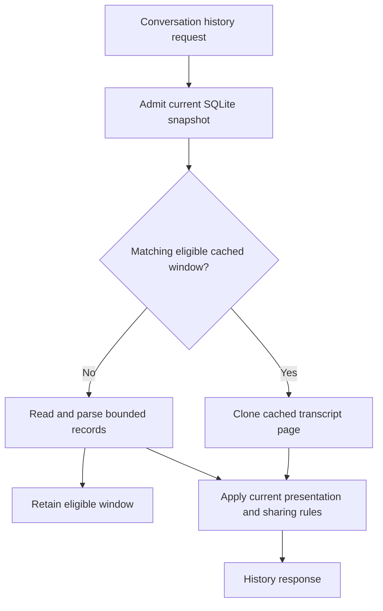

Codex review: needs maintainer review before merge. _Reviewed September 19, 2026, 4:57 AM ET / 08:57 UTC._

# ClawSweeper review

## What this changes

Reuses bounded, unchanged transcript windows to reduce repeated conversation-history parsing, with independent returned copies and regression coverage for freshness and read fences.

## Merge readiness

✅ **Ready for maintainer review**

Keep open: the optimization remains absent from main and the latest release, and the reviewed patch has no blocking correctness findings. The maintainer-authored contribution is focused and supported by a relevant benchmark.

**Priority:** P2
**Reviewed head:** `73d652a4d1fc5454d30303ebfba6c159b9d134e0`

## Review scores

| Measure | Result | What it means |
|---|---|---|
| **Overall readiness** | 🐚 platinum hermit **(4/6)** | A focused optimization with useful consumer-path measurements, targeted regression coverage, and no blocking findings. |
| **Proof confidence** | 🐚 platinum hermit **(4/6)** | Not applicable: The external-contributor proof gate does not apply to this maintainer-authored internal optimization. The supplied benchmark exercises the changed query owner and registered chat.history handler, reports improved latency and CPU, and clearly distinguishes synthetic measurements from unmeasured production benefit. |
| **Patch quality** | 🐚 platinum hermit **(4/6)** | No actionable review findings were identified. |

## Verification

| Check | Result | Evidence |
|---|---|---|
| **Real behavior** | Not applicable | Not applicable: The external-contributor proof gate does not apply to this maintainer-authored internal optimization. The supplied benchmark exercises the changed query owner and registered chat.history handler, reports improved latency and CPU, and clearly distinguishes synthetic measurements from unmeasured production benefit. |
| **Evidence reviewed** | 9 items | Verified patch boundary: The supplied complete merge-base-to-head patch changes the transcript query owner and two tests. Raw inspection confirmed that the test merge has the pinned base followed by the exact PR head as parents; its comparison contains the same three paths. Optimization remains necessary on main: Current main still calls the uncached recent-history reader directly. Its existing query and metadata optimizations do not retain parsed recent pages. Latest release comparison: The latest supplied release, v2026.9.5, also delegates directly to the uncached reader. |
| **Findings** | None | None. |
| **Security** | None | None. |

## How this fits together

Gateway history requests read transcript records from SQLite before applying display, redaction, and sharing rules. This cache sits inside the transcript query owner, after snapshot admission and before message presentation.

## Before merge

None.

<strong>Agent review details</strong>

### Security

None.

### PR surface

Source +58, Tests +75. Total +133 across 3 files.

View PR surface stats

| Area | Files | Added | Removed | Net |
|---|---:|---:|---:|---:|
| Source | 1 | 68 | 10 | +58 |
| Tests | 2 | 96 | 21 | +75 |
| Docs | 0 | 0 | 0 | 0 |
| Config | 0 | 0 | 0 | 0 |
| Generated | 0 | 0 | 0 | 0 |
| Other | 0 | 0 | 0 | 0 |
| **Total** | **3** | **164** | **31** | **+133** |

### Review metrics

| Metric | Value | Why it matters |
|---|---|---|
| **Cache retention** | 16 windows; at most 1 MiB raw transcript data per window | Retention is bounded per process, although decoded objects and connection references add heap overhead. |
| **Reported handler improvement** | Median latency −10.1%; CPU/request −13.7% | The supplied synthetic registered-handler benchmark measures the consumer path beyond the query helper. |

### Technical review

Best possible solution:

Keep parsed-window reuse within the existing snapshot reader while leaving current authorization, display policy, and persistent transcript ownership with their existing owners.

Do we have a high-confidence way to reproduce the issue?

Not applicable as a correctness bug: repeated parsing is visible in main's source, and the supplied synthetic handler benchmark measures its cost.

Is this the best way to solve the issue?

Yes. Reusing bounded parsed pages after snapshot admission addresses the repeated work without introducing another persistence owner or caching authorization decisions.

AGENTS.md: found and applied where relevant.

Codex review notes: model internal, reasoning medium; reviewed against [d7fa5059fc8d](https://github.com/openclaw/openclaw/commit/d7fa5059fc8d30664985bb246aee210be8991d13).

### Labels

Label changes:

- add `P2`: This is a bounded performance improvement for repeated conversation-history reads, without an urgent user-facing regression.
- add `rating: 🐚 platinum hermit`: Overall readiness is 🐚 platinum hermit; proof is 🐚 platinum hermit and patch quality is 🐚 platinum hermit.
- add `status: 👀 ready for maintainer look`: ClawSweeper has no concrete contributor-facing blocker left for this PR. Not applicable: The external-contributor proof gate does not apply to this maintainer-authored internal optimization. The supplied benchmark exercises the changed query owner and registered chat.history handler, reports improved latency and CPU, and clearly distinguishes synthetic measurements from unmeasured production benefit.

Label justifications:

- `P2`: This is a bounded performance improvement for repeated conversation-history reads, without an urgent user-facing regression.
- `rating: 🐚 platinum hermit`: Overall readiness is 🐚 platinum hermit; proof is 🐚 platinum hermit and patch quality is 🐚 platinum hermit.
- `status: 👀 ready for maintainer look`: ClawSweeper has no concrete contributor-facing blocker left for this PR. Not applicable: The external-contributor proof gate does not apply to this maintainer-authored internal optimization. The supplied benchmark exercises the changed query owner and registered chat.history handler, reports improved latency and CPU, and clearly distinguishes synthetic measurements from unmeasured production benefit.

### Evidence

What I checked:

- **Verified patch boundary:** The supplied complete merge-base-to-head patch changes the transcript query owner and two tests. Raw inspection confirmed that the test merge has the pinned base followed by the exact PR head as parents; its comparison contains the same three paths. ([db75f174d999](https://github.com/openclaw/openclaw/commit/db75f174d9993b9d2378c434d478ee3773c78c8f))
- **Optimization remains necessary on main:** Current main still calls the uncached recent-history reader directly. Its existing query and metadata optimizations do not retain parsed recent pages. ([`src/config/sessions/session-accessor.sqlite-history-query.ts:372`](https://github.com/openclaw/openclaw/blob/d7fa5059fc8d30664985bb246aee210be8991d13/src/config/sessions/session-accessor.sqlite-history-query.ts#L372), [d7fa5059fc8d](https://github.com/openclaw/openclaw/commit/d7fa5059fc8d30664985bb246aee210be8991d13))
- **Latest release comparison:** The latest supplied release, v2026.9.5, also delegates directly to the uncached reader. ([`src/config/sessions/session-accessor.sqlite-history-query.ts:372`](https://github.com/openclaw/openclaw/blob/ec9c1a13db8938e5a3eaa51fca2e981cde2395a9/src/config/sessions/session-accessor.sqlite-history-query.ts#L372), [ec9c1a13db89](https://github.com/openclaw/openclaw/commit/ec9c1a13db8938e5a3eaa51fca2e981cde2395a9))
- **Cache identity, bounds, and isolation:** Reuse requires the same physical connection, store, agent, session, generation, indexed sequence, and read limits. In-memory databases, expected-window checks, and current-turn fences bypass reuse. Both retained and returned pages are cloned; retention is capped at 16 windows containing at most 1 MiB of raw transcript data each. ([`src/config/sessions/session-accessor.sqlite-history-query.ts:397`](https://github.com/openclaw/openclaw/blob/73d652a4d1fc5454d30303ebfba6c159b9d134e0/src/config/sessions/session-accessor.sqlite-history-query.ts#L397), [73d652a4d1fc](https://github.com/openclaw/openclaw/commit/73d652a4d1fc5454d30303ebfba6c159b9d134e0))
- **Existing mutation invalidation:** Full replacement rotates the generation, including replacement with an empty transcript; exact row rewrites also rotate it. The suffix writer independently rotates the generation when sequence positions can be reused. Snapshot admission checks indexed sequence against the current latest row before entering the query owner. ([`src/config/sessions/session-accessor.sqlite-transcript-store.ts:408`](https://github.com/openclaw/openclaw/blob/73d652a4d1fc5454d30303ebfba6c159b9d134e0/src/config/sessions/session-accessor.sqlite-transcript-store.ts#L408), [73d652a4d1fc](https://github.com/openclaw/openclaw/commit/73d652a4d1fc5454d30303ebfba6c159b9d134e0))
- **Authority remains outside cached payloads:** The read-only reader repeats canonical admission and conditional row validation before snapshot reads. The history handler separately checks current sharing and session identity after history work; cached transcript pages contain neither a sharing grant nor a final response. ([`src/gateway/session-history-readonly-reader.ts:147`](https://github.com/openclaw/openclaw/blob/73d652a4d1fc5454d30303ebfba6c159b9d134e0/src/gateway/session-history-readonly-reader.ts#L147), [73d652a4d1fc](https://github.com/openclaw/openclaw/commit/73d652a4d1fc5454d30303ebfba6c159b9d134e0))

Likely related people:

- **steipete:** Suggested for follow-up; no historical authorship or introduction is verified. (role: unverified routing candidate; confidence: low)
- **Vincent Koc:** Suggested for follow-up; no historical authorship or introduction is verified. (role: unverified routing candidate; confidence: low)

### Rating scale

| Score | Internal tier | Crab rank | Meaning |
|---:|:---:|---|---|
| **6/6** | S | 🦀 challenger crab | Exceptional readiness |
| **5/6** | A | 🦞 diamond lobster | Very strong readiness |
| **4/6** | B | 🐚 platinum hermit | Good normal PR; ordinary maintainer review |
| **3/6** | C | 🦐 gold shrimp | Useful, but confidence is limited |
| **2/6** | D | 🦪 silver shellfish | Proof or implementation needs work |
| **1/6** | F | 🧂 unranked krab | Not merge-ready |
| N/A | NA | 🌊 off-meta tidepool | Rating does not apply |

Overall follows the weaker of proof and patch quality.
Shiny media proof means a screenshot, video, or linked artifact directly shows the changed behavior. Runtime, network, CSP, and security claims still need visible diagnostics.

### Workflow

- ClawSweeper keeps one durable marker-backed review comment per issue or PR.
- Re-runs edit this comment so the latest verdict, findings, and automation markers stay together instead of adding duplicate bot comments.
- A fresh review can be triggered by eligible `@clawsweeper re-review` comments, exact-item GitHub events, scheduled/background review runs, or manual workflow dispatch.
- PR/issue authors and users with repository write access can comment `@clawsweeper re-review` or `@clawsweeper re-run` on an open PR or issue to request a fresh review only.
- Maintainers can also comment `@clawsweeper review` to request a fresh review only.
- Fresh-review commands do not start repair, autofix, rebase, CI repair, or automerge.
- Maintainer-only repair and merge flows require explicit commands such as `@clawsweeper autofix`, `@clawsweeper automerge`, `@clawsweeper fix ci`, or `@clawsweeper address review`.
- Maintainers can comment `@clawsweeper explain` to ask for more context, or `@clawsweeper stop` to stop active automation.

<!-- clawsweeper-verdict:needs-human item=152734 sha=73d652a4d1fc5454d30303ebfba6c159b9d134e0 confidence=high updated_at=2026-09-19T08:54:47Z reviewed_at=2026-09-19T08:57:24.821Z lease_owner=github-run-35433199624-1 lease_comment_id=5740610220 source_revision=a141dad4eb33cdb8199fa2c891ae7a8b247ca0f92e158e82daa02ea86e3c12c1 live_verification=absent -->
<!-- clawsweeper-review-state:ready item=152734 sha=73d652a4d1fc5454d30303ebfba6c159b9d134e0 v=1 -->

<!-- clawsweeper-review-version item=152734 reviewed_at=2026-09-19T08:57:24.821Z sha=73d652a4d1fc5454d30303ebfba6c159b9d134e0 source_revision=a141dad4eb33cdb8199fa2c891ae7a8b247ca0f92e158e82daa02ea86e3c12c1 lease_owner=github-run-35433199624-1 lease_comment_id=5740610220 v=1 -->

<!-- clawsweeper-review item=152734 -->