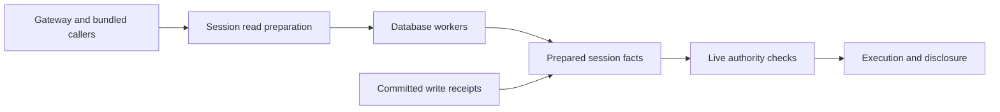

Codex review: needs real behavior proof before merge.

## What this changes

This PR moves bundled session reads into existing database workers and carries committed facts through runtime authorization.

**Example:** The Gateway reads session metadata for agent:main:main.
- **Before:** Bundled callers can query SQLite synchronously on the Gateway thread.
- **After:** Callers await worker reads and consume retained facts updated by committed writes.

## Review scores

| Measure | Result | What it means |
|---|---|---|
| **Overall readiness** | 🧂 unranked krab **(1/6)** | Useful architectural work remains unready because the deferred disclosure guard and voice cleanup are incomplete. |
| **Proof confidence** | 🧂 unranked krab **(1/6)** | Real behavior proof is necessary before merge. See [Before merge](#before-merge). |
| **Patch quality** | 🦪 silver shellfish **(2/6)** | Security review found an item that needs attention. |

## Product

**Kind:** Refactor · **Worth it:** Yes · **Fix scope:** Complete
**User problem:** Synchronous session database reads can block Gateway work across routing, execution, plugins, and status rendering.
**Reason:** The maintainer-authored direction implements the documented worker ownership model and preserves released synchronous SDK adapters.

## Merge readiness

⛔ **Blocked before merge - 5 items remain**

Keep open: this maintainer-directed worker cutover has clear value, but both previously reported defects remain in the reviewed head.

**Priority:** P2
**Reviewed head:** `fad6192d21ded59a7c46b2b5ba4fe837284f8f12`

## Before merge

- [ ] **Add real behavior proof** - Authority-chain proof required: provide redacted terminal output or logs showing successful same-account CLI argv recovery and rejection before private argument transfer when history authority changes during broker or relay transport preparation. The earlier isolated Gateway workload supports ordinary worker behavior, while the inspected mocked relay regression covers stdin only. Redact credentials, IPs, phone numbers, and non-public endpoints. After adding proof, update the PR body; ClawSweeper should re-review automatically. If it does not, the PR author or someone with repository write access can comment `@clawsweeper re-review`.
- [ ] **Validate history at the deferred argv disclosure boundary (P1)** - For a CLI backend carrying recovered history in argv, prepareSpawn validates history before createChildAdapter constructs the transport. The relay then awaits transportReady before sending the start frame containing those arguments. If history ownership or coverage changes during that wait, the later assertCurrent checks only run liveness because executePreparedCliRun now installs cliHistoryWriter.assertCurrent instead of assertReadable. The private prompt can therefore cross the process boundary after its history authority has been revoked. Perform history validation after deferred transport preparation and preserve its authority through the actual argument transfer. This previously reported blocker remains unchanged.
- [ ] **Release voice-request authorization when the request settles (P2)** - When talk.voice.get or talk.voice.set requires session facts, resolveSessionMutationAuthorizationAsync allocates retained sharing reads and session-change subscriptions. resolveVoiceCaller returns only closures using authorization.assertCurrent, so neither successful requests nor subsequent handler failures release this newly allocated authorization. Repeated voice requests accumulate retained readers and listeners, increasing memory and publication work. Return the release operation with the caller and invoke it from the handlers' finally blocks, including resolution failures after acquisition. The body records this as a follow-up, but the defect remains in this head.
- [ ] **Resolve security concern: Run liveness does not establish history ownership** - The original history contract independently binds transcript coverage and the selected account; keeping the run active cannot substitute for that authorization.
- [ ] **Explain or restore the original intent of CLI history disclosure** - e20b56c0b26eec6db2af373da4598c8f40bee626: Recover saved CLI context without crossing authentication-account boundaries, including during deferred execution.

## Findings

- [P1] Validate history at the deferred argv disclosure boundary — `src/agents/cli-runner/execute-process.ts:354-356`
- [P2] Release voice-request authorization when the request settles — `src/gateway/talk/handlers/voice.ts:41-47`
- [high] Run liveness does not establish history ownership — `src/agents/cli-runner/execute.ts:131`

### Provenance

- `CLI history disclosure` changes intended behavior without addressing why it exists (e20b56c0b26eec6db2af373da4598c8f40bee626: Recover saved CLI context without crossing authentication-account boundaries, including during deferred execution.)

### Tests

- Missing end-to-end proof: The supplied evidence does not show allowed same-account argv recovery and rejection before argument transfer when history authority changes during broker or relay preparation; base-failing regression execution for that scenario is also unshown.

<strong>Agent review details</strong>

### How this fits together

Gateway routing, agent execution, plugins, and status rendering consume session metadata; database workers return prepared facts, while runtime owners authorize subsequent effects.

### Technical review

Best possible solution:

Complete the worker cutover while preserving history authorization at argument disclosure and releasing request-owned voice facts.

Do we have a high-confidence way to reproduce the issue?

Source tracing establishes both remaining paths; no target code was executed during this read-only review.

Is this the best way to solve the issue?

Using existing workers and committed receipts fits the repository architecture, provided final-effect authorization and ownership cleanup remain intact.

Full review comments:

- [P1] Validate history at the deferred argv disclosure boundary — `src/agents/cli-runner/execute-process.ts:354-356`
  For a CLI backend carrying recovered history in argv, prepareSpawn validates history before createChildAdapter constructs the transport. The relay then awaits transportReady before sending the start frame containing those arguments. If history ownership or coverage changes during that wait, the later assertCurrent checks only run liveness because executePreparedCliRun now installs cliHistoryWriter.assertCurrent instead of assertReadable. The private prompt can therefore cross the process boundary after its history authority has been revoked. Perform history validation after deferred transport preparation and preserve its authority through the actual argument transfer. This previously reported blocker remains unchanged.
  Confidence: 0.98
- [P2] Release voice-request authorization when the request settles — `src/gateway/talk/handlers/voice.ts:41-47`
  When talk.voice.get or talk.voice.set requires session facts, resolveSessionMutationAuthorizationAsync allocates retained sharing reads and session-change subscriptions. resolveVoiceCaller returns only closures using authorization.assertCurrent, so neither successful requests nor subsequent handler failures release this newly allocated authorization. Repeated voice requests accumulate retained readers and listeners, increasing memory and publication work. Return the release operation with the caller and invoke it from the handlers' finally blocks, including resolution failures after acquisition. The body records this as a follow-up, but the defect remains in this head.
  Confidence: 0.99

Overall correctness: patch is incorrect
Overall confidence: 0.97

AGENTS.md: found and applied where relevant.

Codex review notes: model internal, reasoning medium; reviewed against [006e965aa47d](https://github.com/openclaw/openclaw/commit/006e965aa47dca60acb1cd992bc28cb42b9fffe9).

### Provenance checked

- `Session worker routing and committed facts` keeps the original intent (2c7cc827b309c6a2da1cd6c2aa5cb930eb326030: Move catalog SQLite work off the Gateway thread and reuse facts under the existing writer-receipt owner.)

### Testing

Proof path: shipped entry point.

### Security

Needs attention: Private CLI history needs current disclosure authority through deferred argument transfer.

### Evidence

Security concerns:

- [high] Run liveness does not establish history ownership — `src/agents/cli-runner/execute.ts:131`
  The original history contract independently binds transcript coverage and the selected account; keeping the run active cannot substitute for that authorization.
  Confidence: 0.98

What I checked:

- **Pinned introduction:** Reviewed introduced hunks against the pinned base, including the CLI history, process supervisor, voice authorization, SDK compatibility, and receipt-publication owners. ([fad6192d21de](https://github.com/openclaw/openclaw/commit/fad6192d21ded59a7c46b2b5ba4fe837284f8f12))
- **Deferred argv disclosure:** CLI argv history uses prepareSpawn, which runs before adapter construction; relay construction subsequently awaits transportReady before sending the start frame containing arguments. Later assertions check run authority without rereading history authority. ([`src/agents/cli-runner/execute-process.ts:355`](https://github.com/openclaw/openclaw/blob/fad6192d21ded59a7c46b2b5ba4fe837284f8f12/src/agents/cli-runner/execute-process.ts#L355), [fad6192d21de](https://github.com/openclaw/openclaw/commit/fad6192d21ded59a7c46b2b5ba4fe837284f8f12))
- **Unreleased voice authorization:** Voice callers retain the async authorization assertion but discard its release operation; the preparation owner registers session-change subscriptions and retained sharing reads that require explicit release. ([`src/gateway/talk/handlers/voice.ts:42`](https://github.com/openclaw/openclaw/blob/fad6192d21ded59a7c46b2b5ba4fe837284f8f12/src/gateway/talk/handlers/voice.ts#L42), [fad6192d21de](https://github.com/openclaw/openclaw/commit/fad6192d21ded59a7c46b2b5ba4fe837284f8f12))
- **Prior findings remain:** The CLI disclosure and voice authorization owners are unchanged from the previous reviewed head; both findings were already reported. ([fad6192d21de](https://github.com/openclaw/openclaw/commit/fad6192d21ded59a7c46b2b5ba4fe837284f8f12))
- **Original history-isolation contract:** The merged recovery implementation explicitly preserves account-isolated history authorization through deferred execution: https://github.com/openclaw/openclaw/pull/140294. ([`src/agents/cli-runner/history-boundary.ts`](https://github.com/openclaw/openclaw/blob/e20b56c0b26eec6db2af373da4598c8f40bee626/src/agents/cli-runner/history-boundary.ts), [e20b56c0b26e](https://github.com/openclaw/openclaw/commit/e20b56c0b26eec6db2af373da4598c8f40bee626))
- **Supplied behavior evidence:** The complete PR body reports an isolated Gateway workload at a7e54cd, with scoped reuse limits and a published-driver update result. All three prepared images were inspected; they show fallback and recovery history, not CLI argv authorization. ([fad6192d21de](https://github.com/openclaw/openclaw/commit/fad6192d21ded59a7c46b2b5ba4fe837284f8f12))

Likely related people:

- **Peter Steinberger:** Raw commit af0c38c557c93033337f281fa1d23b7fe9a48876 adds src/config/sessions/session-entry-read-runtime.ts:398 relative to its recorded parents. This identifies author metadata, not feature responsibility or a PR merger. (role: source-line author; confidence: high; commits: [af0c38c557c9](https://github.com/openclaw/openclaw/commit/af0c38c557c93033337f281fa1d23b7fe9a48876); files: `src/config/sessions/session-entry-read-runtime.ts`)

### PR surface

PR surface statistics unavailable: the file list is incomplete.

### Labels

Label changes:

No label changes.

Label justifications:

- `P2`: This is a normal-priority runtime performance refactor with concrete merge blockers, rather than an established deployed incident.
- `merge-risk: 🚨 compatibility`: Public SDK session, approval-routing, and harness APIs gain async replacements and deprecation behavior; the maintainer-directed compatibility path retains existing synchronous contracts.
- `merge-risk: 🚨 security-boundary`: The deferred argv path can disclose prepared private history after its durable read authority changes.
- `rating: 🧂 unranked krab`: Overall readiness is 🧂 unranked krab; proof is 🧂 unranked krab and patch quality is 🦪 silver shellfish.
- `status: 📣 needs proof`: The PR needs real behavior proof before ClawSweeper can clear the contributor ask.

### Rating scale

6/6 🦀 challenger crab · 5/6 🦞 diamond lobster · 4/6 🐚 platinum hermit · 3/6 🦐 gold shrimp · 2/6 🦪 silver shellfish · 1/6 🧂 unranked krab. Overall follows the weaker of proof and patch quality; ✨ marks media proof (a screenshot, video, or linked artifact) that directly shows the changed behavior.

### Workflow

ClawSweeper edits this one comment on every review. Comment `@clawsweeper re-review` for a fresh review only. Repair and merge execution lanes are retired.

### History

Review history (23 earlier review cycles; latest 8 shown)

<!-- clawsweeper-review-history v=1 total=23 -->
- reviewed 2026-10-12T17:37:14.931Z sha fab9d2535b9e54510dad336958a6c9c184775284 :: needs real behavior proof before merge. :: [P1] Validate history at the deferred argv launch boundary | [P2] Release voice-request authorization when the request settles
- reviewed 2026-10-12T18:02:52.698Z sha a7e54cd163567e1cb21534ae374a41f846ea47cf :: needs real behavior proof before merge. :: [P1] Validate history after relay readiness before transferring arguments | [P2] Release voice-request authorization when the request settles | [P2] Prepare describe rows before invoking projection-based authorization
- reviewed 2026-10-12T19:36:01.054Z sha 25e3e1df479693a5dd15ebd618d4a956a79d6b25 :: needs real behavior proof before merge. :: [P1] Validate history at the deferred argv disclosure boundary | [P2] Release voice-request authorization when the request settles
- reviewed 2026-10-12T19:54:59.901Z sha 5e20d90c53fed184e9d88de3fff63855bd66275c :: needs real behavior proof before merge. :: [P1] Validate history at the deferred argv disclosure boundary | [P2] Release voice-request authorization when the request settles
- reviewed 2026-10-12T20:45:40.511Z sha ddbcd13eb5d90d6dd05d3519cb386d60dc38d054 :: needs real behavior proof before merge. :: [P1] Validate history at the deferred argv disclosure boundary | [P2] Release voice-request authorization when the request settles
- reviewed 2026-10-12T21:08:00.458Z sha 3f3de6c23a6a2944385f45e2a39dd8e691237483 :: needs real behavior proof before merge. :: [P1] Validate history at the deferred argv disclosure boundary | [P2] Release voice-request authorization when the request settles
- reviewed 2026-10-12T22:07:45.987Z sha 82dd6305ae33768e3dd297e887beb83645b94f5d :: needs real behavior proof before merge. :: [P1] Validate history at the deferred argv disclosure boundary | [P2] Release voice-request authorization when the request settles
- reviewed 2026-10-12T22:31:09.321Z sha 36b37d472c47d7d072f91e769c7943c508f72c5c :: needs real behavior proof before merge. :: [P1] Validate history at the deferred argv disclosure boundary | [P2] Release voice-request authorization when the request settles

_Reviewed October 12, 2026, 6:47 PM ET / 22:47 UTC (Revision 24)._

<!-- clawsweeper-security:security-sensitive item=169622 sha=fad6192d21ded59a7c46b2b5ba4fe837284f8f12 confidence=high updated_at=2026-10-12T22:41:02Z reviewed_at=2026-10-12T22:47:26.961Z lease_owner=github-run-38317868851-1 lease_comment_id=6133999846 source_revision=1b6e673a2b14861e06acc1556edc3336b8fb90b620c4496f21c90e4aeadf3152 -->
<!-- clawsweeper-verdict:needs-human item=169622 sha=fad6192d21ded59a7c46b2b5ba4fe837284f8f12 confidence=high updated_at=2026-10-12T22:41:02Z reviewed_at=2026-10-12T22:47:26.961Z lease_owner=github-run-38317868851-1 lease_comment_id=6133999846 source_revision=1b6e673a2b14861e06acc1556edc3336b8fb90b620c4496f21c90e4aeadf3152 hold=security findings=2 -->
<!-- clawsweeper-review-state:blocked item=169622 sha=fad6192d21ded59a7c46b2b5ba4fe837284f8f12 v=1 -->

<!-- clawsweeper-review-version item=169622 reviewed_at=2026-10-12T22:47:26.961Z sha=fad6192d21ded59a7c46b2b5ba4fe837284f8f12 source_revision=1b6e673a2b14861e06acc1556edc3336b8fb90b620c4496f21c90e4aeadf3152 lease_owner=github-run-38317868851-1 lease_comment_id=6133999846 v=1 -->

<!-- clawsweeper-review item=169622 -->