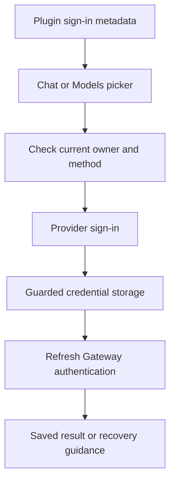

Codex review: blocked before merge. _Reviewed September 10, 2026, 6:35 PM ET / 22:35 UTC (Revision 6)._

# ClawSweeper review

## What this changes

Adds provider selection in private chat and credential-only sign-in in Models settings while preserving model selection and restrictions.

## Merge readiness

⛔ **Blocked before merge - 3 items remain**

This PR remains useful and protected from cleanup. The earlier commit-callback defect is fixed, and no additional blocking code defect was established; restricted-path owner involvement still needs confirmation.

**Priority:** P2
**Reviewed head:** `73cfa4b319b9640a6711b2dc8e871d9ff4aea035`
**Owner decision:** Required. See [Decision needed](#decision-needed).

## Review scores

| Measure | Result | What it means |
|---|---|---|
| **Overall readiness** | 🐚 platinum hermit **(4/6)** | The shared implementation and retained behavior evidence support normal good PR quality; owner qualification is an approval question, not a patch-quality deduction. |
| **Proof confidence** | 🐚 platinum hermit **(4/6)** | Sufficient (live_output): Retained captured evidence reports real Telegram selection and real Gateway credential readback with unchanged settings, peer/disconnect rejection, and disposal recovery through the changed owners. Synthetic provider credentials limit vendor coverage; browser images were not independently available in this review. |
| **Patch quality** | 🐚 platinum hermit **(4/6)** | No actionable review findings were identified. |

## Verification

| Check | Result | Evidence |
|---|---|---|
| **Real behavior** | Verified | Sufficient (live_output): Retained captured evidence reports real Telegram selection and real Gateway credential readback with unchanged settings, peer/disconnect rejection, and disposal recovery through the changed owners. Synthetic provider credentials limit vendor coverage; browser images were not independently available in this review. |
| **Evidence reviewed** | 10 items | Current main still lacks the new entry point: The fetched main revision has no models-auth-login.ts entry, and its chat handler still defaults bare /login to Codex. The merged persistence and refresh-result PRs therefore do not supersede this provider-menu and credential-only work. Prior callback finding resolved: The common persistence path invokes beforePersistentEffect whenever credentials or settings will be written, including credential-only login, and forwards assertCurrent to the credential writer. Live authority and connection ownership: The new Gateway handler rechecks connection liveness, administrator scope, and exact plugin/provider/method identity. Credential writes repeat the guard inside the SQLite transaction after OAuth lock acquisition; wizard access is bound to the originating connection. |
| **Findings** | None | None. |
| **Security** | None | None. |

## How this fits together

Provider plugins declare available sign-in methods, which chat and Models settings present to users. The shared login owner saves credentials, refreshes Gateway authentication, and returns completion or recovery guidance.

## Decision needed

| Question | Recommendation |
|---|---|
| Does a listed security owner endorse the new models.authLogin entry point and its credential-write authority checks at this revision? | **Record listed-owner review:** Have an openclaw-secops owner confirm review of the credential-writing entry point and persistence guards. |

Why: Repository policy requires listed-owner involvement on these paths; the available approval comments and live review metadata do not establish that qualification.

## Before merge

- [ ] **Resolve merge risk (P1)** - The recorded owner-review approvals have not been verified as satisfying listed security-owner involvement for the new credential-writing entry point.
- [ ] **Complete next step (P2)** - Confirm listed security-owner involvement for the new credential-writing Gateway entry point and auth-store guards, or verify that the existing exact-head approval already satisfies it.
- [ ] **Resolve maintainer decision** - Resolve the maintainer decision shown above before merge.

<strong>Agent review details</strong>

### Security

None.

### PR surface

Source +1244, Tests +1742, Docs +4, Other +5. Total +2995 across 69 files.

View PR surface stats

| Area | Files | Added | Removed | Net |
|---|---:|---:|---:|---:|
| Source | 43 | 1752 | 508 | +1244 |
| Tests | 20 | 2101 | 359 | +1742 |
| Docs | 3 | 32 | 28 | +4 |
| Config | 0 | 0 | 0 | 0 |
| Generated | 0 | 0 | 0 | 0 |
| Other | 3 | 7 | 2 | +5 |
| **Total** | **69** | **3892** | **897** | **+2995** |

### Review metrics

| Metric | Value | Why it matters |
|---|---|---|
| **Login contract additions** | 2 optional manifest fields; 1 Gateway method; 1 optional cancellation parameter | These define opt-in provider support and view disposal without adding operator configuration or a database schema. |
| **Production versus test growth** | production/package/generated +1249; tests +1742 net lines | Production growth supplies the shared provider menu, credential-only entry point, and cancellation lifecycle; tests cover their cross-surface contracts. |

### Merge-risk options

**Maintainer options:**
1. **Decide the mitigation before merge**  
   Keep one manifest-driven login flow with guarded persistence, unchanged model settings, and explicit security-owner acceptance of the new Gateway entry point.
2. **Pause or close**  
   Do not merge this PR until maintainers decide whether the risk is worth taking.

### Technical review

Best possible solution:

Keep one manifest-driven login flow with guarded persistence, unchanged model settings, and explicit security-owner acceptance of the new Gateway entry point.

Do we have a high-confidence way to reproduce the issue?

Not applicable as a feature review: current main confirms the missing credential-only entry point and automatic Codex selection for bare /login.

Is this the best way to solve the issue?

Yes: the patch extends existing manifest, login, persistence, and wizard owners instead of introducing a separate credential store or activation workflow.

AGENTS.md: found and applied where relevant.

Codex review notes: model internal, reasoning medium; reviewed against [28589e76ead3](https://github.com/openclaw/openclaw/commit/28589e76ead3876ef73c5675d0fce19f1bbf6e16).

### Labels

Label justifications:

- `P2`: This is a bounded provider sign-in improvement with established setup alternatives and no demonstrated urgent regression.
- `rating: 🐚 platinum hermit`: Overall readiness is 🐚 platinum hermit; proof is 🐚 platinum hermit and patch quality is 🐚 platinum hermit.
- `status: 👀 ready for maintainer look`: ClawSweeper has no concrete contributor-facing blocker left for this PR. Sufficient (live_output): Retained captured evidence reports real Telegram selection and real Gateway credential readback with unchanged settings, peer/disconnect rejection, and disposal recovery through the changed owners. Synthetic provider credentials limit vendor coverage; browser images were not independently available in this review.
- `proof: sufficient`: Contributor real behavior proof is sufficient. Retained captured evidence reports real Telegram selection and real Gateway credential readback with unchanged settings, peer/disconnect rejection, and disposal recovery through the changed owners. Synthetic provider credentials limit vendor coverage; browser images were not independently available in this review.
- `proof: telegram-e2e`: This PR needs Telegram Test Server proof with the repository E2E skill. Provider buttons, method selection, device-code presentation, and completion messages are visible Telegram behavior covered by the retained Test Server evidence.

### Evidence

What I checked:

- **Current main still lacks the new entry point:** The fetched main revision has no models-auth-login.ts entry, and its chat handler still defaults bare /login to Codex. The merged persistence and refresh-result PRs therefore do not supersede this provider-menu and credential-only work. ([`src/auto-reply/reply/commands-login.ts:35`](https://github.com/openclaw/openclaw/blob/28589e76ead3876ef73c5675d0fce19f1bbf6e16/src/auto-reply/reply/commands-login.ts#L35), [28589e76ead3](https://github.com/openclaw/openclaw/commit/28589e76ead3876ef73c5675d0fce19f1bbf6e16))
- **Prior callback finding resolved:** The common persistence path invokes beforePersistentEffect whenever credentials or settings will be written, including credential-only login, and forwards assertCurrent to the credential writer. ([`src/commands/models/auth.ts:473`](https://github.com/openclaw/openclaw/blob/73cfa4b319b9640a6711b2dc8e871d9ff4aea035/src/commands/models/auth.ts#L473), [73cfa4b319b9](https://github.com/openclaw/openclaw/commit/73cfa4b319b9640a6711b2dc8e871d9ff4aea035))
- **Live authority and connection ownership:** The new Gateway handler rechecks connection liveness, administrator scope, and exact plugin/provider/method identity. Credential writes repeat the guard inside the SQLite transaction after OAuth lock acquisition; wizard access is bound to the originating connection. ([`src/gateway/server-methods/models-auth-login.ts:71`](https://github.com/openclaw/openclaw/blob/73cfa4b319b9640a6711b2dc8e871d9ff4aea035/src/gateway/server-methods/models-auth-login.ts#L71), [73cfa4b319b9](https://github.com/openclaw/openclaw/commit/73cfa4b319b9640a6711b2dc8e871d9ff4aea035))
- **Cancellation and disposal coverage:** Read the Gateway and Models tests covering peer refusal, disconnect during admission, protected saves, disposal during an outstanding Cancel request, subsequent login, and suppression of another agent's late completion. Tests were inspected, not executed. ([`ui/src/pages/model-providers/model-providers-page.login.test.ts:180`](https://github.com/openclaw/openclaw/blob/73cfa4b319b9640a6711b2dc8e871d9ff4aea035/ui/src/pages/model-providers/model-providers-page.login.test.ts#L180), [73cfa4b319b9](https://github.com/openclaw/openclaw/commit/73cfa4b319b9640a6711b2dc8e871d9ff4aea035))
- **Captured real-behavior evidence:** The supplied PR body records real Telegram Test Server provider and method selection, synthetic credential persistence through a real Gateway, unchanged model settings, wrong-connection and disconnect rejection, and same-owner login after disposal. Browser captures are reported as inspected by the contributor; none were available locally for independent viewing. The prior accepted proof is retained rather than downgraded for that reviewer limitation. ([73cfa4b319b9](https://github.com/openclaw/openclaw/commit/73cfa4b319b9640a6711b2dc8e871d9ff4aea035))
- **SDK compatibility boundary:** The removed Codex-specific runtime export exists in v2026.9.3, but the current SDK documentation explicitly classifies this subpath as private-local after July 2026. Bundled callers use the replacement shared runtime, so its rename alone does not establish a supported public API regression. Public docs: [`docs/plugins/sdk-subpaths.md`](https://docs.openclaw.ai/plugins/sdk-subpaths). ([`docs/plugins/sdk-subpaths.md:266`](https://docs.openclaw.ai/plugins/sdk-subpaths), [73cfa4b319b9](https://github.com/openclaw/openclaw/commit/73cfa4b319b9640a6711b2dc8e871d9ff4aea035))

Likely related people:

- **obviyus:** Suggested for follow-up; no historical authorship or introduction is verified. (role: unverified routing candidate; confidence: low)
- **vincentkoc:** Suggested for follow-up; no historical authorship or introduction is verified. (role: unverified routing candidate; confidence: low)

### Rating scale

| Score | Internal tier | Crab rank | Meaning |
|---:|:---:|---|---|
| **6/6** | S | 🦀 challenger crab | Exceptional readiness |
| **5/6** | A | 🦞 diamond lobster | Very strong readiness |
| **4/6** | B | 🐚 platinum hermit | Good normal PR; ordinary maintainer review |
| **3/6** | C | 🦐 gold shrimp | Useful, but confidence is limited |
| **2/6** | D | 🦪 silver shellfish | Proof or implementation needs work |
| **1/6** | F | 🧂 unranked krab | Not merge-ready |
| N/A | NA | 🌊 off-meta tidepool | Rating does not apply |

Overall follows the weaker of proof and patch quality.
Shiny media proof means a screenshot, video, or linked artifact directly shows the changed behavior. Runtime, network, CSP, and security claims still need visible diagnostics.

### Workflow

- ClawSweeper keeps one durable marker-backed review comment per issue or PR.
- Re-runs edit this comment so the latest verdict, findings, and automation markers stay together instead of adding duplicate bot comments.
- A fresh review can be triggered by eligible `@clawsweeper re-review` comments, exact-item GitHub events, scheduled/background review runs, or manual workflow dispatch.
- PR/issue authors and users with repository write access can comment `@clawsweeper re-review` or `@clawsweeper re-run` on an open PR or issue to request a fresh review only.
- Maintainers can also comment `@clawsweeper review` to request a fresh review only.
- Fresh-review commands do not start repair, autofix, rebase, CI repair, or automerge.
- Maintainer-only repair and merge flows require explicit commands such as `@clawsweeper autofix`, `@clawsweeper automerge`, `@clawsweeper fix ci`, or `@clawsweeper address review`.
- Maintainers can comment `@clawsweeper explain` to ask for more context, or `@clawsweeper stop` to stop active automation.

### History

Review history (5 earlier review cycles)

<!-- clawsweeper-review-history v=1 total=5 -->
- reviewed 2026-09-10T20:01:59.854Z sha c098c5eaa92220de6fe403e2e93b2672a23674c9 :: blocked before merge. :: [P2] [P2] Invoke the commit callback on credential-only persistence
- reviewed 2026-09-10T20:49:02.714Z sha 6de38f8ca30eac9e9d7a0fa0cb90bf57925d4efc :: blocked before merge. :: [P2] [P2] Invoke the commit callback on credential-only persistence
- reviewed 2026-09-10T21:26:40.288Z sha 8bd0e5c9874fc5985606907358d2c8e3082a6054 :: blocked before merge. :: none
- reviewed 2026-09-10T21:50:20.429Z sha 8bd0e5c9874fc5985606907358d2c8e3082a6054 :: blocked before merge. :: none
- reviewed 2026-09-10T22:05:20.069Z sha 3d51261ea9dd1573b52286ae157c3958837a7822 :: blocked before merge. :: none

<!-- clawsweeper-verdict:needs-human item=144329 sha=73cfa4b319b9640a6711b2dc8e871d9ff4aea035 confidence=high updated_at=2026-09-10T22:32:21Z reviewed_at=2026-09-10T22:35:59.142Z lease_owner=github-run-34537732552-1 lease_comment_id=5626322672 source_revision=14981e2ce3cf5d81951ad39f9a9be791d1c81831fdbbefebdbe0b70392262d99 live_verification=absent -->
<!-- clawsweeper-review-state:blocked item=144329 sha=73cfa4b319b9640a6711b2dc8e871d9ff4aea035 v=1 -->

<!-- clawsweeper-review-version item=144329 reviewed_at=2026-09-10T22:35:59.142Z sha=73cfa4b319b9640a6711b2dc8e871d9ff4aea035 source_revision=14981e2ce3cf5d81951ad39f9a9be791d1c81831fdbbefebdbe0b70392262d99 lease_owner=github-run-34537732552-1 lease_comment_id=5626322672 v=1 -->

<!-- clawsweeper-review item=144329 -->