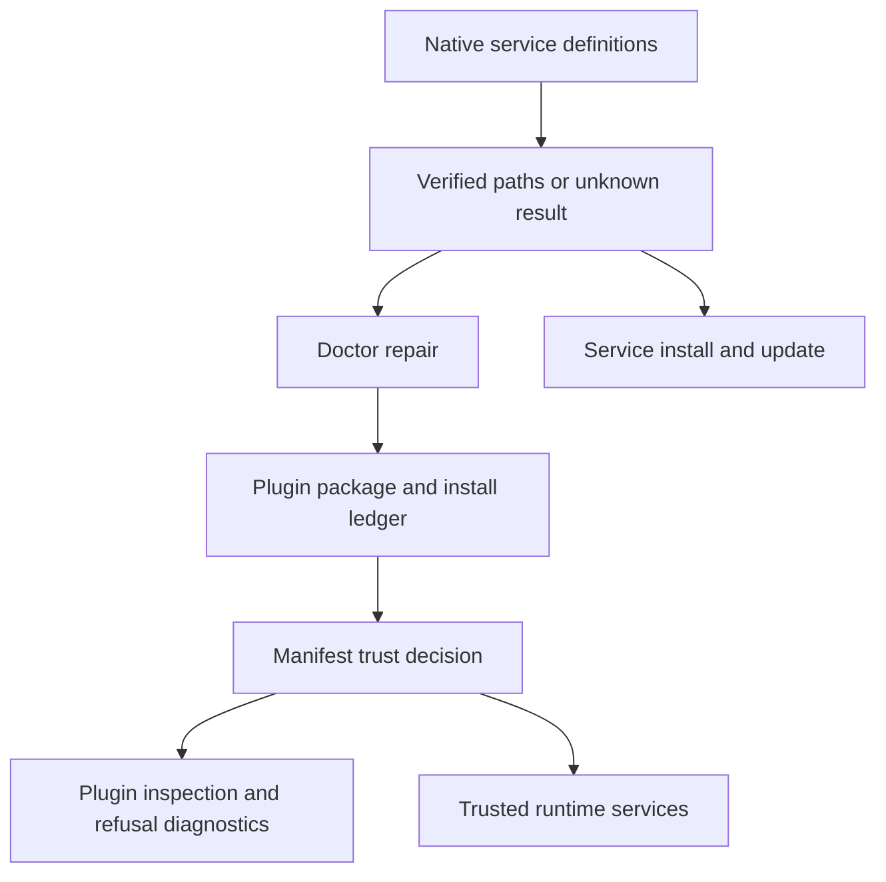

Codex review: blocked before merge. _Reviewed September 4, 2026, 11:01 PM ET / September 5, 2026, 03:01 UTC._

# ClawSweeper review

## What this changes

The PR adds traceable plugin-trust diagnostics, repairs verified legacy ClawHub installation records through Doctor, and distinguishes unavailable native service information from confirmed absence.

## Merge readiness

⛔ **Blocked before merge - 6 items remain**

The prior native-reader finding is resolved, and the trust repair remains useful on current main. No blocking code defect was established; native install/update recovery needs an explicit compatibility decision.

**Priority:** P2
**Reviewed head:** `7d0bc2b41f8c09fdfb9c769536260188413df0d5`
**Owner decision:** Required. See [Decision needed](#decision-needed).

## Review scores

| Measure | Result | What it means |
|---|---|---|
| **Overall readiness** | 🐚 platinum hermit **(4/6)** | A coherent repair with strong packaged proof and the prior blocker addressed; the remaining compatibility choice is separate from patch quality. |
| **Proof confidence** | 🦞 diamond lobster **(5/6)** | Sufficient (terminal): The packaged candidate exercised real plugin loading, keyed-state access, forbidden local/untracked installations, Doctor persistence, and fresh-process trust readback; those trust paths are unchanged at the reviewed head. The supplied comment reports native macOS Doctor flows, while the unavailable body tail limits assessment of additional native install/update recovery evidence. |
| **Patch quality** | 🐚 platinum hermit **(4/6)** | No actionable review findings were identified. |

## Verification

| Check | Result | Evidence |
|---|---|---|
| **Real behavior** | Verified | Sufficient (terminal): The packaged candidate exercised real plugin loading, keyed-state access, forbidden local/untracked installations, Doctor persistence, and fresh-process trust readback; those trust paths are unchanged at the reviewed head. The supplied comment reports native macOS Doctor flows, while the unavailable body tail limits assessment of additional native install/update recovery evidence. |
| **Evidence reviewed** | 11 items | Pinned introduction scope: Reviewed the merge-base-to-head change. Current-main comparisons were used only for behavioral context; the supplied stale test merge was not used to attribute removals. Canonical trust and repair boundaries: Doctor requires missing authority fields, no local source path, catalog-linked provenance, and unanimous package identity before backfilling two existing fields. Manifest loading still binds trust to the selected installation; runtime guards consume that decision without adding a fallback trust reader. Registration and persistence coverage: The loader regression exercises actual plugin registration and keyed-store access before and after Doctor. Companion persistence tests cover repeated repair, legacy config, conflicting identities, partial authority, local sources, and repair-disabled behavior. |
| **Findings** | None | None. |
| **Security** | None | None. |

## How this fits together

OpenClaw’s plugin loader uses installation records to decide which plugins may access trusted runtime services. Doctor repairs those records and compares CLI and Gateway storage paths, while native service readers also support installation and update workflows.

## Decision needed

| Question | Recommendation |
|---|---|
| Should the stricter native readers ship with install/update refusal for previously leniently decoded service definitions before their operator recovery path is verified? | **Verify recovery before accepting the tightening:** Inspect the complete captured proof and confirm that affected native installations have a documented, successful recovery path. |

Why: The strict diagnostic contract is intentional, but its public install/update consequences require an explicit compatibility tradeoff; the accessible evidence does not settle that recovery contract.

## Before merge

- [ ] **Resolve merge risk (P1)** - Native definitions that were previously decoded leniently can now stop gateway install --force and managed updates; preserving a lower-level lenient reader does not itself provide an operator-accessible recovery path.
- [ ] **Resolve merge risk (P1)** - The omitted PR-body tail could contain relevant native recovery evidence that this reviewer could not retrieve.
- [ ] **Complete next step (P2)** - Resolve the native install/update recovery tradeoff using the complete captured evidence, or explicitly accept operator-managed recovery before merge.
- [ ] **Resolve maintainer decision** - Resolve the maintainer decision shown above before merge.
- [ ] **Review config compatibility** - Confirm compatibility and upgrade impact for the changed config or default surface before merge.
- [ ] **Add data-model compatibility proof** - Confirm migration or upgrade compatibility proof before merge.

<strong>Agent review details</strong>

### Security

None.

### PR surface

Source +307, Tests +822, Docs +35. Total +1164 across 42 files.

View PR surface stats

| Area | Files | Added | Removed | Net |
|---|---:|---:|---:|---:|
| Source | 26 | 589 | 282 | +307 |
| Tests | 13 | 859 | 37 | +822 |
| Docs | 3 | 36 | 1 | +35 |
| Config | 0 | 0 | 0 | 0 |
| Generated | 0 | 0 | 0 | 0 |
| Other | 0 | 0 | 0 | 0 |
| **Total** | **42** | **1484** | **320** | **+1164** |

### Review metrics

| Metric | Value | Why it matters |
|---|---|---|
| **Production versus test growth** | Production net +307; tests and test support net +822 | Growth implements recorded diagnostics, explicit provenance repair, and strict native inspection; moved Scheduler probing is not counted as a new capability. |
| **Persistent repair surface** | 2 existing authority fields backfilled; 0 schema or configuration additions | Compatibility rests on narrowly validating existing installation identities rather than introducing a new store or setting. |

### Stored data model

Persistent data-model change detected: `migration/backfill/repair: src/commands/doctor-gateway-health.ts`, `migration/backfill/repair: src/commands/doctor/shared/plugin-registry-migration.ts`, `migration/backfill/repair: src/plugins/plugin-trust.ts`, `serialized state: src/plugins/plugin-trust.ts`, `unknown-data-model-change: src/commands/doctor-gateway-health.ts`, `unknown-data-model-change: src/commands/doctor-plugin-registry.ts`, and 2 more. Confirm migration or upgrade compatibility proof before merge.

### Merge-risk options

**Maintainer options:**
1. **Confirm native recovery coverage (recommended)**  
   Verify the complete evidence covers recovery through public install/update entrypoints while preserving strict refusal of unknown service facts.
2. **Accept the stricter operational boundary**  
   Document maintainer acceptance of manual service-owner recovery for definitions that the new native readers reject.

### Technical review

Best possible solution:

Keep manifest-owned trust diagnostics and Doctor-only provenance repair, with a verified recovery path for native definitions rejected by strict inspection; the added diagnostic records and native validation explain the production growth.

Do we have a high-confidence way to reproduce the issue?

Yes for the legacy ClawHub record and native absence/inspection distinctions: source, regression coverage, and supplied runtime traces identify concrete paths. The related Discord npm failure remains unreproduced; no target code was executed during this read-only review.

Is this the best way to solve the issue?

Yes for the trust repair: reusing catalog validation in Doctor and projecting one manifest-owned decision is preferable to weakening runtime trust or reinstalling every legacy package. Native recovery compatibility remains unresolved.

AGENTS.md: found and applied where relevant.

Codex review notes: model internal, reasoning high; reviewed against [c748cd5714b8](https://github.com/openclaw/openclaw/commit/c748cd5714b8160f0ce0a895071f039877082f08).

### Labels

Label changes:

- add `merge-risk: 🚨 compatibility`: New native strict-read failures propagate into existing gateway installation and managed update entrypoints.
- add `rating: 🐚 platinum hermit`: Overall readiness is 🐚 platinum hermit; proof is 🦞 diamond lobster and patch quality is 🐚 platinum hermit. Replaced prior `rating: 🦐 gold shrimp`.
- remove `rating: 🦐 gold shrimp`: Current PR rating is `rating: 🐚 platinum hermit`, so this older rating label is no longer current.

Label justifications:

- `P2`: This is a bounded plugin diagnosis and legacy-install repair with native service compatibility implications.
- `merge-risk: 🚨 compatibility`: New native strict-read failures propagate into existing gateway installation and managed update entrypoints.
- `rating: 🐚 platinum hermit`: Overall readiness is 🐚 platinum hermit; proof is 🦞 diamond lobster and patch quality is 🐚 platinum hermit. Replaced prior `rating: 🦐 gold shrimp`.
- `status: ⏳ waiting on author`: ClawSweeper has contributor-facing work open and is waiting for author action. Sufficient (terminal): The packaged candidate exercised real plugin loading, keyed-state access, forbidden local/untracked installations, Doctor persistence, and fresh-process trust readback; those trust paths are unchanged at the reviewed head. The supplied comment reports native macOS Doctor flows, while the unavailable body tail limits assessment of additional native install/update recovery evidence.
- `proof: sufficient`: Contributor real behavior proof is sufficient. The packaged candidate exercised real plugin loading, keyed-state access, forbidden local/untracked installations, Doctor persistence, and fresh-process trust readback; those trust paths are unchanged at the reviewed head. The supplied comment reports native macOS Doctor flows, while the unavailable body tail limits assessment of additional native install/update recovery evidence.

### Evidence

What I checked:

- **Pinned introduction scope:** Reviewed the merge-base-to-head change. Current-main comparisons were used only for behavioral context; the supplied stale test merge was not used to attribute removals. ([7d0bc2b41f8c](https://github.com/openclaw/openclaw/commit/7d0bc2b41f8c09fdfb9c769536260188413df0d5))
- **Canonical trust and repair boundaries:** Doctor requires missing authority fields, no local source path, catalog-linked provenance, and unanimous package identity before backfilling two existing fields. Manifest loading still binds trust to the selected installation; runtime guards consume that decision without adding a fallback trust reader. ([`src/commands/doctor/shared/plugin-registry-migration.ts:42`](https://github.com/openclaw/openclaw/blob/7d0bc2b41f8c09fdfb9c769536260188413df0d5/src/commands/doctor/shared/plugin-registry-migration.ts#L42), [7d0bc2b41f8c](https://github.com/openclaw/openclaw/commit/7d0bc2b41f8c09fdfb9c769536260188413df0d5))
- **Registration and persistence coverage:** The loader regression exercises actual plugin registration and keyed-store access before and after Doctor. Companion persistence tests cover repeated repair, legacy config, conflicting identities, partial authority, local sources, and repair-disabled behavior. ([`src/plugins/loader.trust-diagnostics.test.ts:65`](https://github.com/openclaw/openclaw/blob/7d0bc2b41f8c09fdfb9c769536260188413df0d5/src/plugins/loader.trust-diagnostics.test.ts#L65), [7d0bc2b41f8c](https://github.com/openclaw/openclaw/commit/7d0bc2b41f8c09fdfb9c769536260188413df0d5))
- **Prior finding addressed:** Strict LaunchAgent and Scheduled Task reads now throw redacted inspection errors for malformed, unreadable, commandless, or unresolved definitions. Missing files require additional native absence evidence; dedicated reader tests cover these distinctions. These changes postdate the earlier reviewed head. ([`src/daemon/schtasks-layout.ts:285`](https://github.com/openclaw/openclaw/blob/7d0bc2b41f8c09fdfb9c769536260188413df0d5/src/daemon/schtasks-layout.ts#L285), [7d0bc2b41f8c](https://github.com/openclaw/openclaw/commit/7d0bc2b41f8c09fdfb9c769536260188413df0d5))
- **Strict inspection affects public recovery callers:** Gateway installation always requests effective inspection and returns SERVICE_DEFINITION_UNKNOWN on failure, including with --force. Managed update preparation likewise blocks service mutation after strict inspection fails. The new native refusals therefore affect more than Doctor diagnostics. ([`src/cli/daemon-cli/install.ts:179`](https://github.com/openclaw/openclaw/blob/7d0bc2b41f8c09fdfb9c769536260188413df0d5/src/cli/daemon-cli/install.ts#L179), [7d0bc2b41f8c](https://github.com/openclaw/openclaw/commit/7d0bc2b41f8c09fdfb9c769536260188413df0d5))
- **Native compatibility trigger:** Strict Windows parsing rejects unresolved expansion and caret/quote syntax, including escape forms the existing service writer can emit. Lenient decoding remains, but installation and managed update callers request strict reads. This is an intentional safety change with an operator recovery consequence. ([`src/daemon/cmd-set.ts:59`](https://github.com/openclaw/openclaw/blob/7d0bc2b41f8c09fdfb9c769536260188413df0d5/src/daemon/cmd-set.ts#L59), [7d0bc2b41f8c](https://github.com/openclaw/openclaw/commit/7d0bc2b41f8c09fdfb9c769536260188413df0d5))

Likely related people:

- **steipete:** Suggested for follow-up; no historical authorship or introduction is verified. (role: unverified routing candidate; confidence: low)
- **cxy:** Suggested for follow-up; no historical authorship or introduction is verified. (role: unverified routing candidate; confidence: low)

### Rank-up moves

Optional improvements that raise the rating; they are not merge blockers.

- Confirm the complete native evidence establishes recovery through public install/update entrypoints, or explicitly accept the resulting operator intervention.

### Rating scale

| Score | Internal tier | Crab rank | Meaning |
|---:|:---:|---|---|
| **6/6** | S | 🦀 challenger crab | Exceptional readiness |
| **5/6** | A | 🦞 diamond lobster | Very strong readiness |
| **4/6** | B | 🐚 platinum hermit | Good normal PR; ordinary maintainer review |
| **3/6** | C | 🦐 gold shrimp | Useful, but confidence is limited |
| **2/6** | D | 🦪 silver shellfish | Proof or implementation needs work |
| **1/6** | F | 🧂 unranked krab | Not merge-ready |
| N/A | NA | 🌊 off-meta tidepool | Rating does not apply |

Overall follows the weaker of proof and patch quality.
Shiny media proof means a screenshot, video, or linked artifact directly shows the changed behavior. Runtime, network, CSP, and security claims still need visible diagnostics.

### Workflow

- ClawSweeper keeps one durable marker-backed review comment per issue or PR.
- Re-runs edit this comment so the latest verdict, findings, and automation markers stay together instead of adding duplicate bot comments.
- A fresh review can be triggered by eligible `@clawsweeper re-review` comments, exact-item GitHub events, scheduled/background review runs, or manual workflow dispatch.
- PR/issue authors and users with repository write access can comment `@clawsweeper re-review` or `@clawsweeper re-run` on an open PR or issue to request a fresh review only.
- Maintainers can also comment `@clawsweeper review` to request a fresh review only.
- Fresh-review commands do not start repair, autofix, rebase, CI repair, or automerge.
- Maintainer-only repair and merge flows require explicit commands such as `@clawsweeper autofix`, `@clawsweeper automerge`, `@clawsweeper fix ci`, or `@clawsweeper address review`.
- Maintainers can comment `@clawsweeper explain` to ask for more context, or `@clawsweeper stop` to stop active automation.

### History

Review history (3 earlier review cycles)

<!-- clawsweeper-review-history v=1 total=3 -->
- reviewed 2026-09-05T01:13:59.593Z sha 7d94f134518da7fb601e9af808c830d457d63d17 :: blocked before merge. :: [P2] Report unknown service paths when native readers return null
- reviewed 2026-09-05T01:31:18.341Z sha 29c4d6f4e3deeeb0416b74c8d809c4eebf6e09e1 :: blocked before merge. :: [P2] Report unknown service paths when native readers return null
- reviewed 2026-09-05T01:44:49.289Z sha 29c4d6f4e3deeeb0416b74c8d809c4eebf6e09e1 :: blocked before merge. :: [P2] Distinguish native inspection failures from an absent service

<!-- clawsweeper-verdict:needs-human item=138746 sha=7d0bc2b41f8c09fdfb9c769536260188413df0d5 confidence=high updated_at=2026-09-05T02:54:58Z reviewed_at=2026-09-05T03:01:01.138Z lease_owner=github-run-33940282029-1 lease_comment_id=5548879457 source_revision=4f430e82def751dccaf5333695e12166f6bda2bb7a5732241ba7c3239f2012f1 live_verification=absent -->
<!-- clawsweeper-review-state:blocked item=138746 sha=7d0bc2b41f8c09fdfb9c769536260188413df0d5 v=1 -->

<!-- clawsweeper-review-version item=138746 reviewed_at=2026-09-05T03:01:01.138Z sha=7d0bc2b41f8c09fdfb9c769536260188413df0d5 source_revision=4f430e82def751dccaf5333695e12166f6bda2bb7a5732241ba7c3239f2012f1 lease_owner=github-run-33940282029-1 lease_comment_id=5548879457 v=1 -->

<!-- clawsweeper-review item=138746 -->