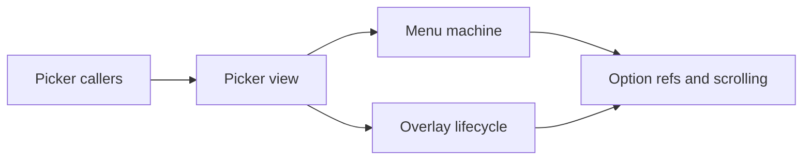

Codex review: needs changes before merge.

## What this changes

This PR replaces picker DOM queries with retained element refs and removes redundant untracking.

**Example:** Open a native sheet picker using its trigger.
- **Before:** Initial focus finds the back button with a DOM query.
- **After:** Initial focus uses the retained back-button ref.

## Review scores

| Measure | Result | What it means |
|---|---|---|
| **Overall readiness** | 🦪 silver shellfish **(2/6)** | The focused refactor has reported browser coverage, but the null-highlight lookup changes observable scrolling behavior. |
| **Proof confidence** | 🦐 gold shrimp **(3/6)** | This maintainer-authored refactor is outside the ordinary contributor proof gate; supplied validation reports browser cases and builds, without a shipped-entry-point demonstration of the changed ref path. |
| **Patch quality** | 🦪 silver shellfish **(2/6)** | 1 actionable review finding remain. |

## Product

**Kind:** Refactor · **Worth it:** Yes
**User problem:** No existing user-visible defect is claimed; picker behavior is intended to remain unchanged.
**Reason:** The maintainer-authored direction follows the established ref-based Solid cleanup and keeps selection and overlay ownership in their existing owners.

## Merge readiness

⛔ **Needs changes before merge - 1 item remains**

Keep this maintainer-authored refactor open; the retained-row lookup introduces a scrolling regression when no enabled option is highlighted.

**Priority:** P3
**Reviewed head:** `f29976c9601f1a5f8f3861a27846b2110de6c14e`

## Before merge

- [ ] **Keep a null highlight distinct from the empty-value option (P2)** - When the observer picker retains an unavailable catalog, its model rows are disabled while the empty-value Disabled choice remains mounted. Filter to enough model rows to keep the list scrollable, scroll down, then append a trailing space to the query. The menu has no enabled result and keeps its highlight null, but this lookup selects the hidden empty-value row. Its zero bounds make revealInScrollRegion move scrollTop toward the beginning even though nothing is highlighted; the previous [data-active] query found no node and preserved the position. Skip the lookup when active() is null while continuing to support an actually highlighted empty-string option.

## Findings

- [P2] Keep a null highlight distinct from the empty-value option — `ui/src/components/select-picker-view.tsx:304`

### Tests

- Missing end-to-end proof: The reported existing browser cases do not demonstrate preserved scroll position for disabled-only filtered results containing a hidden empty-value option.

<strong>Agent review details</strong>

### How this fits together

The shared Control UI picker receives options and selection callbacks, delegates highlighting to the menu machine, and renders focusable sheets or popovers.

### Technical review

Best possible solution:

Retain the refs while skipping row lookup when the menu highlight is null.

Do we have a high-confidence way to reproduce the issue?

Source establishes a stable null highlight for disabled-only search results and a hidden empty-value row that the new lookup incorrectly reveals; no browser reproduction was run.

Is this the best way to solve the issue?

Retained refs fit the repository's Solid guidance, provided null remains distinct from the valid empty-string option.

Full review comments:

- [P2] Keep a null highlight distinct from the empty-value option — `ui/src/components/select-picker-view.tsx:304`
  When the observer picker retains an unavailable catalog, its model rows are disabled while the empty-value Disabled choice remains mounted. Filter to enough model rows to keep the list scrollable, scroll down, then append a trailing space to the query. The menu has no enabled result and keeps its highlight null, but this lookup selects the hidden empty-value row. Its zero bounds make revealInScrollRegion move scrollTop toward the beginning even though nothing is highlighted; the previous [data-active] query found no node and preserved the position. Skip the lookup when active() is null while continuing to support an actually highlighted empty-string option.
  Confidence: 0.92

Overall correctness: patch is incorrect
Overall confidence: 0.9

AGENTS.md: found and applied where relevant.

Codex review notes: model internal, reasoning medium; reviewed against [bffe7345795e](https://github.com/openclaw/openclaw/commit/bffe7345795ed8d4a40cd1310eeb24929e5ed3ce).

### Provenance checked

- `Picker focus, scrolling, and callback tracking` keeps the original intent (ecdc40dbcf9bfc4c083237fdfa69ea949088f27c: The shared Solid migration preserved keyboard navigation, focus restoration, selected-row visibility, and native overlay behavior.)

### Testing

Proof path: in-process harness.

### Security

None.

### Evidence

Acceptance criteria:

- pnpm --dir ui test src/components/select-picker.behavior.browser.test.ts --project browser
- OPENCLAW_UI_WEBKIT=1 pnpm --dir ui test src/components/select-picker.behavior.browser.test.ts --project webkit
- pnpm --dir ui test src/components/select-picker.browser.test.tsx --project browser
- git diff --check

What I checked:

- **Introduced change:** The pinned introduction diff replaces the active DOM-node query with optionElements.get(active() ?? ""); the verified test merge contains the same change. ([`ui/src/components/select-picker-view.tsx:304`](https://github.com/openclaw/openclaw/blob/f29976c9601f1a5f8f3861a27846b2110de6c14e/ui/src/components/select-picker-view.tsx#L304), [f29976c9601f](https://github.com/openclaw/openclaw/commit/f29976c9601f1a5f8f3861a27846b2110de6c14e))
- **Reachable disabled-only results:** The observer model picker includes an empty-value Disabled choice and can retain catalog rows marked disabled when modelsUnavailable is true; an existing test supplies a retained catalog in that state. ([`ui/src/pages/config/session-observer-settings.tsx:65`](https://github.com/openclaw/openclaw/blob/f29976c9601f1a5f8f3861a27846b2110de6c14e/ui/src/pages/config/session-observer-settings.tsx#L65), [f29976c9601f](https://github.com/openclaw/openclaw/commit/f29976c9601f1a5f8f3861a27846b2110de6c14e))
- **Null highlight and geometry:** The menu owner sets the highlight to null when filtered rows contain no enabled choices; revealing a hidden row then subtracts the list's viewport offset from scrollTop. ([`ui/src/components/solid/menu-machine.ts:343`](https://github.com/openclaw/openclaw/blob/f29976c9601f1a5f8f3861a27846b2110de6c14e/ui/src/components/solid/menu-machine.ts#L343), [f29976c9601f](https://github.com/openclaw/openclaw/commit/f29976c9601f1a5f8f3861a27846b2110de6c14e))
- **Original contract and feature ownership:** The shared Solid migration explicitly preserved keyboard navigation, focus, and selected-row visibility; current-main history identifies steipete across that migration and subsequent picker refactors. See https://github.com/openclaw/openclaw/pull/170387. ([`ui/src/components/select-picker-view.tsx:309`](https://github.com/openclaw/openclaw/blob/bffe7345795ed8d4a40cd1310eeb24929e5ed3ce/ui/src/components/select-picker-view.tsx#L309), [bffe7345795e](https://github.com/openclaw/openclaw/commit/bffe7345795ed8d4a40cd1310eeb24929e5ed3ce))
- **Existing review discussion:** The existing Codex comment identifies the null/empty-value alias; the disabled-only result case establishes a scrollable trigger beyond its original no-matches example. Discussion: https://github.com/openclaw/openclaw/pull/174206#discussion_r4294656661. ([`ui/src/components/select-picker-view.tsx:304`](https://github.com/openclaw/openclaw/blob/f29976c9601f1a5f8f3861a27846b2110de6c14e/ui/src/components/select-picker-view.tsx#L304), [f29976c9601f](https://github.com/openclaw/openclaw/commit/f29976c9601f1a5f8f3861a27846b2110de6c14e))
- **CI failure remains unattributed:** The browser E2E shard reports a chat-provider-review request timeout. Its annotations do not establish whether this diff caused it, and downloading full logs was blocked by the network allowlist; no unrelated repair is assigned to the author. ([`ui/src/e2e/chat-provider-review.e2e.test.ts:115`](https://github.com/openclaw/openclaw/blob/f29976c9601f1a5f8f3861a27846b2110de6c14e/ui/src/e2e/chat-provider-review.e2e.test.ts#L115), [f29976c9601f](https://github.com/openclaw/openclaw/commit/f29976c9601f1a5f8f3861a27846b2110de6c14e))

### PR surface

Source -3. Total -3 across 1 file. Added test files: 0.

View PR surface stats

| Area | Files | Added | Removed | Net |
|---|---:|---:|---:|---:|
| Source | 1 | 91 | 94 | -3 |
| Tests | 0 | 0 | 0 | 0 |
| Docs | 0 | 0 | 0 | 0 |
| Config | 0 | 0 | 0 | 0 |
| Generated | 0 | 0 | 0 | 0 |
| Other | 0 | 0 | 0 | 0 |
| **Total** | **1** | **91** | **94** | **-3** |

### Labels

Label changes:

- add `P3`: This is a focused internal UI cleanup with a limited, recoverable scrolling defect.
- add `rating: 🦪 silver shellfish`: Overall readiness is 🦪 silver shellfish; proof is 🦐 gold shrimp and patch quality is 🦪 silver shellfish.
- add `status: ⏳ waiting on author`: ClawSweeper has contributor-facing work open and is waiting for author action.

Label justifications:

- `P3`: This is a focused internal UI cleanup with a limited, recoverable scrolling defect.
- `rating: 🦪 silver shellfish`: Overall readiness is 🦪 silver shellfish; proof is 🦐 gold shrimp and patch quality is 🦪 silver shellfish.
- `status: ⏳ waiting on author`: ClawSweeper has contributor-facing work open and is waiting for author action.

### Rating scale

6/6 🦀 challenger crab · 5/6 🦞 diamond lobster · 4/6 🐚 platinum hermit · 3/6 🦐 gold shrimp · 2/6 🦪 silver shellfish · 1/6 🧂 unranked krab. Overall follows the weaker of proof and patch quality; ✨ marks media proof (a screenshot, video, or linked artifact) that directly shows the changed behavior.

### Workflow

ClawSweeper edits this one comment on every review. Comment `@clawsweeper re-review` for a fresh review only. Repair and merge execution lanes are retired.

_Reviewed October 16, 2026, 8:39 AM ET / 12:39 UTC._

<!-- clawsweeper-verdict:needs-changes item=174206 sha=f29976c9601f1a5f8f3861a27846b2110de6c14e confidence=high updated_at=2026-10-16T12:35:40Z reviewed_at=2026-10-16T12:39:11.523Z lease_owner=github-run-38901489458-1 lease_comment_id=6215616533 source_revision=8dd599f7cb829c6150700eb7297cc450768d65575bf3219cd3ac564b037346aa -->
<!-- clawsweeper-review-state:needs-changes item=174206 sha=f29976c9601f1a5f8f3861a27846b2110de6c14e v=1 -->

<!-- clawsweeper-review-version item=174206 reviewed_at=2026-10-16T12:39:11.523Z sha=f29976c9601f1a5f8f3861a27846b2110de6c14e source_revision=8dd599f7cb829c6150700eb7297cc450768d65575bf3219cd3ac564b037346aa lease_owner=github-run-38901489458-1 lease_comment_id=6215616533 v=1 -->

<!-- clawsweeper-review item=174206 -->