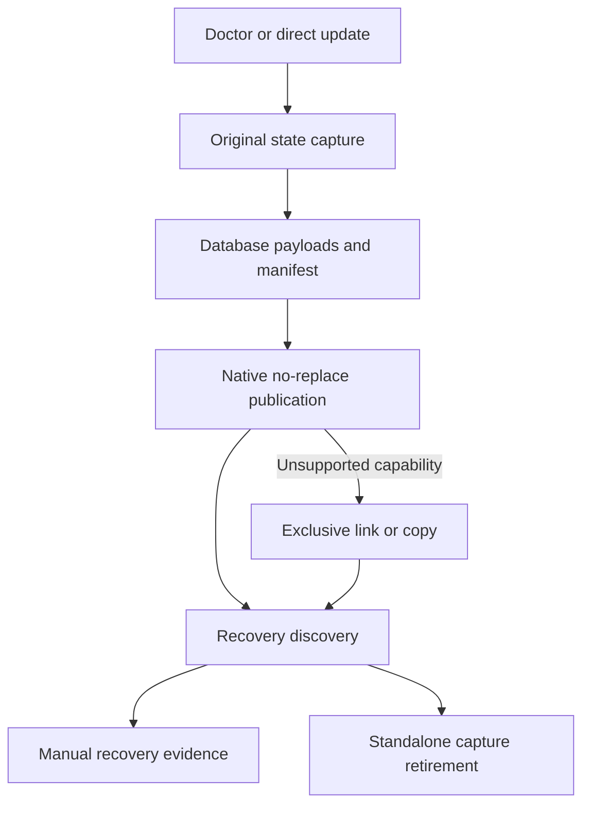

Codex review: blocked before merge. _Reviewed October 6, 2026, 11:32 PM ET / October 7, 2026, 03:32 UTC._

# ClawSweeper review

## What this changes

The PR adds exclusive hard-link or copy fallback for Doctor and update pre-repair captures when native no-replace rename is unsupported.

## Regression provenance

Possible regression — suspected (reviewed change). No predecessor PR is attributed.

## Merge readiness

⛔ **Blocked before merge - 4 items remain**

This repair is still needed on current main, but interrupted manifest publication exposes two concrete recovery defects. The related unreleased dependency fix does not resolve those consumer defects.

**Priority:** P2
**Reviewed head:** `19d2db119dab26136d8264e8608e33e2416dbda6`

## Review scores

| Measure | Result | What it means |
|---|---|---|
| **Overall readiness** | 🦐 gold shrimp **(3/6)** | The repair is focused and has useful validation, but interrupted-seal handling leaves two actionable recovery defects. |
| **Proof confidence** | 🌊 off-meta tidepool | Not applicable: The supplied MEMBER association exempts ordinary contributor proof. The captured evidence exercises the production capture owner under injected unsupported publication and checks sealed outputs; it does not establish interruption recovery. No stored schema or manifest-format contract changes. |
| **Patch quality** | 🦐 gold shrimp **(3/6)** | 2 actionable review findings remain. |

## Verification

| Check | Result | Evidence |
|---|---|---|
| **Real behavior** | Not applicable | Not applicable: The supplied MEMBER association exempts ordinary contributor proof. The captured evidence exercises the production capture owner under injected unsupported publication and checks sealed outputs; it does not establish interruption recovery. No stored schema or manifest-format contract changes. |
| **Evidence reviewed** | 10 items | Pinned introduced change: The merge-base-to-head diff introduces the capture-owned publisher and replaces both database payload and manifest publication calls. The verified test-merge comparison contains the same five paths, without removing unrelated base changes.<br>Current-main necessity: Fetched main still explicitly selects rename-noreplace for database payload publication and manifest sealing. Its package.json pins fs-safe 0.24.1, whose explicit rename publication does not provide this fallback.<br>Verified dependency contract: Repository ownership was verified through GitHub. OpenClaw directly imports this dependency's classifier and durability publisher. At v0.24.1, rename-noreplace throws the classified unsupported error; link-or-copy exclusively creates and verifies the target while retaining the source name. This establishes the new two-name interruption window. |
| **Findings** | 2 actionable findings | [P2] Classify interrupted fallback seals without hiding healthy captures<br>[P2] Exclude interrupted fallback seals from automatic retirement |
| **Security** | None | None. |

## How this fits together

Doctor and direct updates capture original configuration, databases, and plugin resources before repair. The capture publisher creates payloads and seals a manifest that recovery discovery and automatic retirement later consume.



## Before merge

- [ ] **Classify interrupted fallback seals without hiding healthy captures (P2)** - When fallback links `manifest.json.partial` to `manifest.json`, interruption before the unlink leaves both names at nlink=2. `readUpdateRecoveryBackups()` sees a present manifest and reads it with `hardlinks: "reject"`, so the entire enumeration throws; `update status` then reports `recoverySetsError` and loses the healthy sets too. Recognize this interrupted seal as incomplete evidence while retaining strict rejection of unrelated hard links.
- [ ] **Exclude interrupted fallback seals from automatic retirement (P2)** - A crash or failure after fallback creates the final manifest but before source removal leaves a complete JSON manifest alongside `.partial`, commonly with two links. `retireExpiredStandaloneDoctorCaptures()` uses plain `readFile` and never checks either condition, so a later Doctor run can recursively delete this incomplete capture once it is 30 days old. Protect this newly reachable state before retirement; the documented contract explicitly retains incomplete captures.
- [ ] **Resolve merge risk (P2)** - Interrupted fallback seals currently violate the recovery contract: discovery can hide healthy captures, and automatic retirement can delete incomplete evidence.
- [ ] **Complete next step (P2)** - Repair interrupted manifest classification and retirement protection, with focused regressions for both consumers.

## Findings

- [P2] Classify interrupted fallback seals without hiding healthy captures — `src/infra/update-recovery-capture-publication.ts:30-31`
- [P2] Exclude interrupted fallback seals from automatic retirement — `src/infra/update-recovery-capture-publication.ts:30-37`


<details>
<summary><strong>Agent review details</strong></summary>

### Security

None.

### PR surface

Source +43, Tests +104, Docs +3. Total +150 across 5 files.

<details>
<summary>View PR surface stats</summary>

| Area | Files | Added | Removed | Net |
|---|---:|---:|---:|---:|
| Source | 2 | 48 | 5 | +43 |
| Tests | 2 | 105 | 1 | +104 |
| Docs | 1 | 3 | 0 | +3 |
| Config | 0 | 0 | 0 | 0 |
| Generated | 0 | 0 | 0 | 0 |
| Other | 0 | 0 | 0 | 0 |
| **Total** | **5** | **156** | **6** | **+150** |

</details>

### Review metrics

| Metric | Value | Why it matters |
|---|---|---|
| **Production and test growth** | production +48/−5; tests +105/−1 | The PR explains the production growth as one capture-owned fallback publisher and reuses the existing capture fixture. |

### Root-cause cluster

Relationship: `fixed_by_candidate`
Canonical: https://github.com/openclaw/openclaw/issues/166246
Summary: This PR is a candidate repair for the canonical capture-publication issue; the earlier contributor PR addresses the same failure, while the merged migration repair covers a distinct owner.

Members:
- `canonical`: https://github.com/openclaw/openclaw/issues/166246 - The issue reports both failing capture publication sites and controlled Linux reproduction.
- `same_root_cause`: https://github.com/openclaw/openclaw/pull/166255 - The earlier open contributor PR repairs the same two sites and supplies Linux before/after proof.
- `adjacent_distinct`: https://github.com/openclaw/openclaw/pull/166048 - The merged dependency update repairs migration moves rather than explicit capture publication.

Proposal only: this assessment does not dispatch repair, suppress jobs, mutate sibling items, close, or merge anything.

### Merge-risk options

**Maintainer options:**
1. **Preserve interrupted seals (recommended)**  
   Classify the exact interrupted manifest state as incomplete during discovery and exclude it from automatic retirement, retaining strict reader rejection for unrelated hard links.

<details>
<summary>Copy recommended automerge instruction</summary>

```text
@clawsweeper automerge

Special instructions:
Repair interrupted capture-seal handling in recovery discovery and standalone retirement; preserve strict hardlink rejection and add focused regressions proving healthy captures remain visible and incomplete seals are never retired.
```

</details>

### Technical review

Best possible solution:

Keep exclusive fallback publication while teaching recovery discovery and retirement to recognize and preserve interrupted seals without admitting arbitrary hard-linked manifests.

Do we have a high-confidence way to reproduce the issue?

Yes, from source: interrupt fallback manifest publication after exclusive linking and before source removal, then inspect recovery status or run retirement with an age over 30 days. This reviewer did not execute that scenario.

Is this the best way to solve the issue?

Yes, the capture-owned fallback is a bounded repair, but its newly reachable interrupted states must be handled by the existing recovery consumers.

Full review comments:

- [P2] Classify interrupted fallback seals without hiding healthy captures — `src/infra/update-recovery-capture-publication.ts:30-31`
  When fallback links `manifest.json.partial` to `manifest.json`, interruption before the unlink leaves both names at nlink=2. `readUpdateRecoveryBackups()` sees a present manifest and reads it with `hardlinks: "reject"`, so the entire enumeration throws; `update status` then reports `recoverySetsError` and loses the healthy sets too. Recognize this interrupted seal as incomplete evidence while retaining strict rejection of unrelated hard links.
  Confidence: 0.98
- [P2] Exclude interrupted fallback seals from automatic retirement — `src/infra/update-recovery-capture-publication.ts:30-37`
  A crash or failure after fallback creates the final manifest but before source removal leaves a complete JSON manifest alongside `.partial`, commonly with two links. `retireExpiredStandaloneDoctorCaptures()` uses plain `readFile` and never checks either condition, so a later Doctor run can recursively delete this incomplete capture once it is 30 days old. Protect this newly reachable state before retirement; the documented contract explicitly retains incomplete captures.
  Confidence: 0.99

Overall correctness: patch is incorrect
Overall confidence: 0.97

AGENTS.md: found and applied where relevant.

Codex review notes: model internal, reasoning medium; reviewed against [3a90ed1c39d0](https://github.com/openclaw/openclaw/commit/3a90ed1c39d0a2fd0decebda818eb72ce8ee69cf).

### Labels

Label changes:

- add `P2`: This restores optional recovery captures on affected filesystems; Doctor already continues repairs, and no immediate core outage is established.
- add `merge-risk: 🚨 compatibility`: The fallback introduces interrupted seal states that existing recovery discovery and retirement do not safely handle.
- add `rating: 🦐 gold shrimp`: Overall readiness is 🦐 gold shrimp; proof is 🌊 off-meta tidepool and patch quality is 🦐 gold shrimp.
- add `status: ⏳ waiting on author`: ClawSweeper has contributor-facing work open and is waiting for author action. Not applicable: The supplied MEMBER association exempts ordinary contributor proof. The captured evidence exercises the production capture owner under injected unsupported publication and checks sealed outputs; it does not establish interruption recovery. No stored schema or manifest-format contract changes.

Label justifications:

- `P2`: This restores optional recovery captures on affected filesystems; Doctor already continues repairs, and no immediate core outage is established.
- `merge-risk: 🚨 compatibility`: The fallback introduces interrupted seal states that existing recovery discovery and retirement do not safely handle.
- `rating: 🦐 gold shrimp`: Overall readiness is 🦐 gold shrimp; proof is 🌊 off-meta tidepool and patch quality is 🦐 gold shrimp.
- `status: ⏳ waiting on author`: ClawSweeper has contributor-facing work open and is waiting for author action. Not applicable: The supplied MEMBER association exempts ordinary contributor proof. The captured evidence exercises the production capture owner under injected unsupported publication and checks sealed outputs; it does not establish interruption recovery. No stored schema or manifest-format contract changes.

### Evidence

Acceptance criteria:

- [P1] pnpm test src/infra/update-recovery-capture-publication.test.ts --maxWorkers=1.
- [P1] pnpm test src/infra/update-database-backup.test.ts --maxWorkers=1.
- [P1] pnpm test src/cli/update-cli/status.recovery.test.ts --maxWorkers=1.
- [P1] pnpm tsgo:core.
- [P1] git diff --check.

What I checked:

- **Pinned introduced change:** The merge-base-to-head diff introduces the capture-owned publisher and replaces both database payload and manifest publication calls. The verified test-merge comparison contains the same five paths, without removing unrelated base changes. ([`src/infra/update-recovery-capture-publication.ts:30`](https://github.com/openclaw/openclaw/blob/19d2db119dab26136d8264e8608e33e2416dbda6/src/infra/update-recovery-capture-publication.ts#L30), [19d2db119dab](https://github.com/openclaw/openclaw/commit/19d2db119dab26136d8264e8608e33e2416dbda6))
- **Current-main necessity:** Fetched main still explicitly selects rename-noreplace for database payload publication and manifest sealing. Its package.json pins fs-safe 0.24.1, whose explicit rename publication does not provide this fallback. ([`src/infra/update-recovery-baseline-capture.ts:410`](https://github.com/openclaw/openclaw/blob/3a90ed1c39d0a2fd0decebda818eb72ce8ee69cf/src/infra/update-recovery-baseline-capture.ts#L410), [3a90ed1c39d0](https://github.com/openclaw/openclaw/commit/3a90ed1c39d0a2fd0decebda818eb72ce8ee69cf))
- **Verified dependency contract:** Repository ownership was verified through GitHub. OpenClaw directly imports this dependency's classifier and durability publisher. At v0.24.1, rename-noreplace throws the classified unsupported error; link-or-copy exclusively creates and verifies the target while retaining the source name. This establishes the new two-name interruption window. ([`src/publish-file.ts`](https://github.com/openclaw/fs-safe/blob/b749881fd7a66886acd7b403487e87204b822955/src/publish-file.ts), [b749881fd7a6](https://github.com/openclaw/fs-safe/commit/b749881fd7a66886acd7b403487e87204b822955))
- **Interrupted seal breaks discovery:** Recovery discovery reads every present manifest with hardlinks rejected. An interrupted fallback seal leaves manifest.json and manifest.json.partial linked to the same inode, causing discovery to throw. The status command catches that whole discovery failure as recoverySetsError rather than returning the other valid recovery sets. ([`src/infra/update-recovery-backup-reader.ts:528`](https://github.com/openclaw/openclaw/blob/19d2db119dab26136d8264e8608e33e2416dbda6/src/infra/update-recovery-backup-reader.ts#L528), [19d2db119dab](https://github.com/openclaw/openclaw/commit/19d2db119dab26136d8264e8608e33e2416dbda6))
- **Interrupted seal enters retirement:** Retirement reads manifest.json with plain readFile and checks its parsed identity, age, outcome, and run association, but does not check the remaining partial manifest or link count. A complete two-link manifest left by interruption therefore qualifies for recursive deletion after 30 days. ([`src/infra/update-recovery-baseline-capture.ts:665`](https://github.com/openclaw/openclaw/blob/19d2db119dab26136d8264e8608e33e2416dbda6/src/infra/update-recovery-baseline-capture.ts#L665), [19d2db119dab](https://github.com/openclaw/openclaw/commit/19d2db119dab26136d8264e8608e33e2416dbda6))
- **Existing incomplete-capture contract:** The recovery documentation promises that incomplete captures are never retired automatically. Existing status coverage requires valid recovery sets to remain visible beside an unfinished capture; existing retirement coverage models an absent manifest, not an interrupted two-link seal. Public docs: [`docs/cli/update/repair-and-recovery.md`](https://docs.openclaw.ai/cli/update/repair-and-recovery). ([`docs/cli/update/repair-and-recovery.md:133`](https://docs.openclaw.ai/cli/update/repair-and-recovery), [19d2db119dab](https://github.com/openclaw/openclaw/commit/19d2db119dab26136d8264e8608e33e2416dbda6))

Likely related people:

- **steipete:** Suggested for follow-up; no historical authorship or introduction is verified. (role: unverified routing candidate; confidence: low)
- **fuller-stack-dev:** Suggested for follow-up; no historical authorship or introduction is verified. (role: unverified routing candidate; confidence: low)

### Rank-up moves

Optional improvements that raise the rating; they are not merge blockers.

- Add interruption regressions proving recovery status retains healthy sets and retirement preserves incomplete seals.

### Rating scale

| Score | Internal tier | Crab rank | Meaning |
|---:|:---:|---|---|
| **6/6** | S | 🦀 challenger crab | Exceptional readiness |
| **5/6** | A | 🦞 diamond lobster | Very strong readiness |
| **4/6** | B | 🐚 platinum hermit | Good normal PR; ordinary maintainer review |
| **3/6** | C | 🦐 gold shrimp | Useful, but confidence is limited |
| **2/6** | D | 🦪 silver shellfish | Proof or implementation needs work |
| **1/6** | F | 🧂 unranked krab | Not merge-ready |
| N/A | NA | 🌊 off-meta tidepool | Rating does not apply |

Overall follows the weaker of proof and patch quality.
Shiny media proof means a screenshot, video, or linked artifact directly shows the changed behavior. Runtime, network, CSP, and security claims still need visible diagnostics.

### Workflow

- ClawSweeper keeps one durable marker-backed review comment per issue or PR.
- Re-runs edit this comment so the latest verdict, findings, and automation markers stay together instead of adding duplicate bot comments.
- A fresh review can be triggered by eligible `@clawsweeper re-review` comments, exact-item GitHub events, scheduled/background review runs, or manual workflow dispatch.
- PR/issue authors and users with repository write access can comment `@clawsweeper re-review` or `@clawsweeper re-run` on an open PR or issue to request a fresh review only.
- Maintainers can also comment `@clawsweeper review` to request a fresh review only.
- Fresh-review commands do not start repair, autofix, rebase, CI repair, or automerge.
- Maintainer-only repair and merge flows require explicit commands such as `@clawsweeper autofix`, `@clawsweeper automerge`, `@clawsweeper fix ci`, or `@clawsweeper address review`.
- Maintainers can comment `@clawsweeper explain` to ask for more context, or `@clawsweeper stop` to stop active automation.

</details>

<!-- clawsweeper-verdict:needs-human item=166425 sha=19d2db119dab26136d8264e8608e33e2416dbda6 confidence=high updated_at=2026-10-07T03:29:23Z reviewed_at=2026-10-07T03:32:06.307Z lease_owner=github-run-37566904927-1 lease_comment_id=6030297091 source_revision=84a5191df245ba95b7e7cc810d5aa9fb41902891cc6c762aeb5aa85a89f35f24 live_verification=absent -->
<!-- clawsweeper-review-state:blocked item=166425 sha=19d2db119dab26136d8264e8608e33e2416dbda6 v=1 -->

<!-- clawsweeper-review-version item=166425 reviewed_at=2026-10-07T03:32:06.307Z sha=19d2db119dab26136d8264e8608e33e2416dbda6 source_revision=84a5191df245ba95b7e7cc810d5aa9fb41902891cc6c762aeb5aa85a89f35f24 lease_owner=github-run-37566904927-1 lease_comment_id=6030297091 v=1 -->

<!-- clawsweeper-review item=166425 -->