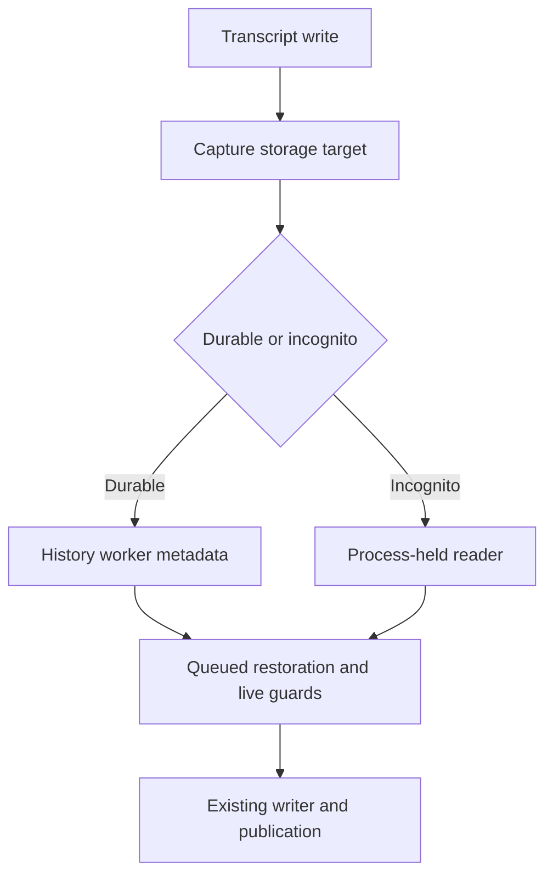

Codex review: needs maintainer review before merge. _Reviewed October 1, 2026, 4:57 AM ET / 08:57 UTC (Revision 5)._

# ClawSweeper review

## What this changes

Moves durable transcript cold-storage checks to the existing history worker and updates restart fixtures and integration coverage for the asynchronous reader lifecycle.

## Merge readiness

✅ **Ready for maintainer review**

This remains useful: current main and the latest release still perform synchronous durable-write metadata probes. The pinned patch has no actionable correctness or security findings.

**Priority:** P2
**Reviewed head:** `1b9f660b628a58fd3a68a2f7d870f542c106fe9e`

## Review scores

| Measure | Result | What it means |
|---|---|---|
| **Overall readiness** | 🐚 platinum hermit **(4/6)** | A focused implementation with meaningful boundary coverage, explained lifecycle repairs, and no actionable findings. |
| **Proof confidence** | 🌊 off-meta tidepool | Not applicable: The verified repository-admin author is exempt from ordinary external-contributor proof. Reported native-worker integration results exercise hot append, cold restoration, persisted events, and commit-time revocation; tests remain supplemental and were not rerun here. No stored-data contract changes require migration proof. |
| **Patch quality** | 🐚 platinum hermit **(4/6)** | No actionable review findings were identified. |

## Verification

| Check | Result | Evidence |
|---|---|---|
| **Real behavior** | Not applicable | Not applicable: The verified repository-admin author is exempt from ordinary external-contributor proof. Reported native-worker integration results exercise hot append, cold restoration, persisted events, and commit-time revocation; tests remain supplemental and were not rerun here. No stored-data contract changes require migration proof. |
| **Evidence reviewed** | 9 items | Pinned introduced change: Reviewed the merge-base-to-head delta, separating the production adapter and fixture repairs from unrelated base-branch changes. The supplied test merge is stale and was not used to infer removal of current-main behavior. Work remains on current main: Current main still resolves the default scope synchronously and uses readNativeMetadata for both initial and queued write-side probes. The merged read-side preparation work explicitly retained this write-side path. Latest release comparison: The v2026.9.7 source also retains synchronous default durable-write preflight; this branch's central change is not already shipped there. |
| **Findings** | None | None. |
| **Security** | None | None. |

## How this fits together

Transcript writes check whether session history must be restored from cold storage before modifying SQLite. The history worker prepares metadata, while the existing restoration and writer owners retain commit authority and publish completed changes.

## Before merge

None.

<strong>Agent review details</strong>

### Security

None.

### PR surface

Source +65, Tests +202. Total +267 across 10 files.

View PR surface stats

| Area | Files | Added | Removed | Net |
|---|---:|---:|---:|---:|
| Source | 1 | 67 | 2 | +65 |
| Tests | 9 | 255 | 53 | +202 |
| Docs | 0 | 0 | 0 | 0 |
| Config | 0 | 0 | 0 | 0 |
| Generated | 0 | 0 | 0 | 0 |
| Other | 0 | 0 | 0 | 0 |
| **Total** | **10** | **322** | **55** | **+267** |

### Review metrics

| Metric | Value | Why it matters |
|---|---|---|
| **Production versus test growth** | production net +65 LOC; tests net +202 LOC | Production growth retains the existing worker owner across preparation and restoration; new coverage targets routing, revocation, and source replacement. |

### Technical review

Best possible solution:

Use the existing history reader for durable preflight while preserving incognito ownership, fresh queued metadata, and the established restoration commit boundary.

Do we have a high-confidence way to reproduce the issue?

Yes, source establishes the synchronous probe: a durable append calls default restoration preflight, which reads cold metadata on the caller even for hot transcripts. This reviewer did not execute that path.

Is this the best way to solve the issue?

Yes, the patch extends the existing history-worker operation and preserves the restoration owner rather than creating another storage or worker mechanism.

AGENTS.md: found and applied where relevant.

Codex review notes: model internal, reasoning medium; reviewed against [726d2cb81ff1](https://github.com/openclaw/openclaw/commit/726d2cb81ff1ef11f8e5dd0aa8b755bf6e9eab92).

### Labels

Label changes:

No label changes.

Label justifications:

- `P2`: This is a bounded session-storage responsiveness improvement without evidence of an urgent user-facing outage.
- `rating: 🐚 platinum hermit`: Overall readiness is 🐚 platinum hermit; proof is 🌊 off-meta tidepool and patch quality is 🐚 platinum hermit.
- `status: 👀 ready for maintainer look`: ClawSweeper has no concrete contributor-facing blocker left for this PR. Not applicable: The verified repository-admin author is exempt from ordinary external-contributor proof. Reported native-worker integration results exercise hot append, cold restoration, persisted events, and commit-time revocation; tests remain supplemental and were not rerun here. No stored-data contract changes require migration proof.

### Evidence

What I checked:

- **Pinned introduced change:** Reviewed the merge-base-to-head delta, separating the production adapter and fixture repairs from unrelated base-branch changes. The supplied test merge is stale and was not used to infer removal of current-main behavior. ([`src/config/sessions/session-cold-storage.ts:393`](https://github.com/openclaw/openclaw/blob/1b9f660b628a58fd3a68a2f7d870f542c106fe9e/src/config/sessions/session-cold-storage.ts#L393), [1b9f660b628a](https://github.com/openclaw/openclaw/commit/1b9f660b628a58fd3a68a2f7d870f542c106fe9e))
- **Work remains on current main:** Current main still resolves the default scope synchronously and uses readNativeMetadata for both initial and queued write-side probes. The merged read-side preparation work explicitly retained this write-side path. ([`src/config/sessions/session-cold-storage.ts:384`](https://github.com/openclaw/openclaw/blob/726d2cb81ff1ef11f8e5dd0aa8b755bf6e9eab92/src/config/sessions/session-cold-storage.ts#L384), [726d2cb81ff1](https://github.com/openclaw/openclaw/commit/726d2cb81ff1ef11f8e5dd0aa8b755bf6e9eab92))
- **Latest release comparison:** The v2026.9.7 source also retains synchronous default durable-write preflight; this branch's central change is not already shipped there. ([`src/config/sessions/session-cold-storage.ts:384`](https://github.com/openclaw/openclaw/blob/c074824a27c96d3983043f9eeb33823cd1772d8c/src/config/sessions/session-cold-storage.ts#L384), [c074824a27c9](https://github.com/openclaw/openclaw/commit/c074824a27c96d3983043f9eeb33823cd1772d8c))
- **Target and commit authority preserved:** The adapter captures the storage environment, retains one history reader, checks caller/state admission and physical source after awaits, and supplies that composed guard to the existing restoration path. runColdMutation retains its writer-admission and synchronous commit-grant checks. Incognito keeps its process-held reader. No stored schema, serialized format, permission, or SDK contract changes were introduced. ([`src/config/sessions/session-cold-storage.ts:419`](https://github.com/openclaw/openclaw/blob/1b9f660b628a58fd3a68a2f7d870f542c106fe9e/src/config/sessions/session-cold-storage.ts#L419), [1b9f660b628a](https://github.com/openclaw/openclaw/commit/1b9f660b628a58fd3a68a2f7d870f542c106fe9e))
- **Current-head regression coverage:** The revised hot-write integration case observes native caller-thread cold-metadata queries, first verifies that the observer detects a direct query, then checks that append performs none and persists the event. The captured PR body reports all 13 integration cases passing and a failing production-file negative control. These are reported execution results, not tests run by this reviewer. ([`src/gateway/session-history-worker.integration.test.ts:179`](https://github.com/openclaw/openclaw/blob/1b9f660b628a58fd3a68a2f7d870f542c106fe9e/src/gateway/session-history-worker.integration.test.ts#L179), [1b9f660b628a](https://github.com/openclaw/openclaw/commit/1b9f660b628a58fd3a68a2f7d870f542c106fe9e))
- **Re-review continuity:** The previous completed review recorded no findings. Since its pinned head, only the integration test changed; production code and earlier lifecycle fixture repairs remain unchanged. The latest change replaces the obsolete zero-history-worker assertion without removing persisted-event coverage. ([`src/gateway/session-history-worker.integration.test.ts:179`](https://github.com/openclaw/openclaw/blob/1b9f660b628a58fd3a68a2f7d870f542c106fe9e/src/gateway/session-history-worker.integration.test.ts#L179), [1b9f660b628a](https://github.com/openclaw/openclaw/commit/1b9f660b628a58fd3a68a2f7d870f542c106fe9e))

Likely related people:

- **steipete:** Suggested for follow-up; no historical authorship or introduction is verified. (role: unverified routing candidate; confidence: low)

### Rating scale

| Score | Internal tier | Crab rank | Meaning |
|---:|:---:|---|---|
| **6/6** | S | 🦀 challenger crab | Exceptional readiness |
| **5/6** | A | 🦞 diamond lobster | Very strong readiness |
| **4/6** | B | 🐚 platinum hermit | Good normal PR; ordinary maintainer review |
| **3/6** | C | 🦐 gold shrimp | Useful, but confidence is limited |
| **2/6** | D | 🦪 silver shellfish | Proof or implementation needs work |
| **1/6** | F | 🧂 unranked krab | Not merge-ready |
| N/A | NA | 🌊 off-meta tidepool | Rating does not apply |

Overall follows the weaker of proof and patch quality.
Shiny media proof means a screenshot, video, or linked artifact directly shows the changed behavior. Runtime, network, CSP, and security claims still need visible diagnostics.

### Workflow

- ClawSweeper keeps one durable marker-backed review comment per issue or PR.
- Re-runs edit this comment so the latest verdict, findings, and automation markers stay together instead of adding duplicate bot comments.
- A fresh review can be triggered by eligible `@clawsweeper re-review` comments, exact-item GitHub events, scheduled/background review runs, or manual workflow dispatch.
- PR/issue authors and users with repository write access can comment `@clawsweeper re-review` or `@clawsweeper re-run` on an open PR or issue to request a fresh review only.
- Maintainers can also comment `@clawsweeper review` to request a fresh review only.
- Fresh-review commands do not start repair, autofix, rebase, CI repair, or automerge.
- Maintainer-only repair and merge flows require explicit commands such as `@clawsweeper autofix`, `@clawsweeper automerge`, `@clawsweeper fix ci`, or `@clawsweeper address review`.
- Maintainers can comment `@clawsweeper explain` to ask for more context, or `@clawsweeper stop` to stop active automation.

### History

Review history (4 earlier review cycles)

<!-- clawsweeper-review-history v=1 total=4 -->
- reviewed 2026-10-01T07:49:38.689Z sha 819afab8ba5acf0bbd3d68fb61b626adefdeeb02 :: needs maintainer review before merge. :: none
- reviewed 2026-10-01T08:02:46.095Z sha 819afab8ba5acf0bbd3d68fb61b626adefdeeb02 :: needs maintainer review before merge. :: none
- reviewed 2026-10-01T08:14:11.262Z sha 7ef4498012e6afb0fead268738c48f771f6ca3b7 :: needs maintainer review before merge. :: none
- reviewed 2026-10-01T08:35:02.347Z sha 28de299559b0bc90c54226465142563e63ce6f38 :: needs maintainer review before merge. :: none

<!-- clawsweeper-verdict:needs-human item=162521 sha=1b9f660b628a58fd3a68a2f7d870f542c106fe9e confidence=high updated_at=2026-10-01T08:54:37Z reviewed_at=2026-10-01T08:57:25.351Z lease_owner=github-run-36839193074-1 lease_comment_id=5928077770 source_revision=e47186cab14bec03f37c837583ca4a500992b986b2dfb764cfc0d0d0d1b741df live_verification=absent -->
<!-- clawsweeper-review-state:ready item=162521 sha=1b9f660b628a58fd3a68a2f7d870f542c106fe9e v=1 -->

<!-- clawsweeper-review-version item=162521 reviewed_at=2026-10-01T08:57:25.351Z sha=1b9f660b628a58fd3a68a2f7d870f542c106fe9e source_revision=e47186cab14bec03f37c837583ca4a500992b986b2dfb764cfc0d0d0d1b741df lease_owner=github-run-36839193074-1 lease_comment_id=5928077770 v=1 -->

<!-- clawsweeper-review item=162521 -->