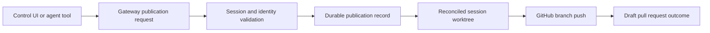

Codex review: needs maintainer review before merge. _Reviewed August 19, 2026, 1:44 PM ET / 17:44 UTC._

# ClawSweeper review

## What this changes

Adds a Gateway-owned broker that lets local and cloud session worktrees publish a reconciled branch and draft GitHub pull request through the selected GitHub identity.

## Merge readiness

⚠️ **Ready for maintainer review - 3 items remain**

Keep open for maintainer review: this is a substantial new Gateway-owned GitHub write boundary, not work already on current main. The earlier recovery, authority, UI fallback, and title findings are covered on the current head; the remaining decision is whether to require a disposable end-to-end GitHub write before landing.

**Priority:** P1
**Reviewed head:** `36b56840a6d913d937c6c74868c4cdabc070ba41`
**Owner decision:** Required. See [Decision needed](#decision-needed).

## Review scores

| Measure | Result | What it means |
|---|---|---|
| **Overall readiness** | 🦐 gold shrimp **(3/6)** | The implementation and focused safety coverage are substantial, but the central external GitHub write has not been demonstrated end to end. |
| **Proof confidence** | 🦐 gold shrimp **(3/6)** | Not applicable: This maintainer-authored PR is exempt from the contributor proof gate; its body includes UI media, but the documented lack of a disposable GitHub write credential leaves end-to-end publication as a maintainer decision. |
| **Patch quality** | 🐚 platinum hermit **(4/6)** | No actionable review findings were identified. |

## Verification

| Check | Result | Evidence |
|---|---|---|
| **Real behavior** | Not applicable | Not applicable: This maintainer-authored PR is exempt from the contributor proof gate; its body includes UI media, but the documented lack of a disposable GitHub write credential leaves end-to-end publication as a maintainer decision. |
| **Evidence reviewed** | 7 items | Gateway owner boundary: The server method derives the session from trusted caller context, rejects a conflicting caller-supplied session, rechecks session-mutation authorization around the awaited coordinator call, and forwards only bounded title/body/idempotency input. Recovery and authority safeguards: Execution validates current session/worktree authority and safe Git configuration before recovery; focused boundary tests cover stale ownership and unsafe local fsmonitor configuration before recovery probes. Prior UI fallback finding addressed: The branch row retains the existing browser Create PR link whenever Gateway publication fails, while successful publication exposes the resulting PR URL. |
| **Findings** | None | None. |
| **Security** | None | None. |

## How this fits together

Agent tools and the Control UI submit bounded publication intent to the Gateway, which owns session worktrees, identity selection, recovery state, Git operations, and pull-request creation. Cloud workers remain credential-free and receive the final publication outcome through the session flow.

## Decision needed

| Question | Recommendation |
|---|---|
| Should this new Gateway-owned GitHub write path require a disposable end-to-end publish proof before merge, or may it land with the documented credential infeasibility and deterministic boundary coverage only? | **Require disposable publish proof:** Provide a temporary scoped identity and repository, then record a redacted request-to-draft-PR run on the exact head. |

Why: The code intentionally handles effective GitHub credentials and mutates user worktrees; accepting the remaining live-proof gap is a maintainer security and release decision.

## Before merge

- [ ] **Resolve merge risk (P1)** - This creates a new write-capable GitHub path that changes a session branch/index and creates a draft PR; deterministic coverage is extensive, but no disposable-repository end-to-end write has demonstrated the full credential, transport, and GitHub API boundary.
- [ ] **Complete next step (P2)** - A maintainer must decide whether the documented external write-proof gap is acceptable before this feature can land.

<strong>Agent review details</strong>

### Security

None.

### Review metrics

| Metric | Value | Why it matters |
|---|---|---|
| **Production versus test growth** | production +4,524/-244; tests/test support +4,061/-106; generated native +219/-0 | The feature adds a durable broker across Gateway, worker, protocol, and UI boundaries, so its large production surface warrants owner review. |
| **Persisted and protocol surface** | 1 lazy SQLite table added; 1 Gateway method added | The new durable request record and publication method affect upgrade, client, and restart behavior. |

### Stored data model

Persistent data-model change detected: `database schema: src/state/openclaw-state-db-schema-additive.ts`, `database schema: src/state/openclaw-state-db.test.ts`, `database schema: src/state/openclaw-state-schema-compatibility.test.ts`, `database schema: src/state/openclaw-state-schema.sql`, `durable storage schema: packages/gateway-protocol/src/schema/worker-admission.ts`, `durable storage schema: src/gateway/worker-environments/placement-dispatch.test.ts`, and 46 more. Migration or upgrade compatibility proof is recorded; maintainers should verify it before merge.

### Merge-risk options

**Maintainer options:**
1. **Require disposable publish proof (recommended)**  
   Before merge, run the exact head against a temporary repository and scoped identity, redacting all credentials while showing branch push and draft PR creation.
2. **Accept deterministic coverage only**  
   A maintainer may accept the documented absence of a usable write identity and land with the remaining external-boundary proof gap explicitly recorded.
3. **Pause until credentials are available**  
   Keep the PR open if maintainers do not want to introduce a credentialed write path without an end-to-end proof.

### Technical review

Best possible solution:

Use a disposable repository and correctly scoped temporary identity to prove request, reconciliation, push, draft-PR creation, and redacted recovery on the exact head before accepting this new write boundary.

Do we have a high-confidence way to reproduce the issue?

Not applicable: this PR adds a new publication capability rather than repairing an established behavior.

Is this the best way to solve the issue?

Unclear: the Gateway-owned design is the appropriate owner boundary for credential-free workers, but a disposable end-to-end publish is still needed to establish that this is safe to ship.

AGENTS.md: found and applied where relevant.

Codex review notes: model internal, reasoning high; reviewed against [e474d23e653c](https://github.com/openclaw/openclaw/commit/e474d23e653c91fb3364976f6ecd8fb61b4cf0f5).

### Labels

Label changes:

- add `rating: 🦐 gold shrimp`: Overall readiness is 🦐 gold shrimp; proof is 🦐 gold shrimp and patch quality is 🐚 platinum hermit.
- add `feature: ✨ showcase`: ClawSweeper spotlight: unusually compelling feature idea for maintainer attention. A credential-free worker publication path with Gateway-owned identity and restart-safe reconciliation unlocks a high-value autonomous coding workflow without forwarding forge credentials.
- add `status: 👀 ready for maintainer look`: ClawSweeper has no concrete contributor-facing blocker left for this PR. Not applicable: This maintainer-authored PR is exempt from the contributor proof gate; its body includes UI media, but the documented lack of a disposable GitHub write credential leaves end-to-end publication as a maintainer decision.
- remove `rating: 🦪 silver shellfish`: Current PR rating is `rating: 🦐 gold shrimp`, so this older rating label is no longer current.
- remove `status: ⏳ waiting on author`: Current PR status label is `status: 👀 ready for maintainer look`.

Label justifications:

- `P1`: The broker sits on the active agent-to-worktree publication workflow and can leave completed work unpublished if its new boundary fails.
- `merge-risk: 🚨 compatibility`: The PR adds a Gateway method, generated clients, and first-use persistent state that must remain safe for existing Gateway installations.
- `merge-risk: 🚨 session-state`: Publication atomically coordinates a session-owned branch, Git index, recovery record, and worker workspace acceptance.
- `merge-risk: 🚨 security-boundary`: The Gateway selects the effective GitHub identity and performs credentialed writes while deliberately keeping credentials out of workers.
- `rating: 🦐 gold shrimp`: Overall readiness is 🦐 gold shrimp; proof is 🦐 gold shrimp and patch quality is 🐚 platinum hermit.
- `feature: ✨ showcase`: ClawSweeper spotlight: unusually compelling feature idea for maintainer attention. A credential-free worker publication path with Gateway-owned identity and restart-safe reconciliation unlocks a high-value autonomous coding workflow without forwarding forge credentials.
- `status: 👀 ready for maintainer look`: ClawSweeper has no concrete contributor-facing blocker left for this PR. Not applicable: This maintainer-authored PR is exempt from the contributor proof gate; its body includes UI media, but the documented lack of a disposable GitHub write credential leaves end-to-end publication as a maintainer decision.
- `proof: 🎥 video`: Contributor real behavior proof includes video or recording evidence. This maintainer-authored PR is exempt from the contributor proof gate; its body includes UI media, but the documented lack of a disposable GitHub write credential leaves end-to-end publication as a maintainer decision.

### Evidence

What I checked:

- **Gateway owner boundary:** The server method derives the session from trusted caller context, rejects a conflicting caller-supplied session, rechecks session-mutation authorization around the awaited coordinator call, and forwards only bounded title/body/idempotency input. ([`src/gateway/server-methods/sessions-github.ts:33`](https://github.com/openclaw/openclaw/blob/36b56840a6d9/src/gateway/server-methods/sessions-github.ts#L33), [36b56840a6d9](https://github.com/openclaw/openclaw/commit/36b56840a6d9))
- **Recovery and authority safeguards:** Execution validates current session/worktree authority and safe Git configuration before recovery; focused boundary tests cover stale ownership and unsafe local fsmonitor configuration before recovery probes. ([`src/gateway/github-publication-executor.ts:221`](https://github.com/openclaw/openclaw/blob/36b56840a6d9/src/gateway/github-publication-executor.ts#L221), [36b56840a6d9](https://github.com/openclaw/openclaw/commit/36b56840a6d9))
- **Prior UI fallback finding addressed:** The branch row retains the existing browser Create PR link whenever Gateway publication fails, while successful publication exposes the resulting PR URL. ([`ui/src/pages/chat/components/chat-pull-requests.ts:273`](https://github.com/openclaw/openclaw/blob/36b56840a6d9/ui/src/pages/chat/components/chat-pull-requests.ts#L273), [36b56840a6d9](https://github.com/openclaw/openclaw/commit/36b56840a6d9))
- **Upgrade-safe persistence design:** The broker owns one lazy additive SQLite table, and its test covers opening an older current-version database, first use, reopen, and integrity validation without a schema-version bump. ([`src/state/openclaw-state-db.test.ts:3124`](https://github.com/openclaw/openclaw/blob/36b56840a6d9/src/state/openclaw-state-db.test.ts#L3124), [36b56840a6d9](https://github.com/openclaw/openclaw/commit/36b56840a6d9))
- **Current-main comparison:** Current main predates this capability: the publication server-method file is absent at the reviewed main SHA, so the central behavior is not already implemented there. ([e474d23e653c](https://github.com/openclaw/openclaw/commit/e474d23e653c))
- **Feature provenance:** Current-main blame attributes the existing GitHub identity owner to Ayaan Zaidi’s commit, while the related merged identity phase was authored by steipete; this PR extends that established identity series into publication. ([`src/agents/github-tool-identity.ts:21`](https://github.com/openclaw/openclaw/blob/16c87e69a633/src/agents/github-tool-identity.ts#L21), [16c87e69a633](https://github.com/openclaw/openclaw/commit/16c87e69a633))

Likely related people:

- **steipete:** Authored the merged per-agent GitHub identity phase and the reviewed publication implementation. (role: feature-series owner; confidence: high; commits: [6e458d84bfc1](https://github.com/openclaw/openclaw/commit/6e458d84bfc1970ccd97b0a0b493f1e0f4965c56), [36b56840a6d9](https://github.com/openclaw/openclaw/commit/36b56840a6d913d937c6c74868c4cdabc070ba41); files: `src/agents/github-tool-identity.ts`, `src/gateway/github-publication.ts`)
- **Ayaan Zaidi:** Current-main history attributes the GitHub identity owner that this broker reuses to Ayaan Zaidi. (role: recent adjacent contributor; confidence: medium; commits: [16c87e69a633](https://github.com/openclaw/openclaw/commit/16c87e69a633234b473a6220ee4c38ce048b5b69); files: `src/agents/github-tool-identity.ts`)

### Rank-up moves

Optional improvements that raise the rating; they are not merge blockers.

- Record a redacted disposable-repository publication run on the exact head.
- Let exact-head CI finish green before merge.

### Rating scale

| Score | Internal tier | Crab rank | Meaning |
|---:|:---:|---|---|
| **6/6** | S | 🦀 challenger crab | Exceptional readiness |
| **5/6** | A | 🦞 diamond lobster | Very strong readiness |
| **4/6** | B | 🐚 platinum hermit | Good normal PR; ordinary maintainer review |
| **3/6** | C | 🦐 gold shrimp | Useful, but confidence is limited |
| **2/6** | D | 🦪 silver shellfish | Proof or implementation needs work |
| **1/6** | F | 🧂 unranked krab | Not merge-ready |
| N/A | NA | 🌊 off-meta tidepool | Rating does not apply |

Overall follows the weaker of proof and patch quality.
Shiny media proof means a screenshot, video, or linked artifact directly shows the changed behavior. Runtime, network, CSP, and security claims still need visible diagnostics.

### Workflow

- ClawSweeper keeps one durable marker-backed review comment per issue or PR.
- Re-runs edit this comment so the latest verdict, findings, and automation markers stay together instead of adding duplicate bot comments.
- A fresh review can be triggered by eligible `@clawsweeper re-review` comments, exact-item GitHub events, scheduled/background review runs, or manual workflow dispatch.
- PR/issue authors and users with repository write access can comment `@clawsweeper re-review` or `@clawsweeper re-run` on an open PR or issue to request a fresh review only.
- Maintainers can also comment `@clawsweeper review` to request a fresh review only.
- Fresh-review commands do not start repair, autofix, rebase, CI repair, or automerge.
- Maintainer-only repair and merge flows require explicit commands such as `@clawsweeper autofix`, `@clawsweeper automerge`, `@clawsweeper fix ci`, or `@clawsweeper address review`.
- Maintainers can comment `@clawsweeper explain` to ask for more context, or `@clawsweeper stop` to stop active automation.

### History

Review history (11 earlier review cycles; latest 8 shown)

<!-- clawsweeper-review-history v=1 total=11 -->
- reviewed 2026-08-19T12:43:36.116Z sha 15c40a2571ecbb0ebba322bd815851be26db7d1b :: needs maintainer review before merge. :: none
- reviewed 2026-08-19T13:06:38.292Z sha 0a3fcbd1c21ce0f7f3ed17a238cf5a5c9ce6fe38 :: found issues before merge. :: [P1] Handle unavailable worktree config scope
- reviewed 2026-08-19T13:30:57.745Z sha c96787b0c3cec3c78b48035abcc77dc24420524c :: found issues before merge. :: [P1] Handle unavailable worktree config scope
- reviewed 2026-08-19T13:48:30.292Z sha 3d18d3bb45c4565479cc845468cf346263b2999d :: found issues before merge. :: [P1] Handle unavailable worktree config scope
- reviewed 2026-08-19T14:16:17.228Z sha aba1ab04f6b6c515f5037665a816d822a44c5a83 :: needs changes before merge. :: [P1] Treat unavailable worktree config scope as absent
- reviewed 2026-08-19T15:02:41.127Z sha 12a5b4ae530b23894b5d02807692eee864e5ebaf :: found issues before merge. :: [P1] Treat an unavailable worktree config scope as absent | [P1] Reuse the publication key across a UI retry | [P1] Validate ownership before recovering Git state
- reviewed 2026-08-19T15:24:28.653Z sha b437f8b64f368ffa66c4278414ab027178d6f5bd :: found issues before merge. :: [P1] Handle an unavailable worktree config scope as empty | [P1] Reuse the idempotency key after an unknown RPC outcome | [P1] Validate authority before Git recovery mutates the worktree | [P2] Do not report a closed marked PR as published
- reviewed 2026-08-19T16:40:00.906Z sha c88ba226565cf68056f55988d0a09e60a63f568b :: found issues before merge. :: [P1] Validate Git safety before recovery | [P1] Revalidate authority before recovery writes the index | [P1] Preserve browser PR creation when broker publication fails | [P2] Avoid generating an overlong publication title

<!-- clawsweeper-verdict:needs-human item=126306 sha=36b56840a6d913d937c6c74868c4cdabc070ba41 confidence=high updated_at=2026-08-19T17:41:37Z reviewed_at=2026-08-19T17:44:18.204Z lease_owner=github-run-32282940789-1 lease_comment_id=5345839486 source_revision=375bf5efc553d6833b2c84c6fef636328ca8ac47c573d0c9e725673015d2fea0 -->

<!-- clawsweeper-review-version item=126306 reviewed_at=2026-08-19T17:44:18.204Z sha=36b56840a6d913d937c6c74868c4cdabc070ba41 source_revision=375bf5efc553d6833b2c84c6fef636328ca8ac47c573d0c9e725673015d2fea0 lease_owner=github-run-32282940789-1 lease_comment_id=5345839486 v=1 -->

<!-- clawsweeper-review item=126306 -->