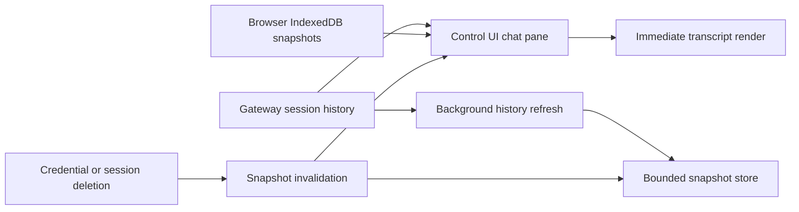

Codex review: needs maintainer review before merge. _Reviewed August 17, 2026, 4:47 AM ET / 08:47 UTC._

# ClawSweeper review

## What this changes

Adds a bounded IndexedDB cache, cross-tab invalidation, idle prefetching, and persisted transcript row measurements so recent Control UI sessions can render before their Gateway refresh completes.

## Merge readiness

⚠️ **Ready for maintainer review - 5 items remain**

Keep open for protected maintainer review: no concrete patch defect was found, but the PR intentionally introduces persistent browser-side transcript storage and needs an explicit security-boundary decision plus exact-head CI.

**Priority:** P2
**Reviewed head:** `6f961c0278934a374eea67d48ff93699325a8e89`
**Owner decision:** Required. See [Decision needed](#decision-needed).

## Review scores

| Measure | Result | What it means |
|---|---|---|
| **Overall readiness** | 🐚 platinum hermit **(4/6)** | The branch has credible visible proof and broad focused coverage; the remaining gate is maintainer acceptance of the persisted-transcript security boundary. |
| **Proof confidence** | 🦞 diamond lobster **(5/6)** ✨ media proof bonus | Sufficient (recording): The PR body provides before/after reload media showing a populated transcript while refresh remains pending, alongside focused lifecycle coverage. |
| **Patch quality** | 🐚 platinum hermit **(4/6)** | Security review found an item that needs attention. |

## Verification

| Check | Result | Evidence |
|---|---|---|
| **Real behavior** | Verified | Sufficient (recording): The PR body provides before/after reload media showing a populated transcript while refresh remains pending, alongside focused lifecycle coverage. |
| **Evidence reviewed** | 6 items | Current main does not already provide this feature: Current main has no persistent snapshot-store module, while the PR introduces it; the central reload-and-render behavior therefore remains unique to this branch. Hydration preserves Gateway authority: The pane reads a stored snapshot only on a memory miss and rejects it if the state/session changed or network data arrived first, then applies the Gateway refresh normally. Credential and deletion invalidation: A changed Gateway URL, token, password, bootstrap token, or bootstrap profile clears stored snapshots; deletion uses the existing shell deletion observer to remove the matching canonical snapshot. |
| **Findings** | None | None. |
| **Security** | Needs attention | Approve persistent transcript storage explicitly: Snapshot records include arbitrary transcript messages and are written to IndexedDB; clearing on credential changes and deletion reduces exposure but does not encrypt browser-profile data at rest. |

## How this fits together

The Control UI chat page receives session history from the Gateway and currently keeps a bounded in-memory transcript cache. This PR adds a per-origin persistent cache that hydrates a pane first, then lets the Gateway refresh replace it.

## Decision needed

| Question | Recommendation |
|---|---|
| Should OpenClaw persist recent transcript content unencrypted in the same-origin browser profile to provide reload-time rendering? | **Accept the bounded browser cache:** Approve the per-origin cache with its credential-change and deletion invalidation as the intended Control UI performance boundary. |

Why: This is an intentional data-at-rest and product-performance tradeoff; source review can verify invalidation but cannot choose the acceptable privacy boundary.

## Before merge

- [ ] **Resolve security concern: Approve persistent transcript storage explicitly** - Snapshot records include arbitrary transcript messages and are written to IndexedDB; clearing on credential changes and deletion reduces exposure but does not encrypt browser-profile data at rest.
- [ ] **Resolve merge risk (P1)** - This makes recent transcript content persist unencrypted in the browser profile until credential/gateway change or session deletion triggers invalidation.
- [ ] **Resolve merge risk (P1)** - The branch is behind main and exact-head checks are still running, so merge should wait for the current head’s required green result.
- [ ] **Complete next step (P2)** - A maintainer must explicitly accept the transcript-at-rest boundary; this is not a mechanical repair candidate.

## Findings

- [medium] Approve persistent transcript storage explicitly — `ui/src/pages/chat/session-snapshot-store.ts:43`

<strong>Agent review details</strong>

### Security

Needs attention: The implementation is bounded and invalidated on credential or deletion events, but it deliberately adds transcript data at rest in the browser profile.

### PR surface

Source +1396, Tests +954, Config +1, Other +3. Total +2354 across 30 files.

View PR surface stats

| Area | Files | Added | Removed | Net |
|---|---:|---:|---:|---:|
| Source | 20 | 1482 | 86 | +1396 |
| Tests | 8 | 961 | 7 | +954 |
| Docs | 0 | 0 | 0 | 0 |
| Config | 1 | 1 | 0 | +1 |
| Generated | 0 | 0 | 0 | 0 |
| Other | 1 | 3 | 0 | +3 |
| **Total** | **30** | **2447** | **93** | **+2354** |

### Review metrics

| Metric | Value | Why it matters |
|---|---|---|
| **Production versus test delta** | production +1466/-79; tests and test support +977/-14; dependency metadata +4/-0 | The substantial production growth implements a new bounded persistence and prefetch capability; the accompanying focused tests cover its lifecycle and invalidation paths. |
| **Persistent browser cache limits** | 1 IndexedDB store; 20 sessions; 500 row heights per session | These bounds define the retained session-state and browser-profile exposure before merge. |

### Stored data model

Persistent data-model change detected: `persistent cache schema: ui/src/pages/chat/chat-history.ts`, `persistent cache schema: ui/src/pages/chat/chat-page.ts`, `persistent cache schema: ui/src/pages/chat/chat-pane-base.ts`, `persistent cache schema: ui/src/pages/chat/chat-pane-lifecycle.ts`, `persistent cache schema: ui/src/pages/chat/chat-pane-startup-subscriptions.ts`, `persistent cache schema: ui/src/pages/chat/chat-pane.test.ts`, and 24 more. Confirm migration or upgrade compatibility proof before merge.

### Merge-risk options

**Maintainer options:**
1. **Accept the explicit browser-storage boundary (recommended)**  
   Land after a maintainer confirms that bounded unencrypted same-origin transcript persistence is acceptable and exact-head checks are green.
2. **Keep transcript state ephemeral**  
   Pause this PR if persistent browser-profile transcript storage is not an acceptable product boundary.

### Technical review

Best possible solution:

Retain the single bounded per-origin snapshot path, with Gateway refresh authoritative, if the designated maintainer accepts the explicit browser-storage boundary and exact-head validation succeeds.

Do we have a high-confidence way to reproduce the issue?

No independent live reproduction was run in this read-only review; the PR supplies before/after delayed-refresh media and focused source tests for the claimed behavior.

Is this the best way to solve the issue?

Yes, conditionally: persisting the existing bounded chat snapshot is the maintainable way to survive reloads, while the memory-miss fence keeps the Gateway refresh authoritative.

AGENTS.md: found and applied where relevant.

Codex review notes: model internal, reasoning high; reviewed against [ee86b24ac170](https://github.com/openclaw/openclaw/commit/ee86b24ac17086401c76a92153bc611e02bc313a).

### Labels

Label justifications:

- `P2`: This is a broad but non-urgent Control UI responsiveness improvement rather than a demonstrated current outage.
- `merge-risk: 🚨 session-state`: Cached histories, active panes, deletion events, and background Gateway refreshes must remain correctly associated with their sessions.
- `merge-risk: 🚨 security-boundary`: The PR stores transcript payloads in the browser profile and relies on credential and deletion invalidation to remove them.
- `rating: 🐚 platinum hermit`: Overall readiness is 🐚 platinum hermit; proof is 🦞 diamond lobster and patch quality is 🐚 platinum hermit.
- `status: 👀 ready for maintainer look`: ClawSweeper has no concrete contributor-facing blocker left for this PR. Sufficient (recording): The PR body provides before/after reload media showing a populated transcript while refresh remains pending, alongside focused lifecycle coverage.
- `proof: sufficient`: Contributor real behavior proof is sufficient. The PR body provides before/after reload media showing a populated transcript while refresh remains pending, alongside focused lifecycle coverage.
- `proof: 🎥 video`: Contributor real behavior proof includes video or recording evidence. The PR body provides before/after reload media showing a populated transcript while refresh remains pending, alongside focused lifecycle coverage.

### Evidence

Security concerns:

- [medium] Approve persistent transcript storage explicitly — `ui/src/pages/chat/session-snapshot-store.ts:43`
  Snapshot records include arbitrary transcript messages and are written to IndexedDB; clearing on credential changes and deletion reduces exposure but does not encrypt browser-profile data at rest.
  Confidence: 0.98

What I checked:

- **Current main does not already provide this feature:** Current main has no persistent snapshot-store module, while the PR introduces it; the central reload-and-render behavior therefore remains unique to this branch. ([`ui/src/pages/chat/session-snapshot-store.ts`](https://github.com/openclaw/openclaw/blob/ee86b24ac170/ui/src/pages/chat/session-snapshot-store.ts), [ee86b24ac170](https://github.com/openclaw/openclaw/commit/ee86b24ac170))
- **Hydration preserves Gateway authority:** The pane reads a stored snapshot only on a memory miss and rejects it if the state/session changed or network data arrived first, then applies the Gateway refresh normally. ([`ui/src/pages/chat/chat-pane-lifecycle.ts:106`](https://github.com/openclaw/openclaw/blob/6f961c027893/ui/src/pages/chat/chat-pane-lifecycle.ts#L106), [6f961c027893](https://github.com/openclaw/openclaw/commit/6f961c027893))
- **Credential and deletion invalidation:** A changed Gateway URL, token, password, bootstrap token, or bootstrap profile clears stored snapshots; deletion uses the existing shell deletion observer to remove the matching canonical snapshot. ([`ui/src/app/gateway-store.ts:289`](https://github.com/openclaw/openclaw/blob/6f961c027893/ui/src/app/gateway-store.ts#L289), [6f961c027893](https://github.com/openclaw/openclaw/commit/6f961c027893))
- **Bounded persisted data and test coverage:** The store validates snapshot records, limits row measurements, and writes records through IndexedDB; focused tests cover hydration races, cross-tab invalidation, credential changes, eviction, and prefetch selection. ([`ui/src/pages/chat/session-snapshot-store.ts:43`](https://github.com/openclaw/openclaw/blob/6f961c027893/ui/src/pages/chat/session-snapshot-store.ts#L43), [6f961c027893](https://github.com/openclaw/openclaw/commit/6f961c027893))
- **Dependency scope:** fake-indexeddb is added only to Control UI devDependencies at the same 6.2.5 pin already used by the bundled Matrix plugin; it supports IndexedDB tests rather than the browser runtime. ([`ui/package.json:52`](https://github.com/openclaw/openclaw/blob/6f961c027893/ui/package.json#L52), [6f961c027893](https://github.com/openclaw/openclaw/commit/6f961c027893))
- **Area provenance:** Current Control UI chat-page and Gateway connection code around this integration traces to Peter Steinberger’s recent merged commits, including the UI refactor that owns the page cache boundary. ([`ui/src/pages/chat/chat-page.ts:80`](https://github.com/openclaw/openclaw/blob/b1e76c4640bc/ui/src/pages/chat/chat-page.ts#L80), [b1e76c4640bc](https://github.com/openclaw/openclaw/commit/b1e76c4640bc))

Likely related people:

- **steipete:** Current-main blame attributes the chat-page cache boundary and Gateway connection path to Peter Steinberger; the relevant merged commits are #125105 and #125083. (role: recent Control UI cache and lifecycle contributor; confidence: high; commits: [b1e76c4640bc](https://github.com/openclaw/openclaw/commit/b1e76c4640bc043955597b654c27399a0e1959f3), [0af3b865d782](https://github.com/openclaw/openclaw/commit/0af3b865d78287b1cfcc8e3516eb07bc17a9027e); files: `ui/src/pages/chat/chat-page.ts`, `ui/src/app/gateway-store.ts`)

### Rating scale

| Score | Internal tier | Crab rank | Meaning |
|---:|:---:|---|---|
| **6/6** | S | 🦀 challenger crab | Exceptional readiness |
| **5/6** | A | 🦞 diamond lobster | Very strong readiness |
| **4/6** | B | 🐚 platinum hermit | Good normal PR; ordinary maintainer review |
| **3/6** | C | 🦐 gold shrimp | Useful, but confidence is limited |
| **2/6** | D | 🦪 silver shellfish | Proof or implementation needs work |
| **1/6** | F | 🧂 unranked krab | Not merge-ready |
| N/A | NA | 🌊 off-meta tidepool | Rating does not apply |

Overall follows the weaker of proof and patch quality.
Shiny media proof means a screenshot, video, or linked artifact directly shows the changed behavior. Runtime, network, CSP, and security claims still need visible diagnostics.

### Workflow

- ClawSweeper keeps one durable marker-backed review comment per issue or PR.
- Re-runs edit this comment so the latest verdict, findings, and automation markers stay together instead of adding duplicate bot comments.
- A fresh review can be triggered by eligible `@clawsweeper re-review` comments, exact-item GitHub events, scheduled/background review runs, or manual workflow dispatch.
- PR/issue authors and users with repository write access can comment `@clawsweeper re-review` or `@clawsweeper re-run` on an open PR or issue to request a fresh review only.
- Maintainers can also comment `@clawsweeper review` to request a fresh review only.
- Fresh-review commands do not start repair, autofix, rebase, CI repair, or automerge.
- Maintainer-only repair and merge flows require explicit commands such as `@clawsweeper autofix`, `@clawsweeper automerge`, `@clawsweeper fix ci`, or `@clawsweeper address review`.
- Maintainers can comment `@clawsweeper explain` to ask for more context, or `@clawsweeper stop` to stop active automation.

### History

Review history (6 earlier review cycles)

<!-- clawsweeper-review-history v=1 total=6 -->
- reviewed 2026-08-17T06:53:25.204Z sha f07e6335d65427b368727202d165e1e088361b8b :: found issues before merge. :: [P1] Clear mounted transcripts on credential changes | [P1] Propagate snapshot invalidation across same-origin tabs
- reviewed 2026-08-17T07:30:05.360Z sha 4c170c5f48f1fc835269feab78a72243473b27f6 :: found issues before merge. :: [P1] Preserve the selected global session in the snapshot key | [P1] Keep the Gateway session key separate from the snapshot key | [P1] Clear mounted transcripts when credentials change | [P1] Broadcast snapshot invalidation to other same-origin tabs
- reviewed 2026-08-17T07:43:38.698Z sha e85adab7338844c16a8b09a0a0faff0aca0ee913 :: found issues before merge. :: [P1] Keep global snapshots distinct from agent main sessions | [P1] Clear mounted transcripts when credentials change
- reviewed 2026-08-17T08:03:01.422Z sha 0e767f629be307d11486db8de265658283581ba3 :: found issues before merge. :: [P1] Clear mounted transcripts on credential changes | [P1] Propagate invalidation to every same-origin tab
- reviewed 2026-08-17T08:12:09.419Z sha d06440040163f7d672c4bc074fdc33557ad8087a :: found issues before merge. :: [P1] Clear mounted transcripts on credential changes | [P1] Broadcast snapshot invalidation across same-origin tabs
- reviewed 2026-08-17T08:39:32.707Z sha 293ffded182f41b63dfd8a431fe97abaab339dbb :: needs maintainer review before merge. :: none

<!-- clawsweeper-security:security-sensitive item=125128 sha=6f961c0278934a374eea67d48ff93699325a8e89 confidence=high updated_at=2026-08-17T08:44:39Z reviewed_at=2026-08-17T08:47:50.714Z lease_owner=github-run-32011667992-1 lease_comment_id=5313809927 source_revision=924a98735cec110817691a5860966025dc78c270534d7df8ddb3d4c531093e51 -->
<!-- clawsweeper-verdict:needs-human item=125128 sha=6f961c0278934a374eea67d48ff93699325a8e89 confidence=high updated_at=2026-08-17T08:44:39Z reviewed_at=2026-08-17T08:47:50.714Z lease_owner=github-run-32011667992-1 lease_comment_id=5313809927 source_revision=924a98735cec110817691a5860966025dc78c270534d7df8ddb3d4c531093e51 -->

<!-- clawsweeper-review-version item=125128 reviewed_at=2026-08-17T08:47:50.714Z sha=6f961c0278934a374eea67d48ff93699325a8e89 source_revision=924a98735cec110817691a5860966025dc78c270534d7df8ddb3d4c531093e51 lease_owner=github-run-32011667992-1 lease_comment_id=5313809927 v=1 -->

<!-- clawsweeper-review item=125128 -->