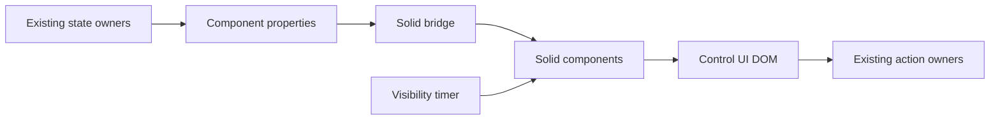

Codex review: needs maintainer review before merge.

## What this changes

This PR replaces shared Lit time labels, sparklines, controls, and dialogs with Solid implementations and updates their consumers.

**Example:** A completed task took 125 seconds.
- **Before:** The Lit elapsed-time element displays “2m 5s”.
- **After:** The Solid elapsed-time element displays “2m 5s”.

## Review scores

| Measure | Result | What it means |
|---|---|---|
| **Overall readiness** | 🦐 gold shrimp **(3/6)** | The focused cutover and prior repairs look correct; confidence rests on component parity screenshots and browser harness coverage rather than a supplied shipped-entry-point demonstration. |
| **Proof confidence** | 🦐 gold shrimp **(3/6)** | The supplied MEMBER association exempts this PR from the contributor proof gate; inspected synthetic browser screenshots support visual parity, while interaction coverage comes from reported Chromium/WebKit tests and passing reviewed-head browser CI. |
| **Patch quality** | 🐚 platinum hermit **(4/6)** | No actionable review findings were identified. |

## Product

**Kind:** Refactor · **Worth it:** Yes · **Fix scope:** Complete
**User problem:** Shared Control UI controls still retain Lit implementations during the approved Solid migration.
**Reason:** Maintainer direction supports this bounded migration, and the patch preserves existing controls, permissions, and domain ownership.

## Merge readiness

✅ **Ready for maintainer review**

Keep open: this PR advances the approved Solid migration, and both previous findings are resolved in source; no remaining actionable code defect was found.

**Priority:** P3
**Reviewed head:** `c7a68fefd9316e5b570b3ea6ae50efb5889adea2`

## Before merge

None.

## Findings

None.

### Tests

- Missing end-to-end proof: The latest timer regression has no supplied base-fail/head-pass replay, although reviewed-head browser E2E passes.

<strong>Agent review details</strong>

### How this fits together

Shared Control UI components receive timestamps, metric samples, settings status, and callbacks from existing owners and produce labels, controls, and modal outcomes.

### Technical review

Best possible solution:

Complete this focused Solid cutover while retaining the existing state, polling, modal, and action owners.

Do we have a high-confidence way to reproduce the issue?

This is a renderer migration; prior defect triggers were checked against the repaired source, and no target code or tests were executed during this review.

Is this the best way to solve the issue?

The existing bridge, visibility-aware polling, and modal host provide a coherent cutover without introducing competing domain owners.

AGENTS.md: found and applied where relevant.

Codex review notes: model internal, reasoning medium; reviewed against [8fc091038f24](https://github.com/openclaw/openclaw/commit/8fc091038f24eb3cd51d316ec67aac23f9dd3f0e).

### Provenance checked

- `Elapsed-time polling` keeps the original intent (e857fba397ba4904e0ba68f7fa8e79dde29c6921: Pause hidden-tab polling and avoid DOM updates when displayed duration text is unchanged.)
- `Relative notification ages` keeps the original intent (318fc3c41f71ff4678c9ed56f31a3c8af293a1d7: Display recorded event ages with visible-page refresh and disconnect cleanup.)
- `Shared sparkline rendering` keeps the original intent (b86bcb7dd2185dd3af553e3ba7fce5bacc84b53c: Share activity graphs between Connection settings and diagnostics.)
- `Option-card focus` keeps the original intent (d6edf57740a487457a7c36d0a974fa9ec704bfc3: Preserve existing input focus when onboarding recommendations arrive.)
- `Settings save feedback` keeps the original intent (d885f9175db0c200328bc59d3654b6d4f9682093: Show Saved briefly in the sidebar footer, then expose pending Apply changes without shifting page layout.)
- `Keyboard-shortcut modal handoff` keeps the original intent (c5cddb2da341b05219d8c7b880fe239a255af337: Release shortcut help before New Session navigation focuses the composer.)
- `One-time secret outcomes` keeps the original intent (7025da83e83045a29e5c658ad104351934308b76: Keep issued secrets visible until acknowledgement and allow ordinary dismissal when no secret was issued.)
- `Shared cron pagination` keeps the original intent (c75e435e30b9c71c6ff090f5584c5558697e8b72: Make jobs beyond the first page reachable through one shared pagination renderer.)

### Testing

Proof path: in-process harness.

### Security

None.

### Evidence

What I checked:

- **Approved migration and remaining main implementation:** The migration tracker https://github.com/openclaw/openclaw/issues/168114 and scoped UI policy support this cutover; fetched main still contains the replaced Lit components. ([`ui/AGENTS.md:5`](https://github.com/openclaw/openclaw/blob/8fc091038f24eb3cd51d316ec67aac23f9dd3f0e/ui/AGENTS.md#L5), [8fc091038f24](https://github.com/openclaw/openclaw/commit/8fc091038f24eb3cd51d316ec67aac23f9dd3f0e))
- **Previous timer finding resolved:** The status effect now consumes an equality-gated memo, and the existing regression replaces saved props before verifying that Saved expires and Apply changes appears. ([`ui/src/components/settings-save-indicator.tsx:56`](https://github.com/openclaw/openclaw/blob/c7a68fefd9316e5b570b3ea6ae50efb5889adea2/ui/src/components/settings-save-indicator.tsx#L56), [c7a68fefd931](https://github.com/openclaw/openclaw/commit/c7a68fefd9316e5b570b3ea6ae50efb5889adea2))
- **Imported reactive contract:** The changed components import Solid signals and effects. Inspected source gives computed nodes an equality comparator, while effect nodes disable equality, supporting the memo boundary used by the timer repair. ([`packages/signals/src/core/core.ts:1038`](https://github.com/solidjs/solid/blob/5efaf260becb32293f2bcb4d32f8be72be6de674/packages/signals/src/core/core.ts#L1038), [5efaf260becb](https://github.com/solidjs/solid/commit/5efaf260becb32293f2bcb4d32f8be72be6de674))
- **Previous teardown finding resolved:** Consumer tests await the bridge disconnect boundary and verify interval release instead of expecting disposed Solid DOM to retain its text. ([`ui/src/test-helpers/app-sidebar-cases/presence.ts:472`](https://github.com/openclaw/openclaw/blob/c7a68fefd9316e5b570b3ea6ae50efb5889adea2/ui/src/test-helpers/app-sidebar-cases/presence.ts#L472), [c7a68fefd931](https://github.com/openclaw/openclaw/commit/c7a68fefd9316e5b570b3ea6ae50efb5889adea2))
- **Visual evidence inspected:** Four prepared before/after pairs show matching time labels, option cards, sparkline hover, save states, pagination, and shortcut help. The two secret-dialog images were absent from the prepared artifacts, and direct retrieval returned Cache miss. ([c7a68fefd931](https://github.com/openclaw/openclaw/commit/c7a68fefd9316e5b570b3ea6ae50efb5889adea2))
- **Reviewed-head checks:** Both browser E2E shards and control-ui-performance passed on the reviewed head; other checks remained in progress. Latest REST mergeability was unknown, so no conflict is asserted. ([c7a68fefd931](https://github.com/openclaw/openclaw/commit/c7a68fefd9316e5b570b3ea6ae50efb5889adea2))

Likely related people:

- **Peter Steinberger:** Raw commit e32292e534ece3c948794080a4be9dfaa5b2b8b3 adds ui/src/components/option-card.test.ts:7 relative to its recorded parents. This identifies author metadata, not feature responsibility or a PR merger. (role: source-line author; confidence: high; commits: [e32292e534ec](https://github.com/openclaw/openclaw/commit/e32292e534ece3c948794080a4be9dfaa5b2b8b3); files: `ui/src/components/option-card.test.ts`)
- **Vincent Koc:** Raw commit 318fc3c41f71ff4678c9ed56f31a3c8af293a1d7 adds ui/src/components/sidebar-notification-card.ts:2 relative to its recorded parents. This identifies author metadata, not feature responsibility or a PR merger. (role: source-line author; confidence: medium; commits: [318fc3c41f71](https://github.com/openclaw/openclaw/commit/318fc3c41f71ff4678c9ed56f31a3c8af293a1d7); files: `ui/src/components/sidebar-notification-card.ts`)
- **Vyctor H. Brzezowski:** Raw commit 7025da83e83045a29e5c658ad104351934308b76 adds ui/src/pages/devices/devices-page.ts:424 relative to its recorded parents. This identifies author metadata, not feature responsibility or a PR merger. (role: source-line author; confidence: medium; commits: [7025da83e830](https://github.com/openclaw/openclaw/commit/7025da83e83045a29e5c658ad104351934308b76); files: `ui/src/pages/devices/devices-page.ts`)

### PR surface

Source -16, Tests +22, Docs +1. Total +7 across 46 files. Added test files: 0.

View PR surface stats

| Area | Files | Added | Removed | Net |
|---|---:|---:|---:|---:|
| Source | 36 | 1040 | 1056 | -16 |
| Tests | 9 | 73 | 51 | +22 |
| Docs | 1 | 1 | 0 | +1 |
| Config | 0 | 0 | 0 | 0 |
| Generated | 0 | 0 | 0 | 0 |
| Other | 0 | 0 | 0 | 0 |
| **Total** | **46** | **1114** | **1107** | **+7** |

### Labels

Label changes:

- add `P3`: This is a behavior-preserving renderer refactor with no remaining demonstrated user-facing regression.
- add `rating: 🦐 gold shrimp`: Overall readiness is 🦐 gold shrimp; proof is 🦐 gold shrimp and patch quality is 🐚 platinum hermit.
- add `status: 👀 ready for maintainer look`: ClawSweeper has no concrete contributor-facing blocker left for this PR.
- remove `P2`: Current review triage priority is P3, so this older priority label is no longer current.
- remove `rating: 🦪 silver shellfish`: Current PR rating is `rating: 🦐 gold shrimp`, so this older rating label is no longer current.
- remove `status: ⏳ waiting on author`: Current PR status label is `status: 👀 ready for maintainer look`.

Label justifications:

- `P3`: This is a behavior-preserving renderer refactor with no remaining demonstrated user-facing regression.
- `rating: 🦐 gold shrimp`: Overall readiness is 🦐 gold shrimp; proof is 🦐 gold shrimp and patch quality is 🐚 platinum hermit.
- `status: 👀 ready for maintainer look`: ClawSweeper has no concrete contributor-facing blocker left for this PR.
- `proof: 📸 screenshot`: Contributor real behavior proof includes screenshot evidence.

### Rating scale

6/6 🦀 challenger crab · 5/6 🦞 diamond lobster · 4/6 🐚 platinum hermit · 3/6 🦐 gold shrimp · 2/6 🦪 silver shellfish · 1/6 🧂 unranked krab. Overall follows the weaker of proof and patch quality; ✨ marks media proof (a screenshot, video, or linked artifact) that directly shows the changed behavior.

### Workflow

ClawSweeper edits this one comment on every review. Comment `@clawsweeper re-review` for a fresh review only. Repair and merge execution lanes are retired.

### History

Review history (4 earlier review cycles)

<!-- clawsweeper-review-history v=1 total=4 -->
- reviewed 2026-10-11T17:42:02.134Z sha 3acb0b86865a5e86208906e4a388b4ce16265bfe :: needs changes before merge. :: none
- reviewed 2026-10-11T17:49:24.632Z sha 3acb0b86865a5e86208906e4a388b4ce16265bfe :: needs changes before merge. :: none
- reviewed 2026-10-11T18:10:37.774Z sha e098af40c9032c1db8e90ea7bca4cd60ac3eed5e :: needs changes before merge. :: [P2] Adapt sidebar teardown tests to the Solid bridge lifecycle
- reviewed 2026-10-11T18:47:27.319Z sha 6f9c138b0c9a65067afedf15cabf0e83207ed530 :: needs changes before merge. :: [P1] Preserve the saved timeout when props change without a status change

_Reviewed October 11, 2026, 3:53 PM ET / 19:53 UTC (Revision 5)._

<!-- clawsweeper-verdict:needs-human item=169246 sha=c7a68fefd9316e5b570b3ea6ae50efb5889adea2 confidence=high updated_at=2026-10-11T19:48:51Z reviewed_at=2026-10-11T19:53:19.843Z lease_owner=github-run-38169514104-1 lease_comment_id=6113023513 source_revision=e8c34d7d084a0a2cf9797f1bb774a91392695e0fc0f6722ae9d0a666e55cc25c hold=not_opted_in findings=0 -->
<!-- clawsweeper-review-state:ready item=169246 sha=c7a68fefd9316e5b570b3ea6ae50efb5889adea2 v=1 -->

<!-- clawsweeper-review-version item=169246 reviewed_at=2026-10-11T19:53:19.843Z sha=c7a68fefd9316e5b570b3ea6ae50efb5889adea2 source_revision=e8c34d7d084a0a2cf9797f1bb774a91392695e0fc0f6722ae9d0a666e55cc25c lease_owner=github-run-38169514104-1 lease_comment_id=6113023513 v=1 -->

<!-- clawsweeper-review item=169246 -->