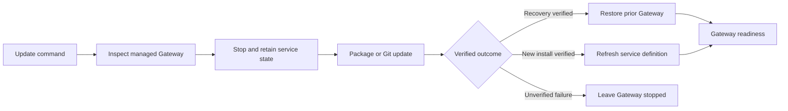

Codex review: needs maintainer review before merge. _Reviewed August 31, 2026, 5:02 PM ET / 21:02 UTC._

# ClawSweeper review

## What this changes

The PR makes managed Gateway updates recover only after a verified result, safely switches between package and Git installs, and lets supported downgraded targets write compatible configuration metadata.

## Regression provenance

Possible regression — probable (reviewed change; failure trace). No predecessor PR is attributed.

## Merge readiness

⚠️ **Ready for maintainer review - 2 items remain**

Keep this maintainer-authored, protected PR open. The prior downgrade-finalization blocker is addressed at both target-owned call sites with focused coverage; exact-head CI is still incomplete and current-main objects could not be fetched in this review environment.

**Priority:** P1
**Reviewed head:** `54ea613633ede4369c767a60f00d7bc45dc24c77`

## Review scores

| Measure | Result | What it means |
|---|---|---|
| **Overall readiness** | 🐚 platinum hermit **(4/6)** | The prior concrete blocker is repaired with owner-bound regression coverage; remaining merge readiness depends on incomplete exact-head CI. |
| **Proof confidence** | 🌊 off-meta tidepool | Not applicable: This maintainer-authored PR is exempt from the external-contributor proof gate; the supplied body nevertheless describes real packaged-CLI and Linux managed-service scenarios for the changed recovery paths. |
| **Patch quality** | 🐚 platinum hermit **(4/6)** | No actionable review findings were identified. |

## Verification

| Check | Result | Evidence |
|---|---|---|
| **Real behavior** | Not applicable | Not applicable: This maintainer-authored PR is exempt from the external-contributor proof gate; the supplied body nevertheless describes real packaged-CLI and Linux managed-service scenarios for the changed recovery paths. |
| **Evidence reviewed** | 5 items | Prior blocker addressed in both target-owned paths: The target writer now commits strictly valid downgraded configuration after post-plugin Doctor completion in both fresh resume and standalone finalization paths. Regression coverage: The lifecycle test covers valid and invalid configuration after a post-plugin Doctor error for both resume and finalization, asserting that only valid configuration receives target-version metadata and remains eligible for startup. Recovery authority remains owner-bound: Pre-mutation refusals return an explicit safe recovery verdict, while unexpected exceptions report unverified recovery and rethrow without authorizing a restart. |
| **Findings** | None | None. |
| **Security** | None | None. |

## How this fits together

The update command records and stops a managed Gateway before changing its package or Git installation. After the update, it decides whether the prior service can be safely recovered or the verified new installation can be activated.

## Before merge

- [ ] **Resolve merge risk (P1)** - This compatibility-sensitive update path adds a net 102 production lines across service recovery, install-root transition, and downgrade finalization; exact-head CI is still running, and current-main comparison could not be completed locally.
- [ ] **Complete next step (P2)** - The PR is maintainer-authored, protected, and changes compatibility-sensitive service recovery; it needs exact-head CI completion and normal maintainer handling rather than automated repair routing.

<strong>Agent review details</strong>

### Security

None.

### PR surface

Source +648, Tests +330, Docs +22. Total +1000 across 38 files.

View PR surface stats

| Area | Files | Added | Removed | Net |
|---|---:|---:|---:|---:|
| Source | 25 | 1023 | 375 | +648 |
| Tests | 10 | 800 | 470 | +330 |
| Docs | 3 | 28 | 6 | +22 |
| Config | 0 | 0 | 0 | 0 |
| Generated | 0 | 0 | 0 | 0 |
| Other | 0 | 0 | 0 | 0 |
| **Total** | **38** | **1851** | **851** | **+1000** |

### Review metrics

| Metric | Value | Why it matters |
|---|---|---|
| **Production versus test delta** | production +102 net; tests/support +876 net; docs +22 net | The production growth implements service-root transition and target-owned downgrade finalization, with substantial lifecycle and recovery coverage added alongside it. |

### Stored data model

Persistent data-model change detected: `migration/backfill/repair: src/commands/doctor-update.ts`, `unknown-data-model-change: src/infra/update-managed-service-handoff.ts`, `vector/embedding metadata: src/cli/update-cli/update-command-git.ts`. Confirm migration or upgrade compatibility proof before merge.

### Merge-risk options

**Maintainer options:**
1. **Complete exact-head validation (recommended)**  
   Require the running exact-head checks to finish successfully before merging this change to installation, downgrade, and managed-service recovery behavior.

### Technical review

Best possible solution:

Land only after exact-head validation confirms package/Git switches, verified rollback, and downgrade restart eligibility across the supported service managers.

Do we have a high-confidence way to reproduce the issue?

Yes: source and focused lifecycle tests define the prior failure path—valid target configuration after a Doctor execution error retained newer writer metadata and blocked startup—and exercise both resume and finalization repairs.

Is this the best way to solve the issue?

Yes: using the normal target config writer after strict validation fixes the writer-version invariant at its owner rather than adding an older-binary startup override.

AGENTS.md: found and applied where relevant.

Codex review notes: model internal, reasoning high; reviewed against [e27a72435258](https://github.com/openclaw/openclaw/commit/e27a72435258a05d09ff5e98b2c2ac2fe18d49f4).

### Labels

Label changes:

- add `rating: 🐚 platinum hermit`: Overall readiness is 🐚 platinum hermit; proof is 🌊 off-meta tidepool and patch quality is 🐚 platinum hermit.
- add `status: 👀 ready for maintainer look`: ClawSweeper has no concrete contributor-facing blocker left for this PR. Not applicable: This maintainer-authored PR is exempt from the external-contributor proof gate; the supplied body nevertheless describes real packaged-CLI and Linux managed-service scenarios for the changed recovery paths.
- remove `rating: 🦐 gold shrimp`: Current PR rating is `rating: 🐚 platinum hermit`, so this older rating label is no longer current.
- remove `status: ⏳ waiting on author`: Current PR status label is `status: 👀 ready for maintainer look`.

Label justifications:

- `P1`: Managed Gateway update failures can otherwise leave a real serving Gateway unavailable or restart an unintended installation.
- `merge-risk: 🚨 compatibility`: The PR changes package/Git switch behavior, channel persistence, downgrade metadata, and recovery behavior for existing installations.
- `merge-risk: 🚨 availability`: The changed decision surface determines whether a stopped managed Gateway is restored, activated from a new root, or intentionally left stopped.
- `rating: 🐚 platinum hermit`: Overall readiness is 🐚 platinum hermit; proof is 🌊 off-meta tidepool and patch quality is 🐚 platinum hermit.
- `status: 👀 ready for maintainer look`: ClawSweeper has no concrete contributor-facing blocker left for this PR. Not applicable: This maintainer-authored PR is exempt from the external-contributor proof gate; the supplied body nevertheless describes real packaged-CLI and Linux managed-service scenarios for the changed recovery paths.

### Evidence

What I checked:

- **Prior blocker addressed in both target-owned paths:** The target writer now commits strictly valid downgraded configuration after post-plugin Doctor completion in both fresh resume and standalone finalization paths. ([`src/cli/update-cli/update-command-config.ts:243`](https://github.com/openclaw/openclaw/blob/54ea613633ed/src/cli/update-cli/update-command-config.ts#L243), [54ea613633ed](https://github.com/openclaw/openclaw/commit/54ea613633ed))
- **Regression coverage:** The lifecycle test covers valid and invalid configuration after a post-plugin Doctor error for both resume and finalization, asserting that only valid configuration receives target-version metadata and remains eligible for startup. ([`src/cli/update-cli/update-command-lease.test.ts:415`](https://github.com/openclaw/openclaw/blob/54ea613633ed/src/cli/update-cli/update-command-lease.test.ts#L415), [54ea613633ed](https://github.com/openclaw/openclaw/commit/54ea613633ed))
- **Recovery authority remains owner-bound:** Pre-mutation refusals return an explicit safe recovery verdict, while unexpected exceptions report unverified recovery and rethrow without authorizing a restart. ([`src/cli/update-cli/update-command-execution.ts:243`](https://github.com/openclaw/openclaw/blob/54ea613633ed/src/cli/update-cli/update-command-execution.ts#L243), [54ea613633ed](https://github.com/openclaw/openclaw/commit/54ea613633ed))
- **Feature-history routing:** Earlier merged work on managed Gateway recovery is commit ccca7d1aa845160d5eda5dcef943bd6a845ebebb, authored by sinner. ([`src/cli/update-cli/update-command-post-update.ts:145`](https://github.com/openclaw/openclaw/blob/ccca7d1aa845/src/cli/update-cli/update-command-post-update.ts#L145), [ccca7d1aa845](https://github.com/openclaw/openclaw/commit/ccca7d1aa845))
- **Current-main inspection limitation:** The supplied current-main SHA could not be materialized because this partial checkout attempted a promisor fetch and DNS access to github.com failed; no current-main equivalence claim is made.

Likely related people:

- **sinner:** Suggested for follow-up; no historical authorship or introduction is verified. (role: unverified routing candidate; confidence: low)

### Rank-up moves

Optional improvements that raise the rating; they are not merge blockers.

- Wait for the exact-head CI run to complete successfully before merge.

### Rating scale

| Score | Internal tier | Crab rank | Meaning |
|---:|:---:|---|---|
| **6/6** | S | 🦀 challenger crab | Exceptional readiness |
| **5/6** | A | 🦞 diamond lobster | Very strong readiness |
| **4/6** | B | 🐚 platinum hermit | Good normal PR; ordinary maintainer review |
| **3/6** | C | 🦐 gold shrimp | Useful, but confidence is limited |
| **2/6** | D | 🦪 silver shellfish | Proof or implementation needs work |
| **1/6** | F | 🧂 unranked krab | Not merge-ready |
| N/A | NA | 🌊 off-meta tidepool | Rating does not apply |

Overall follows the weaker of proof and patch quality.
Shiny media proof means a screenshot, video, or linked artifact directly shows the changed behavior. Runtime, network, CSP, and security claims still need visible diagnostics.

### Workflow

- ClawSweeper keeps one durable marker-backed review comment per issue or PR.
- Re-runs edit this comment so the latest verdict, findings, and automation markers stay together instead of adding duplicate bot comments.
- A fresh review can be triggered by eligible `@clawsweeper re-review` comments, exact-item GitHub events, scheduled/background review runs, or manual workflow dispatch.
- PR/issue authors and users with repository write access can comment `@clawsweeper re-review` or `@clawsweeper re-run` on an open PR or issue to request a fresh review only.
- Maintainers can also comment `@clawsweeper review` to request a fresh review only.
- Fresh-review commands do not start repair, autofix, rebase, CI repair, or automerge.
- Maintainer-only repair and merge flows require explicit commands such as `@clawsweeper autofix`, `@clawsweeper automerge`, `@clawsweeper fix ci`, or `@clawsweeper address review`.
- Maintainers can comment `@clawsweeper explain` to ask for more context, or `@clawsweeper stop` to stop active automation.

### History

Review history (2 earlier review cycles)

<!-- clawsweeper-review-history v=1 total=2 -->
- reviewed 2026-08-31T19:05:30.135Z sha 32ec396d7dc09d546950c011d43be9c7f12f2aa9 :: found issues before merge. :: [P1] Propagate safe recovery for pre-mutation package-to-Git failures
- reviewed 2026-08-31T20:41:11.961Z sha 8471d08c7e8765160c8a6df8d51773234315a419 :: found issues before merge. :: [P1] Persist valid downgrade metadata after Doctor execution errors

<!-- clawsweeper-verdict:needs-human item=134397 sha=54ea613633ede4369c767a60f00d7bc45dc24c77 confidence=high updated_at=2026-08-31T20:59:06Z reviewed_at=2026-08-31T21:02:04.549Z lease_owner=github-run-33438771580-1 lease_comment_id=5484481489 source_revision=748ac0714bdac2f1806a1d60868c1456bf29a2430d52829ebd1b29a478c94714 live_verification=absent -->

<!-- clawsweeper-review-version item=134397 reviewed_at=2026-08-31T21:02:04.549Z sha=54ea613633ede4369c767a60f00d7bc45dc24c77 source_revision=748ac0714bdac2f1806a1d60868c1456bf29a2430d52829ebd1b29a478c94714 lease_owner=github-run-33438771580-1 lease_comment_id=5484481489 v=1 -->

<!-- clawsweeper-review item=134397 -->