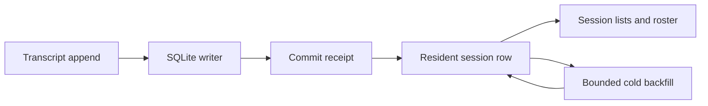

Codex review: blocked before merge.

## What this changes

This PR preserves known assistant previews across user appends instead of scheduling another transcript backfill.

**Example:** An assistant replies “Latest answer” at timestamp 600, followed by “One more question” at timestamp 700.
- **Before:** The assistant preview remains visible, but the user append schedules another transcript backfill.
- **After:** The resident row retains “Latest answer” without another backfill.

## Review scores

| Measure | Result | What it means |
|---|---|---|
| **Overall readiness** | 🦪 silver shellfish **(2/6)** | The focused integration coverage supports a useful optimization, but an introduced stale-publication defect blocks correctness and persisted-cache compatibility remains unproven. |
| **Proof confidence** | 🦐 gold shrimp **(3/6)** | Maintainer authorship exempts the ordinary runtime-proof gate; the persisted row_transcript_json format now includes sentinel values, and the supplied tests and predecessor screenshots do not establish latest-stable upgrade compatibility. |
| **Patch quality** | 🦪 silver shellfish **(2/6)** | 1 actionable review finding remain. |

## Product

**Kind:** Performance · **Worth it:** Yes · **Fix scope:** Complete
**User problem:** Ordinary follow-up messages cause unnecessary background transcript reads and derived-cache writes.
**Reason:** The existing feature remains intact, the repeated work is source-verifiable, and maintainer authorship establishes approval of the direction.

## Merge readiness

⛔ **Blocked before merge - 3 items remain**

Keep open: this maintainer-authored PR removes redundant backfill work, but its changed guard can publish superseded previews after invalidation.

**Priority:** P2
**Reviewed head:** `35cd098cd1d21e22e3ef3d34f8d46e1ab4fc0611`

## Before merge

- [ ] **Reject superseded backfills when retained facts are absent (P2)** - A broad invalidation with factsInvalidated clears retainedDatabaseFacts and calls backfill.remove(), while retaining the same row generation and potentially its ready materialization. If an already-running backfill then returns, revisions.get(id) differs from captured, but facts?.transcriptAssistantMessage is undefined rather than "unknown". This guard now falls through and publishes the invalidated snapshot while replacement facts are pending; the base guard rejected it. Treat absent facts like an unknown assistant fact when the captured revision has been superseded.
- [ ] **Complete next step** - Resolve the merge conflict GitHub reports for the reviewed head.
- [ ] **Add data-model compatibility proof** - The review found that existing stored data may not work after upgrade. Show that existing data still loads and works with this change.

## Findings

- [P2] Reject superseded backfills when retained facts are absent — `src/gateway/session-row-projection-backfill.ts:85`

### Tests

- Missing end-to-end proof: The supplied evidence does not demonstrate a latest-stable upgrade followed by append and reopen with existing settings and transcript data intact.

<strong>Agent review details</strong>

### How this fits together

Transcript writers publish committed preview facts to the Gateway’s resident session rows, which supply session lists and agent roster previews.

### Technical review

Best possible solution:

Preserve known assistant facts while retaining stale-result rejection and bounded reconstruction for cold rows.

Do we have a high-confidence way to reproduce the issue?

Current-main source shows user appends discarding assistant knowledge and scheduling backfill; the PR reports a base-failing integration regression, but no target code was executed during this read-only review.

Is this the best way to solve the issue?

Carrying facts through the existing append, receipt, and projection owners is an appropriately narrow solution without another configuration option or competing owner.

Full review comments:

- [P2] Reject superseded backfills when retained facts are absent — `src/gateway/session-row-projection-backfill.ts:85`
  A broad invalidation with factsInvalidated clears retainedDatabaseFacts and calls backfill.remove(), while retaining the same row generation and potentially its ready materialization. If an already-running backfill then returns, revisions.get(id) differs from captured, but facts?.transcriptAssistantMessage is undefined rather than "unknown". This guard now falls through and publishes the invalidated snapshot while replacement facts are pending; the base guard rejected it. Treat absent facts like an unknown assistant fact when the captured revision has been superseded.
  Confidence: 0.97

Overall correctness: patch is incorrect
Overall confidence: 0.95

AGENTS.md: found and applied where relevant.

Codex review notes: model internal, reasoning medium; reviewed against [7a6dc84576c8](https://github.com/openclaw/openclaw/commit/7a6dc84576c89f697860d6addb7306b18a9d0c72).

### Provenance checked

- `Assistant preview projection` keeps the original intent (0884553208b2d592249d2027833721128a48453c: https://github.com/openclaw/openclaw/pull/174984 added separately timestamped assistant replies so later user messages do not replace agent roster previews.)
- `Persisted preview cache and bounded backfill` keeps the original intent (3d385d4f74237055952758d1c83d9f1f49542b94: https://github.com/openclaw/openclaw/pull/171449 persisted reconstructible window projections to avoid repeated reads while preserving timestamp and indexed-sequence validation.)
- `Transaction-captured transcript receipts` keeps the original intent (7a82a475dc2338e6b5679c8c5795015d1ee8a0f1: Committed transcript postimages keep retained session facts current; this PR extends their assistant-preview information without changing settlement ownership.)

### Testing

Proof path: in-process harness.

### Security

None.

### Evidence

Acceptance criteria:

- pnpm test src/gateway/session-row-projection.backfill.test.ts src/gateway/session-row-projection.foreground.test.ts src/gateway/session-row-transcript-backfill.test.ts --maxWorkers=1
- pnpm check:changed
- git diff --check

What I checked:

- **Pinned introduced change:** The introduced diff carries known, unknown, and unchanged assistant facts through append cursors, receipts, stored-cache readers, and resident rows. ([`src/gateway/session-row-transcript-preview.ts:15`](https://github.com/openclaw/openclaw/blob/35cd098cd1d21e22e3ef3d34f8d46e1ab4fc0611/src/gateway/session-row-transcript-preview.ts#L15), [35cd098cd1d2](https://github.com/openclaw/openclaw/commit/35cd098cd1d21e22e3ef3d34f8d46e1ab4fc0611))
- **Current-main redundant work:** Current main assigns an absent assistant fact after a user append; the backfill owner then queues reconstruction even when the resident row already has the previous assistant reply. ([`src/gateway/session-row-transcript-preview.ts:73`](https://github.com/openclaw/openclaw/blob/7a6dc84576c89f697860d6addb7306b18a9d0c72/src/gateway/session-row-transcript-preview.ts#L73), [7a6dc84576c8](https://github.com/openclaw/openclaw/commit/7a6dc84576c89f697860d6addb7306b18a9d0c72))
- **Invalidation clears facts and revision:** Broad fact invalidation clears retainedDatabaseFacts and removes the backfill revision without necessarily replacing the row generation; the changed guard no longer rejects that absent-facts state. ([`src/gateway/session-row-projection-archive.ts:129`](https://github.com/openclaw/openclaw/blob/35cd098cd1d21e22e3ef3d34f8d46e1ab4fc0611/src/gateway/session-row-projection-archive.ts#L129), [35cd098cd1d2](https://github.com/openclaw/openclaw/commit/35cd098cd1d21e22e3ef3d34f8d46e1ab4fc0611))
- **Earlier publication contract:** https://github.com/openclaw/openclaw/pull/157122 established that same-lifecycle updates retain row generation and that superseded background previews must be discarded. ([`src/gateway/session-row-projection-backfill.ts:85`](https://github.com/openclaw/openclaw/blob/ba65d492cf3e3dd8e49999b30133c09684eaf7ea/src/gateway/session-row-projection-backfill.ts#L85), [ba65d492cf3e](https://github.com/openclaw/openclaw/commit/ba65d492cf3e3dd8e49999b30133c09684eaf7ea))
- **Focused behavioral coverage:** Added integration cases check retained assistant and known-empty results across user appends, coalesced assistant/user appends, and absence of additional backfill calls through the real persistence and projection owners. ([`src/gateway/session-row-projection.backfill.test.ts:254`](https://github.com/openclaw/openclaw/blob/35cd098cd1d21e22e3ef3d34f8d46e1ab4fc0611/src/gateway/session-row-projection.backfill.test.ts#L254), [35cd098cd1d2](https://github.com/openclaw/openclaw/commit/35cd098cd1d21e22e3ef3d34f8d46e1ab4fc0611))
- **Inspected media scope:** All four prepared screenshots were inspected; they illustrate the earlier navigation and roster presentation, not this PR’s append/backfill behavior or persisted-cache upgrade. ([35cd098cd1d2](https://github.com/openclaw/openclaw/commit/35cd098cd1d21e22e3ef3d34f8d46e1ab4fc0611))

Likely related people:

- **Peter Steinberger:** Raw commit 3d385d4f74237055952758d1c83d9f1f49542b94 adds src/gateway/session-row-projection-backfill.ts:79 relative to its recorded parents. This identifies author metadata, not feature responsibility or a PR merger. (role: source-line author; confidence: high; commits: [3d385d4f7423](https://github.com/openclaw/openclaw/commit/3d385d4f74237055952758d1c83d9f1f49542b94); files: `src/gateway/session-row-projection-backfill.ts`)
- **Patrick Erichsen:** Raw commit 0884553208b2d592249d2027833721128a48453c adds src/gateway/session-row-transcript-preview.ts:23 relative to its recorded parents. This identifies author metadata, not feature responsibility or a PR merger. (role: source-line author; confidence: high; commits: [0884553208b2](https://github.com/openclaw/openclaw/commit/0884553208b2d592249d2027833721128a48453c); files: `src/gateway/session-row-transcript-preview.ts`)

### PR surface

Source +54, Tests +69, Docs +3. Total +126 across 16 files. Added test files: 0.

View PR surface stats

| Area | Files | Added | Removed | Net |
|---|---:|---:|---:|---:|
| Source | 12 | 80 | 26 | +54 |
| Tests | 3 | 71 | 2 | +69 |
| Docs | 1 | 4 | 1 | +3 |
| Config | 0 | 0 | 0 | 0 |
| Generated | 0 | 0 | 0 | 0 |
| Other | 0 | 0 | 0 | 0 |
| **Total** | **16** | **155** | **29** | **+126** |

### Labels

Label changes:

- add `P2`: The optimization affects ordinary session traffic, while the introduced defect affects optional preview freshness rather than canonical transcript contents.
- add `rating: 🦪 silver shellfish`: Overall readiness is 🦪 silver shellfish; proof is 🦐 gold shrimp and patch quality is 🦪 silver shellfish.
- add `status: ⏳ waiting on author`: ClawSweeper has contributor-facing work open and is waiting for author action.

Label justifications:

- `P2`: The optimization affects ordinary session traffic, while the introduced defect affects optional preview freshness rather than canonical transcript contents.
- `rating: 🦪 silver shellfish`: Overall readiness is 🦪 silver shellfish; proof is 🦐 gold shrimp and patch quality is 🦪 silver shellfish.
- `status: ⏳ waiting on author`: ClawSweeper has contributor-facing work open and is waiting for author action.

### Rating scale

6/6 🦀 challenger crab · 5/6 🦞 diamond lobster · 4/6 🐚 platinum hermit · 3/6 🦐 gold shrimp · 2/6 🦪 silver shellfish · 1/6 🧂 unranked krab. Overall follows the weaker of proof and patch quality; ✨ marks media proof (a screenshot, video, or linked artifact) that directly shows the changed behavior.

### Workflow

ClawSweeper edits this one comment on every review. Comment `@clawsweeper re-review` for a fresh review only. Repair and merge execution lanes are retired.

_Reviewed October 17, 2026, 9:28 AM ET / 13:28 UTC._

<!-- clawsweeper-verdict:needs-human item=175534 sha=35cd098cd1d21e22e3ef3d34f8d46e1ab4fc0611 confidence=high updated_at=2026-10-17T13:24:34Z reviewed_at=2026-10-17T13:28:35.362Z lease_owner=github-run-39036354427-1 lease_comment_id=6234404497 source_revision=a4e176deb278ed12aa84378b675878d09678e91a34131659212dc9ee1620eef8 hold=blocked findings=1 -->
<!-- clawsweeper-review-state:blocked item=175534 sha=35cd098cd1d21e22e3ef3d34f8d46e1ab4fc0611 v=1 -->

<!-- clawsweeper-review-version item=175534 reviewed_at=2026-10-17T13:28:35.362Z sha=35cd098cd1d21e22e3ef3d34f8d46e1ab4fc0611 source_revision=a4e176deb278ed12aa84378b675878d09678e91a34131659212dc9ee1620eef8 lease_owner=github-run-39036354427-1 lease_comment_id=6234404497 v=1 -->

<!-- clawsweeper-review item=175534 -->