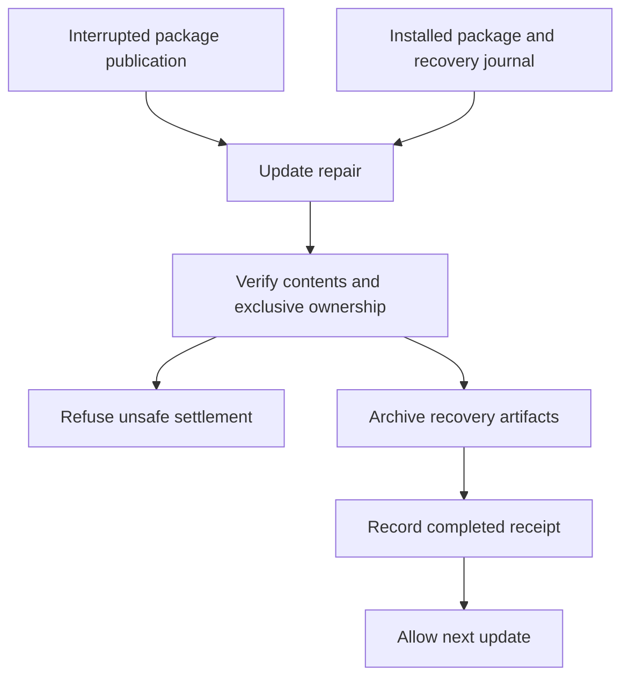

Codex review: blocked before merge. _Reviewed October 5, 2026, 11:22 AM ET / 15:22 UTC (Revision 2)._

# ClawSweeper review

## What this changes

Adds guarded repair settlement for interrupted package publication, preserves recovery artifacts, records a replayable completion receipt, and updates recovery documentation and test fixtures.

## Merge readiness

⛔ **Blocked before merge - 3 items remain**

This remains a useful fix for an unresolved update-recovery dead end. No concrete introduced bug was established, but the earlier published-driver compatibility requirement remains unmet.

**Priority:** P1
**Reviewed head:** `b46c1e473845c30b6499a4dc191f4974a4adaa38`

## Review scores

| Measure | Result | What it means |
|---|---|---|
| **Overall readiness** | 🦐 gold shrimp **(3/6)** | The implementation and focused regression evidence are useful, but the published-operation upgrade boundary remains unverified. |
| **Proof confidence** | 🌊 off-meta tidepool | Not applicable: The supplied repository state identifies a trusted member author, so ordinary external-contributor proof is exempt. The public repair fixture exercises production custody and ledger owners but substitutes an inert helper; independently required compatibility proof for the new persisted intent remains insufficient. |
| **Patch quality** | 🦐 gold shrimp **(3/6)** | No actionable review findings were identified. |

## Verification

| Check | Result | Evidence |
|---|---|---|
| **Real behavior** | Not applicable | Not applicable: The supplied repository state identifies a trusted member author, so ordinary external-contributor proof is exempt. The public repair fixture exercises production custody and ledger owners but substitutes an inert helper; independently required compatibility proof for the new persisted intent remains insufficient. |
| **Evidence reviewed** | 11 items | Pinned introduction and clean checkout: Reviewed the merge-base-to-head introduced changes, not endpoint drift. The checkout remained clean at the pinned original PR head; the supplied test merge is stale and was not used to infer removal of current-main behavior. Current main still lacks this settlement: Current main sends a same-identity installed candidate through the pending-publication refusal unless another existing settlement condition applies. It lacks the external-publication verification and settlement introduced here. Verification and final effects: Settlement checks installed inventories, candidate version, manifest fields and targets, launcher evidence, and the sealed helper. Custody retains live ownership and observation checks through journal transitions and archival, including launcher-directory durability before disarming recovery. |
| **Findings** | None | None. |
| **Security** | None | None. |

## How this fits together

Package activation publishes an installed OpenClaw update and retains evidence for recovery. Repair uses that evidence and exclusive update ownership to decide whether recovery can finish and another update may proceed.

## Before merge

- [ ] **Resolve merge risk (P1)** - Existing-operation compatibility remains unverified: settlement writes a durable intent unknown to the published original helper, while current fixtures use an inert helper. Published-driver evidence must establish safe original-helper refusal, preserved artifacts, interruption recovery, and admission of the next writable update.
- [ ] **Complete next step (P2)** - Provide published 2026.9.7 driver × candidate compatibility evidence for the new settlement receipt before merge.
- [ ] **Add data-model compatibility proof** - Confirm migration or upgrade compatibility proof before merge.

<strong>Agent review details</strong>

### Security

None.

### PR surface

Source +357, Tests +426, Docs +19, Other +2. Total +804 across 18 files.

View PR surface stats

| Area | Files | Added | Removed | Net |
|---|---:|---:|---:|---:|
| Source | 8 | 397 | 40 | +357 |
| Tests | 7 | 485 | 59 | +426 |
| Docs | 1 | 21 | 2 | +19 |
| Config | 0 | 0 | 0 | 0 |
| Generated | 0 | 0 | 0 | 0 |
| Other | 2 | 3 | 1 | +2 |
| **Total** | **18** | **906** | **102** | **+804** |

### Review metrics

| Metric | Value | Why it matters |
|---|---|---|
| **Persisted recovery contract** | 1 new settlement intent; 0 table or schema-version changes | Existing sealed readers still require compatibility verification despite unchanged SQLite DDL. |

### Stored data model

Persistent data-model change detected: `migration/backfill/repair: src/infra/update-run-ledger.ts`. Confirm migration or upgrade compatibility proof before merge.

### Root-cause cluster

Relationship: `fixed_by_candidate`
Canonical: https://github.com/openclaw/openclaw/issues/164214
Summary: This PR specifically implements the external-write publication settlement requested by the open canonical issue.

Members:
- `canonical`: https://github.com/openclaw/openclaw/issues/164214 - The preserved publishing-phase incident is the explicit target of this candidate fix.
- `adjacent_distinct`: https://github.com/openclaw/openclaw/issues/164422 - The closed launcher-ownership report concerns a prepared-phase trigger rather than external writes during publication.

Proposal only: this assessment does not dispatch repair, suppress jobs, mutate sibling items, close, or merge anything.

### Merge-risk options

**Maintainer options:**
1. **Verify published-operation recovery (recommended)**  
   Provide a published 2026.9.7 driver × candidate result covering settlement, original-helper refusal without writes, retained artifacts, interrupted settlement recovery, and the next writable update.

### Technical review

Best possible solution:

Keep settlement in the existing recovery owner and establish published-driver compatibility before landing the new durable receipt contract.

Do we have a high-confidence way to reproduce the issue?

Yes, from source: mutate and restore an inventoried file while publication remains publishing, then attempt repair, retirement, and another update. The reporter and focused fixture support this path; this review did not execute it.

Is this the best way to solve the issue?

Yes in direction: guarded settlement through the existing custody owner is narrower than replacing the sealed helper or deleting recovery artifacts. Upgrade safety remains unproven for an operation created by the published driver.

AGENTS.md: found and applied where relevant.

Codex review notes: model internal, reasoning medium; reviewed against [4e011b13e48a](https://github.com/openclaw/openclaw/commit/4e011b13e48a2bca4a0ab2b9aab066cb60877184).

### Labels

Label changes:

- add `P1`: This addresses a reported native-update recovery dead end that blocks subsequent updates for affected users.
- add `merge-risk: 🚨 compatibility`: The new persisted settlement intent is not understood by published sealed helpers, and current-source fixtures do not verify that upgrade boundary.
- add `rating: 🦐 gold shrimp`: Overall readiness is 🦐 gold shrimp; proof is 🌊 off-meta tidepool and patch quality is 🦐 gold shrimp.
- add `status: 👀 ready for maintainer look`: ClawSweeper has no concrete contributor-facing blocker left for this PR. Not applicable: The supplied repository state identifies a trusted member author, so ordinary external-contributor proof is exempt. The public repair fixture exercises production custody and ledger owners but substitutes an inert helper; independently required compatibility proof for the new persisted intent remains insufficient.

Label justifications:

- `P1`: This addresses a reported native-update recovery dead end that blocks subsequent updates for affected users.
- `merge-risk: 🚨 compatibility`: The new persisted settlement intent is not understood by published sealed helpers, and current-source fixtures do not verify that upgrade boundary.
- `rating: 🦐 gold shrimp`: Overall readiness is 🦐 gold shrimp; proof is 🌊 off-meta tidepool and patch quality is 🦐 gold shrimp.
- `status: 👀 ready for maintainer look`: ClawSweeper has no concrete contributor-facing blocker left for this PR. Not applicable: The supplied repository state identifies a trusted member author, so ordinary external-contributor proof is exempt. The public repair fixture exercises production custody and ledger owners but substitutes an inert helper; independently required compatibility proof for the new persisted intent remains insufficient.

### Evidence

What I checked:

- **Pinned introduction and clean checkout:** Reviewed the merge-base-to-head introduced changes, not endpoint drift. The checkout remained clean at the pinned original PR head; the supplied test merge is stale and was not used to infer removal of current-main behavior. ([b46c1e473845](https://github.com/openclaw/openclaw/commit/b46c1e473845c30b6499a4dc191f4974a4adaa38))
- **Current main still lacks this settlement:** Current main sends a same-identity installed candidate through the pending-publication refusal unless another existing settlement condition applies. It lacks the external-publication verification and settlement introduced here. ([`src/infra/package-update-activation.ts:180`](https://github.com/openclaw/openclaw/blob/4e011b13e48a2bca4a0ab2b9aab066cb60877184/src/infra/package-update-activation.ts#L180), [4e011b13e48a](https://github.com/openclaw/openclaw/commit/4e011b13e48a2bca4a0ab2b9aab066cb60877184))
- **Verification and final effects:** Settlement checks installed inventories, candidate version, manifest fields and targets, launcher evidence, and the sealed helper. Custody retains live ownership and observation checks through journal transitions and archival, including launcher-directory durability before disarming recovery. ([`src/infra/package-update-activation-custody.ts:243`](https://github.com/openclaw/openclaw/blob/b46c1e473845c30b6499a4dc191f4974a4adaa38/src/infra/package-update-activation-custody.ts#L243), [b46c1e473845](https://github.com/openclaw/openclaw/commit/b46c1e473845c30b6499a4dc191f4974a4adaa38))
- **Persisted compatibility boundary:** The patch adds publication-settled-external-change to persisted intent JSON and writes it before archival. This changes a durable recovery contract even though SQLite tables and numeric schema versions remain unchanged. ([`src/infra/package-update-activation-schema.ts:92`](https://github.com/openclaw/openclaw/blob/b46c1e473845c30b6499a4dc191f4974a4adaa38/src/infra/package-update-activation-schema.ts#L92), [b46c1e473845](https://github.com/openclaw/openclaw/commit/b46c1e473845c30b6499a4dc191f4974a4adaa38))
- **Published original reader:** The v2026.9.7 schema has neither superseded nor the new settlement intent. Its sealed entrypoint parses the journal before executing recovery. Safe refusal by that original helper is therefore part of the compatibility scenario to verify, rather than assuming the retained helper understands the new receipt. ([`src/infra/package-update-activation-schema.ts:70`](https://github.com/openclaw/openclaw/blob/c074824a27c96d3983043f9eeb33823cd1772d8c/src/infra/package-update-activation-schema.ts#L70), [c074824a27c9](https://github.com/openclaw/openclaw/commit/c074824a27c96d3983043f9eeb33823cd1772d8c))
- **Latest release boundary:** The latest supplied release, v2026.9.8, also lacks superseded and the new settlement intent; this is not an already-shipped implementation. ([`src/infra/package-update-activation-schema.ts:70`](https://github.com/openclaw/openclaw/blob/fc23bc864e4553c2d215e479eeec47b67a0bf943/src/infra/package-update-activation-schema.ts#L70), [fc23bc864e45](https://github.com/openclaw/openclaw/commit/fc23bc864e4553c2d215e479eeec47b67a0bf943))

Likely related people:

- **unknown:** The claimed source-line change could not be verified from bounded local history. (role: source history unknown; confidence: low)

### Rank-up moves

Optional improvements that raise the rating; they are not merge blockers.

- Add published-driver compatibility evidence covering settlement, safe original-helper refusal, preserved recovery artifacts, interruption recovery, and the next writable update.

### Rating scale

| Score | Internal tier | Crab rank | Meaning |
|---:|:---:|---|---|
| **6/6** | S | 🦀 challenger crab | Exceptional readiness |
| **5/6** | A | 🦞 diamond lobster | Very strong readiness |
| **4/6** | B | 🐚 platinum hermit | Good normal PR; ordinary maintainer review |
| **3/6** | C | 🦐 gold shrimp | Useful, but confidence is limited |
| **2/6** | D | 🦪 silver shellfish | Proof or implementation needs work |
| **1/6** | F | 🧂 unranked krab | Not merge-ready |
| N/A | NA | 🌊 off-meta tidepool | Rating does not apply |

Overall follows the weaker of proof and patch quality.
Shiny media proof means a screenshot, video, or linked artifact directly shows the changed behavior. Runtime, network, CSP, and security claims still need visible diagnostics.

### Workflow

- ClawSweeper keeps one durable marker-backed review comment per issue or PR.
- Re-runs edit this comment so the latest verdict, findings, and automation markers stay together instead of adding duplicate bot comments.
- A fresh review can be triggered by eligible `@clawsweeper re-review` comments, exact-item GitHub events, scheduled/background review runs, or manual workflow dispatch.
- PR/issue authors and users with repository write access can comment `@clawsweeper re-review` or `@clawsweeper re-run` on an open PR or issue to request a fresh review only.
- Maintainers can also comment `@clawsweeper review` to request a fresh review only.
- Fresh-review commands do not start repair, autofix, rebase, CI repair, or automerge.
- Maintainer-only repair and merge flows require explicit commands such as `@clawsweeper autofix`, `@clawsweeper automerge`, `@clawsweeper fix ci`, or `@clawsweeper address review`.
- Maintainers can comment `@clawsweeper explain` to ask for more context, or `@clawsweeper stop` to stop active automation.

### History

Review history (1 earlier review cycle)

<!-- clawsweeper-review-history v=1 total=1 -->
- reviewed 2026-10-05T14:12:18.516Z sha 16ad418330d9f0f055abf2ca1539cb70c92e1cf5 :: blocked before merge. :: none

<!-- clawsweeper-verdict:needs-human item=165607 sha=b46c1e473845c30b6499a4dc191f4974a4adaa38 confidence=high updated_at=2026-10-05T15:17:55Z reviewed_at=2026-10-05T15:22:12.989Z lease_owner=github-run-37331551095-1 lease_comment_id=5997419076 source_revision=4693eae9f673f8507d87644d454ecbe54f0f7dbc6a5baec541d75fd5abf9acdb live_verification=absent -->
<!-- clawsweeper-review-state:blocked item=165607 sha=b46c1e473845c30b6499a4dc191f4974a4adaa38 v=1 -->

<!-- clawsweeper-review-version item=165607 reviewed_at=2026-10-05T15:22:12.989Z sha=b46c1e473845c30b6499a4dc191f4974a4adaa38 source_revision=4693eae9f673f8507d87644d454ecbe54f0f7dbc6a5baec541d75fd5abf9acdb lease_owner=github-run-37331551095-1 lease_comment_id=5997419076 v=1 -->

<!-- clawsweeper-review item=165607 -->