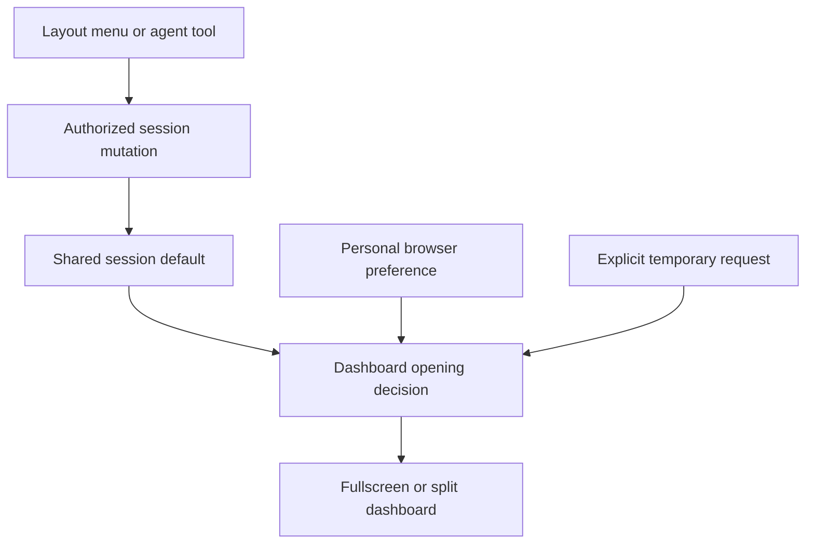

Codex review: needs maintainer review before merge. _Reviewed September 13, 2026, 4:48 PM ET / 20:48 UTC (Revision 5)._

# ClawSweeper review

## What this changes

Adds shared dashboard fullscreen or split defaults through the existing Layout menu and agent tool, while preserving personal browser preferences.

## Merge readiness

✅ **Ready for maintainer review**

Keep open as the active implementation of the accepted request. Prior correctness findings are addressed, and the new screenshot evidence resolves the previous delivery blocker. No new blocking defect was found.

**Priority:** P2
**Reviewed head:** `2f70a553f18406add0386073e07e0822b7a60168`

## Review scores

| Measure | Result | What it means |
|---|---|---|
| **Overall readiness** | 🐚 platinum hermit **(4/6)** | A coherent implementation with focused regression coverage and inspected visual evidence; no remaining actionable blocker was found. |
| **Proof confidence** | 🐚 platinum hermit **(4/6)** | Not applicable: The bot-authored PR is exempt from external setup proof. Inspected Chromium screenshots demonstrate the menu and save acknowledgment with mocked Gateway transport; the body records delivery to both required destinations, and persistence is covered separately by reported Gateway tests. |
| **Patch quality** | 🐚 platinum hermit **(4/6)** | No actionable review findings were identified. |

## Verification

| Check | Result | Evidence |
|---|---|---|
| **Real behavior** | Not applicable | Not applicable: The bot-authored PR is exempt from external setup proof. Inspected Chromium screenshots demonstrate the menu and save acknowledgment with mocked Gateway transport; the body records delivery to both required destinations, and persistence is covered separately by reported Gateway tests. |
| **Evidence reviewed** | 9 items | Accepted scope and active implementation: The supplied discussion links https://github.com/openclaw/openclaw/issues/146308, which records accepted shared-default, personal-override, legacy-layout, and persistence requirements. That issue remains open and this PR explicitly supplies its implementation. Current main still lacks shared defaults: The inspected main dashboard controller restores browser layouts and handles transient expansion, without the proposed shared-default menu or preference resolution. Main's session patch schema also lacks boardPresentation. Latest-release contract: The supplied latest release, v2026.9.4, has no boardPresentation field in its closed session mutation schema; the requested shared-default operation is not available through that released contract. |
| **Findings** | None | None. |
| **Security** | None | None. |

## How this fits together

Dashboard presentation combines shared session metadata from the Gateway with browser-local layout preferences. The Control UI uses those values when opening a dashboard, while explicit one-off commands remain temporary.

## Before merge

None.

<strong>Agent review details</strong>

### Security

None.

### PR surface

Source +421, Tests +1779, Docs +33, Other +22. Total +2255 across 54 files.

View PR surface stats

| Area | Files | Added | Removed | Net |
|---|---:|---:|---:|---:|
| Source | 33 | 492 | 71 | +421 |
| Tests | 18 | 1815 | 36 | +1779 |
| Docs | 2 | 44 | 11 | +33 |
| Config | 0 | 0 | 0 | 0 |
| Generated | 0 | 0 | 0 | 0 |
| Other | 1 | 25 | 3 | +22 |
| **Total** | **54** | **2376** | **121** | **+2255** |

### Review metrics

| Metric | Value | Why it matters |
|---|---|---|
| **Preference contract** | 1 shared setting, 1 browser override field, 0 database schema migrations | The persisted additions separate shared intent from personal presentation without adding another storage owner. |
| **Production versus test growth** | Production net +443, including +22 generated protocol lines; tests and support net +1779 | Production growth supports the accepted persistence and presentation lifecycle, with most added code covering its behavior. |

### Root-cause cluster

Relationship: `fixed_by_candidate`
Canonical: https://github.com/openclaw/openclaw/issues/146308
Summary: This PR implements the linked shared-dashboard-default request, which remains open pending landing.

Members:
- `canonical`: https://github.com/openclaw/openclaw/issues/146308 - The issue defines the accepted behavior and persistence contract implemented here.

Proposal only: this assessment does not dispatch repair, suppress jobs, mutate sibling items, close, or merge anything.

### Technical review

Best possible solution:

Keep shared defaults with the session owner and browser preferences with the existing layout owner, preserving explicit temporary requests and legacy arrangements.

Do we have a high-confidence way to reproduce the issue?

Not applicable as a feature request; inspected main and release contracts lack the shared presentation setting.

Is this the best way to solve the issue?

Yes. The patch extends existing session mutations and layout persistence, and its current source addresses the previously identified preference and navigation defects.

AGENTS.md: found and applied where relevant.

Codex review notes: model internal, reasoning medium; reviewed against [1ed4f2f5ba3d](https://github.com/openclaw/openclaw/commit/1ed4f2f5ba3d91defeb59a8baf2f51246efa356b).

### Labels

Label justifications:

- `P2`: This is a bounded dashboard usability feature with accepted scope and no established urgent regression.
- `rating: 🐚 platinum hermit`: Overall readiness is 🐚 platinum hermit; proof is 🐚 platinum hermit and patch quality is 🐚 platinum hermit.
- `status: 👀 ready for maintainer look`: ClawSweeper has no concrete contributor-facing blocker left for this PR. Not applicable: The bot-authored PR is exempt from external setup proof. Inspected Chromium screenshots demonstrate the menu and save acknowledgment with mocked Gateway transport; the body records delivery to both required destinations, and persistence is covered separately by reported Gateway tests.
- `proof: 📸 screenshot`: Contributor real behavior proof includes screenshot evidence. The bot-authored PR is exempt from external setup proof. Inspected Chromium screenshots demonstrate the menu and save acknowledgment with mocked Gateway transport; the body records delivery to both required destinations, and persistence is covered separately by reported Gateway tests.

### Evidence

What I checked:

- **Accepted scope and active implementation:** The supplied discussion links https://github.com/openclaw/openclaw/issues/146308, which records accepted shared-default, personal-override, legacy-layout, and persistence requirements. That issue remains open and this PR explicitly supplies its implementation.
- **Current main still lacks shared defaults:** The inspected main dashboard controller restores browser layouts and handles transient expansion, without the proposed shared-default menu or preference resolution. Main's session patch schema also lacks boardPresentation. ([`ui/src/pages/chat/chat-pane-board.ts:154`](https://github.com/openclaw/openclaw/blob/1ed4f2f5ba3d91defeb59a8baf2f51246efa356b/ui/src/pages/chat/chat-pane-board.ts#L154), [1ed4f2f5ba3d](https://github.com/openclaw/openclaw/commit/1ed4f2f5ba3d91defeb59a8baf2f51246efa356b))
- **Latest-release contract:** The supplied latest release, v2026.9.4, has no boardPresentation field in its closed session mutation schema; the requested shared-default operation is not available through that released contract. ([`packages/gateway-protocol/src/schema/sessions-patch.ts:18`](https://github.com/openclaw/openclaw/blob/3a9d69db306cd7f081e06254cb89c4bcc14a7107/packages/gateway-protocol/src/schema/sessions-patch.ts#L18), [3a9d69db306c](https://github.com/openclaw/openclaw/commit/3a9d69db306cd7f081e06254cb89c4bcc14a7107))
- **Existing mutation owner reused:** The durable agent action calls sessions.patch through the admitted Gateway context; read obtains the effective default through sessions.describe. The temporary presentation action remains separate. This implementation does not depend on the Codex harness or protocol. ([`src/agents/tools/dashboard-tool.ts:313`](https://github.com/openclaw/openclaw/blob/2f70a553f18406add0386073e07e0822b7a60168/src/agents/tools/dashboard-tool.ts#L313), [2f70a553f184](https://github.com/openclaw/openclaw/commit/2f70a553f18406add0386073e07e0822b7a60168))
- **Prior findings and upgrade coverage:** Current source preserves stored cross-tab overrides during unrelated writes, shares dashboard opening between keyboard and rail controls, and retains transient route intent without saving it. The inspected regression coverage also exercises legacy layouts, absent metadata, reconnects, stale acknowledgments, and conditional menu behavior. Tests were inspected, not executed. ([`ui/src/pages/chat/dashboard-presentation-defaults.test.ts:241`](https://github.com/openclaw/openclaw/blob/2f70a553f18406add0386073e07e0822b7a60168/ui/src/pages/chat/dashboard-presentation-defaults.test.ts#L241), [2f70a553f184](https://github.com/openclaw/openclaw/commit/2f70a553f18406add0386073e07e0822b7a60168))
- **Persistence and authorization boundaries:** The existing session patch engine retains final commit guards. Added coverage exercises the real agent setter and session store, database reopen, revoked authority inside the transaction, and read-only client rejection. Shared defaults remain optional session metadata and survive the existing reset path. ([`src/gateway/server-methods/sessions-mutations.owner.test.ts:107`](https://github.com/openclaw/openclaw/blob/2f70a553f18406add0386073e07e0822b7a60168/src/gateway/server-methods/sessions-mutations.owner.test.ts#L107), [2f70a553f184](https://github.com/openclaw/openclaw/commit/2f70a553f18406add0386073e07e0822b7a60168))

Likely related people:

- **Peter Steinberger:** Suggested for follow-up; no historical authorship or introduction is verified. (role: unverified routing candidate; confidence: low)
- **RoboClaw:** Suggested for follow-up; no historical authorship or introduction is verified. (role: unverified routing candidate; confidence: low)

### Rating scale

| Score | Internal tier | Crab rank | Meaning |
|---:|:---:|---|---|
| **6/6** | S | 🦀 challenger crab | Exceptional readiness |
| **5/6** | A | 🦞 diamond lobster | Very strong readiness |
| **4/6** | B | 🐚 platinum hermit | Good normal PR; ordinary maintainer review |
| **3/6** | C | 🦐 gold shrimp | Useful, but confidence is limited |
| **2/6** | D | 🦪 silver shellfish | Proof or implementation needs work |
| **1/6** | F | 🧂 unranked krab | Not merge-ready |
| N/A | NA | 🌊 off-meta tidepool | Rating does not apply |

Overall follows the weaker of proof and patch quality.
Shiny media proof means a screenshot, video, or linked artifact directly shows the changed behavior. Runtime, network, CSP, and security claims still need visible diagnostics.

### Workflow

- ClawSweeper keeps one durable marker-backed review comment per issue or PR.
- Re-runs edit this comment so the latest verdict, findings, and automation markers stay together instead of adding duplicate bot comments.
- A fresh review can be triggered by eligible `@clawsweeper re-review` comments, exact-item GitHub events, scheduled/background review runs, or manual workflow dispatch.
- PR/issue authors and users with repository write access can comment `@clawsweeper re-review` or `@clawsweeper re-run` on an open PR or issue to request a fresh review only.
- Maintainers can also comment `@clawsweeper review` to request a fresh review only.
- Fresh-review commands do not start repair, autofix, rebase, CI repair, or automerge.
- Maintainer-only repair and merge flows require explicit commands such as `@clawsweeper autofix`, `@clawsweeper automerge`, `@clawsweeper fix ci`, or `@clawsweeper address review`.
- Maintainers can comment `@clawsweeper explain` to ask for more context, or `@clawsweeper stop` to stop active automation.

### History

Review history (4 earlier review cycles)

<!-- clawsweeper-review-history v=1 total=4 -->
- reviewed 2026-09-12T21:28:02.638Z sha 60ab5f446e6e7b3ae33a8273e79e9a17a151c58a :: blocked before merge. :: [P2] Preserve transient presentation through the dashboard route change
- reviewed 2026-09-13T18:04:57.333Z sha 35eefc9300f6dd57e7dafd6e57cdc7b4fc88f113 :: blocked before merge. :: [P1] Preserve newer stored overrides during unrelated layout writes | [P2] Apply presentation defaults when opening Dashboard by keyboard
- reviewed 2026-09-13T19:26:23.666Z sha 24e5cad804a834339b3558a2cba26ae6a92ce386 :: needs maintainer review before merge. :: none
- reviewed 2026-09-13T19:55:06.017Z sha 2f70a553f18406add0386073e07e0822b7a60168 :: blocked before merge. :: none

<!-- clawsweeper-verdict:needs-human item=146475 sha=2f70a553f18406add0386073e07e0822b7a60168 confidence=high updated_at=2026-09-13T20:45:07Z reviewed_at=2026-09-13T20:48:59.301Z lease_owner=github-run-34781608893-1 lease_comment_id=5656009833 source_revision=490b0b5efe5c97635ab6905788493f70ee62f7f200082bf06f009517e2f94b7a live_verification=absent -->
<!-- clawsweeper-review-state:ready item=146475 sha=2f70a553f18406add0386073e07e0822b7a60168 v=1 -->

<!-- clawsweeper-review-version item=146475 reviewed_at=2026-09-13T20:48:59.301Z sha=2f70a553f18406add0386073e07e0822b7a60168 source_revision=490b0b5efe5c97635ab6905788493f70ee62f7f200082bf06f009517e2f94b7a lease_owner=github-run-34781608893-1 lease_comment_id=5656009833 v=1 -->

<!-- clawsweeper-review item=146475 -->