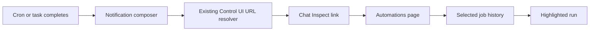

Codex review: needs maintainer review before merge. _Reviewed August 26, 2026, 5:36 AM ET / 09:36 UTC._

# ClawSweeper review

## What this changes

Adds Control UI Inspect links to cron and background-task chat notifications and opens the linked automation run in the Control UI.

## Merge readiness

⚠️ **Ready for maintainer review - 1 item remains**

Keep open. No blocking correctness or security finding: the branch extends the existing Control UI link owner across cron and task delivery, and current main does not yet provide this notification-to-run flow. Merge only after exact-head checks complete successfully.

**Priority:** P2
**Reviewed head:** `a8e14f15d6cb3a4b98ea60e9cebd95edefebda84`

## Review scores

| Measure | Result | What it means |
|---|---|---|
| **Overall readiness** | 🦞 diamond lobster **(5/6)** | Strong owner-boundary coverage and a coherent implementation with described live behavior proof. |
| **Proof confidence** | 🦞 diamond lobster **(5/6)** | Not applicable: This MEMBER-authored PR is exempt from the external-contributor proof gate; its body nevertheless describes a live isolated Gateway and browser click-through. |
| **Patch quality** | 🦞 diamond lobster **(5/6)** | No actionable review findings were identified. |

## Verification

| Check | Result | Evidence |
|---|---|---|
| **Real behavior** | Not applicable | Not applicable: This MEMBER-authored PR is exempt from the external-contributor proof gate; its body nevertheless describes a live isolated Gateway and browser click-through. |
| **Evidence reviewed** | 5 items | Existing link owner reused: The PR adds automation-run URLs through the existing public-origin and Control UI base-path resolver, preserving the configured-origin opt-in rather than adding configuration.<br>Delivery owner boundaries: Cron appends only after silent-payload filtering; task delivery appends only on direct delivery, leaving session-queued events unchanged.<br>UI routing and run identity: The Automations page adopts job/run query parameters after the job inventory loads and matches execution identifiers against recorded run start times. |
| **Findings** | None | None. |
| **Security** | None | None. |


### Live Verification

**Command:** `pnpm openclaw --help`

**Result:** PASS (completed)

```text
$ node scripts/run-node.mjs --help
[openclaw] Building TypeScript (dist is stale: missing_build_stamp - build stamp missing).
[openclaw] Building bundled plugin assets.
[canvas] build: node scripts/bundle-a2ui.mjs
[log] ‹DIR›/a2ui.bundle.js  chunk │ size: 399.96 kB
[log] ‹DIR›/a2ui-v0.9.bundle.js  chunk │ size: 615.66 kB
[log]
[success] rolldown v1.2.0 Finished in 96.60 ms
[diffs] build: node --import tsx ../../scripts/build-diffs-viewer-runtime.mts curated
[diffs-language-pack] build: node --import tsx ../../scripts/build-diffs-viewer-runtime.mts full
[discord] build: node --import tsx ../../scripts/build-discord-activity-sdk.mts
[tsdown-build] invocation 1/2 finished in 0.6s
node_modules/playwright-core/lib/coreBundle.js (65821:28) [EVAL] Use of direct ˋevalˋ function is strongly discouraged as it poses security risks and may cause
issues with minification.
       ╭─[ node_modules/playwright-core/lib/coreBundle.js:65821:29 ]
       │
 65821 │               const value = eval(ˋ(${expr})ˋ);
       │                             ──┬─
       │                               ╰─── Use of direct ˋevalˋ here.
       │
       │ Help: Consider using indirect eval. For more information, check the documentation: https://rolldown.rs/guide/troubleshooting#avoiding-direct-eval
───────╯

node_modules/playwright-core/lib/coreBundle.js (65828:28) [EVAL] Use of direct ˋevalˋ function is strongly discouraged as it poses security risks and may cause
issues with minification.
       ╭─[ node_modules/playwright-core/lib/coreBundle.js:65828:29 ]
       │
 65828 │               const value = eval(ˋ(${expr})ˋ);
       │                             ──┬─
       │                               ╰─── Use of direct ˋevalˋ here.
       │
       │ Help: Consider using indirect eval. For more information, check the documentation: https://rolldown.rs/guide/troubleshooting#avoiding-direct-eval
───────╯

node_modules/web-tree-sitter/web-tree-sitter.js (2343:30) [EVAL] Use of direct ˋevalˋ function is strongly discouraged as it poses security risks and may cause
issues with minification.
      ╭─[ node_modules/web-tree-sitter/web-tree-sitter.js:2343:31 ]
      │
 2343 │           ASM_CONSTS[start] = eval(func);
      │                               ──┬─
      │                                 ╰─── Use of direct ˋevalˋ here.
      │
      │ Help: Consider using indirect eval. For more information, check the documentation: https://rolldown.rs/guide/troubleshooting#avoiding-direct-eval
──────╯

node_modules/web-tree-sitter/web-tree-sitter.js (2366:32) [EVAL] Use of direct ˋevalˋ function is strongly discouraged as it poses security risks and may cause
issues with minification.
      ╭─[ node_modules/web-tree-sitter/web-tree-sitter.js:2366:33 ]
      │
 2366 │           moduleExports[name] = eval(func);
      │                                 ──┬─
      │                                   ╰─── Use of direct ˋevalˋ here.
      │
      │ Help: Consider using indirect eval. For more information, check the documentation: https://rolldown.rs/guide/troubleshooting#avoiding-direct-eval
──────╯

[tsdown-build] invocation 2/2 finished in 12.1s
[plugin-control-plane-loads] verified 35 built modules with native require and checked doctor closures
runtime-postbuild: 11 phases completed in 3446ms (slowest: built plugin control-plane loads 2850ms)

OpenClaw 2026.8.1 (a8e14f1) — All your chats, one OpenClaw.

Usage: openclaw [options] [command]

Options:
  --container ‹name›   Run the CLI inside a running Podman/Docker container named ‹name› (default: env OPENCLAW_CONTAINER)
  --dev                Dev profile: isolate state under ~/.openclaw-dev, default gateway port 19001, and shift derived ports (browser/canvas)
  -h, --help           Display help for command
  --log-level ‹level›  Global log level override for file + console (silent|fatal|error|warn|info|debug|trace)
  --no-color           Disable ANSI colors
  --profile ‹name›     Use a named profile (isol
… output truncated …
```

**Assertions:**

- PASS `expect_output`: Usage: openclaw

## How this fits together

Cron and task completion paths compose outbound chat notifications, using the configured public Gateway origin when available. The Control UI receives the link parameters, selects the job, and highlights the corresponding run history entry.



## Before merge

- [ ] **Complete next step (P2)** - No focused repair is indicated; this PR needs normal exact-head CI completion and maintainer merge review.


<details>
<summary><strong>Agent review details</strong></summary>

### Security

None.

### PR surface

Source +186, Tests +322, Docs +9. Total +517 across 25 files.

<details>
<summary>View PR surface stats</summary>

| Area | Files | Added | Removed | Net |
|---|---:|---:|---:|---:|
| Source | 15 | 213 | 27 | +186 |
| Tests | 7 | 376 | 54 | +322 |
| Docs | 3 | 13 | 4 | +9 |
| Config | 0 | 0 | 0 | 0 |
| Generated | 0 | 0 | 0 | 0 |
| Other | 0 | 0 | 0 | 0 |
| **Total** | **25** | **602** | **85** | **+517** |

</details>

### Review metrics

| Metric | Value | Why it matters |
|---|---|---|
| **Production versus test delta** | production +212/-22; tests/test support +377/-59; docs +13/-4 | The feature’s production growth is justified by a shared URL resolver, three delivery owners, and the Control UI route behavior; focused tests outweigh production changes. |

### Technical review

Best possible solution:

Keep one config-derived link path at notification composition boundaries, then land after exact-head CI confirms the integrated branch.

Do we have a high-confidence way to reproduce the issue?

Not applicable: this is a new, bounded navigation capability; the PR includes focused source-level coverage and a described live gateway/browser flow.

Is this the best way to solve the issue?

Yes. It reuses the existing public-origin resolver and composes links at delivery owners, avoiding new configuration and channel-specific URL discovery.

AGENTS.md: found and applied where relevant.

Codex review notes: model internal, reasoning high; reviewed against [430de50d6735](https://github.com/openclaw/openclaw/commit/430de50d6735a7987a9d0dcb34453662f30c3e22).

### Labels

Label changes:

- add `P2`: This is a bounded operator-facing automation and task workflow improvement, not an urgent regression or release blocker.
- add `rating: 🦞 diamond lobster`: Overall readiness is 🦞 diamond lobster; proof is 🦞 diamond lobster and patch quality is 🦞 diamond lobster.
- add `status: 👀 ready for maintainer look`: ClawSweeper has no concrete contributor-facing blocker left for this PR. Not applicable: This MEMBER-authored PR is exempt from the external-contributor proof gate; its body nevertheless describes a live isolated Gateway and browser click-through.

Label justifications:

- `P2`: This is a bounded operator-facing automation and task workflow improvement, not an urgent regression or release blocker.
- `rating: 🦞 diamond lobster`: Overall readiness is 🦞 diamond lobster; proof is 🦞 diamond lobster and patch quality is 🦞 diamond lobster.
- `status: 👀 ready for maintainer look`: ClawSweeper has no concrete contributor-facing blocker left for this PR. Not applicable: This MEMBER-authored PR is exempt from the external-contributor proof gate; its body nevertheless describes a live isolated Gateway and browser click-through.

### Evidence

What I checked:

- **Existing link owner reused:** The PR adds automation-run URLs through the existing public-origin and Control UI base-path resolver, preserving the configured-origin opt-in rather than adding configuration. ([`src/config/control-ui-link-base.ts:39`](https://github.com/openclaw/openclaw/blob/a8e14f15d6cb/src/config/control-ui-link-base.ts#L39), [a8e14f15d6cb](https://github.com/openclaw/openclaw/commit/a8e14f15d6cb))
- **Delivery owner boundaries:** Cron appends only after silent-payload filtering; task delivery appends only on direct delivery, leaving session-queued events unchanged. ([`src/cron/isolated-agent/delivery-dispatch.ts:273`](https://github.com/openclaw/openclaw/blob/a8e14f15d6cb/src/cron/isolated-agent/delivery-dispatch.ts#L273), [a8e14f15d6cb](https://github.com/openclaw/openclaw/commit/a8e14f15d6cb))
- **UI routing and run identity:** The Automations page adopts job/run query parameters after the job inventory loads and matches execution identifiers against recorded run start times. ([`ui/src/pages/cron/cron-page.ts:194`](https://github.com/openclaw/openclaw/blob/a8e14f15d6cb/ui/src/pages/cron/cron-page.ts#L194), [a8e14f15d6cb](https://github.com/openclaw/openclaw/commit/a8e14f15d6cb))
- **Focused regression coverage:** Coverage includes URL gating and encoding, silent-response suppression, redaction-before-link composition, direct-versus-queued task delivery, and cold-load UI highlighting. ([`ui/src/pages/cron/cron-page.test.ts:182`](https://github.com/openclaw/openclaw/blob/a8e14f15d6cb/ui/src/pages/cron/cron-page.test.ts#L182), [a8e14f15d6cb](https://github.com/openclaw/openclaw/commit/a8e14f15d6cb))
- **Current-main and provenance check:** Current main contains the prior shared Control UI session-link resolver but not the automation-run URL helper or deep-link adoption; blame attributes that surrounding owner surface to the recent main commit below. ([`src/config/control-ui-link-base.ts:10`](https://github.com/openclaw/openclaw/blob/ccac43e3cd5e/src/config/control-ui-link-base.ts#L10), [ccac43e3cd5e](https://github.com/openclaw/openclaw/commit/ccac43e3cd5e))

Likely related people:

- **steipete:** Introduced the current-main Control UI link and surrounding cron/task/UI surfaces in recent history, then extended that same owner boundary here. (role: recent area contributor; confidence: high; commits: [ccac43e3cd5e](https://github.com/openclaw/openclaw/commit/ccac43e3cd5ec3bc653cf2353640356e5ff387fb), [a8e14f15d6cb](https://github.com/openclaw/openclaw/commit/a8e14f15d6cb3a4b98ea60e9cebd95edefebda84); files: `src/config/control-ui-link-base.ts`, `src/gateway/server-cron.ts`, `src/tasks/task-registry-delivery.ts`)

### Rating scale

| Score | Internal tier | Crab rank | Meaning |
|---:|:---:|---|---|
| **6/6** | S | 🦀 challenger crab | Exceptional readiness |
| **5/6** | A | 🦞 diamond lobster | Very strong readiness |
| **4/6** | B | 🐚 platinum hermit | Good normal PR; ordinary maintainer review |
| **3/6** | C | 🦐 gold shrimp | Useful, but confidence is limited |
| **2/6** | D | 🦪 silver shellfish | Proof or implementation needs work |
| **1/6** | F | 🧂 unranked krab | Not merge-ready |
| N/A | NA | 🌊 off-meta tidepool | Rating does not apply |

Overall follows the weaker of proof and patch quality.
Shiny media proof means a screenshot, video, or linked artifact directly shows the changed behavior. Runtime, network, CSP, and security claims still need visible diagnostics.

### Workflow

- ClawSweeper keeps one durable marker-backed review comment per issue or PR.
- Re-runs edit this comment so the latest verdict, findings, and automation markers stay together instead of adding duplicate bot comments.
- A fresh review can be triggered by eligible `@clawsweeper re-review` comments, exact-item GitHub events, scheduled/background review runs, or manual workflow dispatch.
- PR/issue authors and users with repository write access can comment `@clawsweeper re-review` or `@clawsweeper re-run` on an open PR or issue to request a fresh review only.
- Maintainers can also comment `@clawsweeper review` to request a fresh review only.
- Fresh-review commands do not start repair, autofix, rebase, CI repair, or automerge.
- Maintainer-only repair and merge flows require explicit commands such as `@clawsweeper autofix`, `@clawsweeper automerge`, `@clawsweeper fix ci`, or `@clawsweeper address review`.
- Maintainers can comment `@clawsweeper explain` to ask for more context, or `@clawsweeper stop` to stop active automation.

</details>

<!-- clawsweeper-verdict:needs-human item=130049 sha=a8e14f15d6cb3a4b98ea60e9cebd95edefebda84 confidence=high updated_at=2026-08-26T09:33:32Z reviewed_at=2026-08-26T09:36:34.054Z lease_owner=github-run-32953491736-1 lease_comment_id=5423370295 source_revision=3dd59aa2cc3ca06979a0f2716db33f00f28d51fc75fa0ebc1686ec40ace571c0 -->

<!-- clawsweeper-review-version item=130049 reviewed_at=2026-08-26T09:36:34.054Z sha=a8e14f15d6cb3a4b98ea60e9cebd95edefebda84 source_revision=3dd59aa2cc3ca06979a0f2716db33f00f28d51fc75fa0ebc1686ec40ace571c0 lease_owner=github-run-32953491736-1 lease_comment_id=5423370295 v=1 -->

<!-- clawsweeper-review item=130049 -->