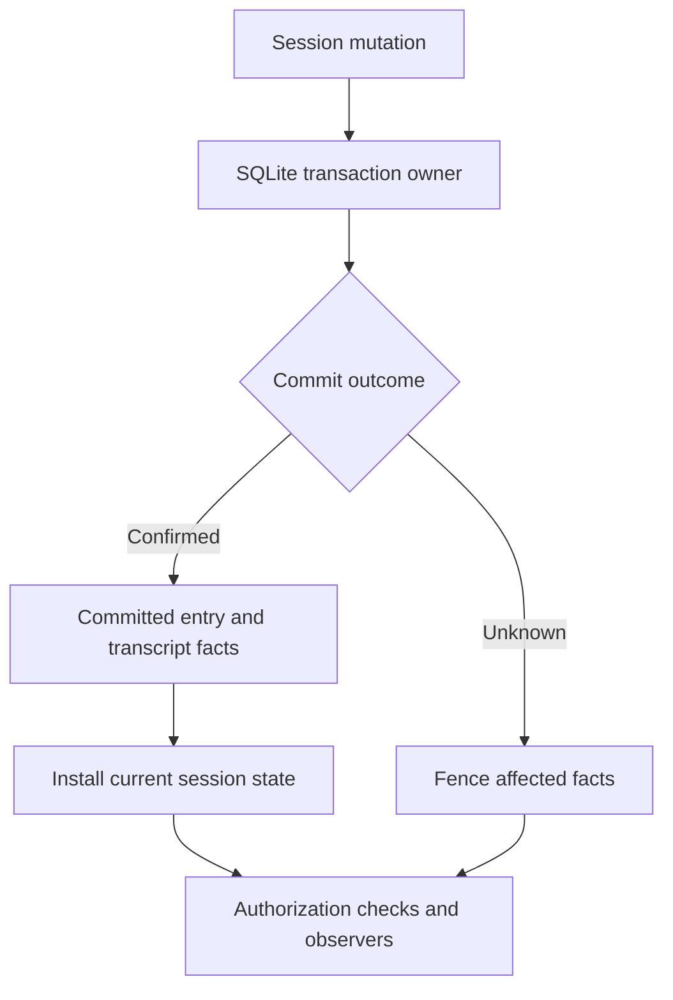

Codex review: needs maintainer review before merge.

## What this changes

The PR keeps session permissions, sharing details, categories, and conversation history current after database commits, including when worker replies are lost or delayed.

**Example:** An operator removes session member guest and the worker reply disappears after the database commits.
- **Before:** The caller receives an uncertain-outcome error and retained membership requires reconciliation.
- **After:** The confirmed commit publishes the removal and returns the guest record without repeating the mutation.

## Review scores

| Measure | Result | What it means |
|---|---|---|
| **Overall readiness** | 🐚 platinum hermit **(4/6)** | A useful repair through existing owners, with sufficient production evidence, resolved prior findings, and no newly identified defect. |
| **Proof confidence** | 🦞 diamond lobster **(5/6)** | Sufficient (live_output): The inspected body records real Gateway workloads and production SQLite runs exercising receipt installation, committed reply loss, supersession, and rejection of revoked/restored permissions and context. Earlier-source runtime and update evidence remains explicitly identified, with integrated-head correction coverage supplied separately; source inspection verifies that no stored-format migration is required. |
| **Patch quality** | 🐚 platinum hermit **(4/6)** | No actionable review findings were identified. |

## Product

**Kind:** Bug fix · **Worth it:** Yes · **Fix scope:** Complete
**User problem:** Session readers and callbacks can see stale permissions, sharing details, categories, or history after a change has committed.
**Reason:** The change restores the established commit-before-observer contract. Current-main history connects the author to these owners, and the recorded direction preserves public and stored-data contracts.

## Merge readiness

✅ **Ready for maintainer review**

This PR remains useful work that current main does not provide. Earlier findings are resolved, no new actionable defect was identified, and the remaining CI failures have evidence of causes outside the introduced changes.

**Priority:** P2
**Reviewed head:** `b1f8ba6439dee22cace975708c5959912aa2552e`

## Before merge

None.

## Findings

None.

### Provenance

- `Transcript mutation postimages`: original intent not found (ecb6eac68422f9ffefec82486df2d612d917d322: Scoped string history reaches the SQLite accessor split; the original mutation-publication rationale was not established.)

<strong>Agent review details</strong>

### How this fits together

OpenClaw stores session details and conversation history in SQLite. Database workers publish committed facts to the Gateway, where authorization checks, session readers, and plugin callbacks consume them.

### Technical review

Best possible solution:

Keep committed-fact publication in the existing session owners while preserving final authority checks and synchronous SDK completion.

Do we have a high-confidence way to reproduce the issue?

Yes: current-main publication paths and the recorded lost-reply, late-receipt, and revoke-and-restore negative controls establish concrete reproduction scenarios. This read-only review did not execute target code.

Is this the best way to solve the issue?

Yes: transaction-captured facts belong in the existing entry, transcript, and commit-publication owners, and the patch preserves native final guards rather than creating competing authorization.

AGENTS.md: found and applied where relevant.

Codex review notes: model internal, reasoning medium; reviewed against [58ba7ede092e](https://github.com/openclaw/openclaw/commit/58ba7ede092ebbc65197ad67bcb4a3f3ed8621b1).

### Provenance checked

- `Shared SQLite commit publication` keeps the original intent (https://github.com/openclaw/openclaw/pull/167570: Install committed facts before observers, fence failed installation, and preserve durable outcomes independently of notification and reply delivery.)
- `Session sharing, category, and participant publication` keeps the original intent (https://github.com/openclaw/openclaw/pull/155620: Reuse worker-maintained facts while preserving immediate revocation, FIFO admission, transaction-held authority, and protection against delayed replies.)
- `Worker entry receipt installation and supersession` keeps the original intent (https://github.com/openclaw/openclaw/pull/167570: Bind receipts to physical source, operation, exact coverage, and commit sequence while retaining domain ownership of supersession and authority.)
- `SessionManager branch adoption and identity notification` keeps the original intent (https://github.com/openclaw/openclaw/pull/138178: Give the live manager its validated successor target after commit and before publishing the identity event.)
- `Awaited SessionManager context acceptance` keeps the original intent (https://github.com/openclaw/openclaw/pull/165134: Retain the admitted source and lifecycle across awaited consumption and revalidate before accepting results.)
- `Plugin session-change subscription` keeps the original intent (https://github.com/openclaw/openclaw/pull/163820: Let plugins consume exact-key changes from the Gateway's existing session owner rather than maintain competing polling.)

### Testing

Proof path: shipped entry point.

### Security

None.

### Evidence

What I checked:

- **Current main still needs the session cutover:** Current main publishes collaboration results after ordinary worker execution and fences lost replies rather than installing the new commit receipts. The merged foundation at https://github.com/openclaw/openclaw/pull/167570 explicitly leaves transcript/context coverage to subsequent domain cutovers. ([`src/config/sessions/session-sharing-store.async.ts:235`](https://github.com/openclaw/openclaw/blob/58ba7ede092ebbc65197ad67bcb4a3f3ed8621b1/src/config/sessions/session-sharing-store.async.ts#L235), [58ba7ede092e](https://github.com/openclaw/openclaw/commit/58ba7ede092ebbc65197ad67bcb4a3f3ed8621b1))
- **Receipt installation preserves authority boundaries:** SessionManager installation requires equality with the admitted receipt and the captured physical source. Delivery generation retains its native identity/settings guard; observed committed revocation remains permanent, and exact anchor validation remains with the existing reader. ([`src/agents/sessions/session-manager-publication.ts:112`](https://github.com/openclaw/openclaw/blob/b1f8ba6439dee22cace975708c5959912aa2552e/src/agents/sessions/session-manager-publication.ts#L112), [b1f8ba6439de](https://github.com/openclaw/openclaw/commit/b1f8ba6439dee22cace975708c5959912aa2552e))
- **Production behavior evidence:** The full PR body was inspected through REST, including omitted ranges from the supplied body whose captured SHA-256 is 21e8b0b8ed4ca9ccd0efb4c9c395a691b38214175449939cd7d974b1a82b. It records real macOS Gateway workloads and native/worker SQLite runs, committed sharing reply loss, native supersession, and rejection of changed/restored raw permissions with SESSION_DELIVERY_GENERATION_UNAVAILABLE. Measurements identify the earlier candidate and baseline explicitly; final-head corrections have separate focused coverage. ([0a26d3384d9d](https://github.com/openclaw/openclaw/commit/0a26d3384d9d6c1b473a14d4f86cfe4c954cd820))
- **Upgrade and released SDK evidence:** The body records published 2026.9.9 driver acceptance against candidate 4d400c10631fe830044c0c16d4df233a5ca36e75: readiness returned 200, durable history survived, and incognito history cleared. The linked Testbox carrier was subsequently cancelled, so its workflow conclusion is not presented as a passing cell. Source inspection confirms process-local receipts, unchanged stored formats, optional worker hooks, and preserved synchronous SDK signatures; the body also records released beta SDK inspection. ([`src/state/openclaw-agent-worker-store.ts:119`](https://github.com/openclaw/openclaw/blob/4d400c10631fe830044c0c16d4df233a5ca36e75/src/state/openclaw-agent-worker-store.ts#L119), [4d400c10631f](https://github.com/openclaw/openclaw/commit/4d400c10631fe830044c0c16d4df233a5ca36e75))
- **Prior findings addressed:** Both missing publication modules are in the wrapper inventory; committed branch adoption precedes identity notification; recovery interception unwraps admission facts; finalizer and category fixtures consume confirmed receipt semantics. The latest completed review examined this same head and contained no findings. ([`src/agents/sessions/session-manager-branching.ts:233`](https://github.com/openclaw/openclaw/blob/b1f8ba6439dee22cace975708c5959912aa2552e/src/agents/sessions/session-manager-branching.ts#L233), [b1f8ba6439de](https://github.com/openclaw/openclaw/commit/b1f8ba6439dee22cace975708c5959912aa2552e))
- **Inherited recovery CI failure:** The writer-held reader-pool close/drain errors in https://github.com/openclaw/openclaw/actions/runs/37980793245/job/113991120925 match the same two test failures on main at https://github.com/openclaw/openclaw/actions/runs/37966817049/job/113943358309. ([`src/config/sessions/session-history-worker-errors.ts:134`](https://github.com/openclaw/openclaw/blob/22e485657b286b6a740eb7083c8c70063c813374/src/config/sessions/session-history-worker-errors.ts#L134), [22e485657b28](https://github.com/openclaw/openclaw/commit/22e485657b286b6a740eb7083c8c70063c813374))

Likely related people:

- **Peter Steinberger:** Raw commit da67a08b20eb3c16445c7d4cc469f96751736cf9 adds src/infra/sqlite-post-commit.ts:40 relative to its recorded parents. This identifies author metadata, not feature responsibility or a PR merger. (role: source-line author; confidence: high; commits: [da67a08b20eb](https://github.com/openclaw/openclaw/commit/da67a08b20eb3c16445c7d4cc469f96751736cf9); files: `src/infra/sqlite-post-commit.ts`)

### PR surface

Source +2103, Tests +1235, Docs +63, Other +26. Total +3427 across 74 files. Added test files: 4.

View PR surface stats

| Area | Files | Added | Removed | Net |
|---|---:|---:|---:|---:|
| Source | 51 | 2865 | 762 | +2103 |
| Tests | 19 | 1338 | 103 | +1235 |
| Docs | 2 | 102 | 39 | +63 |
| Config | 0 | 0 | 0 | 0 |
| Generated | 0 | 0 | 0 | 0 |
| Other | 2 | 34 | 8 | +26 |
| **Total** | **74** | **4339** | **912** | **+3427** |

### Review metrics

| Metric | Value | Why it matters |
|---|---|---|
| **Production versus tests** | Production +2,865/−762 LOC; tests +1,338/−103 LOC | Production growth supports receipt custody and authority installation through existing owners, with fault, rollback, and ordering coverage. |
| **Accepted receipt transport cost** | +3 one-way COMMIT envelopes per warmed turn; +5 on the first turn | The recorded owner decision accepts this measured cost while retaining separate native settlement. |

### Labels

Label changes:

No label changes.

Label justifications:

- `P2`: This repairs bounded session-publication failures without evidence of a widespread urgent outage.
- `merge-risk: 🚨 compatibility`: Released worker and plugin callback surfaces are affected, with optional hooks and committed-fact ordering preserving their existing callable contracts.
- `rating: 🐚 platinum hermit`: Overall readiness is 🐚 platinum hermit; proof is 🦞 diamond lobster and patch quality is 🐚 platinum hermit.
- `status: 👀 ready for maintainer look`: ClawSweeper has no concrete contributor-facing blocker left for this PR.
- `proof: sufficient`: Contributor real behavior proof is sufficient.

### Rating scale

6/6 🦀 challenger crab · 5/6 🦞 diamond lobster · 4/6 🐚 platinum hermit · 3/6 🦐 gold shrimp · 2/6 🦪 silver shellfish · 1/6 🧂 unranked krab. Overall follows the weaker of proof and patch quality; ✨ marks media proof (a screenshot, video, or linked artifact) that directly shows the changed behavior.

### Workflow

ClawSweeper edits this one comment on every review. Comment `@clawsweeper re-review` for a fresh review only; repair and merge need explicit maintainer commands such as `@clawsweeper autofix` or `@clawsweeper automerge`.

### History

Review history (4 earlier review cycles)

<!-- clawsweeper-review-history v=1 total=4 -->
- reviewed 2026-10-09T17:09:46.956Z sha 4d400c10631fe830044c0c16d4df233a5ca36e75 :: needs changes before merge. :: [P2] [P2] Include the new publication modules in the wrapper inventory
- reviewed 2026-10-09T17:57:22.000Z sha bc86a6f1e44d5dceba9f6dbd2d064bc7557f3cc3 :: blocked before merge. :: [P2] [P2] Adopt the committed branch before notifying identity observers | [P2] [P2] Update recovery fault injection for the wrapped admission facts | [P2] [P2] Accept the finalizer receipt in the held-reply fixture | [P2] [P2] Migrate the Gateway category uncertainty fixture to commit receipts
- reviewed 2026-10-09T18:45:41.310Z sha eeeaed95dac4da9211faca24136933c4bc89d944 :: needs changes before merge. :: none
- reviewed 2026-10-09T19:43:39.015Z sha b1f8ba6439dee22cace975708c5959912aa2552e :: needs maintainer review before merge. :: none

_Reviewed October 9, 2026, 3:58 PM ET / 19:58 UTC (Revision 5)._

<!-- clawsweeper-verdict:needs-human item=167875 sha=b1f8ba6439dee22cace975708c5959912aa2552e confidence=high updated_at=2026-10-09T19:52:55Z reviewed_at=2026-10-09T19:58:22.814Z lease_owner=github-run-37983136305-1 lease_comment_id=6088179552 source_revision=53e626b4b2626602cf948f7cde1b41004a0ec912f988b8de1097e7bc62ecdc74 live_verification=absent hold=not_opted_in findings=0 -->
<!-- clawsweeper-review-state:ready item=167875 sha=b1f8ba6439dee22cace975708c5959912aa2552e v=1 -->

<!-- clawsweeper-review-version item=167875 reviewed_at=2026-10-09T19:58:22.814Z sha=b1f8ba6439dee22cace975708c5959912aa2552e source_revision=53e626b4b2626602cf948f7cde1b41004a0ec912f988b8de1097e7bc62ecdc74 lease_owner=github-run-37983136305-1 lease_comment_id=6088179552 v=1 -->

<!-- clawsweeper-review item=167875 -->