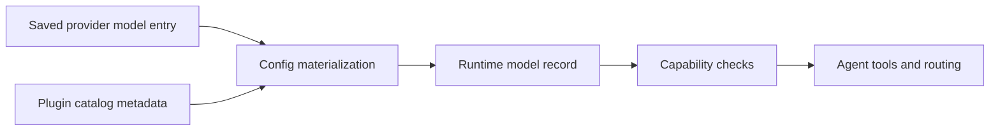

Codex review: found issues before merge. _Reviewed August 18, 2026, 8:27 PM ET / August 19, 2026, 00:27 UTC._

# ClawSweeper review

## What this changes

The PR makes partial configured provider-model entries inherit omitted catalog metadata before generic defaults are applied.

## Regression provenance

Possible regression — suspected (reviewed change). No predecessor PR is attributed.

## Merge readiness

⚠️ **Ready for maintainer review - 3 items remain**

The reworked owner-boundary fix is in the right materialization path, but one nested catalog field can still be silently discarded. Likely related people: steipete (high confidence, current and prior model-default history).

**Priority:** P1
**Reviewed head:** `c7b1d86a25e6fc7368e307fc67e1607d060ce945`

## Review scores

| Measure | Result | What it means |
|---|---|---|
| **Overall readiness** | 🦐 gold shrimp **(3/6)** | The core repair is well targeted, but the uncovered nested-cost defect blocks merge. |
| **Proof confidence** | 🌊 off-meta tidepool | Not applicable: This maintainer-authored PR describes a live A/B result; the external-contributor proof gate does not apply. |
| **Patch quality** | 🦐 gold shrimp **(3/6)** | 1 actionable review finding remain. |

## Verification

| Check | Result | Evidence |
|---|---|---|
| **Real behavior** | Not applicable | Not applicable: This maintainer-authored PR describes a live A/B result; the external-contributor proof gate does not apply. |
| **Evidence reviewed** | 7 items | Correct owner boundary: Catalog lookup now happens inside model-default materialization, before generic defaults replace omitted metadata.<br>Normal load path: Runtime materialization invokes applyModelDefaults with the resolved manifest registry, so the revised lookup is on the loaded-config path.<br>Observed consumer: The local OpenClaw Codex extension derives vision capability from the materialized model input and filters vision tools with that result; this is not a dependency on sibling Codex source. |
| **Findings** | 1 actionable finding | [P2] Preserve catalog tiered pricing when cost fields are explicit |
| **Security** | None | None. |


### Live Verification

**Command:** `node scripts/run-vitest.mjs src/config/defaults.test.ts`

**Result:** FAIL (partial) — step 2 `expect_output` `fills omitted fields from the owning catalog row before generic defaults`: `expected terminal output was not visible within 30 seconds: "fills omitted fields from the owning catalog row before generic defaults"`

```text
node scripts/run-vitest.mjs src/config/defaults.test.ts
runner@runnervm76f27:/tmp/clawsweeper-live-proof-126068-bxgFeq/target$ node scripts/run-vitest.mjs src/config/defaults.test.ts
node scripts/run-vitest.mjs src/config/defaults.test.ts
[test] starting test/vitest/vitest.runtime-config.config.ts

 RUN  v4.1.10 /tmp/clawsweeper-live-proof-126068-bxgFeq/target

 ✓  runtime-config  src/config/defaults.test.ts (9 tests) 10ms

 Test Files  1 passed (1)
      Tests  9 passed (9)
   Start at  00:28:16
   Duration  2.82s (transform 1.95s, setup 58ms, import 2.43s, tests 10ms, environment 0ms)

[test] passed 1 Vitest shard in 8.30s
runner@runnervm76f27:/tmp/clawsweeper-live-proof-126068-bxgFeq/target$ node scripts/run-vitest.mjs src/config/defaults.test.ts
[test] starting test/vitest/vitest.runtime-config.config.ts

 RUN  v4.1.10 /tmp/clawsweeper-live-proof-126068-bxgFeq/target

 ✓  runtime-config  src/config/defaults.test.ts (9 tests) 10ms

 Test Files  1 passed (1)
      Tests  9 passed (9)
   Start at  00:28:25
   Duration  1.46s (transform 627ms, setup 28ms, import 1.23s, tests 10ms, environment 0ms)

[test] passed 1 Vitest shard in 6.86s
runner@runnervm76f27:/tmp/clawsweeper-live-proof-126068-bxgFeq/target$


```

**Assertions:**

- FAIL `expect_output`: fills omitted fields from the owning catalog row before generic defaults

## How this fits together

Provider model configuration is materialized at startup into runtime model records. Those records feed model capability checks, including whether the Codex extension exposes vision-dependent tools.



## Before merge

- [ ] **Preserve catalog tiered pricing when cost fields are explicit (P2)** - The merge at this point can add a catalog `tieredPricing`, but `costMutated` only compares the four flat rates. A valid saved entry with those four rates already set and no `tieredPricing` therefore returns unchanged, so the catalog schedule is never inherited even though the schema defines it as optional model-cost metadata. Include that property in the mutation check and add the corresponding regression case.
- [ ] **Resolve merge risk (P1)** - A saved model entry with all four flat cost rates but no tieredPricing will not inherit the catalog schedule, leaving usage accounting on the wrong pricing mode.
- [ ] **Complete next step (P2)** - A concrete P2 correction is needed, but the maintainer-labeled PR should remain under its existing human review path.

## Findings

- [P2] Preserve catalog tiered pricing when cost fields are explicit — `src/config/defaults.ts:286-291`


<details>
<summary><strong>Agent review details</strong></summary>

### Security

None.

### PR surface

Source +96, Tests +131. Total +227 across 2 files.

<details>
<summary>View PR surface stats</summary>

| Area | Files | Added | Removed | Net |
|---|---:|---:|---:|---:|
| Source | 1 | 112 | 16 | +96 |
| Tests | 1 | 131 | 0 | +131 |
| Docs | 0 | 0 | 0 | 0 |
| Config | 0 | 0 | 0 | 0 |
| Generated | 0 | 0 | 0 | 0 |
| Other | 0 | 0 | 0 | 0 |
| **Total** | **2** | **243** | **16** | **+227** |

</details>

### Review metrics

| Metric | Value | Why it matters |
|---|---|---|
| **Production vs test delta** | production +96, tests +131 | The fix adds catalog-lookup and merge logic plus focused regression coverage. |
| **Configured metadata behavior** | 8 top-level metadata fields seeded | Existing partial provider-model entries will materialize differently after upgrade. |

### Merge-risk options

**Maintainer options:**
1. **Complete nested cost inheritance (recommended)**  
   Compare or explicitly propagate tieredPricing alongside the flat cost fields and add a regression case for a complete flat override without that optional field.

### Technical review

Best possible solution:

Preserve catalog tiered pricing whenever that nested configuration field is absent, while retaining an explicitly authored tier schedule.

Do we have a high-confidence way to reproduce the issue?

Yes, source-reproducible: current main replaces omitted model input and cost metadata during config materialization before vision-capability consumers read the model.

Is this the best way to solve the issue?

No: the materialization location is correct, but the nested tiered-pricing inheritance path must be completed before this is the best fix.

Full review comments:

- [P2] Preserve catalog tiered pricing when cost fields are explicit — `src/config/defaults.ts:286-291`
  The merge at this point can add a catalog `tieredPricing`, but `costMutated` only compares the four flat rates. A valid saved entry with those four rates already set and no `tieredPricing` therefore returns unchanged, so the catalog schedule is never inherited even though the schema defines it as optional model-cost metadata. Include that property in the mutation check and add the corresponding regression case.
  Confidence: 0.96

Overall correctness: patch is incorrect
Overall confidence: 0.96

AGENTS.md: found and applied where relevant.

Codex review notes: model internal, reasoning high; reviewed against [8d6cbee1b527](https://github.com/openclaw/openclaw/commit/8d6cbee1b527cd8df313db401a40fbbd4e0c0ee8).

### Labels

Label changes:

- add `rating: 🦐 gold shrimp`: Overall readiness is 🦐 gold shrimp; proof is 🌊 off-meta tidepool and patch quality is 🦐 gold shrimp.
- remove `rating: 🧂 unranked krab`: Current PR rating is `rating: 🦐 gold shrimp`, so this older rating label is no longer current.

Label justifications:

- `P1`: The underlying defect silently removes default-model capabilities from configured agent workflows.
- `merge-risk: 🚨 compatibility`: The PR intentionally changes runtime materialization of existing saved provider-model entries.
- `rating: 🦐 gold shrimp`: Overall readiness is 🦐 gold shrimp; proof is 🌊 off-meta tidepool and patch quality is 🦐 gold shrimp.
- `status: ⏳ waiting on author`: ClawSweeper has contributor-facing work open and is waiting for author action. Not applicable: This maintainer-authored PR describes a live A/B result; the external-contributor proof gate does not apply.

### Evidence

What I checked:

- **Correct owner boundary:** Catalog lookup now happens inside model-default materialization, before generic defaults replace omitted metadata. ([`src/config/defaults.ts:271`](https://github.com/openclaw/openclaw/blob/c7b1d86a25e6/src/config/defaults.ts#L271), [c7b1d86a25e6](https://github.com/openclaw/openclaw/commit/c7b1d86a25e6))
- **Normal load path:** Runtime materialization invokes applyModelDefaults with the resolved manifest registry, so the revised lookup is on the loaded-config path. ([`src/config/materialize.ts:49`](https://github.com/openclaw/openclaw/blob/c7b1d86a25e6/src/config/materialize.ts#L49), [c7b1d86a25e6](https://github.com/openclaw/openclaw/commit/c7b1d86a25e6))
- **Observed consumer:** The local OpenClaw Codex extension derives vision capability from the materialized model input and filters vision tools with that result; this is not a dependency on sibling Codex source. ([`extensions/codex/src/app-server/dynamic-tool-build.ts:239`](https://github.com/openclaw/openclaw/blob/c7b1d86a25e6/extensions/codex/src/app-server/dynamic-tool-build.ts#L239), [c7b1d86a25e6](https://github.com/openclaw/openclaw/commit/c7b1d86a25e6))
- **Remaining nested-cost defect:** The patch merges catalog tieredPricing into the computed cost but mutation detection compares only the four flat rates, so a complete flat configured cost can return the original object without the catalog tier schedule. ([`src/config/defaults.ts:286`](https://github.com/openclaw/openclaw/blob/c7b1d86a25e6/src/config/defaults.ts#L286), [c7b1d86a25e6](https://github.com/openclaw/openclaw/commit/c7b1d86a25e6))
- **Configuration contract:** Configured model costs explicitly allow optional tieredPricing, and runtime cost calculation treats it as meaningful pricing metadata. ([`src/config/zod-schema.core.ts:406`](https://github.com/openclaw/openclaw/blob/c7b1d86a25e6/src/config/zod-schema.core.ts#L406), [c7b1d86a25e6](https://github.com/openclaw/openclaw/commit/c7b1d86a25e6))
- **Prior behavior provenance:** The current-main implementation defaulted omitted input and cost before this PR; blame attributes that path to the preceding commit by steipete. ([`src/config/defaults.ts:219`](https://github.com/openclaw/openclaw/blob/f59392fdf5e6/src/config/defaults.ts#L219), [f59392fdf5e6](https://github.com/openclaw/openclaw/commit/f59392fdf5e6))

Likely related people:

- **steipete:** Base-path blame and the exact-head repair both point to this contributor's recent work on configured model defaults. (role: introduced current model-default behavior and authored the repair; confidence: high; commits: [f59392fdf5e6](https://github.com/openclaw/openclaw/commit/f59392fdf5e6b1e2f941bfb766beec685e221be7), [c7b1d86a25e6](https://github.com/openclaw/openclaw/commit/c7b1d86a25e6fc7368e307fc67e1607d060ce945); files: `src/config/defaults.ts`, `src/config/defaults.test.ts`)

### Rank-up moves

Optional improvements that raise the rating; they are not merge blockers.

- Preserve catalog tieredPricing when it is absent from an otherwise complete configured cost object.
- Add a focused regression assertion for that configured-cost shape.

### Rating scale

| Score | Internal tier | Crab rank | Meaning |
|---:|:---:|---|---|
| **6/6** | S | 🦀 challenger crab | Exceptional readiness |
| **5/6** | A | 🦞 diamond lobster | Very strong readiness |
| **4/6** | B | 🐚 platinum hermit | Good normal PR; ordinary maintainer review |
| **3/6** | C | 🦐 gold shrimp | Useful, but confidence is limited |
| **2/6** | D | 🦪 silver shellfish | Proof or implementation needs work |
| **1/6** | F | 🧂 unranked krab | Not merge-ready |
| N/A | NA | 🌊 off-meta tidepool | Rating does not apply |

Overall follows the weaker of proof and patch quality.
Shiny media proof means a screenshot, video, or linked artifact directly shows the changed behavior. Runtime, network, CSP, and security claims still need visible diagnostics.

### Workflow

- ClawSweeper keeps one durable marker-backed review comment per issue or PR.
- Re-runs edit this comment so the latest verdict, findings, and automation markers stay together instead of adding duplicate bot comments.
- A fresh review can be triggered by eligible `@clawsweeper re-review` comments, exact-item GitHub events, scheduled/background review runs, or manual workflow dispatch.
- PR/issue authors and users with repository write access can comment `@clawsweeper re-review` or `@clawsweeper re-run` on an open PR or issue to request a fresh review only.
- Maintainers can also comment `@clawsweeper review` to request a fresh review only.
- Fresh-review commands do not start repair, autofix, rebase, CI repair, or automerge.
- Maintainer-only repair and merge flows require explicit commands such as `@clawsweeper autofix`, `@clawsweeper automerge`, `@clawsweeper fix ci`, or `@clawsweeper address review`.
- Maintainers can comment `@clawsweeper explain` to ask for more context, or `@clawsweeper stop` to stop active automation.

### History

<details>
<summary>Review history (1 earlier review cycle)</summary>

<!-- clawsweeper-review-history v=1 total=1 -->
- reviewed 2026-08-18T23:27:30.462Z sha 4f9992fd1390be391e7fea2a7070b01fa0760817 :: found issues before merge. :: [P1] Seed metadata before config defaults erase field presence

</details>

</details>

<!-- clawsweeper-verdict:needs-human item=126068 sha=c7b1d86a25e6fc7368e307fc67e1607d060ce945 confidence=high updated_at=2026-08-19T00:24:48Z reviewed_at=2026-08-19T00:27:32.667Z lease_owner=github-run-32201026520-1 lease_comment_id=5335948273 source_revision=ae228ef97c0db839300988e79462d39ab3d8bec8864ed133faeb82f906852c3a -->

<!-- clawsweeper-review-version item=126068 reviewed_at=2026-08-19T00:27:32.667Z sha=c7b1d86a25e6fc7368e307fc67e1607d060ce945 source_revision=ae228ef97c0db839300988e79462d39ab3d8bec8864ed133faeb82f906852c3a lease_owner=github-run-32201026520-1 lease_comment_id=5335948273 v=1 -->

<!-- clawsweeper-review item=126068 -->