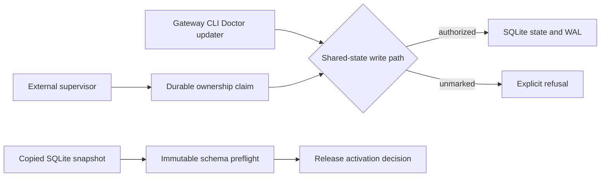

Codex review: found issues before merge. _Reviewed August 9, 2026, 4:44 PM ET / 20:44 UTC._

# ClawSweeper review

## What this changes

Adds external-supervisor ownership for shared SQLite state, immutable copied-state schema preflight, and write checks across Gateway, CLI, Doctor, updater, and diagnostic paths.

## Regression provenance

Possible regression — probable (reproduction; reviewed change). No predecessor PR is attributed.

## Merge readiness

⚠️ **Ready for maintainer review - 7 items remain**

Keep this PR open: both previously identified P1 ownership races remain at the exact head, so its documented once-claimed refusal guarantee is not yet true.

**Priority:** P1
**Reviewed head:** `2b02823de87d752a1a6d37b3ebf0109e47a10253`
**Owner decision:** Required. See [Decision needed](#decision-needed).

## Review scores

| Measure | Result | What it means |
|---|---|---|
| **Overall readiness** | 🦐 gold shrimp **(3/6)** | The patch has strong stated validation, but two P1 owner-boundary defects leave it short of merge readiness. |
| **Proof confidence** | 🌊 off-meta tidepool | Not applicable: This maintainer-authored PR is exempt from the external-contributor proof gate; its body nevertheless links exact-head CI and isolated Gateway/state evidence. |
| **Patch quality** | 🦐 gold shrimp **(3/6)** | 2 actionable review findings remain. |

## Verification

| Check | Result | Evidence |
|---|---|---|
| **Real behavior** | Not applicable | Not applicable: This maintainer-authored PR is exempt from the external-contributor proof gate; its body nevertheless links exact-head CI and isolated Gateway/state evidence. |
| **Evidence reviewed** | 7 items | Unfenced cold-open mutation: The exact head checks ownership, then performs permission hardening before its later transactional recheck; a claim between those operations lets an unmarked process mutate filesystem permissions despite the documented guarantee. Documented contract: The new operator documentation says an unmarked writable open fails before permissions or other mutation, which the claim-after-check race violates. Doctor remains concurrent with claims: Doctor validates ownership before checkpoint/VACUUM, but claim operations do not take Doctor’s maintenance lock, so a claim can commit after validation and before the destructive SQLite operations. |
| **Findings** | 2 actionable findings | [P1] Fence state-open setup under the ownership claim [P1] Serialize Doctor compaction with ownership claims |
| **Security** | None | None. |

## How this fits together

Gateway, CLI, Doctor, updater, and diagnostics share OpenClaw’s SQLite state database. The new ownership row should make unmarked writers refuse while copied snapshots are assessed read-only before activation or rollback.

## Decision needed

| Question | Recommendation |
|---|---|
| Should external ownership guarantee refusal before every filesystem, WAL, and Doctor mutation once a claim commits, or should the product explicitly narrow that guarantee to a coordinated transition protocol? | **Complete the durable ownership boundary:** Serialize claims with cold-open setup and Doctor compaction, and prove both claim-during-operation races refuse before mutation. |

Why: The branch deliberately leaves both concurrent windows open while public documentation promises the broader guarantee; choosing the permanent operator contract requires maintainer intent.

## Before merge

- [ ] **Fence state-open setup under the ownership claim (P1)** - A claim can commit after the check at line 591 but before this permission/WAL setup. That lets an unmarked opener change filesystem or SQLite state after ownership exists, contradicting the documented pre-mutation refusal guarantee; the existing race test starts at BEGIN IMMEDIATE and misses this window.
- [ ] **Serialize Doctor compaction with ownership claims (P1)** - This check is not held through `wal_checkpoint(TRUNCATE)` and `VACUUM`, while the claim path does not acquire Doctor’s maintenance lock. A claim can therefore commit immediately after validation and the unmarked Doctor still mutates the database; add shared coordination and an injected-race regression.
- [ ] **Resolve merge risk (P1)** - An external ownership claim can commit after the fast pre-open check, allowing an unmarked process to chmod or initialize SQLite/WAL state after the documented refusal boundary.
- [ ] **Resolve merge risk (P1)** - Doctor can still checkpoint and VACUUM after an external claim commits because its maintenance lock is not shared by the claim path.
- [ ] **Resolve merge risk (P1)** - GitHub currently reports a dirty merge state, so an exact merged result must be revalidated after the ownership-boundary repair.
- [ ] **Complete next step (P2)** - Protected maintainer-owned scope and the explicit ownership-contract choice require human direction before a repair or merge.

## Findings

- [P1] Fence state-open setup under the ownership claim — `src/state/openclaw-state-db.ts:592-604`
- [P1] Serialize Doctor compaction with ownership claims — `src/commands/doctor-state-sqlite-compact.ts:89-92`

<strong>Agent review details</strong>

### Security

None.

### PR surface

Source +947, Tests +1324, Docs +35, Generated 0, Other +2. Total +2308 across 41 files.

View PR surface stats

| Area | Files | Added | Removed | Net |
|---|---:|---:|---:|---:|
| Source | 23 | 1458 | 511 | +947 |
| Tests | 14 | 1342 | 18 | +1324 |
| Docs | 2 | 37 | 2 | +35 |
| Config | 0 | 0 | 0 | 0 |
| Generated | 1 | 46 | 46 | 0 |
| Other | 1 | 2 | 0 | +2 |
| **Total** | **41** | **2885** | **577** | **+2308** |

### Review metrics

| Metric | Value | Why it matters |
|---|---|---|
| **Operator command surface** | 2 subcommands added | `database preflight` and `database ownership` become public operator interfaces, so their safety contract must match runtime behavior. |
| **Configuration surfaces** | 0 new config options or environment variables | The repair uses the existing external-supervisor marker rather than expanding configuration surface. |

### Stored data model

Persistent data-model change detected: `database schema: src/infra/sqlite-schema-contract.test.ts`, `database schema: src/proxy-capture/store.sqlite.test.ts`, `migration/backfill/repair: src/commands/doctor-config-preflight.ts`, `migration/backfill/repair: src/commands/doctor-state-sqlite-compact.ts`, `migration/backfill/repair: src/infra/startup-migration-checkpoint.test.ts`, `migration/backfill/repair: src/state/openclaw-state-ownership.test.ts`, and 23 more. Confirm migration or upgrade compatibility proof before merge.

### Root-cause cluster

Relationship: `fixed_by_candidate`
Canonical: https://github.com/openclaw/openclaw/issues/121068
Summary: This PR is the linked candidate repair for externally supervised same-version state schema drift.

Members:
- `canonical`: https://github.com/openclaw/openclaw/issues/121068 - The PR body explicitly links the issue and implements its proposed shared-state ownership and copied-schema-preflight boundary.

Proposal only: this assessment does not dispatch repair, suppress jobs, mutate sibling items, close, or merge anything.

### Merge-risk options

**Maintainer options:**
1. **Close the ownership race windows (recommended)**  
   Make claims and every state-opening or Doctor mutation use the same owner boundary, with injected-race regressions before merge.
2. **Adopt a narrower contract**  
   Explicitly limit the ownership promise to an externally coordinated transition and revise the operator documentation to match.

### Technical review

Best possible solution:

Use one lifecycle coordination boundary for ownership claims, state-open setup, and destructive Doctor maintenance, then add claim-during-open and claim-during-compaction regressions.

Do we have a high-confidence way to reproduce the issue?

Yes—injecting a claim after the pre-open ownership check or after Doctor validation gives a high-confidence source-level reproduction; the current tests inject only before schema repair.

Is this the best way to solve the issue?

No—the state lifecycle is the correct owner, but the patch does not fence all mutations that its new public contract says occur after a claim.

Full review comments:

- [P1] Fence state-open setup under the ownership claim — `src/state/openclaw-state-db.ts:592-604`
  A claim can commit after the check at line 591 but before this permission/WAL setup. That lets an unmarked opener change filesystem or SQLite state after ownership exists, contradicting the documented pre-mutation refusal guarantee; the existing race test starts at BEGIN IMMEDIATE and misses this window.
  Confidence: 0.99
- [P1] Serialize Doctor compaction with ownership claims — `src/commands/doctor-state-sqlite-compact.ts:89-92`
  This check is not held through `wal_checkpoint(TRUNCATE)` and `VACUUM`, while the claim path does not acquire Doctor’s maintenance lock. A claim can therefore commit immediately after validation and the unmarked Doctor still mutates the database; add shared coordination and an injected-race regression.
  Confidence: 0.99

Overall correctness: patch is incorrect
Overall confidence: 0.98

AGENTS.md: found and applied where relevant.

Codex review notes: model internal, reasoning high; reviewed against [bff0494f33b2](https://github.com/openclaw/openclaw/commit/bff0494f33b24aef664990dafda0d38750d798bc).

### Labels

Label justifications:

- `P1`: Incomplete ownership fencing can let an unmarked shared-state writer mutate state during external-supervisor lifecycle transitions.
- `merge-risk: 🚨 compatibility`: The new durable ownership contract can refuse existing writable state paths and is presently inconsistent at concurrent mutation boundaries.
- `rating: 🦐 gold shrimp`: Overall readiness is 🦐 gold shrimp; proof is 🌊 off-meta tidepool and patch quality is 🦐 gold shrimp.
- `status: ⏳ waiting on author`: ClawSweeper has contributor-facing work open and is waiting for author action. Not applicable: This maintainer-authored PR is exempt from the external-contributor proof gate; its body nevertheless links exact-head CI and isolated Gateway/state evidence.

### Evidence

What I checked:

- **Unfenced cold-open mutation:** The exact head checks ownership, then performs permission hardening before its later transactional recheck; a claim between those operations lets an unmarked process mutate filesystem permissions despite the documented guarantee. ([`src/state/openclaw-state-db.ts:591`](https://github.com/openclaw/openclaw/blob/2b02823de87d/src/state/openclaw-state-db.ts#L591), [2b02823de87d](https://github.com/openclaw/openclaw/commit/2b02823de87d))
- **Documented contract:** The new operator documentation says an unmarked writable open fails before permissions or other mutation, which the claim-after-check race violates. Public docs: [`docs/cli/gateway.md`](https://docs.openclaw.ai/cli/gateway). ([`docs/cli/gateway.md:172`](https://docs.openclaw.ai/cli/gateway), [2b02823de87d](https://github.com/openclaw/openclaw/commit/2b02823de87d))
- **Doctor remains concurrent with claims:** Doctor validates ownership before checkpoint/VACUUM, but claim operations do not take Doctor’s maintenance lock, so a claim can commit after validation and before the destructive SQLite operations. ([`src/commands/doctor-state-sqlite-compact.ts:89`](https://github.com/openclaw/openclaw/blob/2b02823de87d/src/commands/doctor-state-sqlite-compact.ts#L89), [2b02823de87d](https://github.com/openclaw/openclaw/commit/2b02823de87d))
- **Existing tests miss both timing windows:** The cold-open test injects a claim at BEGIN IMMEDIATE and verifies schema repair is stopped; it does not inject after the pre-open check or after Doctor validation. ([`src/state/openclaw-state-ownership.test.ts:143`](https://github.com/openclaw/openclaw/blob/2b02823de87d/src/state/openclaw-state-ownership.test.ts#L143), [2b02823de87d](https://github.com/openclaw/openclaw/commit/2b02823de87d))
- **Current-main comparison:** Current main has no external-state ownership module, so this PR’s central repair is not already implemented. ([`src/state/openclaw-state-ownership.ts`](https://github.com/openclaw/openclaw/blob/bff0494f33b2/src/state/openclaw-state-ownership.ts), [bff0494f33b2](https://github.com/openclaw/openclaw/commit/bff0494f33b2))
- **Feature-history provenance:** The final functional commit is titled “fix: close external state ownership races”; the residual windows above show that it closed only later transaction/schema windows. ([`src/state/openclaw-state-db.ts`](https://github.com/openclaw/openclaw/blob/56dbdfa8b8f5/src/state/openclaw-state-db.ts), [56dbdfa8b8f5](https://github.com/openclaw/openclaw/commit/56dbdfa8b8f5))

Likely related people:

- **steipete:** Authored the PR’s ownership-race commit and has substantial recent history in the state database owner path. (role: recent shared-state lifecycle contributor; confidence: high; commits: [56dbdfa8b8f5](https://github.com/openclaw/openclaw/commit/56dbdfa8b8f5f15cc1a1d4a8ad57a740eb506710), [e7950d968b87](https://github.com/openclaw/openclaw/commit/e7950d968b873a87e899d61b41b7e553aaaffecd); files: `src/state/openclaw-state-db.ts`, `src/state/openclaw-state-ownership-operations.ts`)
- **Vincent Koc:** Recent state-history work covers canonical SQLite repair, verification, and compatibility boundaries affected by this change. (role: adjacent state-integrity contributor; confidence: medium; commits: [663c4fba1053](https://github.com/openclaw/openclaw/commit/663c4fba10536a7148749f2b35fb5af6d54d3cb7), [f288589166e0](https://github.com/openclaw/openclaw/commit/f288589166e07f20cd1cdc0ea3b293f2ae9f911b); files: `src/state/openclaw-state-db.ts`, `src/infra/sqlite-schema-contract.ts`)

### Rank-up moves

Optional improvements that raise the rating; they are not merge blockers.

- Serialize claims with cold-open permissions/WAL setup and test a claim in that interval.
- Serialize claims with Doctor compaction and test a claim after validation but before checkpoint/VACUUM.
- Resolve the dirty merge state and rerun exact-head validation.

### Rating scale

| Score | Internal tier | Crab rank | Meaning |
|---:|:---:|---|---|
| **6/6** | S | 🦀 challenger crab | Exceptional readiness |
| **5/6** | A | 🦞 diamond lobster | Very strong readiness |
| **4/6** | B | 🐚 platinum hermit | Good normal PR; ordinary maintainer review |
| **3/6** | C | 🦐 gold shrimp | Useful, but confidence is limited |
| **2/6** | D | 🦪 silver shellfish | Proof or implementation needs work |
| **1/6** | F | 🧂 unranked krab | Not merge-ready |
| N/A | NA | 🌊 off-meta tidepool | Rating does not apply |

Overall follows the weaker of proof and patch quality.
Shiny media proof means a screenshot, video, or linked artifact directly shows the changed behavior. Runtime, network, CSP, and security claims still need visible diagnostics.

### Workflow

- ClawSweeper keeps one durable marker-backed review comment per issue or PR.
- Re-runs edit this comment so the latest verdict, findings, and automation markers stay together instead of adding duplicate bot comments.
- A fresh review can be triggered by eligible `@clawsweeper re-review` comments, exact-item GitHub events, scheduled/background review runs, or manual workflow dispatch.
- PR/issue authors and users with repository write access can comment `@clawsweeper re-review` or `@clawsweeper re-run` on an open PR or issue to request a fresh review only.
- Maintainers can also comment `@clawsweeper review` to request a fresh review only.
- Fresh-review commands do not start repair, autofix, rebase, CI repair, or automerge.
- Maintainer-only repair and merge flows require explicit commands such as `@clawsweeper autofix`, `@clawsweeper automerge`, `@clawsweeper fix ci`, or `@clawsweeper address review`.
- Maintainers can comment `@clawsweeper explain` to ask for more context, or `@clawsweeper stop` to stop active automation.

### History

Review history (4 earlier review cycles)

<!-- clawsweeper-review-history v=1 total=4 -->
- reviewed 2026-08-09T13:47:50.370Z sha f4ab91d88b4d4dd636c79e17608476909d94ac93 :: found issues before merge. :: [P1] Preserve the existing shared_host lazy-column compatibility | [P3] Remove the release-owned changelog entry
- reviewed 2026-08-09T14:54:55.803Z sha a864c7517f9e9818f6fafd514693acddc70bf65d :: found issues before merge. :: [P3] Remove the release-owned changelog entry
- reviewed 2026-08-09T18:46:17.846Z sha afa84ebaba322440e08c23fae9069c9509769986 :: found issues before merge. :: [P1] Fence state-open repairs before they execute | [P1] Accept safe same-version additive columns during preflight
- reviewed 2026-08-09T19:42:43.209Z sha eb80c650375affb5249e2a5f6c244a4ea851d03b :: needs changes before merge. :: [P1] Fence permission and WAL changes under the ownership lock | [P1] Serialize Doctor compaction with ownership claims

<!-- clawsweeper-verdict:needs-human item=121069 sha=2b02823de87d752a1a6d37b3ebf0109e47a10253 confidence=high updated_at=2026-08-09T20:40:09Z reviewed_at=2026-08-09T20:44:42.109Z lease_owner=github-run-31334747491-1 lease_comment_id=5233738454 source_revision=fdf57e50444719c9cf91ed65ccad2093eeeab0674ee0028307146d230aa81328 -->

<!-- clawsweeper-review-version item=121069 reviewed_at=2026-08-09T20:44:42.109Z sha=2b02823de87d752a1a6d37b3ebf0109e47a10253 source_revision=fdf57e50444719c9cf91ed65ccad2093eeeab0674ee0028307146d230aa81328 lease_owner=github-run-31334747491-1 lease_comment_id=5233738454 v=1 -->

<!-- clawsweeper-review item=121069 -->