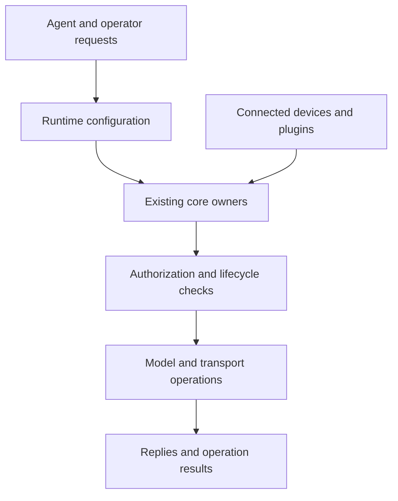

Codex review: needs maintainer review before merge. _Reviewed October 5, 2026, 9:36 AM ET / 13:36 UTC (Revision 3)._

# ClawSweeper review

## What this changes

The branch removes private forwarding helpers across agent execution, Gateway requests, message delivery, plugin loading, and updates while preserving their existing behavior.

## Merge readiness

✅ **Ready for maintainer review**

Keep open: the refactor remains useful, and no concrete introduced defect was found. The earlier migration-proof warning is unsupported by the current diff and should not remain a blocker. Required CI still gates landing.

Likely related people: steipete (medium-confidence routing) and obviyus (low-confidence routing), based on prior merged work.

**Priority:** P3
**Reviewed head:** `edf83589ba4f1af0bcfde27088830b4bd70edeec`

## Review scores

| Measure | Result | What it means |
|---|---|---|
| **Overall readiness** | 🐚 platinum hermit **(4/6)** | Useful, coherent cleanup with preserved owner boundaries and substantial reported validation; no actionable correctness finding remains. |
| **Proof confidence** | 🌊 off-meta tidepool | Not applicable: The verified trusted author is exempt from external-contributor runtime proof; reported focused tests are supplemental validation. The diff does not materially change authority or stored-data contracts, so neither additional authority proof nor migration proof is required. |
| **Patch quality** | 🐚 platinum hermit **(4/6)** | No actionable review findings were identified. |

## Verification

| Check | Result | Evidence |
|---|---|---|
| **Real behavior** | Not applicable | Not applicable: The verified trusted author is exempt from external-contributor runtime proof; reported focused tests are supplemental validation. The diff does not materially change authority or stored-data contracts, so neither additional authority proof nor migration proof is required. |
| **Evidence reviewed** | 8 items | Pinned introduction: Reviewed the merge-base-to-head delta, preserving the distinction between introduced edits and base-branch drift. The supplied test merge is stale relative to the pinned base; no claim that merging removes current-main behavior was made. Prior queue findings resolved by restoration: The current node-runtime-state module retains its private pruning helper and public read distinction and has no introduced delta. The historical Opengrep comments therefore do not establish an outstanding defect in this head. Preserved authorization boundary: The complete cross-context policy still rejects unguarded actions before target selection. Artifact HTTP callers supply the same classifiers, prefixes, callbacks, and rate-limit attribution to the existing transfer owner, which retains current-authorization checks after file opening and during streaming. Approval binding comparisons retain their ordering and mismatch outcomes. |
| **Findings** | None | None. |
| **Security** | None | None. |

## How this fits together

Core runtime owners turn agent requests, configuration, and connected-device state into model calls, messages, plugin operations, and update steps. This refactor moves parameter and result construction directly into those owners.

## Before merge

None.

<strong>Agent review details</strong>

### Security

None.

### PR surface

Source -1001, Tests +16, Other -1. Total -986 across 63 files.

View PR surface stats

| Area | Files | Added | Removed | Net |
|---|---:|---:|---:|---:|
| Source | 56 | 1726 | 2727 | -1001 |
| Tests | 6 | 44 | 28 | +16 |
| Docs | 0 | 0 | 0 | 0 |
| Config | 0 | 0 | 0 | 0 |
| Generated | 0 | 0 | 0 | 0 |
| Other | 1 | 1 | 2 | -1 |
| **Total** | **63** | **1771** | **2757** | **-986** |

### Review metrics

None.

### Technical review

Best possible solution:

Keep parameter construction with the existing runtime owners while preserving lazy loading, prompt bytes, wire contracts, authorization, and cleanup ordering.

Do we have a high-confidence way to reproduce the issue?

Not applicable: this PR proposes behavior-preserving cleanup rather than a reported runtime defect; no tests or target code were executed during this read-only review.

Is this the best way to solve the issue?

Yes: directly using the existing owners removes redundant projections without creating competing policy or API surfaces.

AGENTS.md: found and applied where relevant.

Codex review notes: model internal, reasoning medium; reviewed against [7dbeb96c3981](https://github.com/openclaw/openclaw/commit/7dbeb96c3981ad85bd4030c6ab2b8a3087d08cca).

### Labels

Label changes:

No label changes.

Label justifications:

- `P3`: This is internal cleanup with no intended user-visible behavior change or established urgent regression.
- `rating: 🐚 platinum hermit`: Overall readiness is 🐚 platinum hermit; proof is 🌊 off-meta tidepool and patch quality is 🐚 platinum hermit.
- `status: 👀 ready for maintainer look`: ClawSweeper has no concrete contributor-facing blocker left for this PR. Not applicable: The verified trusted author is exempt from external-contributor runtime proof; reported focused tests are supplemental validation. The diff does not materially change authority or stored-data contracts, so neither additional authority proof nor migration proof is required.

### Evidence

What I checked:

- **Pinned introduction:** Reviewed the merge-base-to-head delta, preserving the distinction between introduced edits and base-branch drift. The supplied test merge is stale relative to the pinned base; no claim that merging removes current-main behavior was made. ([edf83589ba4f](https://github.com/openclaw/openclaw/commit/edf83589ba4f1af0bcfde27088830b4bd70edeec))
- **Prior queue findings resolved by restoration:** The current node-runtime-state module retains its private pruning helper and public read distinction and has no introduced delta. The historical Opengrep comments therefore do not establish an outstanding defect in this head. ([`src/gateway/node-runtime-state.ts:24`](https://github.com/openclaw/openclaw/blob/edf83589ba4f1af0bcfde27088830b4bd70edeec/src/gateway/node-runtime-state.ts#L24), [edf83589ba4f](https://github.com/openclaw/openclaw/commit/edf83589ba4f1af0bcfde27088830b4bd70edeec))
- **Preserved authorization boundary:** The complete cross-context policy still rejects unguarded actions before target selection. Artifact HTTP callers supply the same classifiers, prefixes, callbacks, and rate-limit attribution to the existing transfer owner, which retains current-authorization checks after file opening and during streaming. Approval binding comparisons retain their ordering and mismatch outcomes. ([`src/gateway/worker-environments/artifact-transfer-http.ts:49`](https://github.com/openclaw/openclaw/blob/edf83589ba4f1af0bcfde27088830b4bd70edeec/src/gateway/worker-environments/artifact-transfer-http.ts#L49), [edf83589ba4f](https://github.com/openclaw/openclaw/commit/edf83589ba4f1af0bcfde27088830b4bd70edeec))
- **No introduced stored-data contract:** Session event construction remains an outbound projection with the same lifecycle filtering, tombstones, and active-run fields. Transcript mirror idempotency keys and update receipt matching are equivalent to their removed helpers. No schema, migration, persisted-format, or default change supports the previous generic upgrade-proof blocker. ([`src/gateway/session-event-payload.ts:10`](https://github.com/openclaw/openclaw/blob/edf83589ba4f1af0bcfde27088830b4bd70edeec/src/gateway/session-event-payload.ts#L10), [edf83589ba4f](https://github.com/openclaw/openclaw/commit/edf83589ba4f1af0bcfde27088830b4bd70edeec))
- **Retained wire coverage and completed cutover:** NodeRegistry tests retain observable input-frame and cancellation-frame assertions, including pairing-generation invalidation. Searches found no remaining references to the deleted DTO builders or forwarding modules. Changed artifact tests call the same production HTTP owner directly. ([`src/gateway/node-registry.test.ts:994`](https://github.com/openclaw/openclaw/blob/edf83589ba4f1af0bcfde27088830b4bd70edeec/src/gateway/node-registry.test.ts#L994), [edf83589ba4f](https://github.com/openclaw/openclaw/commit/edf83589ba4f1af0bcfde27088830b4bd70edeec))
- **Validation and trusted-author proof treatment:** The captured PR body reports 299 focused tests and both import-cycle checks passing on the reviewed head; its earlier build pass predates the final correction, and final local lint was interrupted. These are reported validation results, not reviewer execution or live proof. The security guard verifies steipete's admin access, so the external-contributor proof gate does not apply. No material authority change introduces a separate authority-proof requirement. ([edf83589ba4f](https://github.com/openclaw/openclaw/commit/edf83589ba4f1af0bcfde27088830b4bd70edeec))

Likely related people:

- **steipete:** Suggested for follow-up; no historical authorship or introduction is verified. (role: unverified routing candidate; confidence: low)
- **obviyus:** Suggested for follow-up; no historical authorship or introduction is verified. (role: unverified routing candidate; confidence: low)

### Rating scale

| Score | Internal tier | Crab rank | Meaning |
|---:|:---:|---|---|
| **6/6** | S | 🦀 challenger crab | Exceptional readiness |
| **5/6** | A | 🦞 diamond lobster | Very strong readiness |
| **4/6** | B | 🐚 platinum hermit | Good normal PR; ordinary maintainer review |
| **3/6** | C | 🦐 gold shrimp | Useful, but confidence is limited |
| **2/6** | D | 🦪 silver shellfish | Proof or implementation needs work |
| **1/6** | F | 🧂 unranked krab | Not merge-ready |
| N/A | NA | 🌊 off-meta tidepool | Rating does not apply |

Overall follows the weaker of proof and patch quality.
Shiny media proof means a screenshot, video, or linked artifact directly shows the changed behavior. Runtime, network, CSP, and security claims still need visible diagnostics.

### Workflow

- ClawSweeper keeps one durable marker-backed review comment per issue or PR.
- Re-runs edit this comment so the latest verdict, findings, and automation markers stay together instead of adding duplicate bot comments.
- A fresh review can be triggered by eligible `@clawsweeper re-review` comments, exact-item GitHub events, scheduled/background review runs, or manual workflow dispatch.
- PR/issue authors and users with repository write access can comment `@clawsweeper re-review` or `@clawsweeper re-run` on an open PR or issue to request a fresh review only.
- Maintainers can also comment `@clawsweeper review` to request a fresh review only.
- Fresh-review commands do not start repair, autofix, rebase, CI repair, or automerge.
- Maintainer-only repair and merge flows require explicit commands such as `@clawsweeper autofix`, `@clawsweeper automerge`, `@clawsweeper fix ci`, or `@clawsweeper address review`.
- Maintainers can comment `@clawsweeper explain` to ask for more context, or `@clawsweeper stop` to stop active automation.

### History

Review history (2 earlier review cycles)

<!-- clawsweeper-review-history v=1 total=2 -->
- reviewed 2026-10-05T12:26:03.601Z sha c085dec018381803ae67d032b04425bc119d8ea0 :: blocked before merge. :: none
- reviewed 2026-10-05T12:39:16.982Z sha c085dec018381803ae67d032b04425bc119d8ea0 :: blocked before merge. :: none

<!-- clawsweeper-verdict:needs-human item=165567 sha=edf83589ba4f1af0bcfde27088830b4bd70edeec confidence=high updated_at=2026-10-05T13:33:14Z reviewed_at=2026-10-05T13:36:14.385Z lease_owner=github-run-37317560803-1 lease_comment_id=5995526130 source_revision=e60c0a57e7732b9ea37261536ea6029ceabc23faa09ddcad9549a030e42c45bb live_verification=absent -->
<!-- clawsweeper-review-state:ready item=165567 sha=edf83589ba4f1af0bcfde27088830b4bd70edeec v=1 -->

<!-- clawsweeper-review-version item=165567 reviewed_at=2026-10-05T13:36:14.385Z sha=edf83589ba4f1af0bcfde27088830b4bd70edeec source_revision=e60c0a57e7732b9ea37261536ea6029ceabc23faa09ddcad9549a030e42c45bb lease_owner=github-run-37317560803-1 lease_comment_id=5995526130 v=1 -->

<!-- clawsweeper-review item=165567 -->