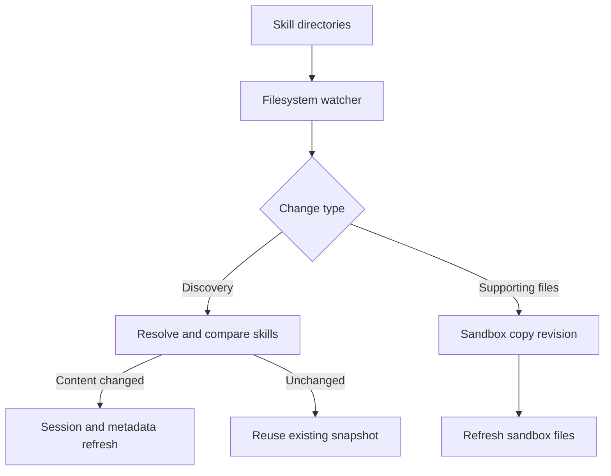

Codex review: needs maintainer review before merge. _Reviewed September 18, 2026, 7:35 AM ET / 11:35 UTC (Revision 4)._

# ClawSweeper review

## What this changes

Separates skill discovery, content changes, and supporting-file updates so unchanged skills avoid session rebuilds, chat metadata broadcasts, and repeated collision warnings.

## Merge readiness

✅ **Ready for maintainer review**

Keep open: the fix remains necessary on current main, and the reviewed patch has no actionable correctness findings. The merged watcher-residency fix addresses a separate problem.

**Priority:** P2
**Reviewed head:** `2995620749e9c99821bd7e6cfd448b2f325f2c8b`

## Review scores

| Measure | Result | What it means |
|---|---|---|
| **Overall readiness** | 🐚 platinum hermit **(4/6)** | A coherent owner-level repair with meaningful regression coverage and no blocking findings. |
| **Proof confidence** | 🌊 off-meta tidepool | Not applicable: The maintainer-authored internal refresh change is exempt from the external-contributor proof gate. Supplied regressions cover snapshot, sandbox-copy, and metadata owners; production observations describe the pre-fix problem, not an after-fix live result. |
| **Patch quality** | 🐚 platinum hermit **(4/6)** | No actionable review findings were identified. |

## Verification

| Check | Result | Evidence |
|---|---|---|
| **Real behavior** | Not applicable | Not applicable: The maintainer-authored internal refresh change is exempt from the external-contributor proof gate. Supplied regressions cover snapshot, sandbox-copy, and metadata owners; production observations describe the pre-fix problem, not an after-fix live result. |
| **Evidence reviewed** | 8 items | Current main and release still need the fix: Both fetched main and v2026.9.4 unconditionally publish snapshot-version bumps; clearing workspace state can promote a workspace version globally. Neither contains the proposed content comparison. Content publication stays with the refresh owner: Discovery revisions invalidate loading independently of published snapshot versions. Resolved names, configuration keys, sources, paths, and content hashes determine content publication; config and remote-node changes retain explicit invalidation. Sandbox freshness and upgrade boundary: Both sandbox reuse paths check the resource revision. The additional revision lives in the process-local cache; the persisted manifest shape remains unchanged. Supporting-file tests exercise the watcher-to-copy boundary. |
| **Findings** | None | None. |
| **Security** | None | None. |

## How this fits together

OpenClaw discovers skills from workspace, installed, and plugin directories and prepares them for agent sessions. Its refresh owner determines when sessions and chat metadata need rebuilding and when sandbox copies need updating.

## Before merge

None.

<strong>Agent review details</strong>

### Security

None.

### PR surface

Source +510, Tests +821, Docs +11, Other -1. Total +1341 across 22 files.

View PR surface stats

| Area | Files | Added | Removed | Net |
|---|---:|---:|---:|---:|
| Source | 10 | 790 | 280 | +510 |
| Tests | 10 | 926 | 105 | +821 |
| Docs | 1 | 12 | 1 | +11 |
| Config | 0 | 0 | 0 | 0 |
| Generated | 0 | 0 | 0 | 0 |
| Other | 1 | 0 | 1 | -1 |
| **Total** | **22** | **1728** | **387** | **+1341** |

### Review metrics

| Metric | Value | Why it matters |
|---|---|---|
| **Production versus regression coverage** | Production net +510 lines; tests net +821 lines | Production growth implements separate discovery, publication, and resource lifecycles; the tests protect their distinct observable outcomes. |

### Technical review

Best possible solution:

Keep content-based publication in the existing refresh owner while independently invalidating discovery and sandbox resources.

Do we have a high-confidence way to reproduce the issue?

Yes, from source: unchanged readiness reconciliation advances versions, and workspace disposal can invalidate unrelated workspaces on current main. No runtime reproduction was executed during this read-only review.

Is this the best way to solve the issue?

Yes. Comparing resolved content at the refresh owner preserves genuine updates while avoiding downstream work; separate resource revisions preserve sandbox asset freshness.

AGENTS.md: found and applied where relevant.

Codex review notes: model internal, reasoning medium; reviewed against [705856070e3a](https://github.com/openclaw/openclaw/commit/705856070e3ac46e9e12ba4d22f0c72d447edd64).

### Labels

Label justifications:

- `P2`: Addresses repeated skill loading and metadata refresh work on busy Gateways without evidence of an emergency outage.
- `rating: 🐚 platinum hermit`: Overall readiness is 🐚 platinum hermit; proof is 🌊 off-meta tidepool and patch quality is 🐚 platinum hermit.
- `status: 👀 ready for maintainer look`: ClawSweeper has no concrete contributor-facing blocker left for this PR. Not applicable: The maintainer-authored internal refresh change is exempt from the external-contributor proof gate. Supplied regressions cover snapshot, sandbox-copy, and metadata owners; production observations describe the pre-fix problem, not an after-fix live result.

### Evidence

What I checked:

- **Current main and release still need the fix:** Both fetched main and v2026.9.4 unconditionally publish snapshot-version bumps; clearing workspace state can promote a workspace version globally. Neither contains the proposed content comparison. ([`src/skills/runtime/refresh-state.ts:42`](https://github.com/openclaw/openclaw/blob/705856070e3ac46e9e12ba4d22f0c72d447edd64/src/skills/runtime/refresh-state.ts#L42), [705856070e3a](https://github.com/openclaw/openclaw/commit/705856070e3ac46e9e12ba4d22f0c72d447edd64))
- **Content publication stays with the refresh owner:** Discovery revisions invalidate loading independently of published snapshot versions. Resolved names, configuration keys, sources, paths, and content hashes determine content publication; config and remote-node changes retain explicit invalidation. ([`src/skills/runtime/refresh-state.ts:95`](https://github.com/openclaw/openclaw/blob/2995620749e9c99821bd7e6cfd448b2f325f2c8b/src/skills/runtime/refresh-state.ts#L95), [2995620749e9](https://github.com/openclaw/openclaw/commit/2995620749e9c99821bd7e6cfd448b2f325f2c8b))
- **Sandbox freshness and upgrade boundary:** Both sandbox reuse paths check the resource revision. The additional revision lives in the process-local cache; the persisted manifest shape remains unchanged. Supporting-file tests exercise the watcher-to-copy boundary. ([`src/skills/loading/workspace-skill-sync.runtime.ts:190`](https://github.com/openclaw/openclaw/blob/2995620749e9c99821bd7e6cfd448b2f325f2c8b/src/skills/loading/workspace-skill-sync.runtime.ts#L190), [2995620749e9](https://github.com/openclaw/openclaw/commit/2995620749e9c99821bd7e6cfd448b2f325f2c8b))
- **Observable regression coverage:** Coverage checks unchanged snapshot identity, instruction-only edits, installed skill identity changes, precedence changes, retirement/reacquisition, supporting-file copies, and metadata broadcasts. The captured PR body reports 606 passes and one platform skip on earlier head d73430b3012; this read-only review did not execute tests or establish production performance after the fix. ([`src/gateway/server-chat-metadata-lifecycle.test.ts:228`](https://github.com/openclaw/openclaw/blob/2995620749e9c99821bd7e6cfd448b2f325f2c8b/src/gateway/server-chat-metadata-lifecycle.test.ts#L228), [2995620749e9](https://github.com/openclaw/openclaw/commit/2995620749e9c99821bd7e6cfd448b2f325f2c8b))
- **Related work and review continuity:** The captured discussion identifies https://github.com/openclaw/openclaw/issues/144368 as the unchanged-readiness problem and https://github.com/openclaw/openclaw/pull/127204 as the merged subscription-limit fix. The latter does not implement content deduplication. The previous completed review contains no findings or published rank-up moves.
- **Historical routing:** Current-main history and GitHub commit patches connect steipete with watcher residency and recent loading work, and vincentkoc with snapshot refresh across process restarts. These are routing signals, not attribution of the reported defect. ([`src/skills/runtime/refresh-state.ts:39`](https://github.com/openclaw/openclaw/blob/1884cedd350e600469c1e5cd8fd90f21ec0bec85/src/skills/runtime/refresh-state.ts#L39), [1884cedd350e](https://github.com/openclaw/openclaw/commit/1884cedd350e600469c1e5cd8fd90f21ec0bec85))

Likely related people:

- **unknown:** The claimed source-line change could not be verified from bounded local history. (role: source history unknown; confidence: low)
- **unknown:** The claimed source-line change could not be verified from bounded local history. (role: source history unknown; confidence: low)

### Rating scale

| Score | Internal tier | Crab rank | Meaning |
|---:|:---:|---|---|
| **6/6** | S | 🦀 challenger crab | Exceptional readiness |
| **5/6** | A | 🦞 diamond lobster | Very strong readiness |
| **4/6** | B | 🐚 platinum hermit | Good normal PR; ordinary maintainer review |
| **3/6** | C | 🦐 gold shrimp | Useful, but confidence is limited |
| **2/6** | D | 🦪 silver shellfish | Proof or implementation needs work |
| **1/6** | F | 🧂 unranked krab | Not merge-ready |
| N/A | NA | 🌊 off-meta tidepool | Rating does not apply |

Overall follows the weaker of proof and patch quality.
Shiny media proof means a screenshot, video, or linked artifact directly shows the changed behavior. Runtime, network, CSP, and security claims still need visible diagnostics.

### Workflow

- ClawSweeper keeps one durable marker-backed review comment per issue or PR.
- Re-runs edit this comment so the latest verdict, findings, and automation markers stay together instead of adding duplicate bot comments.
- A fresh review can be triggered by eligible `@clawsweeper re-review` comments, exact-item GitHub events, scheduled/background review runs, or manual workflow dispatch.
- PR/issue authors and users with repository write access can comment `@clawsweeper re-review` or `@clawsweeper re-run` on an open PR or issue to request a fresh review only.
- Maintainers can also comment `@clawsweeper review` to request a fresh review only.
- Fresh-review commands do not start repair, autofix, rebase, CI repair, or automerge.
- Maintainer-only repair and merge flows require explicit commands such as `@clawsweeper autofix`, `@clawsweeper automerge`, `@clawsweeper fix ci`, or `@clawsweeper address review`.
- Maintainers can comment `@clawsweeper explain` to ask for more context, or `@clawsweeper stop` to stop active automation.

### History

Review history (3 earlier review cycles)

<!-- clawsweeper-review-history v=1 total=3 -->
- reviewed 2026-09-18T09:44:17.415Z sha df5bd84e1e9f8102344e33a69d855cffcad865f8 :: blocked before merge. :: none
- reviewed 2026-09-18T10:08:32.020Z sha 16f49b321164dc7024bc00cc00324b5cfbd7fcd2 :: needs maintainer review before merge. :: none
- reviewed 2026-09-18T11:03:33.666Z sha d73430b3012cc0cb365dc38b1a5a91bdfd42eeb2 :: needs maintainer review before merge. :: none

<!-- clawsweeper-verdict:needs-human item=151670 sha=2995620749e9c99821bd7e6cfd448b2f325f2c8b confidence=high updated_at=2026-09-18T11:31:52Z reviewed_at=2026-09-18T11:35:21.434Z lease_owner=github-run-35339887946-1 lease_comment_id=5729369752 source_revision=689b39ac486b2ff04187ccb84bbf02cc2eff8abba130254b33a94151c9c1a5b8 live_verification=absent -->
<!-- clawsweeper-review-state:ready item=151670 sha=2995620749e9c99821bd7e6cfd448b2f325f2c8b v=1 -->

<!-- clawsweeper-review-version item=151670 reviewed_at=2026-09-18T11:35:21.434Z sha=2995620749e9c99821bd7e6cfd448b2f325f2c8b source_revision=689b39ac486b2ff04187ccb84bbf02cc2eff8abba130254b33a94151c9c1a5b8 lease_owner=github-run-35339887946-1 lease_comment_id=5729369752 v=1 -->

<!-- clawsweeper-review item=151670 -->