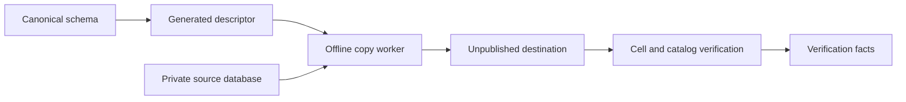

Codex review: needs changes before merge.

## What this changes

This PR adds internal verified SQLite/PostgreSQL copying, generated workboard descriptors, and a versioned export envelope.

**Example:** Copy a workboard containing 1,001 cards and notification cursor 9007199254740995 between database engines.
- **Before:** No verified internal cross-engine copy path exists.
- **After:** The worker copies into an unpublished destination and compares canonical cells, counts, allocation facts, and catalog definitions.

## Review scores

| Measure | Result | What it means |
|---|---|---|
| **Overall readiness** | 🦪 silver shellfish **(2/6)** | Useful approved foundations have meaningful PostgreSQL harness coverage, but the known canonical-ordering defect remains. |
| **Proof confidence** | 🦐 gold shrimp **(3/6)** | This maintainer-authored PR is outside the ordinary shipped-entry-point proof gate; the supplied PostgreSQL round-trip harness exercises internal copying, and no user-facing port entry point is enabled. |
| **Patch quality** | 🦪 silver shellfish **(2/6)** | 1 actionable review finding remain. |

## Product

**Kind:** Feature · **Worth it:** Yes · **Fix scope:** Complete
**User problem:** Existing populated workboard stores cannot yet move safely between SQLite and PostgreSQL.
**Reason:** The maintainer-authored direction supplies a distinct prerequisite and explicitly defers user-facing port enablement.

## Merge readiness

⛔ **Needs changes before merge - 1 item remains**

Keep this useful maintainer-authored PR open; the previously reported SQLite ordering defect still blocks merge.

**Priority:** P2
**Reviewed head:** `243996c0f1b7f3bc580638d3154ffde367045958`

## Before merge

- [ ] **Order SQLite pages by original source keys (P2)** - The previously reported defect remains unresolved. The SQLite projection aliases JSON-escaped text to the original column names, so ORDER BY resolves to escaped output. For valid keys `a"x` and `a0x`, SQLite reads `a0x` first while PostgreSQL C ordering reads `a"x` first, causing `Port canonical verification failed`. Across page boundaries, the decoded cursor can also revisit or skip rows because filtering and ordering use different representations. Add a source-table alias, qualify SQLite ordering and cursor keys through it, and extend the PostgreSQL round trip with escaped keys spanning a page boundary.

## Findings

- [P2] Order SQLite pages by original source keys — `src/infra/database-engine/port.worker.ts:116`

### Tests

- Missing end-to-end proof: The supplied round trip does not show a failing-before and passing-after regression for escaped text keys spanning a pagination boundary.

<strong>Agent review details</strong>

### How this fits together

The offline worker consumes caller-owned private databases and canonical descriptors, producing an unpublished destination and verification facts for later port orchestration.

### Technical review

Best possible solution:

Order SQLite pages by source-qualified canonical keys and cover escaped keys across page boundaries.

Do we have a high-confidence way to reproduce the issue?

Source inspection establishes the escaped-key ordering failure; no target code or tests were executed during this read-only review.

Is this the best way to solve the issue?

The foundations appropriately reuse canonical schema, SQLite primitive, and cell-encoding owners, but pagination must order original source keys.

Full review comments:

- [P2] Order SQLite pages by original source keys — `src/infra/database-engine/port.worker.ts:116`
  The previously reported defect remains unresolved. The SQLite projection aliases JSON-escaped text to the original column names, so ORDER BY resolves to escaped output. For valid keys `a"x` and `a0x`, SQLite reads `a0x` first while PostgreSQL C ordering reads `a"x` first, causing `Port canonical verification failed`. Across page boundaries, the decoded cursor can also revisit or skip rows because filtering and ordering use different representations. Add a source-table alias, qualify SQLite ordering and cursor keys through it, and extend the PostgreSQL round trip with escaped keys spanning a page boundary.
  Confidence: 0.99

Overall correctness: patch is incorrect
Overall confidence: 0.98

AGENTS.md: found and applied where relevant.

Codex review notes: model internal, reasoning medium; reviewed against [001e13bc4f7d](https://github.com/openclaw/openclaw/commit/001e13bc4f7d9ca3fb4c3b4437b693633769f345).

### Provenance checked

- `Workboard PostgreSQL generation` keeps the original intent (5e78ec6881c277fae9d4279e9315b5a1cc4b2925: Generate canonical workboard DDL while retaining namespace and admission-transaction ownership at the connection boundary.)
- `SQLite primitive ownership` keeps the original intent (30ae21fca71b56a22127b22f1462fbd002fafce3: Preserve allocation state and integrity during atomic STRICT migrations.)
- `Dialect ratchet classification` changes intended behavior with a stated reason (a1c1610b1907a3750f623297af19dedd425f7399: Prevent growth in SQLite-specific constructs; this PR records an accepted exception for centralized engine-maintenance primitives.)
- `Git backup cell encoding` keeps the original intent (37b4fc8621d98a3debbd2202d27f40aa039f386f: Produce deterministic versioned snapshots with lossless bigint and BLOB encoding.)
- `NUL-safe Git backup serialization` keeps the original intent (a036c70ee75d246e6c5d5e874e91dc159d12d6b1: Escape text before native reads while preserving original source-column ordering.)
- `Snapshot manifest parser visibility` changes intended behavior with a stated reason (c1d6d31855627b15e361dbdb41c802d6b26fd439: Keep implementation-only exports private; the new internal envelope reader now requires the existing parser.)

### Testing

Proof path: in-process harness.

### Security

None.

### Evidence

Acceptance criteria:

- node scripts/test-database-conformance.mjs --engine postgres --connection postgresql://postgres@127.0.0.1:5432/postgres -- src/infra/database-engine/port.test.ts --maxWorkers=1
- pnpm test src/snapshot/git-backup-codec.test.ts --maxWorkers=1
- git diff --check

What I checked:

- **Unresolved ordering defect:** SQLite text projections retain original column names as aliases, and ORDER BY uses those unqualified names; decoded source keys subsequently become pagination cursors. ([`src/infra/database-engine/port.worker.ts:116`](https://github.com/openclaw/openclaw/blob/243996c0f1b7f3bc580638d3154ffde367045958/src/infra/database-engine/port.worker.ts#L116), [243996c0f1b7](https://github.com/openclaw/openclaw/commit/243996c0f1b7f3bc580638d3154ffde367045958))
- **Previous finding remains:** The change since the previous reviewed head adds only an assertion-invariant comment and leaves the affected query unchanged. ([`src/infra/database-engine/port.worker.ts:140`](https://github.com/openclaw/openclaw/blob/243996c0f1b7f3bc580638d3154ffde367045958/src/infra/database-engine/port.worker.ts#L140), [243996c0f1b7](https://github.com/openclaw/openclaw/commit/243996c0f1b7f3bc580638d3154ffde367045958))
- **Existing source-ordering contract:** The Git backup serializer qualifies original source keys to avoid ordering escaped aliases, preserving the NUL-safe serialization work in https://github.com/openclaw/openclaw/pull/138327, reported by @ced-cm. ([`src/snapshot/git-backup-codec.ts:156`](https://github.com/openclaw/openclaw/blob/243996c0f1b7f3bc580638d3154ffde367045958/src/snapshot/git-backup-codec.ts#L156), [243996c0f1b7](https://github.com/openclaw/openclaw/commit/243996c0f1b7f3bc580638d3154ffde367045958))
- **Distinct foundations:** Fetched main has neither the port worker nor the export-envelope module; current reference searches find only test callers for their new APIs. ([`src/infra/database-engine/port.worker.ts:383`](https://github.com/openclaw/openclaw/blob/001e13bc4f7d9ca3fb4c3b4437b693633769f345/src/infra/database-engine/port.worker.ts#L383), [001e13bc4f7d](https://github.com/openclaw/openclaw/commit/001e13bc4f7d9ca3fb4c3b4437b693633769f345))
- **Accepted ratchet classification:** The maintainer-authored body explicitly accepts the primitive-owner exception; inspection confirms that only sqlite-strict.ts is listed and only its engine-maintenance matches are excluded from comparison. ([`scripts/check-database-dialect-ratchet.mts:41`](https://github.com/openclaw/openclaw/blob/243996c0f1b7f3bc580638d3154ffde367045958/scripts/check-database-dialect-ratchet.mts#L41), [243996c0f1b7](https://github.com/openclaw/openclaw/commit/243996c0f1b7f3bc580638d3154ffde367045958))
- **Existing-state compatibility:** Format-1 reading delegates to the existing parser, the extracted Git cell encoding preserves its implementation, and no runtime caller activates the new envelope or copy path. ([`src/snapshot/export-envelope.ts:73`](https://github.com/openclaw/openclaw/blob/243996c0f1b7f3bc580638d3154ffde367045958/src/snapshot/export-envelope.ts#L73), [243996c0f1b7](https://github.com/openclaw/openclaw/commit/243996c0f1b7f3bc580638d3154ffde367045958))

Likely related people:

- **Peter Steinberger:** Raw commit 5e78ec6881c277fae9d4279e9315b5a1cc4b2925 adds scripts/generate-postgres-schema.mts:17 relative to its recorded parents. This identifies author metadata, not feature responsibility or a PR merger. (role: source-line author; confidence: high; commits: [5e78ec6881c2](https://github.com/openclaw/openclaw/commit/5e78ec6881c277fae9d4279e9315b5a1cc4b2925); files: `scripts/generate-postgres-schema.mts`)
- **Ayaan Zaidi:** Raw commit a036c70ee75d246e6c5d5e874e91dc159d12d6b1 adds src/snapshot/git-backup-codec.ts:173 relative to its recorded parents. This identifies author metadata, not feature responsibility or a PR merger. (role: source-line author; confidence: medium; commits: [a036c70ee75d](https://github.com/openclaw/openclaw/commit/a036c70ee75d246e6c5d5e874e91dc159d12d6b1); files: `src/snapshot/git-backup-codec.ts`)
- **Vincent Koc:** Raw commit 2f25e9cba384acfc06cdf83640f236fdb7c1af33 adds src/snapshot/manifest.ts:245 relative to its recorded parents. This identifies author metadata, not feature responsibility or a PR merger. (role: source-line author; confidence: medium; commits: [2f25e9cba384](https://github.com/openclaw/openclaw/commit/2f25e9cba384acfc06cdf83640f236fdb7c1af33); files: `src/snapshot/manifest.ts`)

### PR surface

Source +648, Tests +668, Docs +1, Generated +1572, Other +69. Total +2958 across 19 files. Added test files: 3.

View PR surface stats

| Area | Files | Added | Removed | Net |
|---|---:|---:|---:|---:|
| Source | 6 | 673 | 25 | +648 |
| Tests | 6 | 670 | 2 | +668 |
| Docs | 1 | 1 | 0 | +1 |
| Config | 0 | 0 | 0 | 0 |
| Generated | 1 | 1572 | 0 | +1572 |
| Other | 5 | 90 | 21 | +69 |
| **Total** | **19** | **3006** | **48** | **+2958** |

### Labels

Label changes:

No label changes.

Label justifications:

- `P2`: Valid text keys can fail an internal port operation, but no runtime or CLI caller enables this path.
- `rating: 🦪 silver shellfish`: Overall readiness is 🦪 silver shellfish; proof is 🦐 gold shrimp and patch quality is 🦪 silver shellfish.
- `status: ⏳ waiting on author`: ClawSweeper has contributor-facing work open and is waiting for author action.

### Rating scale

6/6 🦀 challenger crab · 5/6 🦞 diamond lobster · 4/6 🐚 platinum hermit · 3/6 🦐 gold shrimp · 2/6 🦪 silver shellfish · 1/6 🧂 unranked krab. Overall follows the weaker of proof and patch quality; ✨ marks media proof (a screenshot, video, or linked artifact) that directly shows the changed behavior.

### Workflow

ClawSweeper edits this one comment on every review. Comment `@clawsweeper re-review` for a fresh review only. Repair and merge execution lanes are retired.

### History

Review history (3 earlier review cycles)

<!-- clawsweeper-review-history v=1 total=3 -->
- reviewed 2026-10-13T02:02:18.774Z sha 33161c2b86739c7173c5aadfc1ca56fc3c931c74 :: needs maintainer review before merge. :: none
- reviewed 2026-10-13T02:20:21.808Z sha 33161c2b86739c7173c5aadfc1ca56fc3c931c74 :: needs changes before merge. :: [P2] Order SQLite pages by original source keys
- reviewed 2026-10-13T03:22:39.403Z sha 92424ba70dc2f17afc31805c37d67e845e9f60cb :: needs changes before merge. :: [P2] Order SQLite pages by original source keys

_Reviewed October 12, 2026, 11:43 PM ET / October 13, 2026, 03:43 UTC (Revision 4)._

<!-- clawsweeper-verdict:needs-changes item=170518 sha=243996c0f1b7f3bc580638d3154ffde367045958 confidence=high updated_at=2026-10-13T03:39:56Z reviewed_at=2026-10-13T03:43:20.481Z lease_owner=github-run-38342682520-1 lease_comment_id=6137680652 source_revision=fa55d9445be97bbbf7802f37b53716975e289839d1ba8cd3b970fd853c1800be -->
<!-- clawsweeper-review-state:needs-changes item=170518 sha=243996c0f1b7f3bc580638d3154ffde367045958 v=1 -->

<!-- clawsweeper-review-version item=170518 reviewed_at=2026-10-13T03:43:20.481Z sha=243996c0f1b7f3bc580638d3154ffde367045958 source_revision=fa55d9445be97bbbf7802f37b53716975e289839d1ba8cd3b970fd853c1800be lease_owner=github-run-38342682520-1 lease_comment_id=6137680652 v=1 -->

<!-- clawsweeper-review item=170518 -->