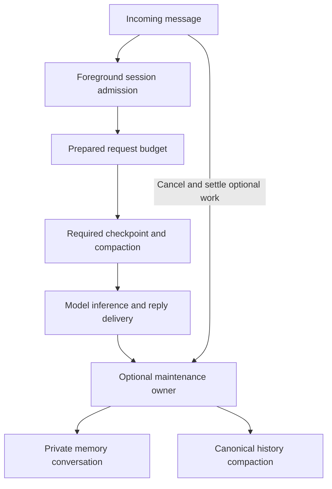

Codex review: blocked before merge. _Reviewed September 6, 2026, 2:21 PM ET / 18:21 UTC._

# ClawSweeper review

## What this changes

The PR sizes compaction around the incoming request, isolates memory housekeeping from conversation history, and schedules optional maintenance after foreground replies finish.

## Merge readiness

⛔ **Blocked before merge - 2 items remain**

The PR remains useful: current main still has the old compaction and memory-flush paths. The prior activity-projection finding is addressed, and no new blocking defect was found in the reviewed changes.

**Priority:** P1
**Reviewed head:** `62a7df7596bc94e1d9b1fbef1e2e3bccd632594d`

## Review scores

| Measure | Result | What it means |
|---|---|---|
| **Overall readiness** | 🐚 platinum hermit **(4/6)** | Useful owner-level repairs have substantive runtime evidence and focused regression coverage, with no blocking finding identified. |
| **Proof confidence** | 🦞 diamond lobster **(5/6)** | Sufficient (live_output): The supplied real-model CLI and native runs exercise private memory execution, exact subsequent human input, completed replies, and post-reply compaction settlement. Later coordinator changes have separately identified regression coverage; the omitted interruption-report ending remains a reviewer inspection limitation, not a new contributor proof defect. |
| **Patch quality** | 🐚 platinum hermit **(4/6)** | No actionable review findings were identified. |

## Verification

| Check | Result | Evidence |
|---|---|---|
| **Real behavior** | Verified | Sufficient (live_output): The supplied real-model CLI and native runs exercise private memory execution, exact subsequent human input, completed replies, and post-reply compaction settlement. Later coordinator changes have separately identified regression coverage; the omitted interruption-report ending remains a reviewer inspection limitation, not a new contributor proof defect. |
| **Evidence reviewed** | 8 items | Pinned introduction and clean checkout: Inspected the merge-base-to-head delta locally, including files omitted from the supplied bounded patches. The checkout is the recorded PR head; git diff --check passed and final git status remained clean. Current main still needs the central repair: Current main’s automatic compaction returns the old result contract without prepared request constraints. Its memory runner still dispatches against the original session identity. The newly introduced maintenance, private-memory, and request-budget files are absent from the inspected latest release tag v2026.9.2; no merged replacement for this combined behavior is established. Replacement validation belongs to the compaction owner: Before committing a replacement, the session checks retained pending input, estimates the complete replacement against the foreground budget, and revalidates context-replacement authority. Request sizing reuses the extracted existing pressure estimator; these are OpenClaw-owned implementation contracts. |
| **Findings** | None | None. |
| **Security** | None | None. |

## How this fits together

OpenClaw’s agent runtime combines conversation history, instructions, tools, and incoming messages for model inference. Compaction and memory maintenance manage that context while the session owner coordinates delivery, cancellation, and transcript writes.

## Before merge

- [ ] **Review config compatibility** - Confirm compatibility and upgrade impact for the changed config or default surface before merge.
- [ ] **Add data-model compatibility proof** - Confirm migration or upgrade compatibility proof before merge.

<strong>Agent review details</strong>

### Security

None.

### PR surface

PR surface statistics unavailable: the file list is incomplete.

### Review metrics

| Metric | Value | Why it matters |
|---|---|---|
| **Production versus regression coverage** | Production net +1,687 lines; tests/support net +4,331 lines | Production growth implements shared request budgeting and maintenance ownership, with substantial coverage for ordering, input preservation, and cancellation. |

### Stored data model

Persistent data-model change detected: `unknown-data-model-change: src/auto-reply/reply/memory-flush-session.ts`, `unknown-truncated-pull-files`, `vector/embedding metadata: src/auto-reply/reply/memory-flush-session.ts`. Confirm migration or upgrade compatibility proof before merge.

### Technical review

Best possible solution:

Keep request sizing and transcript replacement with their existing owners, with private memory execution and cancellable optional maintenance after delivery.

Do we have a high-confidence way to reproduce the issue?

Yes, the current-main source and supplied before/after runs establish concrete compaction-budget and utility-transcript failure paths; this read-only review did not execute them.

Is this the best way to solve the issue?

Yes, the patch repairs the owning request-budget and maintenance lifecycle boundaries while preserving manual compaction, source policy, and existing configuration.

AGENTS.md: found and applied where relevant.

Codex review notes: model internal, reasoning medium; reviewed against [7115aca8246f](https://github.com/openclaw/openclaw/commit/7115aca8246f214a82654ea370457676a23998c5).

### Labels

Label changes:

- remove `merge-risk: 🚨 session-state`: Current PR review selected no merge-risk labels.

Label justifications:

- `P1`: The repair addresses delayed agent replies and memory housekeeping leaking into subsequent human turns.
- `rating: 🐚 platinum hermit`: Overall readiness is 🐚 platinum hermit; proof is 🦞 diamond lobster and patch quality is 🐚 platinum hermit.
- `status: 👀 ready for maintainer look`: ClawSweeper has no concrete contributor-facing blocker left for this PR. Sufficient (live_output): The supplied real-model CLI and native runs exercise private memory execution, exact subsequent human input, completed replies, and post-reply compaction settlement. Later coordinator changes have separately identified regression coverage; the omitted interruption-report ending remains a reviewer inspection limitation, not a new contributor proof defect.
- `proof: sufficient`: Contributor real behavior proof is sufficient. The supplied real-model CLI and native runs exercise private memory execution, exact subsequent human input, completed replies, and post-reply compaction settlement. Later coordinator changes have separately identified regression coverage; the omitted interruption-report ending remains a reviewer inspection limitation, not a new contributor proof defect.

### Evidence

What I checked:

- **Pinned introduction and clean checkout:** Inspected the merge-base-to-head delta locally, including files omitted from the supplied bounded patches. The checkout is the recorded PR head; git diff --check passed and final git status remained clean. ([62a7df7596bc](https://github.com/openclaw/openclaw/commit/62a7df7596bc94e1d9b1fbef1e2e3bccd632594d))
- **Current main still needs the central repair:** Current main’s automatic compaction returns the old result contract without prepared request constraints. Its memory runner still dispatches against the original session identity. The newly introduced maintenance, private-memory, and request-budget files are absent from the inspected latest release tag v2026.9.2; no merged replacement for this combined behavior is established. ([`src/agents/sessions/agent-session-compaction.ts:77`](https://github.com/openclaw/openclaw/blob/7115aca8246f214a82654ea370457676a23998c5/src/agents/sessions/agent-session-compaction.ts#L77), [7115aca8246f](https://github.com/openclaw/openclaw/commit/7115aca8246f214a82654ea370457676a23998c5))
- **Replacement validation belongs to the compaction owner:** Before committing a replacement, the session checks retained pending input, estimates the complete replacement against the foreground budget, and revalidates context-replacement authority. Request sizing reuses the extracted existing pressure estimator; these are OpenClaw-owned implementation contracts. ([`src/agents/sessions/agent-session-compaction.ts:399`](https://github.com/openclaw/openclaw/blob/62a7df7596bc94e1d9b1fbef1e2e3bccd632594d/src/agents/sessions/agent-session-compaction.ts#L399), [62a7df7596bc](https://github.com/openclaw/openclaw/commit/62a7df7596bc94e1d9b1fbef1e2e3bccd632594d))
- **Private memory and fresh maintenance admission:** Memory execution receives a bounded, detached conversation with no persistence target. Optional maintenance waits for delivery settlement, obtains fresh session admission, verifies session identity and lifecycle revision, and rejects pending delivery before inference. Source policy remains separate from private execution identity. ([`src/agents/session-maintenance/run.ts:178`](https://github.com/openclaw/openclaw/blob/62a7df7596bc94e1d9b1fbef1e2e3bccd632594d/src/agents/session-maintenance/run.ts#L178), [62a7df7596bc](https://github.com/openclaw/openclaw/commit/62a7df7596bc94e1d9b1fbef1e2e3bccd632594d))
- **Nested dependency and stale-writer coverage:** The coordinator excludes owners dependent on active ancestors consistently for execution, reads, and foreground admission. Its tests cover external dependent siblings, nested independent siblings, released parents, real cleanup settlement, and retired assertions. The context-engine test also rejects retained rewrite callbacks before transcript access or publication after disposal. These tests were inspected, not executed in this review. ([`src/agents/session-maintenance/coordinator.ts:75`](https://github.com/openclaw/openclaw/blob/62a7df7596bc94e1d9b1fbef1e2e3bccd632594d/src/agents/session-maintenance/coordinator.ts#L75), [62a7df7596bc](https://github.com/openclaw/openclaw/commit/62a7df7596bc94e1d9b1fbef1e2e3bccd632594d))
- **Real behavior evidence and review continuity:** Captured body SHA-256 7bd079a2b008c2689bb91c9b799ea388ee960671ad9bb817dbc9ae43590578a0 reports matched real-model CLI runs with exact submitted input and zero extra canonical utility turns, plus actual Tauri replies followed by committed compaction and owner settlement. Measurements identify c82fa7647fa634be8053a99c3988926c5096189c and explicitly separate later coordinator validation. The update reports a fresh interruption case passing, but its excerpt ends mid-sentence and 3,152 body units remain omitted. GitHub retrieval failed, so that ending and the claimed byte identity were not independently verified. Earlier failed attempts remain failures; the available substantive runtime evidence is preserved.

Likely related people:

- **Peter Steinberger:** Suggested for follow-up; no historical authorship or introduction is verified. (role: unverified routing candidate; confidence: low)
- **Jialong(Bruce) Li:** Suggested for follow-up; no historical authorship or introduction is verified. (role: unverified routing candidate; confidence: low)

### Rating scale

| Score | Internal tier | Crab rank | Meaning |
|---:|:---:|---|---|
| **6/6** | S | 🦀 challenger crab | Exceptional readiness |
| **5/6** | A | 🦞 diamond lobster | Very strong readiness |
| **4/6** | B | 🐚 platinum hermit | Good normal PR; ordinary maintainer review |
| **3/6** | C | 🦐 gold shrimp | Useful, but confidence is limited |
| **2/6** | D | 🦪 silver shellfish | Proof or implementation needs work |
| **1/6** | F | 🧂 unranked krab | Not merge-ready |
| N/A | NA | 🌊 off-meta tidepool | Rating does not apply |

Overall follows the weaker of proof and patch quality.
Shiny media proof means a screenshot, video, or linked artifact directly shows the changed behavior. Runtime, network, CSP, and security claims still need visible diagnostics.

### Workflow

- ClawSweeper keeps one durable marker-backed review comment per issue or PR.
- Re-runs edit this comment so the latest verdict, findings, and automation markers stay together instead of adding duplicate bot comments.
- A fresh review can be triggered by eligible `@clawsweeper re-review` comments, exact-item GitHub events, scheduled/background review runs, or manual workflow dispatch.
- PR/issue authors and users with repository write access can comment `@clawsweeper re-review` or `@clawsweeper re-run` on an open PR or issue to request a fresh review only.
- Maintainers can also comment `@clawsweeper review` to request a fresh review only.
- Fresh-review commands do not start repair, autofix, rebase, CI repair, or automerge.
- Maintainer-only repair and merge flows require explicit commands such as `@clawsweeper autofix`, `@clawsweeper automerge`, `@clawsweeper fix ci`, or `@clawsweeper address review`.
- Maintainers can comment `@clawsweeper explain` to ask for more context, or `@clawsweeper stop` to stop active automation.

### History

Review history (13 earlier review cycles; latest 8 shown)

<!-- clawsweeper-review-history v=1 total=13 -->
- reviewed 2026-09-06T12:12:21.841Z sha 830c705bf31802a0cc8a1c68083600149e52310a :: blocked before merge. :: none
- reviewed 2026-09-06T12:36:41.423Z sha bbbad8fd512ac5a530939623b5ff7b31054a9712 :: blocked before merge. :: none
- reviewed 2026-09-06T13:06:35.732Z sha 781ea6fd7bf6c2bac33bdce9e20e22a01dcbc8a4 :: blocked before merge. :: none
- reviewed 2026-09-06T15:51:57.041Z sha c82fa7647fa634be8053a99c3988926c5096189c :: blocked before merge. :: none
- reviewed 2026-09-06T16:35:26.332Z sha 7e2dbd0f11653664c894fbddca90ce03ab729097 :: blocked before merge. :: none
- reviewed 2026-09-06T16:51:39.894Z sha 7e2dbd0f11653664c894fbddca90ce03ab729097 :: blocked before merge. :: none
- reviewed 2026-09-06T17:36:01.281Z sha 7e2dbd0f11653664c894fbddca90ce03ab729097 :: blocked before merge. :: none
- reviewed 2026-09-06T18:04:26.495Z sha 35bafa068bca428b7f95f2d8524e83f636205cf3 :: blocked before merge. :: none

<!-- clawsweeper-verdict:needs-human item=139822 sha=62a7df7596bc94e1d9b1fbef1e2e3bccd632594d confidence=high updated_at=2026-09-06T18:18:53Z reviewed_at=2026-09-06T18:21:49.683Z lease_owner=github-run-34051212626-1 lease_comment_id=5561200483 source_revision=feed022c7ad0afdd14fdae9285816c84162b28fd5478da40fc99acbb3559b099 live_verification=absent -->
<!-- clawsweeper-review-state:blocked item=139822 sha=62a7df7596bc94e1d9b1fbef1e2e3bccd632594d v=1 -->

<!-- clawsweeper-review-version item=139822 reviewed_at=2026-09-06T18:21:49.683Z sha=62a7df7596bc94e1d9b1fbef1e2e3bccd632594d source_revision=feed022c7ad0afdd14fdae9285816c84162b28fd5478da40fc99acbb3559b099 lease_owner=github-run-34051212626-1 lease_comment_id=5561200483 v=1 -->

<!-- clawsweeper-review item=139822 -->