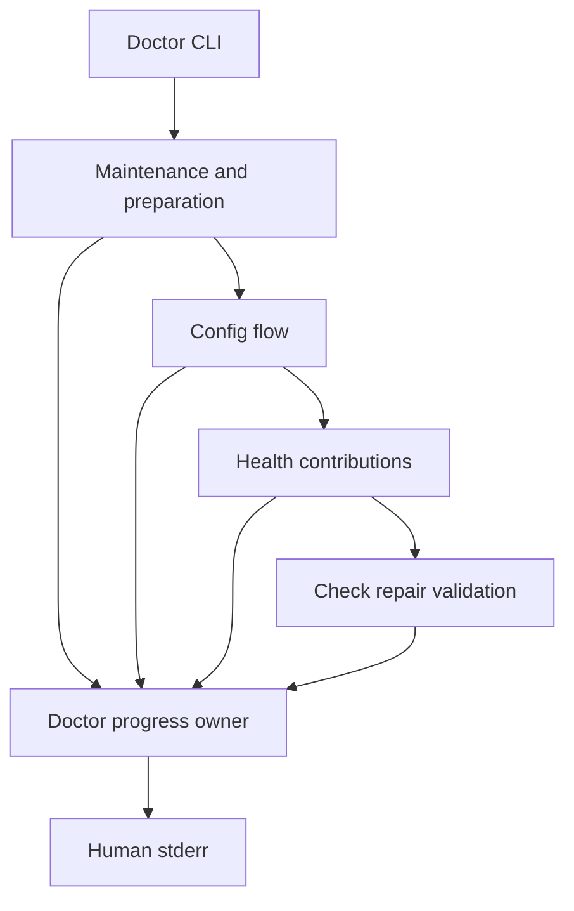

Codex review: needs changes before merge.

## What this changes

This PR adds section-start messages and 10-second elapsed-time updates to Doctor’s checks and repairs.

**Example:** A human-output Doctor contribution remains pending for 10 seconds.
- **Before:** The contribution runs without identifying the pending work.
- **After:** Stderr identifies the section and then prints an elapsed-time update.

## Review scores

| Measure | Result | What it means |
|---|---|---|
| **Overall readiness** | 🦐 gold shrimp **(3/6)** | Useful owner-approved reporting with real non-interactive CLI evidence, but the verified interactive prompt regression blocks merge. |
| **Proof confidence** | 🐚 platinum hermit **(4/6)** | This maintainer-authored PR is outside the ordinary contributor proof gate; its supplied isolated Doctor CLI run exercises non-interactive section output and a heartbeat through completion. |
| **Patch quality** | 🦐 gold shrimp **(3/6)** | 1 actionable review finding remain. |

## Product

**Kind:** Bug fix · **Worth it:** Yes · **Fix scope:** Complete
**User problem:** Long Doctor runs appear stalled because users cannot identify the pending checks or repairs.
**Reason:** The linked issue contains explicit maintainer approval for progress reporting, and this maintainer-authored PR keeps timeout and skip policies outside its scope.

## Merge readiness

⛔ **Needs changes before merge - 2 items remain**

Keep this PR open: it addresses the maintainer-approved Doctor reporting gap that remains on main.

**Priority:** P2
**Reviewed head:** `b874b54eb3f8b7c01110035752162a0fb14450fe`

## Before merge

- [ ] **Pause all active progress timers while interactive prompts await input (P2)** - Running interactive `openclaw doctor` and leaving the maintenance confirmation unanswered for more than 10 seconds causes this scope’s interval to write raw progress lines into the active Clack prompt. Config-flow, capability-consent, workspace-alias, and contribution prompts can likewise remain enclosed by active progress scopes; removing the former workspace `beforePrompt` callback also removes its existing protection. Coordinate prompt entry and exit with the shared progress owner so all enclosing heartbeats pause during input, rather than stopping only an innermost timer. This confirms the existing concern at https://github.com/openclaw/openclaw/pull/178767#discussion_r4330157408.
- [ ] **Explain or restore the original intent of Workspace prompt coordination** - 6e455104428f3a7c1dc2f0db2d96635b976701b7: The base explicitly calls progress.done before workspace confirmation; removing that coordination leaves the replacement and enclosing timers active.

## Findings

- [P2] Pause all active progress timers while interactive prompts await input — `src/flows/doctor-health.ts:188-195`

### Provenance

- `Workspace prompt coordination` changes intended behavior without addressing why it exists (6e455104428f3a7c1dc2f0db2d96635b976701b7: The base explicitly calls progress.done before workspace confirmation; removing that coordination leaves the replacement and enclosing timers active.)

### Tests

- Missing end-to-end proof: The supplied non-interactive CLI run does not cover leaving an interactive confirmation open across a heartbeat interval.

<strong>Agent review details</strong>

### How this fits together

Doctor orchestrates maintenance admission, backups, config preparation, health checks, repairs, and cleanup; the change reports these existing boundaries to stderr while suppressing progress in JSON mode.

### Technical review

Best possible solution:

Coordinate the existing Doctor progress owner with interactive prompts so enclosing heartbeats pause during operator input and resume afterward.

Do we have a high-confidence way to reproduce the issue?

Current-main source establishes the silent structured-check path, and the introduced wrappers establish heartbeat writes during pending confirmations; no target code was executed in this read-only review.

Is this the best way to solve the issue?

Reporting at the existing execution owners is a focused solution, provided progress yields the terminal to the existing prompt owner.

Full review comments:

- [P2] Pause all active progress timers while interactive prompts await input — `src/flows/doctor-health.ts:188-195`
  Running interactive `openclaw doctor` and leaving the maintenance confirmation unanswered for more than 10 seconds causes this scope’s interval to write raw progress lines into the active Clack prompt. Config-flow, capability-consent, workspace-alias, and contribution prompts can likewise remain enclosed by active progress scopes; removing the former workspace `beforePrompt` callback also removes its existing protection. Coordinate prompt entry and exit with the shared progress owner so all enclosing heartbeats pause during input, rather than stopping only an innermost timer. This confirms the existing concern at https://github.com/openclaw/openclaw/pull/178767#discussion_r4330157408.
  Confidence: 0.98

Overall correctness: patch is incorrect
Overall confidence: 0.96

AGENTS.md: found and applied where relevant.

Codex review notes: model internal, reasoning medium; reviewed against [bead2a8e5427](https://github.com/openclaw/openclaw/commit/bead2a8e542740f943fe57e8391e5e6c11e9773d).

### Provenance checked

- `Config-preflight progress` changes intended behavior with a stated reason (66dc9d1c1e25a19fa8ca0b5c497a1165e27cf316: The earlier progress wrapper made long migrations visible and preserved machine-readable output.)
- `Ordered contribution and repair execution` keeps the original intent (1ae0dfed4d14e539f5426159432a85314974ee06: The contribution split preserved registry order, lazy boundaries, repair ownership, and config-write sequencing; the new reporting retains those execution contracts.)
- `Startup repair and original-capture contracts` keeps the original intent (https://github.com/openclaw/openclaw/pull/170051: Admission must precede mutation, and admitted schema preparation must precede deletion-journal recovery; the moved code and reporting wrappers preserve that order and existing authority forwarding.)

### Testing

Proof path: shipped entry point.

### Security

None.

### Evidence

Acceptance criteria:

- pnpm test src/flows/doctor-health-contributions.availability.test.ts src/commands/doctor-prompter.test.ts --maxWorkers=1
- pnpm test src/commands/doctor-workspace-alias.test.ts src/flows/doctor-health-contributions.cancellation.test.ts --maxWorkers=1
- Exercise isolated interactive Doctor with a confirmation pending beyond 10 seconds, then answer and verify reporting resumes.
- git diff --check

What I checked:

- **Introduced patch:** The pinned introduction diff adds one progress owner and calls it from existing execution boundaries; it removes the old config spinner and workspace prompt-cleanup callback. ([`src/flows/doctor-health-startup.ts:19`](https://github.com/openclaw/openclaw/blob/b874b54eb3f8b7c01110035752162a0fb14450fe/src/flows/doctor-health-startup.ts#L19), [b874b54eb3f8](https://github.com/openclaw/openclaw/commit/b874b54eb3f8b7c01110035752162a0fb14450fe))
- **Current-main gap:** Current main still awaits structured detection, repair, and validation without default per-check progress. ([`src/flows/doctor-repair-flow.ts:54`](https://github.com/openclaw/openclaw/blob/bead2a8e542740f943fe57e8391e5e6c11e9773d/src/flows/doctor-repair-flow.ts#L54), [bead2a8e5427](https://github.com/openclaw/openclaw/commit/bead2a8e542740f943fe57e8391e5e6c11e9773d))
- **Verified interactive trigger:** The new maintenance-admission progress scope encloses prepareDoctorInteractiveMaintenance, which awaits a Clack confirmation; the interval writes directly to stderr until the entire scope settles. ([`src/flows/doctor-health.ts:188`](https://github.com/openclaw/openclaw/blob/b874b54eb3f8b7c01110035752162a0fb14450fe/src/flows/doctor-health.ts#L188), [b874b54eb3f8](https://github.com/openclaw/openclaw/commit/b874b54eb3f8b7c01110035752162a0fb14450fe))
- **Approved product scope:** On https://github.com/openclaw/openclaw/issues/154636, steipete approved Doctor-owned per-check progress without a new option and explicitly separated timeout and skip policies.
- **Contribution and existing review:** The PR credits MoerAI’s https://github.com/openclaw/openclaw/pull/175719 as superseded work; the existing comment at https://github.com/openclaw/openclaw/pull/178767#discussion_r4330157408 independently identifies the prompt-interference concern verified here.
- **Supplied runtime evidence:** The full PR body records an isolated real Doctor repair emitting section messages and a 10-second heartbeat before completing; the invocation is explicitly non-interactive. ([b874b54eb3f8](https://github.com/openclaw/openclaw/commit/b874b54eb3f8b7c01110035752162a0fb14450fe))

### PR surface

Source +113, Tests +84, Docs +4. Total +201 across 14 files. Added test files: 0.

View PR surface stats

| Area | Files | Added | Removed | Net |
|---|---:|---:|---:|---:|
| Source | 9 | 333 | 220 | +113 |
| Tests | 4 | 95 | 11 | +84 |
| Docs | 1 | 4 | 0 | +4 |
| Config | 0 | 0 | 0 | 0 |
| Generated | 0 | 0 | 0 | 0 |
| Other | 0 | 0 | 0 | 0 |
| **Total** | **14** | **432** | **231** | **+201** |

### Review metrics

| Metric | Value | Why it matters |
|---|---|---|
| **Production versus test changes** | Production +333/-220; tests +95/-11 | Growth supplies the shared timer and existing phase boundaries, with preparation moved into its startup owner and the superseded spinner removed. |

### Root-cause cluster

Relationship: `same_root_cause`
Canonical: https://github.com/openclaw/openclaw/issues/154636
Summary: This PR implements the canonical Doctor progress request and explicitly replaces the earlier contributor implementation.

Members:
- `canonical`: https://github.com/openclaw/openclaw/issues/154636 - Owns the approved Doctor progress requirement.
- `superseded`: https://github.com/openclaw/openclaw/pull/175719 - The current PR explicitly supersedes and credits this implementation.

Proposal only: this assessment does not dispatch repair, suppress jobs, mutate sibling items, close, or merge anything.

### Labels

Label changes:

- add `P2`: Doctor’s silent work creates recoverable user confusion; the introduced prompt-display defect has a bounded interactive impact.
- add `rating: 🦐 gold shrimp`: Overall readiness is 🦐 gold shrimp; proof is 🐚 platinum hermit and patch quality is 🦐 gold shrimp.
- add `status: ⏳ waiting on author`: ClawSweeper has contributor-facing work open and is waiting for author action.

Label justifications:

- `P2`: Doctor’s silent work creates recoverable user confusion; the introduced prompt-display defect has a bounded interactive impact.
- `rating: 🦐 gold shrimp`: Overall readiness is 🦐 gold shrimp; proof is 🐚 platinum hermit and patch quality is 🦐 gold shrimp.
- `status: ⏳ waiting on author`: ClawSweeper has contributor-facing work open and is waiting for author action.

### Rating scale

6/6 🦀 challenger crab · 5/6 🦞 diamond lobster · 4/6 🐚 platinum hermit · 3/6 🦐 gold shrimp · 2/6 🦪 silver shellfish · 1/6 🧂 unranked krab. Overall follows the weaker of proof and patch quality; ✨ marks media proof (a screenshot, video, or linked artifact) that directly shows the changed behavior.

### Workflow

ClawSweeper edits this one comment on every review. Comment `@clawsweeper re-review` for a fresh review only. Repair and merge execution lanes are retired.

_Reviewed October 20, 2026, 5:03 PM ET / 21:03 UTC._

<!-- clawsweeper-verdict:needs-changes item=178767 sha=b874b54eb3f8b7c01110035752162a0fb14450fe confidence=high updated_at=2026-10-20T20:59:47Z reviewed_at=2026-10-20T21:03:56.000Z lease_owner=github-run-39496544852-1 lease_comment_id=6301352052 source_revision=506b4224d347219fc278fd2f820feb047d9c182021c73ef6d77325eb0e8c17be -->
<!-- clawsweeper-review-state:needs-changes item=178767 sha=b874b54eb3f8b7c01110035752162a0fb14450fe v=1 -->

<!-- clawsweeper-review-version item=178767 reviewed_at=2026-10-20T21:03:56.000Z sha=b874b54eb3f8b7c01110035752162a0fb14450fe source_revision=506b4224d347219fc278fd2f820feb047d9c182021c73ef6d77325eb0e8c17be lease_owner=github-run-39496544852-1 lease_comment_id=6301352052 v=1 -->

<!-- clawsweeper-review item=178767 -->