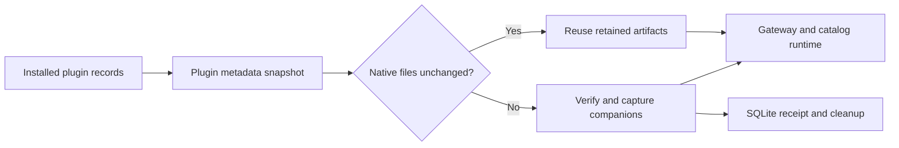

Codex review: blocked before merge. _Reviewed September 26, 2026, 8:03 AM ET / 12:03 UTC (Revision 5)._

# ClawSweeper review

## What this changes

The branch records native plugin admission receipts and reuses retained binaries and companion files so Gateway and model catalog startup avoid repeated reads of unchanged artifacts.

## Merge readiness

⛔ **Blocked before merge - 5 items remain**

Keep this PR open. Current main still repeats native plugin file reads, and the branch has credible evidence of a useful startup improvement. Its persisted admission contract and changed behavior on filesystems without file symlinks still need an explicit upgrade decision.

**Priority:** P2
**Reviewed head:** `06979007f0c8b8d635b5551e6151398a72f27e3b`
**Owner decision:** Required. See [Decision needed](#decision-needed).

## Review scores

| Measure | Result | What it means |
|---|---|---|
| **Overall readiness** | 🦐 gold shrimp **(3/6)** | The startup optimization has substantial source and runtime evidence, while its durable upgrade and restricted-filesystem contracts remain unresolved. |
| **Proof confidence** | 🐚 platinum hermit **(4/6)** | Sufficient (terminal): The PR body's Linux x64 Testbox trace exercises Gateway startup through the installed-index and plugin capture path and reports zero warm native reads after the change; final-head focused checks are supplemental. The measured runtime tree predates the final rebase, and an existing v2026.9.6 installation's upgrade, rollback, and retained receipt behavior remains unverified. |
| **Patch quality** | 🦐 gold shrimp **(3/6)** | No actionable review findings were identified. |

## Verification

| Check | Result | Evidence |
|---|---|---|
| **Real behavior** | Verified | Sufficient (terminal): The PR body's Linux x64 Testbox trace exercises Gateway startup through the installed-index and plugin capture path and reports zero warm native reads after the change; final-head focused checks are supplemental. The measured runtime tree predates the final rebase, and an existing v2026.9.6 installation's upgrade, rollback, and retained receipt behavior remains unverified. |
| **Evidence reviewed** | 10 items | Current main still reads native inputs: The current-main generation capture reads source or prior captured files into Buffers, writes copies, and hashes raw bytes; it has no native admission reuse path. Latest release retains the older path: The v2026.9.6 artifact capture also reads and hashes native input bytes; this PR's central optimization is neither on current main nor in that release. Persistent admission representation: The patch adds source admissions, captured paths, file identities, and namespace members to each installed-plugin index record. |
| **Findings** | None | None. |
| **Security** | None | None. |

## How this fits together

OpenClaw's plugin loader turns installed plugin records and source files into isolated runtime generations used by the Gateway and model catalog. This change adds reusable native-file facts to that path and stores their receipts in the shared SQLite state.

## Decision needed

| Question | Recommendation |
|---|---|
| Should this PR make persisted native admissions and the documented load error on file-symlink-restricted filesystems part of the plugin upgrade contract? | **Preserve loading compatibility:** Use a complete copied companion snapshot when file symlinks are unavailable, then prove upgrade and rollback of the stored receipts. |

Why: The branch changes retained state and can change whether an installed plugin loads; source review cannot authorize that compatibility tradeoff or substitute for a published-driver upgrade observation.

## Before merge

- [ ] **Resolve merge risk (P1)** - The new SQLite admission receipts and retained native roots lack a published v2026.9.6 updater-to-candidate test with an existing installed native plugin, including rollback and later cleanup.
- [ ] **Resolve merge risk (P1)** - A plugin whose native companion directory cannot be preserved without file symlinks now reports a load error; maintainers have not accepted that upgrade behavior or an operator recovery path.
- [ ] **Complete next step (P2)** - Record the retention and symlink-loading decision and verify an existing v2026.9.6 native plugin through candidate update and rollback before merge.
- [ ] **Resolve maintainer decision** - Resolve the maintainer decision shown above before merge.
- [ ] **Add data-model compatibility proof** - Confirm migration or upgrade compatibility proof before merge.

<strong>Agent review details</strong>

### Security

None.

### PR surface

Source +2345, Tests +1574, Docs +21, Other +14. Total +3954 across 62 files.

View PR surface stats

| Area | Files | Added | Removed | Net |
|---|---:|---:|---:|---:|
| Source | 38 | 2721 | 376 | +2345 |
| Tests | 22 | 1923 | 349 | +1574 |
| Docs | 1 | 23 | 2 | +21 |
| Config | 0 | 0 | 0 | 0 |
| Generated | 0 | 0 | 0 | 0 |
| Other | 1 | 14 | 0 | +14 |
| **Total** | **62** | **4681** | **727** | **+3954** |

### Review metrics

| Metric | Value | Why it matters |
|---|---|---|
| **Production versus test growth** | production net +2,345 lines; tests/support net +1,574 lines | The PR attributes production growth to durable receipt custody and complete companion namespaces, making the lifecycle and upgrade contract the main review focus. |

### Stored data model

Persistent data-model change detected: `migration/backfill/repair: src/commands/doctor-plugin-source-captures.ts`, `serialized state: src/plugins/test-helpers/installed-plugin-index.ts`, `serialized state: src/plugins/test-helpers/plugin-registry-snapshot.ts`, `unknown-data-model-change: src/commands/doctor-plugin-source-captures.ts`. Confirm migration or upgrade compatibility proof before merge.

### Merge-risk options

**Maintainer options:**
1. **Prove the upgrade and preserve fallback loading (recommended)**  
   Exercise a published v2026.9.6 installation through candidate startup and rollback, and retain a complete-copy path for filesystems without file symlinks.
2. **Accept a symlink requirement**  
   Approve the changed plugin-load behavior and document recovery, while still requiring published-driver upgrade and rollback proof.

### Technical review

Best possible solution:

Keep the bounded native-I/O improvement with one plugin admission owner, preserve loading through a complete-copy fallback where practical, and verify an existing installation's update and rollback before adopting durable receipts.

Do we have a high-confidence way to reproduce the issue?

Yes for repeated native-file I/O: current-main source reads and copies inputs during capture, and the PR records a matched Gateway startup trace. The reported ARM host's full startup and health-command delays were not reproduced here.

Is this the best way to solve the issue?

Unclear. Reusing facts at the plugin admission owner fits the existing architecture, but the persisted upgrade contract and symlink-restricted loading need a compatibility decision and published-driver proof.

AGENTS.md: found and applied where relevant.

Codex review notes: model internal, reasoning high; reviewed against [1197afde91d2](https://github.com/openclaw/openclaw/commit/1197afde91d2b42c5141fb8f3809e609fea7f6f1).

### Labels

Label changes:

No label changes.

Label justifications:

- `P2`: This is a measured plugin startup improvement with limited proven impact on the broader reported host latency.
- `merge-risk: 🚨 compatibility`: Persisted native admissions change the installed-index upgrade, rollback, and retained-capture contract.
- `merge-risk: 🚨 availability`: The patch intentionally rejects some native plugin loads when file symlinks are unavailable.
- `rating: 🦐 gold shrimp`: Overall readiness is 🦐 gold shrimp; proof is 🐚 platinum hermit and patch quality is 🦐 gold shrimp.
- `status: 👀 ready for maintainer look`: ClawSweeper has no concrete contributor-facing blocker left for this PR. Sufficient (terminal): The PR body's Linux x64 Testbox trace exercises Gateway startup through the installed-index and plugin capture path and reports zero warm native reads after the change; final-head focused checks are supplemental. The measured runtime tree predates the final rebase, and an existing v2026.9.6 installation's upgrade, rollback, and retained receipt behavior remains unverified.
- `proof: sufficient`: Contributor real behavior proof is sufficient. The PR body's Linux x64 Testbox trace exercises Gateway startup through the installed-index and plugin capture path and reports zero warm native reads after the change; final-head focused checks are supplemental. The measured runtime tree predates the final rebase, and an existing v2026.9.6 installation's upgrade, rollback, and retained receipt behavior remains unverified.

### Evidence

What I checked:

- **Current main still reads native inputs:** The current-main generation capture reads source or prior captured files into Buffers, writes copies, and hashes raw bytes; it has no native admission reuse path. ([`src/plugins/plugin-generation-artifact.ts:209`](https://github.com/openclaw/openclaw/blob/1197afde91d2b42c5141fb8f3809e609fea7f6f1/src/plugins/plugin-generation-artifact.ts#L209), [1197afde91d2](https://github.com/openclaw/openclaw/commit/1197afde91d2b42c5141fb8f3809e609fea7f6f1))
- **Latest release retains the older path:** The v2026.9.6 artifact capture also reads and hashes native input bytes; this PR's central optimization is neither on current main nor in that release. ([`src/plugins/plugin-generation-artifact.ts:212`](https://github.com/openclaw/openclaw/blob/eb377ac59e6c9fd6c7705028034812becf00271b/src/plugins/plugin-generation-artifact.ts#L212), [eb377ac59e6c](https://github.com/openclaw/openclaw/commit/eb377ac59e6c9fd6c7705028034812becf00271b))
- **Persistent admission representation:** The patch adds source admissions, captured paths, file identities, and namespace members to each installed-plugin index record. ([`src/plugins/installed-plugin-index-store.ts:55`](https://github.com/openclaw/openclaw/blob/06979007f0c8b8d635b5551e6151398a72f27e3b/src/plugins/installed-plugin-index-store.ts#L55), [06979007f0c8](https://github.com/openclaw/openclaw/commit/06979007f0c8b8d635b5551e6151398a72f27e3b))
- **Receipt publication guard:** The state-worker write checks the lifecycle lease and matches plugin ID, root directory, and install-record hash before replacing a stored receipt. ([`src/plugins/installed-plugin-index-store-write.ts:252`](https://github.com/openclaw/openclaw/blob/06979007f0c8b8d635b5551e6151398a72f27e3b/src/plugins/installed-plugin-index-store-write.ts#L252), [06979007f0c8](https://github.com/openclaw/openclaw/commit/06979007f0c8b8d635b5551e6151398a72f27e3b))
- **Native companion fallback:** When file symlink creation is denied, the loader tries a hardlink and rejects a generation whose companion directory cannot be preserved. ([`src/plugins/plugin-native-reference.ts:29`](https://github.com/openclaw/openclaw/blob/06979007f0c8b8d635b5551e6151398a72f27e3b/src/plugins/plugin-native-reference.ts#L29), [06979007f0c8](https://github.com/openclaw/openclaw/commit/06979007f0c8b8d635b5551e6151398a72f27e3b))
- **Restricted-filesystem test:** The new test explicitly expects a plugin-load error when file symlinks are denied for a native alias with a companion file. ([`src/plugins/plugin-module-generation.sibling-assets.test.ts:38`](https://github.com/openclaw/openclaw/blob/06979007f0c8b8d635b5551e6151398a72f27e3b/src/plugins/plugin-module-generation.sibling-assets.test.ts#L38), [06979007f0c8](https://github.com/openclaw/openclaw/commit/06979007f0c8b8d635b5551e6151398a72f27e3b))

Likely related people:

- **Peter Steinberger:** Suggested for follow-up; no historical authorship or introduction is verified. (role: unverified routing candidate; confidence: low)
- **RichSomeday222:** Suggested for follow-up; no historical authorship or introduction is verified. (role: unverified routing candidate; confidence: low)
- **Vyctor H. Brzezowski:** Suggested for follow-up; no historical authorship or introduction is verified. (role: unverified routing candidate; confidence: low)

### Rank-up moves

Optional improvements that raise the rating; they are not merge blockers.

- Record a published v2026.9.6 updater-to-candidate run with an existing native plugin, followed by rollback and cleanup verification.
- Obtain a maintainer decision on retained receipts and plugin loading when file symlinks are unavailable.

### Rating scale

| Score | Internal tier | Crab rank | Meaning |
|---:|:---:|---|---|
| **6/6** | S | 🦀 challenger crab | Exceptional readiness |
| **5/6** | A | 🦞 diamond lobster | Very strong readiness |
| **4/6** | B | 🐚 platinum hermit | Good normal PR; ordinary maintainer review |
| **3/6** | C | 🦐 gold shrimp | Useful, but confidence is limited |
| **2/6** | D | 🦪 silver shellfish | Proof or implementation needs work |
| **1/6** | F | 🧂 unranked krab | Not merge-ready |
| N/A | NA | 🌊 off-meta tidepool | Rating does not apply |

Overall follows the weaker of proof and patch quality.
Shiny media proof means a screenshot, video, or linked artifact directly shows the changed behavior. Runtime, network, CSP, and security claims still need visible diagnostics.

### Workflow

- ClawSweeper keeps one durable marker-backed review comment per issue or PR.
- Re-runs edit this comment so the latest verdict, findings, and automation markers stay together instead of adding duplicate bot comments.
- A fresh review can be triggered by eligible `@clawsweeper re-review` comments, exact-item GitHub events, scheduled/background review runs, or manual workflow dispatch.
- PR/issue authors and users with repository write access can comment `@clawsweeper re-review` or `@clawsweeper re-run` on an open PR or issue to request a fresh review only.
- Maintainers can also comment `@clawsweeper review` to request a fresh review only.
- Fresh-review commands do not start repair, autofix, rebase, CI repair, or automerge.
- Maintainer-only repair and merge flows require explicit commands such as `@clawsweeper autofix`, `@clawsweeper automerge`, `@clawsweeper fix ci`, or `@clawsweeper address review`.
- Maintainers can comment `@clawsweeper explain` to ask for more context, or `@clawsweeper stop` to stop active automation.

### History

Review history (4 earlier review cycles)

<!-- clawsweeper-review-history v=1 total=4 -->
- reviewed 2026-09-25T22:57:28.706Z sha 5e2eb616a5bd321d91491a3ee3bc059fb7fc6f9f :: blocked before merge. :: none
- reviewed 2026-09-26T00:19:08.188Z sha fb6191ecd71f527a44db0a01125a333a6bb2a587 :: blocked before merge. :: none
- reviewed 2026-09-26T10:40:03.739Z sha 82fab2e06f4550ef50069f7fca5e30d5a13a2f2d :: blocked before merge. :: none
- reviewed 2026-09-26T11:26:45.180Z sha 82fab2e06f4550ef50069f7fca5e30d5a13a2f2d :: blocked before merge. :: none

<!-- clawsweeper-verdict:needs-human item=158414 sha=06979007f0c8b8d635b5551e6151398a72f27e3b confidence=high updated_at=2026-09-26T11:59:04Z reviewed_at=2026-09-26T12:03:09.715Z lease_owner=github-run-36240409079-1 lease_comment_id=5846076790 source_revision=cf2497a11f425a7ec0eab8a1c682f3df4b4c8b45427f7aeceaf7b44f6a33116b live_verification=absent -->
<!-- clawsweeper-review-state:blocked item=158414 sha=06979007f0c8b8d635b5551e6151398a72f27e3b v=1 -->

<!-- clawsweeper-review-version item=158414 reviewed_at=2026-09-26T12:03:09.715Z sha=06979007f0c8b8d635b5551e6151398a72f27e3b source_revision=cf2497a11f425a7ec0eab8a1c682f3df4b4c8b45427f7aeceaf7b44f6a33116b lease_owner=github-run-36240409079-1 lease_comment_id=5846076790 v=1 -->

<!-- clawsweeper-review item=158414 -->