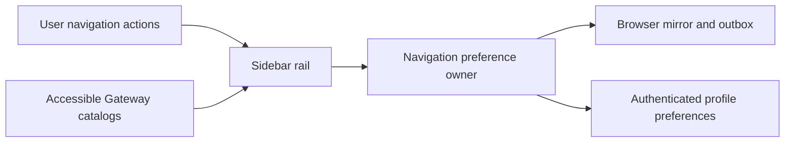

Codex review: needs maintainer review before merge.

## What this changes

This PR separates Pages, Sessions, and Online into a compact sidebar rail with personal shortcuts and profile-synchronized navigation preferences.

**Example:** Alex pins the Plugins page and collapses the desktop sidebar.
- **Before:** Collapsing hides navigation, and session pin actions change shared session metadata.
- **After:** The rail retains Alex’s shortcuts, and personal pin actions leave shared session metadata unchanged.

## Review scores

| Measure | Result | What it means |
|---|---|---|
| **Overall readiness** | 🐚 platinum hermit **(4/6)** | Approved user value, directly inspected browser evidence, and stable-upgrade coverage support landing; no actionable finding remains in the reviewed paths. |
| **Proof confidence** | 🦞 diamond lobster **(5/6)** ✨ media proof bonus | Sufficient (screenshot): Inspected actual Control UI browser captures showing the rail, collapse, narrow drawer, profileless fallback, and visible stable-outbox recovery; supplied interaction and upgrade results exercise the production UI with a mocked Gateway and synthetic identities. |
| **Patch quality** | 🐚 platinum hermit **(4/6)** | No actionable review findings were identified. |

## Product

**Kind:** Feature · **Worth it:** Yes · **Fix scope:** Complete
**User problem:** Destinations, conversations, and online people compete in one sidebar, and shared pins cannot express each person’s preferred navigation.
**Reason:** The collaborator-authored change implements recorded owner direction and provides personal navigation through the existing persistence owner.

## Merge readiness

✅ **Ready for maintainer review**

Keep this approved, collaborator-authored feature open; current main still uses shared session pins, and I found no actionable defect in the reviewed changes.

**Priority:** P2
**Reviewed head:** `968087f45c5aab2f66857f3343c2e145addffb0d`

## Before merge

None.

## Findings

None.

<strong>Agent review details</strong>

### How this fits together

The Control UI sidebar projects accessible Gateway sessions, plugin destinations, and people into navigation; the existing profile preference APIs persist personal references while browser storage retains local presentation and pending edits.

### Technical review

Best possible solution:

Land the approved personal-navigation cutover through the existing preference and session owners once the enforced current-head gates pass.

Do we have a high-confidence way to reproduce the issue?

This is a feature request; current-main source confirms the shared pin behavior being replaced, and supplied browser evidence demonstrates the proposed navigation.

Is this the best way to solve the issue?

The implementation follows the approved design by reusing authenticated profile preferences, preserving browser-local fallback, and keeping personal shortcuts separate from shared session promotion and archive actions.

AGENTS.md: found and applied where relevant.

Codex review notes: model internal, reasoning medium; reviewed against [9cf7fc279c26](https://github.com/openclaw/openclaw/commit/9cf7fc279c26cf3493b75e703aeadac6d0deb5ee).

### Provenance checked

- `Interleaved sidebar and shared session pinning` changes intended behavior with a stated reason (88e5af7097de5fdbc897e1ca622116fc289a1ee1: https://github.com/openclaw/openclaw/pull/110682 combined destinations and pinned sessions into an ordered zone while preserving unresolved references.)
- `Serialized configuration writes and recoverable acknowledgments` keeps the original intent (9eee6181d7b9983b6d75f86b5a1b924bcf3b6965: https://github.com/openclaw/openclaw/pull/116029 serialized settings mutations, bound them to the submitting connection, and distinguished commit success from refresh failure.)
- `Profile-owned preferences` keeps the original intent (a4c01c1a77acae8ffd9740bfbf53b5f8f7bbc78a: https://github.com/openclaw/openclaw/pull/130340 made appearance personal through the existing preference store and explicitly identified sidebar entries as a later extension of that seam.)

### Testing

Proof path: shipped entry point.

### Security

None.

### Evidence

What I checked:

- **Approved direction and active feature request:** The collaborator-authored PR implements the accepted navigation design in https://github.com/openclaw/openclaw/issues/168053; the issue and PR record owner approval, including the bounded Lit migration exception.
- **Current main retains the replaced behavior:** Current main’s sidebar pin action still calls the session organizer with a shared pinned mutation, so the personal-navigation cutover remains distinct work. ([`ui/src/components/app-sidebar.ts:351`](https://github.com/openclaw/openclaw/blob/9cf7fc279c26cf3493b75e703aeadac6d0deb5ee/ui/src/components/app-sidebar.ts#L351), [9cf7fc279c26](https://github.com/openclaw/openclaw/commit/9cf7fc279c26cf3493b75e703aeadac6d0deb5ee))
- **Profile write boundary:** Navigation writes recheck current ownership after reading preferences, rebase authored shortcut changes, and use expectedEntries through the existing authenticated users.prefs.set owner. ([`ui/src/app/server-prefs-profile-runtime.ts:112`](https://github.com/openclaw/openclaw/blob/968087f45c5aab2f66857f3343c2e145addffb0d/ui/src/app/server-prefs-profile-runtime.ts#L112), [968087f45c5a](https://github.com/openclaw/openclaw/commit/968087f45c5aab2f66857f3343c2e145addffb0d))
- **Stable pending-outbox compatibility:** The v2026.9.9 source confirms pending records lacked sidebarEntriesBase; adoption now captures only a valid same-profile pre-hydration baseline, while browser coverage exercises retained local choices, appearance draining, reload, and Unpin recovery. ([`ui/src/app/server-prefs.ts:148`](https://github.com/openclaw/openclaw/blob/968087f45c5aab2f66857f3343c2e145addffb0d/ui/src/app/server-prefs.ts#L148), [968087f45c5a](https://github.com/openclaw/openclaw/commit/968087f45c5aab2f66857f3343c2e145addffb0d))
- **Inspected browser evidence:** Inspected the supplied before/after sidebar images, collapsed rail, narrow drawer, profileless comparison, and stable-outbox recovery comparison; the actual Control UI uses synthetic data and a mocked Gateway, as disclosed in https://github.com/openclaw/openclaw/pull/168325#issuecomment-6095274135 and https://github.com/openclaw/openclaw/pull/168325#issuecomment-6101555259. ([`ui/src/e2e/sidebar-navigation-upgrade.e2e.test.ts:151`](https://github.com/openclaw/openclaw/blob/968087f45c5aab2f66857f3343c2e145addffb0d/ui/src/e2e/sidebar-navigation-upgrade.e2e.test.ts#L151), [968087f45c5a](https://github.com/openclaw/openclaw/commit/968087f45c5aab2f66857f3343c2e145addffb0d))
- **Re-review delta:** Git tree comparison and GitHub’s compare response identify only the readiness helper change since the previous reviewed head; production behavior is unchanged. ([`ui/src/test-helpers/control-ui-e2e.ts:231`](https://github.com/openclaw/openclaw/blob/968087f45c5aab2f66857f3343c2e145addffb0d/ui/src/test-helpers/control-ui-e2e.ts#L231), [968087f45c5a](https://github.com/openclaw/openclaw/commit/968087f45c5aab2f66857f3343c2e145addffb0d))

Likely related people:

- **Peter Steinberger:** Raw commit a4c01c1a77acae8ffd9740bfbf53b5f8f7bbc78a adds ui/src/app/server-prefs.ts:60 relative to its recorded parents. This identifies author metadata, not feature responsibility or a PR merger. (role: source-line author; confidence: high; commits: [a4c01c1a77ac](https://github.com/openclaw/openclaw/commit/a4c01c1a77acae8ffd9740bfbf53b5f8f7bbc78a); files: `ui/src/app/server-prefs.ts`)

### PR surface

PR surface statistics unavailable: the file list is incomplete.

### Review metrics

| Metric | Value | Why it matters |
|---|---|---|
| **Persistent navigation preference** | 1 new Mine/All setting; 2 profile navigation keys | navigationScope defaults to mine, while sidebarEntries moves to the existing profile preference store without adding a database table or raising the value limit. |

### Labels

Label changes:

- remove `merge-risk: 🚨 compatibility`: Current PR review selected no merge-risk labels.

Label justifications:

- `P2`: This is an approved navigation improvement with meaningful preference and upgrade behavior, without evidence of an urgent production outage.
- `rating: 🐚 platinum hermit`: Overall readiness is 🐚 platinum hermit; proof is 🦞 diamond lobster and patch quality is 🐚 platinum hermit.
- `status: 👀 ready for maintainer look`: ClawSweeper has no concrete contributor-facing blocker left for this PR.
- `proof: sufficient`: Contributor real behavior proof is sufficient.
- `proof: 📸 screenshot`: Contributor real behavior proof includes screenshot evidence.

### Rating scale

6/6 🦀 challenger crab · 5/6 🦞 diamond lobster · 4/6 🐚 platinum hermit · 3/6 🦐 gold shrimp · 2/6 🦪 silver shellfish · 1/6 🧂 unranked krab. Overall follows the weaker of proof and patch quality; ✨ marks media proof (a screenshot, video, or linked artifact) that directly shows the changed behavior.

### Workflow

ClawSweeper edits this one comment on every review. Comment `@clawsweeper re-review` for a fresh review only; repair and merge need explicit maintainer commands such as `@clawsweeper autofix` or `@clawsweeper automerge`.

### History

Review history (8 earlier review cycles)

<!-- clawsweeper-review-history v=1 total=8 -->
- reviewed 2026-10-10T08:07:04.443Z sha c951f53b24544d344b481bf0f9b24089e256a5a4 :: blocked before merge. :: [P2] Preserve visible sessions for resolved profileless connections
- reviewed 2026-10-10T09:05:44.542Z sha c951f53b24544d344b481bf0f9b24089e256a5a4 :: blocked before merge. :: [P2] Preserve visible sessions for resolved profileless connections | [P2] Migrate the split-pane browser flow off the removed Home row
- reviewed 2026-10-10T10:19:46.471Z sha c951f53b24544d344b481bf0f9b24089e256a5a4 :: blocked before merge. :: [P2] Preserve visible sessions for resolved profileless connections | [P2] Migrate browser flows off the removed Home row | [P2] Render Home draft and outbox indicators in the rail | [P3] Drive pinned-row styling from personal pin membership | [P3] Render each plugin child destination once in Pages
- reviewed 2026-10-10T10:45:09.164Z sha c951f53b24544d344b481bf0f9b24089e256a5a4 :: blocked before merge. :: [P2] Preserve visible sessions for resolved profileless connections | [P2] Migrate browser flows off the removed Home row | [P2] Render Home draft and outbox indicators in the rail | [P3] Drive pinned-row styling from personal pin membership | [P3] Render each plugin child destination once in Pages
- reviewed 2026-10-10T18:16:46.295Z sha 39b4a23ca999a352d722b222eced335ba9bb16bd :: blocked before merge. :: [P2] Reserve the child toggle when positioning mobile session actions | [P3] Render plugin child destinations only once in Pages | [P2] Restrict owner-roster assertions to roster requests | [P2] Update the remaining assertion for personal pin styling | [P2] Open Pages before returning to the X plugin destination
- reviewed 2026-10-10T19:06:12.697Z sha 1437c68307ff2225d2239011c11051843a353078 :: blocked before merge. :: [P2] Migrate pending navigation edits from the stable outbox format | [P2] Update the shard-routing assertion for the moved helper tests
- reviewed 2026-10-10T19:28:15.248Z sha e567f204cb14caa43f4373ede26c1d3d1a193dce :: blocked before merge. :: [P2] Migrate pending navigation edits from the stable outbox format
- reviewed 2026-10-10T20:33:33.050Z sha 86c43964f18a432c5ef7912bc6dcbf5b53b7ceb3 :: needs maintainer review before merge. :: none

_Reviewed October 10, 2026, 4:47 PM ET / 20:47 UTC (Revision 9)._

<!-- clawsweeper-verdict:needs-human item=168325 sha=968087f45c5aab2f66857f3343c2e145addffb0d confidence=high updated_at=2026-10-10T20:42:03Z reviewed_at=2026-10-10T20:47:17.136Z lease_owner=github-run-38084708035-1 lease_comment_id=6101970268 source_revision=9d057a22d885ffff54f6bda276124fea9145582fc3d3f7cbcf2429b36ffcf646 live_verification=absent hold=not_opted_in findings=0 -->
<!-- clawsweeper-review-state:ready item=168325 sha=968087f45c5aab2f66857f3343c2e145addffb0d v=1 -->

<!-- clawsweeper-review-version item=168325 reviewed_at=2026-10-10T20:47:17.136Z sha=968087f45c5aab2f66857f3343c2e145addffb0d source_revision=9d057a22d885ffff54f6bda276124fea9145582fc3d3f7cbcf2429b36ffcf646 lease_owner=github-run-38084708035-1 lease_comment_id=6101970268 v=1 -->

<!-- clawsweeper-review item=168325 -->