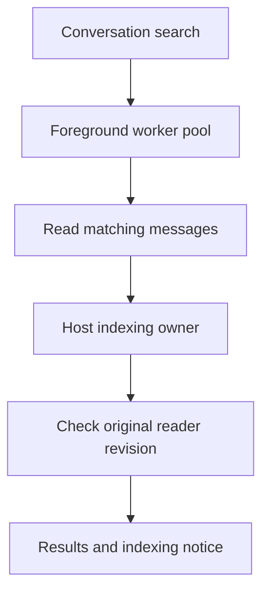

Codex review: needs maintainer review before merge. _Reviewed October 8, 2026, 8:01 AM ET / 12:01 UTC (Revision 3)._

# ClawSweeper review

## What this changes

Keeps each session search and its freshness check in one foreground worker task so independent searches can run in parallel with accurate indexing status.

**Example:** Search for needle while projection work and another foreground search are waiting
- **Before:** On main commit 888bd0, the search remained queued behind the projection worker until the reported 30-second cutoff.
- **After:** The candidate returned the expected hit with indexing: false in the reported 338 ms.

## Review scores

| Measure | Result | What it means |
|---|---|---|
| **Overall readiness** | 🐚 platinum hermit **(4/6)** | A useful, coherent repair supported by production-owner concurrency evidence and real-Gateway correctness proof. |
| **Proof confidence** | 🐚 platinum hermit **(4/6)** | Sufficient (live_output): The real search-owner comparison exercises foreground admission with occupied projection work and observes a correct hit with indexing false; GitHub blob identities preserve that production implementation on the reviewed head. Inspected screenshots and the recorded real-Gateway palette run support visible correctness, while worker cases cover foreign commits and settlement. No stored-data contract changes. |
| **Patch quality** | 🐚 platinum hermit **(4/6)** | No actionable review findings were identified. |

## Product

**Kind:** Bug fix · **Worth it:** Yes · **Fix scope:** Complete
**User problem:** Conversation searches can wait behind unrelated projection work despite available foreground reader capacity.
**Reason:** The change preserves the established accurate-readiness contract and restores the existing parallel-reader intent. It adds no user settings, persistent schema, or public API.

## Merge readiness

✅ **Ready for maintainer review**

Keep open: this PR retains useful concurrency work beyond the merged false-notice fix. The inspected patch and supplied behavior evidence support it, with no actionable review findings.

**Priority:** P2
**Reviewed head:** `e1f78a85f8300c3cc14141696927886f42191055`

## Before merge

None.

## Findings

None.

<strong>Agent review details</strong>

### How this fits together

Session search reads indexed conversation messages from SQLite for the Gateway and Control UI. A separate projection owner reports indexing readiness, while the search reader verifies that its original connection has not observed a changed snapshot.

### Technical review

Best possible solution:

Preserve connection-local freshness validation within the existing foreground worker task, with readiness and reconciliation still owned by the host.

Do we have a high-confidence way to reproduce the issue?

Yes: current main explicitly routes searches through the single projection lane, and the supplied controlled comparison demonstrates the resulting queueing. This read-only review did not execute the scenario.

Is this the best way to solve the issue?

Yes: keeping the paired reads in one existing foreground task repairs reader affinity without globally serializing searches or weakening stale-snapshot detection.

AGENTS.md: found and applied where relevant.

Codex review notes: model internal, reasoning medium; reviewed against [9360633c73f1](https://github.com/openclaw/openclaw/commit/9360633c73f1164c8f993ebedb385fcae77638c3).

### Provenance checked

- `src/config/sessions/session-transcript-search.ts: projection-lane routing` changes intended behavior with a stated reason (https://github.com/openclaw/openclaw/pull/167174: Keep hit reads and connection-local revision checks on one serialized reader to prevent false indexing notices.)
- `Search worker requests, dispatch, and readiness documentation` keeps the original intent (https://github.com/openclaw/openclaw/pull/165377: Consume writer-owned readiness facts while preserving the original search snapshot witness and read-only fallback.)
- `src/config/sessions/session-transcript-worker-runtime.ts: interactive reader requests` keeps the original intent (https://github.com/openclaw/openclaw/pull/153325: Move transcript hydration off-thread while retaining cancellation, reader fences, captured identity, and worker settlement.)

### Testing

Proof path: shipped entry point. Added test files: 3.

### Security

None.

### Evidence

What I checked:

- **Introduced production change:** The pinned introduced diff moves search off the projection lane and combines its query, host readiness exchange, and connection-local freshness check; the standalone freshness request is removed. ([`src/config/sessions/session-transcript.worker.ts:96`](https://github.com/openclaw/openclaw/blob/e1f78a85f8300c3cc14141696927886f42191055/src/config/sessions/session-transcript.worker.ts#L96), [e1f78a85f830](https://github.com/openclaw/openclaw/commit/e1f78a85f8300c3cc14141696927886f42191055))
- **Current main solves correctness through serialization:** Merged https://github.com/openclaw/openclaw/pull/167174 preserves connection-local correctness by putting both requests on the single projection lane. This PR retains that correctness while addressing the resulting foreground search serialization. ([`src/config/sessions/session-transcript-search.ts:284`](https://github.com/openclaw/openclaw/blob/888bd0d488aa8fd4453a98b3bcdbc692f262c125/src/config/sessions/session-transcript-search.ts#L284), [888bd0d488aa](https://github.com/openclaw/openclaw/commit/888bd0d488aa8fd4453a98b3bcdbc692f262c125))
- **No material current-main drift:** The fetched main and pinned base have no differences in the inspected session subtree, changed storage documentation, or palette test. ([9360633c73f1](https://github.com/openclaw/openclaw/commit/9360633c73f1164c8f993ebedb385fcae77638c3))
- **Cancellation retains admitted host work:** The runtime registers outstanding host exchanges with existing database custody and joins them before returning; database close already joins those registered effects. The pool pauses its worker timer during host exchange and resumes with the supplied timeout. ([`src/config/sessions/session-transcript-worker-runtime.ts:281`](https://github.com/openclaw/openclaw/blob/e1f78a85f8300c3cc14141696927886f42191055/src/config/sessions/session-transcript-worker-runtime.ts#L281), [e1f78a85f830](https://github.com/openclaw/openclaw/commit/e1f78a85f8300c3cc14141696927886f42191055))
- **Production-owner concurrency proof:** The complete PR body reports a controlled comparison through the real search API: main 888bd0 stayed blocked behind occupied projection work; candidate 47c2079 returned the expected hit with indexing false in 338 ms. Held work was released and joined. The durable regression passed in 725 ms, and routing search back to the projection lane failed at the native timeout. ([`src/config/sessions/session-transcript-search.worker.test.ts:265`](https://github.com/openclaw/openclaw/blob/47c20792621545364aca16670b1f1071d9cdc88e/src/config/sessions/session-transcript-search.worker.test.ts#L265), [47c207926215](https://github.com/openclaw/openclaw/commit/47c20792621545364aca16670b1f1071d9cdc88e))
- **Prior proof remains relevant to current production code:** GitHub contents reads at 47c2079 and the reviewed head returned identical blobs for search orchestration (0ec45ca4fa0db1f8aca38ee8a5a9f9f5aa5e0699), worker dispatch (ae4cc0f4f284a43447f6fb2075758f285afcd422), and runtime custody (c4387265a5d50fcc469da2052f8abfc7560c175b). The latest commit changes no production bytes in these owners. ([`src/config/sessions/session-transcript-search.ts:279`](https://github.com/openclaw/openclaw/blob/e1f78a85f8300c3cc14141696927886f42191055/src/config/sessions/session-transcript-search.ts#L279), [e1f78a85f830](https://github.com/openclaw/openclaw/commit/e1f78a85f8300c3cc14141696927886f42191055))

Likely related people:

- **Peter Steinberger:** Raw commit 359eb9c88f6700d76868c00e7677cc3e4a0e9b03 adds src/config/sessions/session-transcript-search.ts:71 relative to its recorded parents. This identifies author metadata, not feature responsibility or a PR merger. (role: source-line author; confidence: high; commits: [359eb9c88f67](https://github.com/openclaw/openclaw/commit/359eb9c88f6700d76868c00e7677cc3e4a0e9b03); files: `src/config/sessions/session-transcript-search.ts`)

### PR surface

Source +13, Tests +144, Docs +1. Total +158 across 11 files.

View PR surface stats

| Area | Files | Added | Removed | Net |
|---|---:|---:|---:|---:|
| Source | 7 | 107 | 94 | +13 |
| Tests | 3 | 194 | 50 | +144 |
| Docs | 1 | 3 | 2 | +1 |
| Config | 0 | 0 | 0 | 0 |
| Generated | 0 | 0 | 0 | 0 |
| Other | 0 | 0 | 0 | 0 |
| **Total** | **11** | **304** | **146** | **+158** |

### Root-cause cluster

Relationship: `fixed_by_candidate`
Canonical: https://github.com/openclaw/openclaw/issues/167130
Summary: The linked issue owns the connection-affinity defect; this candidate preserves its repair while restoring parallel search. The merged alternative addresses correctness through serialization.

Members:
- `canonical`: https://github.com/openclaw/openclaw/issues/167130 - The linked report defines the accurate indexing contract and connection mismatch.
- `partial_overlap`: https://github.com/openclaw/openclaw/pull/167174 - Merged correctness repair shares the same problem but leaves searches serialized on the projection lane.

Proposal only: this assessment does not dispatch repair, suppress jobs, mutate sibling items, close, or merge anything.

### Labels

Label changes:

- add `rating: 🐚 platinum hermit`: Overall readiness is 🐚 platinum hermit; proof is 🐚 platinum hermit and patch quality is 🐚 platinum hermit.
- remove `rating: 🦞 diamond lobster`: Current PR rating is `rating: 🐚 platinum hermit`, so this older rating label is no longer current.
- remove `proof: 📸 screenshot`: Current real behavior proof evidence kind is live_output.

Label justifications:

- `P2`: This restores bounded foreground search concurrency while preserving accurate readiness, without evidence of transcript loss or a blocked core workflow.
- `rating: 🐚 platinum hermit`: Overall readiness is 🐚 platinum hermit; proof is 🐚 platinum hermit and patch quality is 🐚 platinum hermit.
- `status: 👀 ready for maintainer look`: ClawSweeper has no concrete contributor-facing blocker left for this PR.
- `proof: sufficient`: Contributor real behavior proof is sufficient.

### Rating scale

6/6 🦀 challenger crab · 5/6 🦞 diamond lobster · 4/6 🐚 platinum hermit · 3/6 🦐 gold shrimp · 2/6 🦪 silver shellfish · 1/6 🧂 unranked krab. Overall follows the weaker of proof and patch quality; ✨ marks media proof (a screenshot, video, or linked artifact) that directly shows the changed behavior.

### Workflow

ClawSweeper edits this one comment on every review. Comment `@clawsweeper re-review` for a fresh review only; repair and merge need explicit maintainer commands such as `@clawsweeper autofix` or `@clawsweeper automerge`.

### History

Review history (2 earlier review cycles)

<!-- clawsweeper-review-history v=1 total=2 -->
- reviewed 2026-10-08T10:49:09.744Z sha a816e865bc92d91c344eebc990afe80f8dc4a329 :: needs maintainer review before merge. :: none
- reviewed 2026-10-08T11:03:19.071Z sha 47c20792621545364aca16670b1f1071d9cdc88e :: needs maintainer review before merge. :: none

<!-- clawsweeper-verdict:needs-human item=167163 sha=e1f78a85f8300c3cc14141696927886f42191055 confidence=high updated_at=2026-10-08T11:58:01Z reviewed_at=2026-10-08T12:01:18.877Z lease_owner=github-run-37773408492-1 lease_comment_id=6059345069 source_revision=c58bec5838388d72d1551f0b44edcf6a5579a8bf9e2ea6da4ad96686852b80dd live_verification=absent -->
<!-- clawsweeper-review-state:ready item=167163 sha=e1f78a85f8300c3cc14141696927886f42191055 v=1 -->

<!-- clawsweeper-review-version item=167163 reviewed_at=2026-10-08T12:01:18.877Z sha=e1f78a85f8300c3cc14141696927886f42191055 source_revision=c58bec5838388d72d1551f0b44edcf6a5579a8bf9e2ea6da4ad96686852b80dd lease_owner=github-run-37773408492-1 lease_comment_id=6059345069 v=1 -->

<!-- clawsweeper-review item=167163 -->