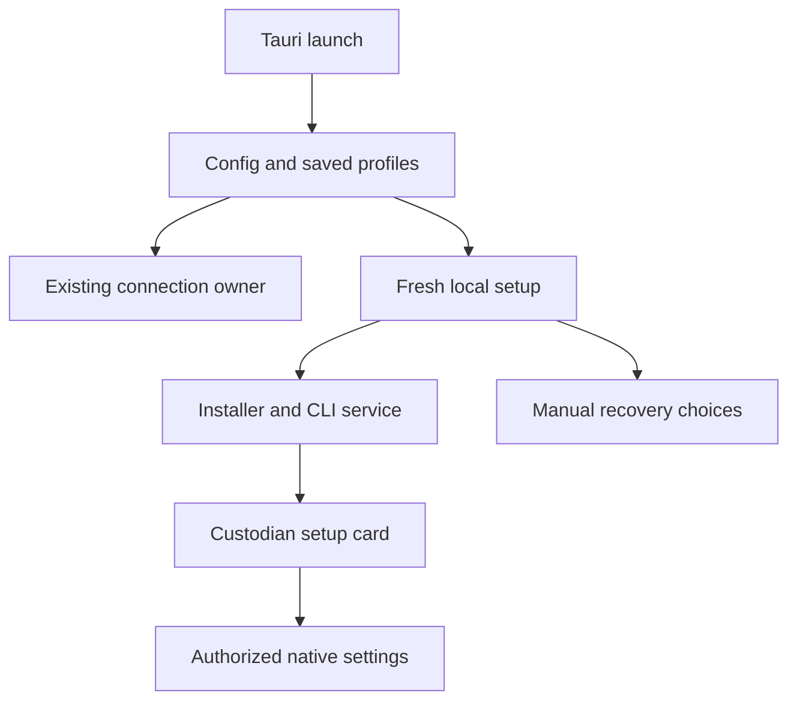

Codex review: blocked before merge.

## What this changes

This PR automatically prepares a local Gateway for fresh Linux and Windows Tauri installs and connects the shared setup card to native desktop actions.

**Example:** Launch the Linux Tauri app with no openclaw.json and no saved Gateway profiles.
- **Before:** The user chooses a local Gateway and installs it manually before reaching Model Setup.
- **After:** The app prepares the local Gateway and opens custodian onboarding, returning to visible local and remote choices if setup fails.

## Review scores

| Measure | Result | What it means |
|---|---|---|
| **Overall readiness** | 🦐 gold shrimp **(3/6)** | The patch is focused and has no actionable finding; native boundary evidence is useful, but packaged stable-upgrade compatibility is not established. |
| **Proof confidence** | 🦐 gold shrimp **(3/6)** | This maintainer-authored PR is outside the ordinary contributor proof gate; inspected native captures and the successful exact-head workflow support automatic Linux navigation and setup-card actions through real Tauri/WebKit with synthetic installer, service, and provider results, without claiming real Windows desktop installation. |
| **Patch quality** | 🐚 platinum hermit **(4/6)** | No actionable review findings were identified. |

## Product

**Kind:** Feature · **Worth it:** Yes · **Fix scope:** Complete
**User problem:** Fresh desktop users must perform local Gateway setup before reaching their assistant, and the shared setup card needs working Tauri actions.
**Reason:** The maintainer-approved change removes first-run setup clicks while preserving existing configuration, remote choices, explicit manual model setup, and visible failure recovery.

## Merge readiness

⛔ **Blocked before merge - 1 item remains**

Keep this PR open: it provides distinct, maintainer-approved desktop onboarding work, and review found no actionable code defect.

**Priority:** P2
**Reviewed head:** `efbf523281a6dc3c00866f4dd3e5064d325d76e8`

## Before merge

- [ ] **Add data-model compatibility proof** - The review found that existing stored data may not work after upgrade. Show that existing data still loads and works with this change.

## Findings

None.

### Tests

- Missing end-to-end proof: Show a packaged upgrade from v2026.10.2 preserving saved local and remote configuration, Gateway profiles, and runtime selection.

<strong>Agent review details</strong>

### How this fits together

The Tauri startup owner reads existing configuration and saved profiles, delegates provisioning to the existing installer and CLI service owners, and opens the Gateway-served Control UI; setup-card callbacks use the existing authenticated native settings transport.

### Technical review

Best possible solution:

Land the existing-owner implementation after validating stable-upgrade preservation, with inference selection remaining in its separate Gateway-owned change.

Do we have a high-confidence way to reproduce the issue?

This is an intentional feature change; fetched-main source confirms that fresh startup currently returns manual setup rather than invoking the new provisioning wrapper.

Is this the best way to solve the issue?

The implementation fits the existing ownership model: it reuses local setup and canonical CLI service operations, preserves configured installs, and adapts the existing native settings bridge.

AGENTS.md: found and applied where relevant.

Codex review notes: model internal, reasoning medium; reviewed against [10bdf2c2ab1f](https://github.com/openclaw/openclaw/commit/10bdf2c2ab1f65133461b2c3b487f5172934aa86).

### Provenance checked

- `Fresh startup and bundled-runtime consent` changes intended behavior with a stated reason (d9ccc498f15cab42ecd9dca21187c010f163f8b6: The bundled-runtime change kept startup and upgrades observational to preserve existing operator-selected runtimes; this PR deliberately adds provisioning only for absent config and profiles.)
- `Manual Model Setup routing` changes intended behavior with a stated reason (e70faf75400755fcc3fb9d6f8da8e62495d5a3ed: Manual setup required explicit provider choice and retained recoverable activation; this PR preserves that path and introduces a separate automatic first-run route.)
- `Saved connection and native document ownership` keeps the original intent (0fcaa5c27a73d5c9f1004ff0f802392d00bff634: Saved remote recovery and committed presentation must not implicitly start a local Gateway or replace healthy sessions; the fresh-install guard preserves those paths.)

### Testing

Proof path: shipped entry point.

### Security

None.

### Evidence

What I checked:

- **Pinned change and current-main boundary:** The introduced diff adds automatic setup around connect_selected; fetched main still returns its existing connection result without this first-run provisioning wrapper. ([`apps/linux/src-tauri/src/main.rs:755`](https://github.com/openclaw/openclaw/blob/efbf523281a6dc3c00866f4dd3e5064d325d76e8/apps/linux/src-tauri/src/main.rs#L755), [efbf523281a6](https://github.com/openclaw/openclaw/commit/efbf523281a6dc3c00866f4dd3e5064d325d76e8))
- **Existing-state exclusion:** Automatic setup requires absent configuration and no saved profiles, runs only for missingCli or unconfigured snapshots, and records setup errors for manual recovery. ([`apps/linux/src-tauri/src/first_run.rs:4`](https://github.com/openclaw/openclaw/blob/efbf523281a6dc3c00866f4dd3e5064d325d76e8/apps/linux/src-tauri/src/first_run.rs#L4), [efbf523281a6](https://github.com/openclaw/openclaw/commit/efbf523281a6dc3c00866f4dd3e5064d325d76e8))
- **Native final-effect authorization:** Panel requests reauthorize the current main WebView on the native thread immediately before navigation or opening Gateway management; destinations are fixed and preserve the selected Gateway base. ([`apps/linux/src-tauri/src/native_device_settings.rs:33`](https://github.com/openclaw/openclaw/blob/efbf523281a6dc3c00866f4dd3e5064d325d76e8/apps/linux/src-tauri/src/native_device_settings.rs#L33), [efbf523281a6](https://github.com/openclaw/openclaw/commit/efbf523281a6dc3c00866f4dd3e5064d325d76e8))
- **Inspected native captures:** Downloaded before and after images show the real Tauri window moving from manual Model Setup to the production setup card, including its unavailable-provider recovery action; the captures explicitly identify synthetic Gateway/provider data. ([efbf523281a6](https://github.com/openclaw/openclaw/commit/efbf523281a6dc3c00866f4dd3e5064d325d76e8))
- **Exact-head native workflow:** https://github.com/openclaw/openclaw/actions/runs/38308449630 completed successfully on the reviewed head, including the Linux native switching/onboarding step and Windows runtime/installer boundaries. Raw job-log retrieval was blocked by the allowlist at productionresultssa14.blob.core.windows.net; those logs were not inspected. ([`.github/workflows/linux-app.yml:172`](https://github.com/openclaw/openclaw/blob/efbf523281a6dc3c00866f4dd3e5064d325d76e8/.github/workflows/linux-app.yml#L172), [efbf523281a6](https://github.com/openclaw/openclaw/commit/efbf523281a6dc3c00866f4dd3e5064d325d76e8))
- **Exact-head CI:** The main CI run https://github.com/openclaw/openclaw/actions/runs/38309643632 succeeded on the reviewed head; paginated check reads found no failing check, and openclaw/ci-gate, dependency review, and security-sensitive review report success. ([efbf523281a6](https://github.com/openclaw/openclaw/commit/efbf523281a6dc3c00866f4dd3e5064d325d76e8))

Likely related people:

- **Peter Steinberger:** Raw commit ce5c1cb1b1d398778a8254f5ee12654b2436b1ad adds apps/linux/src-tauri/src/native\_browser\_bridge.rs:137 relative to its recorded parents. This identifies author metadata, not feature responsibility or a PR merger. (role: source-line author; confidence: high; commits: [ce5c1cb1b1d3](https://github.com/openclaw/openclaw/commit/ce5c1cb1b1d398778a8254f5ee12654b2436b1ad); files: `apps/linux/src-tauri/src/native_browser_bridge.rs`)
- **Vincent Koc:** Raw commit 0fcaa5c27a73d5c9f1004ff0f802392d00bff634 adds apps/linux/src-tauri/src/main.rs:688 relative to its recorded parents. This identifies author metadata, not feature responsibility or a PR merger. (role: source-line author; confidence: high; commits: [0fcaa5c27a73](https://github.com/openclaw/openclaw/commit/0fcaa5c27a73d5c9f1004ff0f802392d00bff634); files: `apps/linux/src-tauri/src/main.rs`)

### PR surface

Source +305, Tests +352, Docs +47, Config +1. Total +705 across 22 files. Added test files: 4.

View PR surface stats

| Area | Files | Added | Removed | Net |
|---|---:|---:|---:|---:|
| Source | 9 | 323 | 18 | +305 |
| Tests | 10 | 478 | 126 | +352 |
| Docs | 2 | 65 | 18 | +47 |
| Config | 1 | 1 | 0 | +1 |
| Generated | 0 | 0 | 0 | 0 |
| Other | 0 | 0 | 0 | 0 |
| **Total** | **22** | **867** | **162** | **+705** |

### Review metrics

| Metric | Value | Why it matters |
|---|---|---|
| **Native setup contract** | 1 added request type with 3 fixed destinations | The existing device-settings transport gains Gateway management, permissions, and AI setup requests without another credential or selection store. |

### Labels

Label changes:

- add `proof: 📸 screenshot`: Contributor real behavior proof includes screenshot evidence.

Label justifications:

- `P2`: This is a bounded desktop onboarding improvement with retained manual setup and recovery.
- `merge-risk: 🚨 compatibility`: Fresh startup changes from manual setup to automatic local provisioning; the direction is maintainer-approved, while preservation of existing configurations, profiles, and runtime choices across stable upgrade remains unverified.
- `rating: 🦐 gold shrimp`: Overall readiness is 🦐 gold shrimp; proof is 🦐 gold shrimp and patch quality is 🐚 platinum hermit.
- `proof: 📸 screenshot`: Contributor real behavior proof includes screenshot evidence.

### Rank-up moves

Optional improvements that raise the rating; they are not merge blockers.

- Demonstrate the v2026.10.2 packaged upgrade with existing configuration, profiles, and runtime selection intact.

### Rating scale

6/6 🦀 challenger crab · 5/6 🦞 diamond lobster · 4/6 🐚 platinum hermit · 3/6 🦐 gold shrimp · 2/6 🦪 silver shellfish · 1/6 🧂 unranked krab. Overall follows the weaker of proof and patch quality; ✨ marks media proof (a screenshot, video, or linked artifact) that directly shows the changed behavior.

### Workflow

ClawSweeper edits this one comment on every review. Comment `@clawsweeper re-review` for a fresh review only. Repair and merge execution lanes are retired.

### History

Review history (5 earlier review cycles)

<!-- clawsweeper-review-history v=1 total=5 -->
- reviewed 2026-10-12T01:47:51.199Z sha 565da4cda5faa3c212b5b531ffcb49f8beeb9490 :: blocked before merge. :: [P2] Update the startup boundary guard for automatic first run
- reviewed 2026-10-12T02:18:13.330Z sha 6c5d8e904c5d33d73ce9de10190a456480789689 :: blocked before merge. :: none
- reviewed 2026-10-12T02:42:54.451Z sha af2ced2b8c8cbd927fdbf6832abc1b6b46346e35 :: blocked before merge. :: none
- reviewed 2026-10-12T03:08:39.791Z sha af2ced2b8c8cbd927fdbf6832abc1b6b46346e35 :: blocked before merge. :: none
- reviewed 2026-10-12T21:13:32.847Z sha efbf523281a6dc3c00866f4dd3e5064d325d76e8 :: blocked before merge. :: none

_Reviewed October 12, 2026, 5:56 PM ET / 21:56 UTC (Revision 6)._

<!-- clawsweeper-verdict:needs-human item=169512 sha=efbf523281a6dc3c00866f4dd3e5064d325d76e8 confidence=high updated_at=2026-10-12T21:52:23Z reviewed_at=2026-10-12T21:56:53.532Z lease_owner=github-run-38313112205-1 lease_comment_id=6133283216 source_revision=3beb741d06c4a289ce8f4583bd15538e23c19ea54f4ba5ad33c890f33dff9715 hold=blocked findings=0 -->
<!-- clawsweeper-review-state:blocked item=169512 sha=efbf523281a6dc3c00866f4dd3e5064d325d76e8 v=1 -->

<!-- clawsweeper-review-version item=169512 reviewed_at=2026-10-12T21:56:53.532Z sha=efbf523281a6dc3c00866f4dd3e5064d325d76e8 source_revision=3beb741d06c4a289ce8f4583bd15538e23c19ea54f4ba5ad33c890f33dff9715 lease_owner=github-run-38313112205-1 lease_comment_id=6133283216 v=1 -->

<!-- clawsweeper-review item=169512 -->