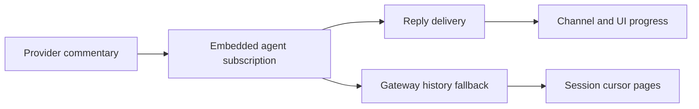

Codex review: needs changes before merge. _Reviewed August 24, 2026, 1:13 PM ET / 17:13 UTC._

# ClawSweeper review

## What this changes

This PR converts explicit native commentary into keyed progress items and adds bounded commentary rows to Gateway chat-history views.

## Regression provenance

Possible regression — suspected (reviewed change). No predecessor PR is attributed.

## Merge readiness

⚠️ **Ready for maintainer review - 3 items remain**

Keep open: generated commentary history rows lose their transcript sequence, so cursor pagination can report older history without a usable next cursor.

**Priority:** P1
**Reviewed head:** `e3590a67b7c44718fe08c5d718ae5343172f47b1`

## Review scores

| Measure | Result | What it means |
|---|---|---|
| **Overall readiness** | 🦐 gold shrimp **(3/6)** | The user-visible direction is well scoped, but the cursor-pagination regression blocks merge. |
| **Proof confidence** | 🌊 off-meta tidepool | Not applicable: Repository state identifies the author as a MEMBER, so the external-contributor proof gate does not apply; the PR body nevertheless records an exact-head Telegram run. |
| **Patch quality** | 🦐 gold shrimp **(3/6)** | 1 actionable review finding remain. |

## Verification

| Check | Result | Evidence |
|---|---|---|
| **Real behavior** | Not applicable | Not applicable: Repository state identifies the author as a MEMBER, so the external-contributor proof gate does not apply; the PR body nevertheless records an exact-head Telegram run. |
| **Evidence reviewed** | 7 items | Commentary owner boundary: The embedded subscription accumulates Responses commentary, and reply delivery converts it to keyed preamble items for consumers.<br>Pagination regression: The new fallback row is constructed without the source transcript __openclaw metadata, including seq.<br>Cursor invariant: Session pagination groups projected rows by __openclaw.seq and only emits a nextCursor when the page's first row has a sequence. |
| **Findings** | 1 actionable finding | [P1] Preserve transcript sequence metadata on commentary fallbacks |
| **Security** | None | None. |


### Live Verification

**Command:** `node scripts/run-vitest.mjs src/agents/embedded-agent-subscribe.subscribe-embedded-agent-session.reasoning-delivery.test.ts`

**Result:** FAIL (partial) — step 2 `expect_output` `projects commentary deltas into one cumulative keyed preamble`: `expected terminal output was not visible within 30 seconds: "projects commentary deltas into one cumulative keyed preamble"`

```text
node scripts/run-vitest.mjs src/agents/embedded-agent-subscribe.subscribe-embedded-agent-session.reasoning-delivery.test.ts
runner@runnervm76f27:/tmp/clawsweeper-live-proof-128793-fgeQul/target$ node scripts/run-vitest.mjs src/agents/embedded-agent-subscribe.subscribe-embedded-agent-
session.reasoning-delivery.test.ts
node scripts/run-vitest.mjs src/agents/embedded-agent-subscribe.subscribe-embedded-agent-session.reasoning-delivery.test.ts
[test] starting test/vitest/vitest.agents-core.config.ts

 RUN  v4.1.10 /tmp/clawsweeper-live-proof-128793-fgeQul/target

 ✓  agents-core  src/agents/embedded-agent-subscribe.subscribe-embedded-agent-session.reasoning-delivery.test.ts (21 tests) 119ms

 Test Files  1 passed (1)
      Tests  21 passed (21)
   Start at  17:14:03
   Duration  13.92s (transform 10.85s, setup 1.08s, import 12.33s, tests 119ms, environment 0ms)

[test] passed 1 Vitest shard in 20.01s
runner@runnervm76f27:/tmp/clawsweeper-live-proof-128793-fgeQul/target$ node scripts/run-vitest.mjs src/agents/embedded-agent-subscribe.subscribe-embedded-agent-
session.reasoning-delivery.test.ts
[test] starting test/vitest/vitest.agents-core.config.ts

 RUN  v4.1.10 /tmp/clawsweeper-live-proof-128793-fgeQul/target

 ✓  agents-core  src/agents/embedded-agent-subscribe.subscribe-embedded-agent-session.reasoning-delivery.test.ts (21 tests) 120ms

 Test Files  1 passed (1)
      Tests  21 passed (21)
   Start at  17:14:24
   Duration  6.23s (transform 3.42s, setup 470ms, import 5.40s, tests 120ms, environment 0ms)

[test] passed 1 Vitest shard in 12.41s
runner@runnervm76f27:/tmp/clawsweeper-live-proof-128793-fgeQul/target$


```

**Assertions:**

- FAIL `expect_output`: projects commentary deltas into one cumulative keyed preamble

## How this fits together

Embedded-agent commentary feeds reply delivery for channel and Control UI progress, while Gateway projections turn completed transcript records into paginated chat history. The change affects both the live progress path and history display rows.



## Before merge

- [ ] **Preserve transcript sequence metadata on commentary fallbacks (P1)** - The generated fallback row drops the source `__openclaw.seq`, but `buildSessionHistorySnapshot` now paginates these rows by that sequence. With a commentary record before a final record, a cursor page can contain only the unsequenced fallback, set `hasMore`, and omit `nextCursor`, making older history unreachable. Copy the source metadata (merging the truncation marker) and add a cursor/SSE regression.
- [ ] **Resolve merge risk (P2)** - A commentary fallback without the source sequence can strand older session history behind a page with hasMore but no nextCursor.
- [ ] **Complete next step (P2)** - The pagination failure has a narrow owner-boundary repair and focused regression path.

## Findings

- [P1] Preserve transcript sequence metadata on commentary fallbacks — `src/gateway/chat-display-projection.sanitize.ts:319-328`


<details>
<summary><strong>Agent review details</strong></summary>

### Security

None.

### PR surface

Source +67, Tests +257. Total +324 across 18 files.

<details>
<summary>View PR surface stats</summary>

| Area | Files | Added | Removed | Net |
|---|---:|---:|---:|---:|
| Source | 9 | 123 | 56 | +67 |
| Tests | 9 | 329 | 72 | +257 |
| Docs | 0 | 0 | 0 | 0 |
| Config | 0 | 0 | 0 | 0 |
| Generated | 0 | 0 | 0 | 0 |
| Other | 0 | 0 | 0 | 0 |
| **Total** | **18** | **452** | **128** | **+324** |

</details>

### Review metrics

| Metric | Value | Why it matters |
|---|---|---|
| **Production versus test LOC** | production +67, tests +257 | The bug-fix branch adds a generic presentation boundary, but the positive production growth includes the fallback path that currently violates cursor pagination. |

### Stored data model

Persistent data-model change detected: `serialized state: src/agents/embedded-agent-subscribe.subscribe-embedded-agent-session.reasoning-delivery.test.ts`, `serialized state: src/gateway/server-methods/server-methods.test.ts`, `serialized state: src/gateway/session-history-state.ts`, `serialized state: src/gateway/sessions-history-http.test.ts`, `vector/embedding metadata: src/gateway/server-methods/server-methods.test.ts`. Confirm migration or upgrade compatibility proof before merge.

### Merge-risk options

**Maintainer options:**
1. **Preserve fallback transcript identity (recommended)**  
   Copy the original __openclaw metadata into commentary fallback rows, merge any display-truncation marker, and prove cursor and SSE history pagination.

<details>
<summary>Copy recommended automerge instruction</summary>

```text
@clawsweeper automerge

Special instructions:
Preserve source __openclaw metadata on commentary fallback rows and add cursor and SSE pagination regressions.
```

</details>

### Technical review

Best possible solution:

Carry the source transcript metadata, especially __openclaw.seq, onto each generated fallback row and add cursor and SSE pagination regressions before merge.

Do we have a high-confidence way to reproduce the issue?

Yes—source inspection gives a deterministic case: a commentary record followed by a final record, queried with a cursor page limit, produces an unsequenced fallback page with no next cursor.

Is this the best way to solve the issue?

No—the live commentary normalization is at the right owner boundary, but the history fallback must retain the originating transcript identity to preserve pagination.

Full review comments:

- [P1] Preserve transcript sequence metadata on commentary fallbacks — `src/gateway/chat-display-projection.sanitize.ts:319-328`
  The generated fallback row drops the source `__openclaw.seq`, but `buildSessionHistorySnapshot` now paginates these rows by that sequence. With a commentary record before a final record, a cursor page can contain only the unsequenced fallback, set `hasMore`, and omit `nextCursor`, making older history unreachable. Copy the source metadata (merging the truncation marker) and add a cursor/SSE regression.
  Confidence: 0.98

Overall correctness: patch is incorrect
Overall confidence: 0.98

AGENTS.md: found and applied where relevant.

Codex review notes: model internal, reasoning high; reviewed against [dbf412074270](https://github.com/openclaw/openclaw/commit/dbf412074270f31015fd380e47bd56c81de5fde8).

### Labels

Label changes:

- add `P1`: The proposed history projection can make older session transcript pages unreachable through their public cursor.
- add `merge-risk: 🚨 compatibility`: The PR changes paginated chat-history output by adding derived assistant rows to existing client responses.
- add `merge-risk: 🚨 session-state`: The new derived history row drops the sequence needed to continue an existing session-history cursor.
- add `rating: 🦐 gold shrimp`: Overall readiness is 🦐 gold shrimp; proof is 🌊 off-meta tidepool and patch quality is 🦐 gold shrimp.
- add `status: ⏳ waiting on author`: ClawSweeper has contributor-facing work open and is waiting for author action. Not applicable: Repository state identifies the author as a MEMBER, so the external-contributor proof gate does not apply; the PR body nevertheless records an exact-head Telegram run.
- add `mantis: telegram-visible-proof`: Mantis should capture Telegram visible proof. The PR changes visible Telegram progress messages and can be demonstrated in a short Telegram Desktop flow.

Label justifications:

- `P1`: The proposed history projection can make older session transcript pages unreachable through their public cursor.
- `merge-risk: 🚨 compatibility`: The PR changes paginated chat-history output by adding derived assistant rows to existing client responses.
- `merge-risk: 🚨 session-state`: The new derived history row drops the sequence needed to continue an existing session-history cursor.
- `rating: 🦐 gold shrimp`: Overall readiness is 🦐 gold shrimp; proof is 🌊 off-meta tidepool and patch quality is 🦐 gold shrimp.
- `status: ⏳ waiting on author`: ClawSweeper has contributor-facing work open and is waiting for author action. Not applicable: Repository state identifies the author as a MEMBER, so the external-contributor proof gate does not apply; the PR body nevertheless records an exact-head Telegram run.
- `mantis: telegram-visible-proof`: Mantis should capture Telegram visible proof. The PR changes visible Telegram progress messages and can be demonstrated in a short Telegram Desktop flow.

### Evidence

Acceptance criteria:

- [P1] node scripts/run-vitest.mjs src/gateway/session-history-state.test.ts.
- [P1] node scripts/run-vitest.mjs src/gateway/server-methods/server-methods.test.ts.
- [P1] node scripts/run-vitest.mjs src/gateway/sessions-history-http.test.ts.
- [P1] pnpm check:changed.

What I checked:

- **Commentary owner boundary:** The embedded subscription accumulates Responses commentary, and reply delivery converts it to keyed preamble items for consumers. ([`src/agents/embedded-agent-subscribe.reply-delivery.ts:35`](https://github.com/openclaw/openclaw/blob/e3590a67b7c4/src/agents/embedded-agent-subscribe.reply-delivery.ts#L35), [e3590a67b7c4](https://github.com/openclaw/openclaw/commit/e3590a67b7c4))
- **Pagination regression:** The new fallback row is constructed without the source transcript __openclaw metadata, including seq. ([`src/gateway/chat-display-projection.sanitize.ts:319`](https://github.com/openclaw/openclaw/blob/e3590a67b7c4/src/gateway/chat-display-projection.sanitize.ts#L319), [e3590a67b7c4](https://github.com/openclaw/openclaw/commit/e3590a67b7c4))
- **Cursor invariant:** Session pagination groups projected rows by __openclaw.seq and only emits a nextCursor when the page's first row has a sequence. ([`src/gateway/session-history-state.ts:119`](https://github.com/openclaw/openclaw/blob/e3590a67b7c4/src/gateway/session-history-state.ts#L119), [e3590a67b7c4](https://github.com/openclaw/openclaw/commit/e3590a67b7c4))
- **Established feature history:** The shipped release notes identify prior Control UI/WebChat Codex commentary and preamble support and credit obviyus and ragesaq. Public docs: [`docs/releases/2026.7.1.md`](https://docs.openclaw.ai/releases/2026.7.1). ([`docs/releases/2026.7.1.md:65`](https://docs.openclaw.ai/releases/2026.7.1), [e3590a67b7c4](https://github.com/openclaw/openclaw/commit/e3590a67b7c4))
- **Current-main provenance check:** The PR head is not an ancestor of local main, so this work is neither implemented on current main nor in a local release tag. ([`src/gateway/chat-display-projection.sanitize.ts:319`](https://github.com/openclaw/openclaw/blob/e3590a67b7c4/src/gateway/chat-display-projection.sanitize.ts#L319), [e3590a67b7c4](https://github.com/openclaw/openclaw/commit/e3590a67b7c4))
- **History ownership:** Gateway display projection was substantially refactored by steipete in the recent bounded-projection work. ([`src/gateway/chat-display-projection.sanitize.ts:319`](https://github.com/openclaw/openclaw/blob/4e1f26dc1892/src/gateway/chat-display-projection.sanitize.ts#L319), [4e1f26dc1892](https://github.com/openclaw/openclaw/commit/4e1f26dc1892))

Likely related people:

- **obviyus:** The shipped commentary/preamble feature is credited to obviyus, and this PR continues that surface. (role: prior feature contributor and current feature owner; confidence: high; commits: [e3590a67b7c4](https://github.com/openclaw/openclaw/commit/e3590a67b7c44718fe08c5d718ae5343172f47b1); files: `docs/releases/2026.7.1.md`, `src/agents/embedded-agent-subscribe.reply-delivery.ts`)
- **ragesaq:** The shipped release notes credit ragesaq for the existing Control UI/WebChat commentary and preamble behavior. (role: prior feature contributor; confidence: medium; files: `docs/releases/2026.7.1.md`)
- **steipete:** Recent projection refactoring owns the bounded display and history boundary affected by the fallback row. (role: recent gateway projection refactor author; confidence: high; commits: [4e1f26dc1892](https://github.com/openclaw/openclaw/commit/4e1f26dc18920d8ce9cd01cf000e7908fb5d1209), [70876c9790ec](https://github.com/openclaw/openclaw/commit/70876c9790ec2e3733b7843a95e123ead762f412); files: `src/gateway/chat-display-projection.sanitize.ts`, `src/gateway/session-history-state.ts`)

### Rank-up moves

Optional improvements that raise the rating; they are not merge blockers.

- Preserve source transcript metadata on fallback rows and add the focused pagination regression.
- Rerun the affected Gateway history tests and the structured autoreview gate once TruffleHog is available.

### Rating scale

| Score | Internal tier | Crab rank | Meaning |
|---:|:---:|---|---|
| **6/6** | S | 🦀 challenger crab | Exceptional readiness |
| **5/6** | A | 🦞 diamond lobster | Very strong readiness |
| **4/6** | B | 🐚 platinum hermit | Good normal PR; ordinary maintainer review |
| **3/6** | C | 🦐 gold shrimp | Useful, but confidence is limited |
| **2/6** | D | 🦪 silver shellfish | Proof or implementation needs work |
| **1/6** | F | 🧂 unranked krab | Not merge-ready |
| N/A | NA | 🌊 off-meta tidepool | Rating does not apply |

Overall follows the weaker of proof and patch quality.
Shiny media proof means a screenshot, video, or linked artifact directly shows the changed behavior. Runtime, network, CSP, and security claims still need visible diagnostics.

### Workflow

- ClawSweeper keeps one durable marker-backed review comment per issue or PR.
- Re-runs edit this comment so the latest verdict, findings, and automation markers stay together instead of adding duplicate bot comments.
- A fresh review can be triggered by eligible `@clawsweeper re-review` comments, exact-item GitHub events, scheduled/background review runs, or manual workflow dispatch.
- PR/issue authors and users with repository write access can comment `@clawsweeper re-review` or `@clawsweeper re-run` on an open PR or issue to request a fresh review only.
- Maintainers can also comment `@clawsweeper review` to request a fresh review only.
- Fresh-review commands do not start repair, autofix, rebase, CI repair, or automerge.
- Maintainer-only repair and merge flows require explicit commands such as `@clawsweeper autofix`, `@clawsweeper automerge`, `@clawsweeper fix ci`, or `@clawsweeper address review`.
- Maintainers can comment `@clawsweeper explain` to ask for more context, or `@clawsweeper stop` to stop active automation.

</details>

<!-- clawsweeper-verdict:needs-human item=128793 sha=e3590a67b7c44718fe08c5d718ae5343172f47b1 confidence=high updated_at=2026-08-24T17:08:42Z reviewed_at=2026-08-24T17:13:11.264Z lease_owner=github-run-32754796085-1 lease_comment_id=5398659055 source_revision=95cadc2f03bd8425bfdb14b749b418eba6c1d2253b779a8ca7e6a1d2f9d7e9ed -->

<!-- clawsweeper-review-version item=128793 reviewed_at=2026-08-24T17:13:11.264Z sha=e3590a67b7c44718fe08c5d718ae5343172f47b1 source_revision=95cadc2f03bd8425bfdb14b749b418eba6c1d2253b779a8ca7e6a1d2f9d7e9ed lease_owner=github-run-32754796085-1 lease_comment_id=5398659055 v=1 -->

<!-- clawsweeper-review item=128793 -->