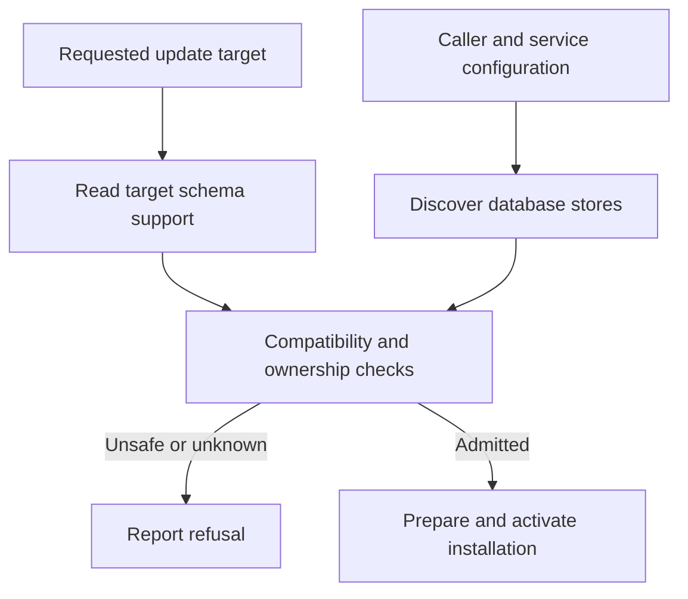

Codex review: blocked before merge. _Reviewed September 6, 2026, 3:26 AM ET / 07:26 UTC._

# ClawSweeper review

## What this changes

The updater checks caller and managed-service databases before installation changes, stages Git target inspection separately, and refuses updates when compatibility or service ownership cannot be established.

## Merge readiness

⛔ **Blocked before merge - 4 items remain**

This remains useful, maintainer-owned work: current main still lacks the complete configured-store admission added here. The related merged updater changes do not establish that this PR is redundant. No blocking introduced defect was established.

**Priority:** P2
**Reviewed head:** `549abf7807afb1da92ad9db5c02207718c0d803b`

## Review scores

| Measure | Result | What it means |
|---|---|---|
| **Overall readiness** | 🐚 platinum hermit **(4/6)** | A coherent safety repair with meaningful regression coverage and no established blocking defect; current-main integration still needs validation. |
| **Proof confidence** | 🌊 off-meta tidepool | Not applicable: The ordinary contributor-proof gate does not apply to this MEMBER-authored PR. The reported exact-head database API observation remains qualified positive evidence; source inspection did not establish a specific unresolved authority violation requiring the prior blanket service/Git recording gate. |
| **Patch quality** | 🐚 platinum hermit **(4/6)** | No actionable review findings were identified. |

## Verification

| Check | Result | Evidence |
|---|---|---|
| **Real behavior** | Not applicable | Not applicable: The ordinary contributor-proof gate does not apply to this MEMBER-authored PR. The reported exact-head database API observation remains qualified positive evidence; source inspection did not establish a specific unresolved authority violation requiring the prior blanket service/Git recording gate. |
| **Evidence reviewed** | 8 items | Pinned introduction and clean checkout: The checkout matches the supplied original head. The reviewed delta is 932886441a348cca7d5128300cc2c030d8445660..549abf7807afb1da92ad9db5c02207718c0d803b. Initial and final status were clean, and git diff --check reported no whitespace errors. Distinct work remains on current main: Current main still calls database preflight with only environment and supported versions; it does not supply this PR’s configured candidate inventory or caller/service union. The supplied merged records for https://github.com/openclaw/openclaw/pull/138868 and https://github.com/openclaw/openclaw/pull/138839 concern read preservation and candidate activation respectively. Inventory does not grant migration ownership: The changed schema wrapper supplies configured paths as inspection candidates and explicitly passes an empty configured migration-owner list. Database preflight retains registered external paths and uses the existing artifact-preserving reader. |
| **Findings** | None | None. |
| **Security** | None | None. |

## How this fits together

OpenClaw’s updater selects a package or Git revision, checks local database compatibility, and coordinates installation changes with the managed Gateway. These checks determine whether preparation and activation may proceed.

## Before merge

- [ ] **Resolve merge risk (P1)** - Existing workflows using --no-restart when service definitions cannot be inspected will now refuse updates; the change is intentional, but compatible fresh-install and upgrade paths need validation after integration.
- [ ] **Resolve merge risk (P1)** - The current head conflicts with the newly merged updater transaction, so preservation of candidate validation, activation, recovery, and reporting cannot yet be assessed in a merged result.
- [ ] **Complete next step (P2)** - Resolve the updater conflicts with current main, preserve the candidate validation, activation, recovery, and reporting from https://github.com/openclaw/openclaw/pull/138839, and validate the affected integrated product paths before landing.
- [ ] **Add data-model compatibility proof** - Confirm migration or upgrade compatibility proof before merge.

<strong>Agent review details</strong>

### Security

None.

### PR surface

Source +1002, Tests +1463, Docs +1. Total +2466 across 30 files.

View PR surface stats

| Area | Files | Added | Removed | Net |
|---|---:|---:|---:|---:|
| Source | 19 | 1193 | 191 | +1002 |
| Tests | 10 | 1782 | 319 | +1463 |
| Docs | 1 | 6 | 5 | +1 |
| Config | 0 | 0 | 0 | 0 |
| Generated | 0 | 0 | 0 | 0 |
| Other | 0 | 0 | 0 | 0 |
| **Total** | **30** | **2981** | **515** | **+2466** |

### Review metrics

| Metric | Value | Why it matters |
|---|---|---|
| **Production versus regression coverage** | Production +1,002 net lines; tests +1,463 net lines | Production growth implements separate Git inspection and multi-context admission; the accompanying tests cover refusal ordering, inventory, preservation, and compatible paths. |

### Stored data model

Persistent data-model change detected: `unknown-data-model-change: src/cli/update-cli/schema-preflight.ts`. Confirm migration or upgrade compatibility proof before merge.

### Merge-risk options

**Maintainer options:**
1. **Preserve admission within the current transaction (recommended)**  
   Resolve the updater conflicts while retaining main’s candidate lifecycle, then validate refusal and compatible fresh-install/upgrade behavior on the integrated source.

### Technical review

Best possible solution:

Integrate complete read-only store admission into main’s candidate-validation transaction, retaining the accepted refusal policy and validating compatible fresh-install and upgrade paths.

Do we have a high-confidence way to reproduce the issue?

Yes, from source: current main’s schema wrapper omits configured candidate paths, allowing an unregistered configured store to escape that check. No runtime reproduction was executed during this read-only review.

Is this the best way to solve the issue?

Yes, the inventory-only extension and deferred mutation address the owning boundary without adding storage or migration policy; its final placement must be reconciled with main’s newer transaction.

AGENTS.md: found and applied where relevant.

Codex review notes: model internal, reasoning medium; reviewed against [d22893ca8c58](https://github.com/openclaw/openclaw/commit/d22893ca8c5815b7f7f0d68aa63831a7a25ee02d).

### Labels

Label changes:

- add `rating: 🐚 platinum hermit`: Overall readiness is 🐚 platinum hermit; proof is 🌊 off-meta tidepool and patch quality is 🐚 platinum hermit.
- add `status: 👀 ready for maintainer look`: ClawSweeper has no concrete contributor-facing blocker left for this PR. Not applicable: The ordinary contributor-proof gate does not apply to this MEMBER-authored PR. The reported exact-head database API observation remains qualified positive evidence; source inspection did not establish a specific unresolved authority violation requiring the prior blanket service/Git recording gate.
- remove `rating: 🦐 gold shrimp`: Current PR rating is `rating: 🐚 platinum hermit`, so this older rating label is no longer current.
- remove `merge-risk: 🚨 security-boundary`: Current PR review merge-risk labels are `merge-risk: 🚨 compatibility`.
- remove `status: 📣 needs proof`: Current PR status label is `status: 👀 ready for maintainer look`.

Label justifications:

- `P2`: This is a bounded updater safety improvement for incompatible or unreadable database stores.
- `merge-risk: 🚨 compatibility`: The intentional refusal now prevents some existing --no-restart workflows, requiring compatibility validation on the integrated updater.
- `rating: 🐚 platinum hermit`: Overall readiness is 🐚 platinum hermit; proof is 🌊 off-meta tidepool and patch quality is 🐚 platinum hermit.
- `status: 👀 ready for maintainer look`: ClawSweeper has no concrete contributor-facing blocker left for this PR. Not applicable: The ordinary contributor-proof gate does not apply to this MEMBER-authored PR. The reported exact-head database API observation remains qualified positive evidence; source inspection did not establish a specific unresolved authority violation requiring the prior blanket service/Git recording gate.

### Evidence

What I checked:

- **Pinned introduction and clean checkout:** The checkout matches the supplied original head. The reviewed delta is 932886441a348cca7d5128300cc2c030d8445660..549abf7807afb1da92ad9db5c02207718c0d803b. Initial and final status were clean, and git diff --check reported no whitespace errors. ([549abf7807af](https://github.com/openclaw/openclaw/commit/549abf7807afb1da92ad9db5c02207718c0d803b))
- **Distinct work remains on current main:** Current main still calls database preflight with only environment and supported versions; it does not supply this PR’s configured candidate inventory or caller/service union. The supplied merged records for https://github.com/openclaw/openclaw/pull/138868 and https://github.com/openclaw/openclaw/pull/138839 concern read preservation and candidate activation respectively. ([`src/cli/update-cli/schema-preflight.ts:38`](https://github.com/openclaw/openclaw/blob/d22893ca8c5815b7f7f0d68aa63831a7a25ee02d/src/cli/update-cli/schema-preflight.ts#L38), [d22893ca8c58](https://github.com/openclaw/openclaw/commit/d22893ca8c5815b7f7f0d68aa63831a7a25ee02d))
- **Inventory does not grant migration ownership:** The changed schema wrapper supplies configured paths as inspection candidates and explicitly passes an empty configured migration-owner list. Database preflight retains registered external paths and uses the existing artifact-preserving reader. ([`src/cli/update-cli/schema-preflight.ts:68`](https://github.com/openclaw/openclaw/blob/549abf7807afb1da92ad9db5c02207718c0d803b/src/cli/update-cli/schema-preflight.ts#L68), [549abf7807af](https://github.com/openclaw/openclaw/commit/549abf7807afb1da92ad9db5c02207718c0d803b))
- **Authority and re-review assessment:** Admission rejects changed service kinds and owned-definition fingerprints; configuration snapshots are revalidated, and native shutdown retains its current-service inspection with refreshDefinition disabled before stop. The reviewed change strengthens existing service restrictions rather than making an inspection path a new grant of writable ownership. No concrete unresolved unauthorized-principal path was established to sustain the previous blanket authority-proof requirement. ([`src/cli/update-cli/update-command-service-plan.ts:43`](https://github.com/openclaw/openclaw/blob/549abf7807afb1da92ad9db5c02207718c0d803b/src/cli/update-cli/update-command-service-plan.ts#L43), [549abf7807af](https://github.com/openclaw/openclaw/commit/549abf7807afb1da92ad9db5c02207718c0d803b))
- **Intentional compatibility change:** The documentation now states that unavailable or unresolved service ownership blocks installation mutation even with --no-restart. The captured PR body explicitly identifies this as an accepted decision carried from https://github.com/openclaw/openclaw/pull/135541; absent, stopped, and foreign service handling remains distinguished. Public docs: [`docs/cli/update.md`](https://docs.openclaw.ai/cli/update). ([`docs/cli/update.md:448`](https://docs.openclaw.ai/cli/update), [549abf7807af](https://github.com/openclaw/openclaw/commit/549abf7807afb1da92ad9db5c02207718c0d803b))
- **Current integration blocker and prior proof dispositions:** Captured context revision 4c13b0ea5d263d7e58bacfe756de9b179b5c67276289f2e96155793ea0b13be5 reports a dirty merge and explicitly requires integration with https://github.com/openclaw/openclaw/pull/138839. Its updated body retires custom Lab matrices and installed-service/Git/SSH recordings as individual-PR gates, while retaining affected product regressions. The earlier proof rank-ups are therefore not repeated as unconditional requirements. No pinned test merge is available. ([549abf7807af](https://github.com/openclaw/openclaw/commit/549abf7807afb1da92ad9db5c02207718c0d803b))

Likely related people:

- **fuller-stack-dev:** Suggested for follow-up; no historical authorship or introduction is verified. (role: unverified routing candidate; confidence: low)
- **steipete:** Suggested for follow-up; no historical authorship or introduction is verified. (role: unverified routing candidate; confidence: low)

### Rank-up moves

Optional improvements that raise the rating; they are not merge blockers.

- Validate the resolved integration against early refusal, compatible updates, and main’s candidate activation/recovery behavior.

### Rating scale

| Score | Internal tier | Crab rank | Meaning |
|---:|:---:|---|---|
| **6/6** | S | 🦀 challenger crab | Exceptional readiness |
| **5/6** | A | 🦞 diamond lobster | Very strong readiness |
| **4/6** | B | 🐚 platinum hermit | Good normal PR; ordinary maintainer review |
| **3/6** | C | 🦐 gold shrimp | Useful, but confidence is limited |
| **2/6** | D | 🦪 silver shellfish | Proof or implementation needs work |
| **1/6** | F | 🧂 unranked krab | Not merge-ready |
| N/A | NA | 🌊 off-meta tidepool | Rating does not apply |

Overall follows the weaker of proof and patch quality.
Shiny media proof means a screenshot, video, or linked artifact directly shows the changed behavior. Runtime, network, CSP, and security claims still need visible diagnostics.

### Workflow

- ClawSweeper keeps one durable marker-backed review comment per issue or PR.
- Re-runs edit this comment so the latest verdict, findings, and automation markers stay together instead of adding duplicate bot comments.
- A fresh review can be triggered by eligible `@clawsweeper re-review` comments, exact-item GitHub events, scheduled/background review runs, or manual workflow dispatch.
- PR/issue authors and users with repository write access can comment `@clawsweeper re-review` or `@clawsweeper re-run` on an open PR or issue to request a fresh review only.
- Maintainers can also comment `@clawsweeper review` to request a fresh review only.
- Fresh-review commands do not start repair, autofix, rebase, CI repair, or automerge.
- Maintainer-only repair and merge flows require explicit commands such as `@clawsweeper autofix`, `@clawsweeper automerge`, `@clawsweeper fix ci`, or `@clawsweeper address review`.
- Maintainers can comment `@clawsweeper explain` to ask for more context, or `@clawsweeper stop` to stop active automation.

### History

Review history (4 earlier review cycles)

<!-- clawsweeper-review-history v=1 total=4 -->
- reviewed 2026-09-06T04:23:55.037Z sha 21b88df2bff2e58b5b22ac78558e64dd6fb708ce :: needs real behavior proof before merge. :: none
- reviewed 2026-09-06T04:47:54.109Z sha a669ec337646855e9db7d6545064f0d1edb7986d :: needs real behavior proof before merge. :: none
- reviewed 2026-09-06T05:05:04.151Z sha 549abf7807afb1da92ad9db5c02207718c0d803b :: needs real behavior proof before merge. :: none
- reviewed 2026-09-06T06:02:23.176Z sha 549abf7807afb1da92ad9db5c02207718c0d803b :: needs real behavior proof before merge. :: none

<!-- clawsweeper-verdict:needs-human item=139722 sha=549abf7807afb1da92ad9db5c02207718c0d803b confidence=high updated_at=2026-09-06T07:23:43Z reviewed_at=2026-09-06T07:26:43.422Z lease_owner=github-run-34018939432-1 lease_comment_id=5557717427 source_revision=4c13b0ea5d263d7e58bacfe756de9b179b5c67276289f2e96155793ea0b13be5 live_verification=absent -->
<!-- clawsweeper-review-state:blocked item=139722 sha=549abf7807afb1da92ad9db5c02207718c0d803b v=1 -->

<!-- clawsweeper-review-version item=139722 reviewed_at=2026-09-06T07:26:43.422Z sha=549abf7807afb1da92ad9db5c02207718c0d803b source_revision=4c13b0ea5d263d7e58bacfe756de9b179b5c67276289f2e96155793ea0b13be5 lease_owner=github-run-34018939432-1 lease_comment_id=5557717427 v=1 -->

<!-- clawsweeper-review item=139722 -->