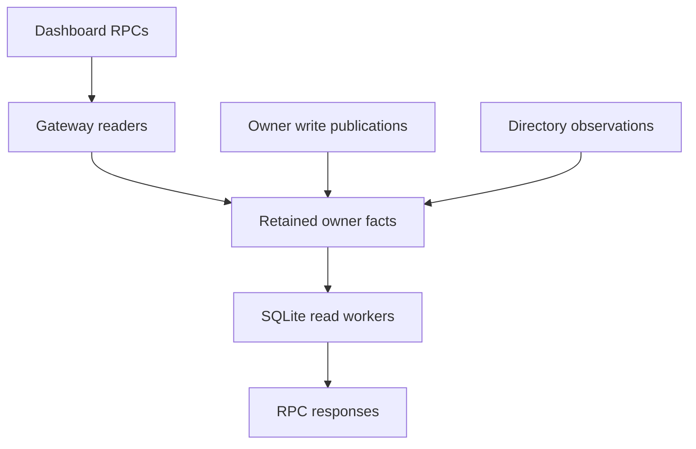

Codex review: needs changes before merge.

## What this changes

This PR retains filesystem facts in Gateway owners and refreshes them through write publications and shared directory observations.

**Example:** A dashboard client requests talk.catalog with six synthetic agents and 120 auth profiles per agent.
- **Before:** The reported request performs 56 synchronous existence checks, 40 stat calls, and 26 native realpath calls.
- **After:** The reported request performs four existence checks and no stat or native realpath calls.

## Review scores

| Measure | Result | What it means |
|---|---|---|
| **Overall readiness** | 🦪 silver shellfish **(2/6)** | Useful measured performance work, but the destination migration defect remains and scoped cleanup introduces another correctness failure. |
| **Proof confidence** | 🐚 platinum hermit **(4/6)** | Sufficient (live_output): The full body supplies production Gateway RPC measurements in a synthetic six-agent environment with successful request waves and reduced filesystem calls; this supports the performance mechanism, while authority and lifecycle correctness remain subject to the listed findings. |
| **Patch quality** | 🦪 silver shellfish **(2/6)** | 2 actionable review findings remain. |

## Product

**Kind:** Performance · **Worth it:** Yes · **Fix scope:** Complete
**User problem:** Dashboard boot RPCs repeatedly perform filesystem discovery and identity work on the Gateway thread.
**Reason:** The maintainer-directed change targets measured work, uses existing owners, and adds no configuration or public API.

## Merge readiness

⛔ **Needs changes before merge - 3 items remain**

Keep this PR open: the measured performance improvement is useful, but destination migration admission and scoped teardown still have blocking defects.

**Priority:** P2
**Reviewed head:** `1bfcd0a20da38f507b012309ade1016c476ff43b`

## Before merge

- [ ] **Keep destination migration checks current at credential effects (P1)** - After an empty SQLite owner caches absence of auth-profiles.json, restoring that file leaves this guard permissive until observation or the 30-second fallback runs. AuthStorage.withLock and updateAsync both consume this guard, so a credential write can populate the destination before migration is required; subsequent observation then treats the legacy file as warning-only because SQLite is populated. This prior finding remains unfixed. Adding refreshAuthProfileFileState to the destination-refusal test hides the original trigger. Keep cached presence for discovery, retain a direct source check at credential-write admission, and restore the negative control without pre-refreshing observations.
- [ ] **Scope observation cleanup to the closing state owner (P2)** - closeOpenClawStateDatabaseByPathAsync passes the selected physical identity to every registered resource, but this callback ignores it and clears every auth directory. If root A has a prepared auth read while root B closes, A's capture subsequently throws 'Auth profile database file identity changed' despite its owner and file remaining valid. The new callback in session-utils-store-sources.ts has the same defect and retires A's pending history preparation. Retire only facts bound to the supplied closing identity, reserving global cleanup for an undefined identity, and cover one root closing while another retains a read.
- [ ] **Complete next step** - Bring the expanded validation production and test files within their existing max-lines budgets, and classify the remaining failed CI checks against the base before requesting landing.

## Findings

- [P1] Keep destination migration checks current at credential effects — `src/agents/auth-profiles/legacy-source-diagnostic.ts:341-343`
- [P2] Scope observation cleanup to the closing state owner — `src/agents/auth-profiles/file-state.ts:41`

### Tests

- Low-value test `src/gateway/server-methods/models-auth-status.test.ts`: The added refresh-order test asserts calls to mocked internal preparers rather than refreshed credential results; replace it with an RPC assertion or consolidate it with the credential-publication coverage.
- Missing end-to-end proof: The supplied Gateway benchmark demonstrates performance, but the destination-refusal regression now refreshes observations first and no scoped-close regression keeps an unrelated root's read alive.

<strong>Agent review details</strong>

### How this fits together

Gateway boot RPCs consume agent, auth, workspace, and session facts derived from filesystem paths and SQLite owners; committed writes and directory observations update those retained facts.

### Technical review

Best possible solution:

Retain cached discovery while checking migration readiness at credential effects and retiring observations only for their closing owner.

Do we have a high-confidence way to reproduce the issue?

Both findings have concrete source paths: restore a legacy file after cached absence before a credential write, or close root B while root A retains an auth reader or session-source preparation; no target code was executed.

Is this the best way to solve the issue?

Caching in existing owners fits the measured problem, and persisted-source separation addresses the earlier baseline concern; effect admission and scoped cleanup must preserve their existing contracts.

Full review comments:

- [P1] Keep destination migration checks current at credential effects — `src/agents/auth-profiles/legacy-source-diagnostic.ts:341-343`
  After an empty SQLite owner caches absence of auth-profiles.json, restoring that file leaves this guard permissive until observation or the 30-second fallback runs. AuthStorage.withLock and updateAsync both consume this guard, so a credential write can populate the destination before migration is required; subsequent observation then treats the legacy file as warning-only because SQLite is populated. This prior finding remains unfixed. Adding refreshAuthProfileFileState to the destination-refusal test hides the original trigger. Keep cached presence for discovery, retain a direct source check at credential-write admission, and restore the negative control without pre-refreshing observations.
  Confidence: 0.99
- [P2] Scope observation cleanup to the closing state owner — `src/agents/auth-profiles/file-state.ts:41`
  closeOpenClawStateDatabaseByPathAsync passes the selected physical identity to every registered resource, but this callback ignores it and clears every auth directory. If root A has a prepared auth read while root B closes, A's capture subsequently throws 'Auth profile database file identity changed' despite its owner and file remaining valid. The new callback in session-utils-store-sources.ts has the same defect and retires A's pending history preparation. Retire only facts bound to the supplied closing identity, reserving global cleanup for an undefined identity, and cover one root closing while another retains a read.
  Confidence: 0.97

Overall correctness: patch is incorrect
Overall confidence: 0.97

AGENTS.md: found and applied where relevant.

Codex review notes: model internal, reasoning medium; reviewed against [f7d7425192bd](https://github.com/openclaw/openclaw/commit/f7d7425192bdd08cc690fc40c4e6dab361422ab4).

### Provenance checked

- `Legacy auth-source refusal` changes intended behavior with a stated reason (19a98c873ce63c839869f2b109057d9965649056: The SQLite-only cutover deliberately rechecked retired credential filenames recreated by restores or older binaries.)
- `Persisted auth-row reuse` changes intended behavior with a stated reason (d3d2d2ea3b47eae541232eb5528d23d3276e2518: Avoid repeated worker reads while preserving source provenance, publication invalidation, and revocable request authority.)
- `Database read-validation capture` changes intended behavior with a stated reason (ad3c93078e7fca4eb8733185479a627d5bea4988: Carry physical database identity into worker reads without allowing replacement files to borrow prior validation.)
- `Registered agent-directory identity` keeps the original intent (0427564bfd594a3a38323752c7e9fcf24442d838: Preserve custom-directory ownership and remove only membership added by a request.)
- `Workspace Git discovery` changes intended behavior with a stated reason (b4b1984fe7a9d3b32445fe7bc66d21eadf9ffa6c: Keep managed-worktree eligibility consistent between agent presentation and session creation.)
- `Session-source preparation` keeps the original intent (3ed79ceaf4488c8cb939699580faae202228fe34: Capture routing once while retaining final physical-target and reader authority.)
- `Pending-input history reads` keeps the original intent (84af47269371dbc3cd8662b1f7203200a474c64d: Move bounded history reads to workers while retaining captured storage identity and write custody.)
- `Auth committed-state publication` keeps the original intent (381b1e05d7f0fa572fdf085e7714d4f90864d4b5: Publish canonical committed auth facts incrementally without main-thread SQLite rereads.)

### Testing

Proof path: shipped entry point.

### Security

None.

### Evidence

What I checked:

- **Reviewed head and merge state:** GitHub still reports the pinned head as open and mergeable, with mergeable_state blocked; the checkout remains clean. ([1bfcd0a20da3](https://github.com/openclaw/openclaw/commit/1bfcd0a20da38f507b012309ade1016c476ff43b))
- **Destination migration guard remains cached:** The introduced guard uses cached source presence. AuthStorage.withLock and updateAsync consume this guard before credential persistence, while the native update kernel contains no replacement direct legacy-source check. ([`src/agents/auth-profiles/legacy-source-diagnostic.ts:343`](https://github.com/openclaw/openclaw/blob/1bfcd0a20da38f507b012309ade1016c476ff43b/src/agents/auth-profiles/legacy-source-diagnostic.ts#L343), [1bfcd0a20da3](https://github.com/openclaw/openclaw/commit/1bfcd0a20da38f507b012309ade1016c476ff43b))
- **Existing destination contract:** The documented contract requires owner-wide migration readiness at credential-write destinations: https://docs.openclaw.ai/auth-credential-semantics. ([`docs/auth-credential-semantics.md:370`](https://docs.openclaw.ai/auth-credential-semantics), [1bfcd0a20da3](https://github.com/openclaw/openclaw/commit/1bfcd0a20da38f507b012309ade1016c476ff43b))
- **Prior migration regression was weakened:** The destination-refusal test now explicitly refreshes file observations before checking rejection; this does not exercise a credential write before watcher or fallback delivery. ([`src/agents/sessions/auth-storage.oauth-refresh.test.ts:232`](https://github.com/openclaw/openclaw/blob/1bfcd0a20da38f507b012309ade1016c476ff43b/src/agents/sessions/auth-storage.oauth-refresh.test.ts#L232), [1bfcd0a20da3](https://github.com/openclaw/openclaw/commit/1bfcd0a20da38f507b012309ade1016c476ff43b))
- **Scoped close invokes identity-aware resources:** The lifecycle passes the closing physical identity to every resource. Both new observation cleanup callbacks ignore that identity and clear all retained roots. ([`src/state/openclaw-state-db-async-lifecycle.ts:637`](https://github.com/openclaw/openclaw/blob/1bfcd0a20da38f507b012309ade1016c476ff43b/src/state/openclaw-state-db-async-lifecycle.ts#L637), [1bfcd0a20da3](https://github.com/openclaw/openclaw/commit/1bfcd0a20da38f507b012309ade1016c476ff43b))
- **Earlier source-baseline concern addressed:** Canonical reads and committed stores now establish persisted source provenance independently of reusable rows, and observation compares normalized source facts. ([`src/agents/auth-profiles/runtime-persisted-rows.ts:260`](https://github.com/openclaw/openclaw/blob/1bfcd0a20da38f507b012309ade1016c476ff43b/src/agents/auth-profiles/runtime-persisted-rows.ts#L260), [1bfcd0a20da3](https://github.com/openclaw/openclaw/commit/1bfcd0a20da38f507b012309ade1016c476ff43b))

### PR surface

Source +1235, Tests +1424, Other +2. Total +2661 across 48 files. Added test files: 6.

View PR surface stats

| Area | Files | Added | Removed | Net |
|---|---:|---:|---:|---:|
| Source | 21 | 1342 | 107 | +1235 |
| Tests | 26 | 1479 | 55 | +1424 |
| Docs | 0 | 0 | 0 | 0 |
| Config | 0 | 0 | 0 | 0 |
| Generated | 0 | 0 | 0 | 0 |
| Other | 1 | 2 | 0 | +2 |
| **Total** | **48** | **2823** | **162** | **+2661** |

### Review metrics

| Metric | Value | Why it matters |
|---|---|---|
| **Production versus test growth** | Production net +1,237 lines; tests net +1,424 lines. | Growth implements retained observations, publication, and lifecycle coverage; the measured hot-path savings support the scope, but the owner-boundary findings remain. |

### Labels

Label changes:

- add `P2`: This is a measured Gateway performance improvement with normal maintenance priority; the introduced findings separately block merge.
- add `rating: 🦪 silver shellfish`: Overall readiness is 🦪 silver shellfish; proof is 🐚 platinum hermit and patch quality is 🦪 silver shellfish.
- remove `P1`: Current review triage priority is P2, so this older priority label is no longer current.
- remove `rating: 🧂 unranked krab`: Current PR rating is `rating: 🦪 silver shellfish`, so this older rating label is no longer current.

Label justifications:

- `P2`: This is a measured Gateway performance improvement with normal maintenance priority; the introduced findings separately block merge.
- `merge-risk: 🚨 auth-provider`: Cached legacy-source absence can admit a credential write into a destination that requires migration.
- `merge-risk: 🚨 availability`: Closing an unrelated state database invalidates active auth and session-read preparation.
- `rating: 🦪 silver shellfish`: Overall readiness is 🦪 silver shellfish; proof is 🐚 platinum hermit and patch quality is 🦪 silver shellfish.
- `status: ⏳ waiting on author`: ClawSweeper has contributor-facing work open and is waiting for author action.
- `proof: sufficient`: Contributor real behavior proof is sufficient.

### Rating scale

6/6 🦀 challenger crab · 5/6 🦞 diamond lobster · 4/6 🐚 platinum hermit · 3/6 🦐 gold shrimp · 2/6 🦪 silver shellfish · 1/6 🧂 unranked krab. Overall follows the weaker of proof and patch quality; ✨ marks media proof (a screenshot, video, or linked artifact) that directly shows the changed behavior.

### Workflow

ClawSweeper edits this one comment on every review. Comment `@clawsweeper re-review` for a fresh review only. Repair and merge execution lanes are retired.

### History

Review history (2 earlier review cycles)

<!-- clawsweeper-review-history v=1 total=2 -->
- reviewed 2026-10-13T01:01:27.399Z sha 956b67a286420b06a948fb633535f87e464145cb :: needs maintainer review before merge. :: none
- reviewed 2026-10-13T02:32:53.347Z sha 102a035b7b7d9b58fd489ce16322de6903478651 :: blocked before merge. :: [P1] Keep destination migration checks current at credential effects | [P1] Establish a row baseline before treating observation as an auth change

_Reviewed October 12, 2026, 11:52 PM ET / October 13, 2026, 03:52 UTC (Revision 3)._

<!-- clawsweeper-verdict:needs-changes item=170467 sha=1bfcd0a20da38f507b012309ade1016c476ff43b confidence=high updated_at=2026-10-13T03:45:17Z reviewed_at=2026-10-13T03:52:54.023Z lease_owner=github-run-38343100930-1 lease_comment_id=6137750694 source_revision=f9e98f87fbb63816461f2814c5083ffdcbc73a81ec1dc0b829bc83f38cc0798f -->
<!-- clawsweeper-review-state:needs-changes item=170467 sha=1bfcd0a20da38f507b012309ade1016c476ff43b v=1 -->

<!-- clawsweeper-review-version item=170467 reviewed_at=2026-10-13T03:52:54.023Z sha=1bfcd0a20da38f507b012309ade1016c476ff43b source_revision=f9e98f87fbb63816461f2814c5083ffdcbc73a81ec1dc0b829bc83f38cc0798f lease_owner=github-run-38343100930-1 lease_comment_id=6137750694 v=1 -->

<!-- clawsweeper-review item=170467 -->