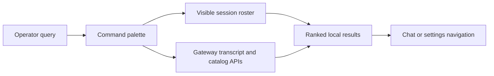

Codex review: needs maintainer review before merge. _Reviewed August 24, 2026, 2:42 PM ET / 18:42 UTC._

# ClawSweeper review

## What this changes

This PR lets the Control UI command palette search visible session transcripts and lazily loaded automation, skill, plugin, app, agent, settings, and model catalogs.

## Merge readiness

⚠️ **Ready for maintainer review - 2 items remain**

Keep open for maintainer product review. Current main still has metadata-only palette search, while this branch adds a distinct Control UI capability; no concrete patch defect was established.

**Priority:** P2
**Reviewed head:** `6207636026c7230b37a486c0ad3cb2d022feb95c`
**Owner decision:** Required. See [Decision needed](#decision-needed).

## Review scores

| Measure | Result | What it means |
|---|---|---|
| **Overall readiness** | 🐚 platinum hermit **(4/6)** | The feature has focused regression and browser coverage plus linked runtime evidence, with no concrete correctness finding in the reviewed source. |
| **Proof confidence** | 🐚 platinum hermit **(4/6)** | Not applicable: The stated author association is MEMBER, so the external-contributor proof gate does not apply; the PR additionally links isolated Gateway and Control UI media evidence. |
| **Patch quality** | 🐚 platinum hermit **(4/6)** | No actionable review findings were identified. |

## Verification

| Check | Result | Evidence |
|---|---|---|
| **Real behavior** | Not applicable | Not applicable: The stated author association is MEMBER, so the external-contributor proof gate does not apply; the PR additionally links isolated Gateway and Control UI media evidence. |
| **Evidence reviewed** | 6 items | Current-main gap: Current main only debounces metadata session-list searches; it has no transcript-search request or catalog-item state in the palette path, so the requested capability is not already implemented.<br>Changed UI owner boundary: The branch keeps palette orchestration in the Control UI, invoking the existing Gateway transcript endpoint only after a two-character query and retaining connection-staleness checks.<br>Gateway contract: The existing OpenClaw protocol bounds each transcript-search request to 200 session keys and 25 results; the Gateway handler validates and scopes the request before searching. |
| **Findings** | None | None. |
| **Security** | None | None. |


### Live Verification

**Command:** `pnpm test ui/src/e2e/session-management.groups.e2e.test.ts`

**Result:** FAIL (partial) — step 2 `expect_output` `manages sessions through the sidebar groups and command palette`: `expected terminal output was not visible within 30 seconds: "manages sessions through the sidebar groups and command palette"`

```text
pnpm test ui/src/e2e/session-management.groups.e2e.test.ts
runner@runnervm76f27:/tmp/clawsweeper-live-proof-128356-5m2q3P/target$ pnpm test ui/src/e2e/session-management.groups.e2e.test.ts
$ node --import tsx scripts/test-projects.mts ui/src/e2e/session-management.groups.e2e.test.ts
[test] starting test/vitest/vitest.ui-e2e.config.ts
[test] preflight test/vitest/vitest.ui-e2e.config.ts
pnpm test ui/src/e2e/session-management.groups.e2e.test.ts
[ui-e2e] Using system Chromium at /usr/bin/chromium-browser.
Downloading FFmpeg (playwright ffmpeg v1011) from https://cdn.playwright.dev/dbazure/download/playwright/builds/ffmpeg/1011/ffmpeg-linux.zip
|                                                                                |   0% of 2.3 MiB
|■■■■■■■■                                                                        |  10% of 2.3 MiB
|■■■■■■■■■■■■■■■■                                                                |  20% of 2.3 MiB
|■■■■■■■■■■■■■■■■■■■■■■■■                                                        |  30% of 2.3 MiB
|■■■■■■■■■■■■■■■■■■■■■■■■■■■■■■■■                                                |  40% of 2.3 MiB
|■■■■■■■■■■■■■■■■■■■■■■■■■■■■■■■■■■■■■■■■                                        |  50% of 2.3 MiB
|■■■■■■■■■■■■■■■■■■■■■■■■■■■■■■■■■■■■■■■■■■■■■■■■                                |  60% of 2.3 MiB
|■■■■■■■■■■■■■■■■■■■■■■■■■■■■■■■■■■■■■■■■■■■■■■■■■■■■■■■■                        |  70% of 2.3 MiB
|■■■■■■■■■■■■■■■■■■■■■■■■■■■■■■■■■■■■■■■■■■■■■■■■■■■■■■■■■■■■■■■■                |  80% of 2.3 MiB
|■■■■■■■■■■■■■■■■■■■■■■■■■■■■■■■■■■■■■■■■■■■■■■■■■■■■■■■■■■■■■■■■■■■■■■■■        |  90% of 2.3 MiB
|■■■■■■■■■■■■■■■■■■■■■■■■■■■■■■■■■■■■■■■■■■■■■■■■■■■■■■■■■■■■■■■■■■■■■■■■■■■■■■■■| 100% of 2.3 MiB
FFmpeg (playwright ffmpeg v1011) downloaded to /tmp/clawsweeper-live-proof-128356-5m2q3P/profile/cache/ms-playwright/ffmpeg-1011

 RUN  v4.1.10 /tmp/clawsweeper-live-proof-128356-5m2q3P/target


```

**Assertions:**

- FAIL `expect_output`: manages sessions through the sidebar groups and command palette

## How this fits together

The Control UI command palette turns an operator query into navigation choices. It obtains transcript matches through the Gateway session-search API and locally ranks bounded catalog summaries before opening the selected chat or page.



## Decision needed

| Question | Recommendation |
|---|---|
| Should the command palette become the shared discovery surface for transcript snippets plus live automation, skill, plugin, agent, settings, app, and model catalogs? | **Accept the scoped search surface:** Keep the existing Gateway permission filters and bounded transcript path, then validate the final merge result. |

Why: This is a broad new operator workflow rather than a repair of an established contract, and its permanent navigation and data-discovery scope needs maintainer intent.

## Before merge

- [ ] **Resolve merge risk (P1)** - GitHub reports the branch mergeable but behind current main; validate the exact merge result’s Control UI flow before landing because no local GitHub merge-result tree was available.


<details>
<summary><strong>Agent review details</strong></summary>

### Security

None.

### PR surface

Source +507, Tests +423. Total +930 across 12 files.

<details>
<summary>View PR surface stats</summary>

| Area | Files | Added | Removed | Net |
|---|---:|---:|---:|---:|
| Source | 8 | 747 | 240 | +507 |
| Tests | 4 | 517 | 94 | +423 |
| Docs | 0 | 0 | 0 | 0 |
| Config | 0 | 0 | 0 | 0 |
| Generated | 0 | 0 | 0 | 0 |
| Other | 0 | 0 | 0 | 0 |
| **Total** | **12** | **1264** | **334** | **+930** |

</details>

### Review metrics

| Metric | Value | Why it matters |
|---|---|---|
| **Production versus test LOC** | production +740/-233 (net +507); tests +517/-94 (net +423); i18n baseline +7/-7 | The production growth implements a new user-facing search capability and has substantial focused UI and E2E coverage, but its breadth merits owner review. |

### Stored data model

Persistent data-model change detected: `serialized state: ui/src/e2e/session-management.groups.e2e.test.ts`, `serialized state: ui/src/lib/sessions/transcript-search.ts`, `serialized state: ui/src/pages/sessions/agent-scope.test.ts`, `serialized state: ui/src/pages/sessions/agent-scope.ts`, `unknown-data-model-change: ui/src/e2e/session-management.groups.e2e.test.ts`, `unknown-data-model-change: ui/src/lib/sessions/transcript-search.ts`, and 3 more. Confirm migration or upgrade compatibility proof before merge.

### Merge-risk options

**Maintainer options:**
1. **Decide the mitigation before merge**  
   Land only an exact-merge-result-validated version after a Control UI owner accepts the command palette as the operator-facing surface for these catalog categories and transcript snippets.
2. **Pause or close**  
   Do not merge this PR until maintainers decide whether the risk is worth taking.

### Technical review

Best possible solution:

Land only an exact-merge-result-validated version after a Control UI owner accepts the command palette as the operator-facing surface for these catalog categories and transcript snippets.

Do we have a high-confidence way to reproduce the issue?

Not applicable: this is a feature PR; its body supplies focused Control UI, Gateway, and browser-E2E validation evidence.

Is this the best way to solve the issue?

Unclear: the implementation reuses the existing Gateway search contract and preserves the UI owner boundary, but the expanded palette scope needs maintainer product acceptance.

AGENTS.md: found but not applied because it conflicted with ClawSweeper's review contract.

Codex review notes: model internal, reasoning high; reviewed against [bf83a4dde8f0](https://github.com/openclaw/openclaw/commit/bf83a4dde8f00e5d330bd00de79cb0232fe6ae09).

### Labels

Label justifications:

- `P2`: This is a normal-priority Control UI discoverability enhancement with bounded operator-facing impact.
- `rating: 🐚 platinum hermit`: Overall readiness is 🐚 platinum hermit; proof is 🐚 platinum hermit and patch quality is 🐚 platinum hermit.
- `status: 👀 ready for maintainer look`: ClawSweeper has no concrete contributor-facing blocker left for this PR. Not applicable: The stated author association is MEMBER, so the external-contributor proof gate does not apply; the PR additionally links isolated Gateway and Control UI media evidence.

### Evidence

What I checked:

- **Current-main gap:** Current main only debounces metadata session-list searches; it has no transcript-search request or catalog-item state in the palette path, so the requested capability is not already implemented. ([`ui/src/components/command-palette.ts:497`](https://github.com/openclaw/openclaw/blob/bf83a4dde8f0/ui/src/components/command-palette.ts#L497), [bf83a4dde8f0](https://github.com/openclaw/openclaw/commit/bf83a4dde8f0))
- **Changed UI owner boundary:** The branch keeps palette orchestration in the Control UI, invoking the existing Gateway transcript endpoint only after a two-character query and retaining connection-staleness checks. ([`ui/src/components/command-palette.ts:501`](https://github.com/openclaw/openclaw/blob/6207636026c7/ui/src/components/command-palette.ts#L501), [6207636026c7](https://github.com/openclaw/openclaw/commit/6207636026c7))
- **Gateway contract:** The existing OpenClaw protocol bounds each transcript-search request to 200 session keys and 25 results; the Gateway handler validates and scopes the request before searching. ([`packages/gateway-protocol/src/schema/sessions.ts:434`](https://github.com/openclaw/openclaw/blob/6207636026c7/packages/gateway-protocol/src/schema/sessions.ts#L434), [6207636026c7](https://github.com/openclaw/openclaw/commit/6207636026c7))
- **Focused regression coverage:** The added UI tests cover transcript-only matches, bare default-session ownership, incomplete results, bounded roster handling, and lazy catalog matching; the browser E2E covers palette navigation. ([`ui/src/components/command-palette.test.ts:218`](https://github.com/openclaw/openclaw/blob/6207636026c7/ui/src/components/command-palette.test.ts#L218), [6207636026c7](https://github.com/openclaw/openclaw/commit/6207636026c7))
- **Feature history:** Current-main palette search and its failure-state behavior were recently maintained in the Control UI history by Peter Steinberger. ([`ui/src/components/command-palette.ts:517`](https://github.com/openclaw/openclaw/blob/b90d7efddbc0/ui/src/components/command-palette.ts#L517), [b90d7efddbc0](https://github.com/openclaw/openclaw/commit/b90d7efddbc0))
- **Release and main provenance:** The branch head is neither contained by a release tag nor current main, so this feature remains unshipped and is not a candidate for an implemented-on-main close. ([`ui/src/components/command-palette.ts:507`](https://github.com/openclaw/openclaw/blob/6207636026c7/ui/src/components/command-palette.ts#L507), [6207636026c7](https://github.com/openclaw/openclaw/commit/6207636026c7))

Likely related people:

- **Peter Steinberger:** History covers the palette’s original search behavior and the current-main failure-state repair. (role: recent Control UI feature owner; confidence: high; commits: [add5c513aed8](https://github.com/openclaw/openclaw/commit/add5c513aed8eff62db30d30c021693f299c2e4c), [b90d7efddbc0](https://github.com/openclaw/openclaw/commit/b90d7efddbc04f0363ba5c024d9cf538511d6ae1); files: `ui/src/components/command-palette.ts`, `ui/src/pages/sessions/agent-scope.ts`)

### Rank-up moves

Optional improvements that raise the rating; they are not merge blockers.

- Revalidate the documented palette flow on the exact merge result after current-base drift is resolved.

### Rating scale

| Score | Internal tier | Crab rank | Meaning |
|---:|:---:|---|---|
| **6/6** | S | 🦀 challenger crab | Exceptional readiness |
| **5/6** | A | 🦞 diamond lobster | Very strong readiness |
| **4/6** | B | 🐚 platinum hermit | Good normal PR; ordinary maintainer review |
| **3/6** | C | 🦐 gold shrimp | Useful, but confidence is limited |
| **2/6** | D | 🦪 silver shellfish | Proof or implementation needs work |
| **1/6** | F | 🧂 unranked krab | Not merge-ready |
| N/A | NA | 🌊 off-meta tidepool | Rating does not apply |

Overall follows the weaker of proof and patch quality.
Shiny media proof means a screenshot, video, or linked artifact directly shows the changed behavior. Runtime, network, CSP, and security claims still need visible diagnostics.

### Workflow

- ClawSweeper keeps one durable marker-backed review comment per issue or PR.
- Re-runs edit this comment so the latest verdict, findings, and automation markers stay together instead of adding duplicate bot comments.
- A fresh review can be triggered by eligible `@clawsweeper re-review` comments, exact-item GitHub events, scheduled/background review runs, or manual workflow dispatch.
- PR/issue authors and users with repository write access can comment `@clawsweeper re-review` or `@clawsweeper re-run` on an open PR or issue to request a fresh review only.
- Maintainers can also comment `@clawsweeper review` to request a fresh review only.
- Fresh-review commands do not start repair, autofix, rebase, CI repair, or automerge.
- Maintainer-only repair and merge flows require explicit commands such as `@clawsweeper autofix`, `@clawsweeper automerge`, `@clawsweeper fix ci`, or `@clawsweeper address review`.
- Maintainers can comment `@clawsweeper explain` to ask for more context, or `@clawsweeper stop` to stop active automation.

### History

<details>
<summary>Review history (6 earlier review cycles)</summary>

<!-- clawsweeper-review-history v=1 total=6 -->
- reviewed 2026-08-23T20:45:26.439Z sha 3c8fe6311c704d211da9defe4774bb8df4c87727 :: found issues before merge. :: [P1] Resolve bare default session keys before transcript search | [P1] Keep palette transcript search bounded
- reviewed 2026-08-23T21:22:31.095Z sha 3c8fe6311c704d211da9defe4774bb8df4c87727 :: needs changes before merge. :: [P1] Resolve bare default session keys before transcript search | [P1] Bound transcript roster enumeration for palette queries | [P1] Preserve metadata search when transcript search rejects
- reviewed 2026-08-23T21:53:52.664Z sha b490bd9b537fb2a856f250fae75f251744f04bc4 :: needs changes before merge. :: [P1] Surface incomplete transcript results in the palette
- reviewed 2026-08-23T23:03:41.680Z sha b490bd9b537fb2a856f250fae75f251744f04bc4 :: needs changes before merge. :: [P1] Surface successful but incomplete transcript searches | [P2] Do not truncate a terminal roster at the exact key cap
- reviewed 2026-08-24T13:23:50.898Z sha 32ce8ccca77807c232ed9cad23357753cd4d0aea :: found issues before merge. :: [P2] Describe partial transcript results accurately
- reviewed 2026-08-24T13:42:39.145Z sha 6207636026c7230b37a486c0ad3cb2d022feb95c :: needs maintainer review before merge. :: none

</details>

</details>

<!-- clawsweeper-verdict:needs-human item=128356 sha=6207636026c7230b37a486c0ad3cb2d022feb95c confidence=high updated_at=2026-08-24T18:37:49Z reviewed_at=2026-08-24T18:42:12.322Z lease_owner=github-run-32763305507-1 lease_comment_id=5399685293 source_revision=2d56c17a04e09a010bc30703e639315a3cf6c73112f1bd077e61c9be2a6b4624 -->

<!-- clawsweeper-review-version item=128356 reviewed_at=2026-08-24T18:42:12.322Z sha=6207636026c7230b37a486c0ad3cb2d022feb95c source_revision=2d56c17a04e09a010bc30703e639315a3cf6c73112f1bd077e61c9be2a6b4624 lease_owner=github-run-32763305507-1 lease_comment_id=5399685293 v=1 -->

<!-- clawsweeper-review item=128356 -->