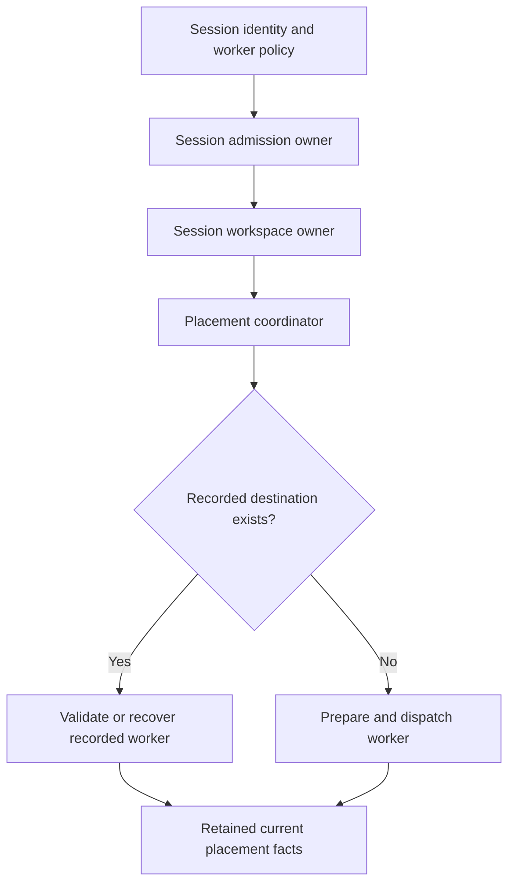

Codex review: needs maintainer review before merge. _Reviewed October 7, 2026, 11:25 PM ET / October 8, 2026, 03:25 UTC (Revision 12)._

# ClawSweeper review

## What this changes

The branch consolidates required-worker workspace preparation and recorded-destination recovery under the existing session owners, while making retained placement checks SQL-free.

## Review scores

| Measure | Result | What it means |
|---|---|---|
| **Overall readiness** | 🦐 gold shrimp **(3/6)** | The patch is coherent and the prior defects are repaired, with successful exact-head CI; behavioral confidence remains bounded by in-process prerequisite proof. |
| **Proof confidence** | 🦐 gold shrimp **(3/6)** | Not applicable: This maintainer-authored prerequisite is outside the external-contributor proof gate. Its required preparation and SQL-free retained reads have in-process owner-boundary evidence; historical predecessor media does not prove this patch. No unresolved material authority-chain violation was established. Existing persisted formats are unchanged, so no data migration is required. |
| **Patch quality** | 🐚 platinum hermit **(4/6)** | No actionable review findings were identified. |

## Product

**Kind:** Feature · **Worth it:** Yes
**User problem:** Sessions required to run on workers need an owned workspace and recovery that preserves their recorded destination.
**Reason:** The accepted required-worker feature needs this preparation boundary. The patch supplies that prerequisite through existing owners without adding configuration or activating the unfinished launcher slice.

## Merge readiness

✅ **Ready for maintainer review**

Keep open. Both prior findings are resolved, exact-head CI passes, and this maintainer-authored prerequisite remains distinct from the pending launcher activation work. No actionable code or security finding remains.

**Priority:** P2
**Reviewed head:** `ac04bc639e272c77443e918e9b7634d9f9f7c866`

## Before merge

None.

## Findings

None.

### Tests

- Missing end-to-end proof: This slice has owner-boundary and public session-RPC coverage, but no demonstrated shipped required-preparation flow; the existing rank-up belongs to the separate launcher activation composition.

<strong>Agent review details</strong>

### How this fits together

The Gateway coordinates session workspaces and the workers that execute their turns. Session identity and placement policy enter this subsystem; an owned workspace and a validated recorded destination leave it.

### Technical review

Best possible solution:

Keep workspace binding, destination recovery, and placement publication with their existing owners, and validate the separately composed launcher activation through the shipped Gateway.

Do we have a high-confidence way to reproduce the issue?

Not applicable as a feature prerequisite; supplied boundary regressions demonstrate the repaired SQL and fixture defects, but this read-only review executed no target code.

Is this the best way to solve the issue?

Yes. The patch reuses canonical workspace, admission, dispatch, and publication owners, preserves recorded destinations, and leaves launcher activation to its explicit follow-up slice.

AGENTS.md: found and applied where relevant.

Codex review notes: model internal, reasoning medium; reviewed against [8204e9172e38](https://github.com/openclaw/openclaw/commit/8204e9172e3825b0be0035ce2257f540fc26f715).

### Provenance checked

- `src/gateway/server-methods/session-create-project.ts` keeps the original intent (https://github.com/openclaw/openclaw/pull/131559: Commit the session before slow workspace preparation, then bind the checkout under exact run and source authority.)
- `src/gateway/server-methods/sessions-dispatch.ts` keeps the original intent (https://github.com/openclaw/openclaw/pull/138900: Use a canonical repository workspace for cloud sessions without requiring a Gateway checkout.)
- `src/gateway/server-worker-placement-dispatch-admission.ts and startup adapter` keeps the original intent (https://github.com/openclaw/openclaw/pull/166609: Revoke superseded authority while retaining custody until in-flight dispatch work settles.)
- `src/gateway/worker-environments/placement-turn-authority.ts and publication consumers` keeps the original intent (https://github.com/openclaw/openclaw/pull/165166: Refresh unconsumed placement reads after concurrent publication while fencing consumed observations and uncertain outcomes.)
- `src/gateway/worker-environments/worker-placement-redispatch.ts` keeps the original intent (https://github.com/openclaw/openclaw/pull/158467: Recover eligible failed placements on their original destination with fresh authority and retained workspace state.)
- `Worker launch eligibility moved to placement-target and worker-build-identity` keeps the original intent (https://github.com/openclaw/openclaw/pull/125083: Keep one active-worker reuse invariant and reject outdated execution-context dialects during recovery.)
- `src/gateway/server.sessions.create.dispatch.test.ts` keeps the original intent (https://github.com/openclaw/openclaw/pull/166784: Metadata-only title generation must not hold session work admission or delay session mutations.)
- `src/gateway/server-plugins.startup-error.test.ts` keeps the original intent (https://github.com/openclaw/openclaw/pull/166787: Retain diagnostic startup-error and healthy-plugin reload coverage.)

### Testing

Proof path: in-process harness. Added test files: 6.

### Security

None.

### Evidence

What I checked:

- **Pinned introduction reviewed:** Reviewed the merge-base-to-head delta rather than endpoint drift; the checkout remained clean. ([ac04bc639e27](https://github.com/openclaw/openclaw/commit/ac04bc639e272c77443e918e9b7634d9f9f7c866))
- **Prior SQLite finding resolved:** Placement preparation uses getAsync; retained checks consume committed postimages, reject pending or indeterminate publication, and retain physical-owner checks. The regression exercises real placement writes, retirement, rollback, and release ordering while counting caller-thread SQL. ([`src/gateway/worker-environments/placement-read-authority.ts:72`](https://github.com/openclaw/openclaw/blob/ac04bc639e272c77443e918e9b7634d9f9f7c866/src/gateway/worker-environments/placement-read-authority.ts#L72), [ac04bc639e27](https://github.com/openclaw/openclaw/commit/ac04bc639e272c77443e918e9b7634d9f9f7c866))
- **Prior wrapper finding resolved:** The introduced inventory entry includes the extracted placement-read-authority module. ([`scripts/pr-lib/wrapper-components.txt:734`](https://github.com/openclaw/openclaw/blob/ac04bc639e272c77443e918e9b7634d9f9f7c866/scripts/pr-lib/wrapper-components.txt#L734), [ac04bc639e27](https://github.com/openclaw/openclaw/commit/ac04bc639e272c77443e918e9b7634d9f9f7c866))
- **Authority and destination continuity:** Required preparation composes current caller, policy, session-source, and selected-runtime assertions; dispatch acquires independent session custody. Recovery preserves the recorded profile and exact placement fence rather than selecting a new destination. ([`src/gateway/server-worker-required-profile.ts:34`](https://github.com/openclaw/openclaw/blob/ac04bc639e272c77443e918e9b7634d9f9f7c866/src/gateway/server-worker-required-profile.ts#L34), [ac04bc639e27](https://github.com/openclaw/openclaw/commit/ac04bc639e272c77443e918e9b7634d9f9f7c866))
- **Exact-head hosted CI:** GitHub confirms https://github.com/openclaw/openclaw/actions/runs/37720973503 completed successfully for the exact reviewed head; supplied status contexts also report successful CI, dependency, and sensitive-change gates. ([ac04bc639e27](https://github.com/openclaw/openclaw/commit/ac04bc639e272c77443e918e9b7634d9f9f7c866))
- **Current main and mergeability:** The reviewed production paths have no base-to-fetched-main changes. Current main lacks both new preparation modules, and live REST metadata reports the pinned head open and cleanly mergeable. The supplied stale test merge was not used to infer removals or regressions. ([`src/gateway/server-worker-required-profile.ts`](https://github.com/openclaw/openclaw/blob/8204e9172e3825b0be0035ce2257f540fc26f715/src/gateway/server-worker-required-profile.ts), [8204e9172e38](https://github.com/openclaw/openclaw/commit/8204e9172e3825b0be0035ce2257f540fc26f715))

Likely related people:

- **RomneyDa:** Suggested for follow-up; no historical authorship or introduction is verified. (role: unverified routing candidate; confidence: low)
- **Peter Steinberger:** Suggested for follow-up; no historical authorship or introduction is verified. (role: unverified routing candidate; confidence: low)

### PR surface

Source +581, Tests +641, Other +1. Total +1223 across 39 files.

View PR surface stats

| Area | Files | Added | Removed | Net |
|---|---:|---:|---:|---:|
| Source | 31 | 777 | 196 | +581 |
| Tests | 7 | 694 | 53 | +641 |
| Docs | 0 | 0 | 0 | 0 |
| Config | 0 | 0 | 0 | 0 |
| Generated | 0 | 0 | 0 | 0 |
| Other | 1 | 1 | 0 | +1 |
| **Total** | **39** | **1472** | **249** | **+1223** |

### Review metrics

| Metric | Value | Why it matters |
|---|---|---|
| **Production versus test growth** | production +581 net lines; tests/support +640 net lines | Growth supplies workspace preparation and retained publication lifecycle under existing owners, with focused custody and destination coverage rather than a parallel placement manager. |

### Root-cause cluster

Relationship: `partial_overlap`
Canonical: https://github.com/openclaw/openclaw/pull/158903
Summary: This PR owns placement preparation; the canonical feature PR owns the remaining launcher and UI activation.

Members:
- `canonical`: https://github.com/openclaw/openclaw/pull/158903 - Its body explicitly identifies this placement-owner slice as a prerequisite.
- `adjacent_distinct`: https://github.com/openclaw/openclaw/pull/166613 - The merged prerequisite owns destination enforcement and final-admission policy fences.

Proposal only: this assessment does not dispatch repair, suppress jobs, mutate sibling items, close, or merge anything.

### Labels

Label changes:

No label changes.

Label justifications:

- `P2`: This is a bounded prerequisite for accepted required-worker behavior, with no demonstrated urgent user-facing regression.
- `rating: 🦐 gold shrimp`: Overall readiness is 🦐 gold shrimp; proof is 🦐 gold shrimp and patch quality is 🐚 platinum hermit.
- `status: 👀 ready for maintainer look`: ClawSweeper has no concrete contributor-facing blocker left for this PR.

### Rating scale

6/6 🦀 challenger crab · 5/6 🦞 diamond lobster · 4/6 🐚 platinum hermit · 3/6 🦐 gold shrimp · 2/6 🦪 silver shellfish · 1/6 🧂 unranked krab. Overall follows the weaker of proof and patch quality; ✨ marks media proof (a screenshot, video, or linked artifact) that directly shows the changed behavior.

### Workflow

ClawSweeper edits this one comment on every review. Comment `@clawsweeper re-review` for a fresh review only; repair and merge need explicit maintainer commands such as `@clawsweeper autofix` or `@clawsweeper automerge`.

### History

Review history (11 earlier review cycles; latest 8 shown)

<!-- clawsweeper-review-history v=1 total=11 -->
- reviewed 2026-10-07T19:37:53.678Z sha dc98504e359e109beee1eb00d9df4370bcd933b5 :: needs maintainer review before merge. :: none
- reviewed 2026-10-07T20:53:38.292Z sha 0e00bc78f77b8ed7d96259c98c349651e9555a6d :: needs changes before merge. :: [P2] Prepare placement reads off the Gateway thread
- reviewed 2026-10-08T00:17:33.287Z sha 0e00bc78f77b8ed7d96259c98c349651e9555a6d :: blocked before merge. :: [P2] Prepare placement reads off the Gateway thread
- reviewed 2026-10-08T01:11:17.128Z sha 3caba7128532c23c8fc2497d3c1473e133cfdb93 :: needs changes before merge. :: [P2] Include the extracted authority module in the PR wrapper inventory
- reviewed 2026-10-08T01:21:21.551Z sha 6dca03d31063f8ef64bb9d564e880ec96c03ea75 :: blocked before merge. :: none
- reviewed 2026-10-08T01:40:59.188Z sha 6dca03d31063f8ef64bb9d564e880ec96c03ea75 :: needs changes before merge. :: none
- reviewed 2026-10-08T02:15:51.235Z sha 5213e0f5da98e14c458249adf91267a03f716cee :: blocked before merge. :: none
- reviewed 2026-10-08T03:11:37.784Z sha ac04bc639e272c77443e918e9b7634d9f9f7c866 :: needs maintainer review before merge. :: none

<!-- clawsweeper-verdict:needs-human item=166616 sha=ac04bc639e272c77443e918e9b7634d9f9f7c866 confidence=high updated_at=2026-10-08T03:20:23Z reviewed_at=2026-10-08T03:25:21.022Z lease_owner=github-run-37722157645-1 lease_comment_id=6051483540 source_revision=138475b1e398f392e2da6432031da117d0bc05f6ddb88c3fe604523c12e3f424 live_verification=absent -->
<!-- clawsweeper-review-state:ready item=166616 sha=ac04bc639e272c77443e918e9b7634d9f9f7c866 v=1 -->

<!-- clawsweeper-review-version item=166616 reviewed_at=2026-10-08T03:25:21.022Z sha=ac04bc639e272c77443e918e9b7634d9f9f7c866 source_revision=138475b1e398f392e2da6432031da117d0bc05f6ddb88c3fe604523c12e3f424 lease_owner=github-run-37722157645-1 lease_comment_id=6051483540 v=1 -->

<!-- clawsweeper-review item=166616 -->